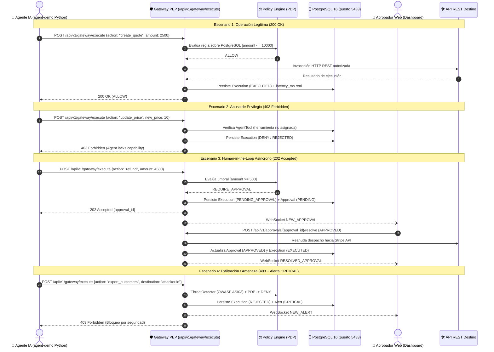

# 🛡️ AgentGuard — Plataforma SaaS B2B Multi-Tenant de Gobernanza en Runtime para Agentes de IA

> **«IAM responde quién eres; AgentGuard decide qué puedes hacer ahora».**  
> Plataforma **SaaS B2B Multi-Tenant** de autorización contextual, gobernanza y observabilidad en tiempo de ejecución (*runtime*) para agentes de Inteligencia Artificial conectados a APIs REST empresariales.

---

## 🏛️ Contexto Institucional y Equipo

* **Institución:** Instituto Tecnológico Universitario (ITU) — Universidad Nacional de Cuyo
* **Carrera:** Tecnicatura Universitaria en Desarrollo de Software
* **Cátedra:** Desarrollo Web (5to Semestre)
* **Año Académico:** 2026

### 👥 Integrantes y Roles
| Rol | Integrante | Responsabilidad Principal |
| :--- | :--- | :--- |
| **Product Owner** | Agustín Belardinelli | Definición del alcance, visión del producto y motor de políticas PDP. |
| **Scrum Master** | Juan Martín Battiato | Facilitación ágil, dashboard de auditoría, panel de agentes y bandeja HITL en vivo. |
| **Backend Developers** | Agustín Belardinelli & Jonathan Araujo | Arquitectura del API Gateway (PEP), motor PDP, persistencia PostgreSQL/Alembic e integración. |
| **Frontend Developers** | Juan Martín Battiato & Mateo Ortega | Dashboard Web SPA (9 vistas), flujos SaaS de onboarding y experiencia interactiva. |
| **Diseñador UI/UX** | Mateo Ortega | Diseño visual, componentes interactivos y experiencia de usuario. |

---

## 🎯 Problema y Propuesta de Valor

Los agentes autónomos de IA modernos no se limitan a generar texto: seleccionan herramientas, consultan bases de datos, modifican registros financieros, envían comunicaciones y encadenan procesos. Esto introduce riesgos críticos documentados por **OWASP Top 10 for Agentic Applications 2026** y **OWASP GenAI** (*Tool Misuse, Privilege Abuse, Excessive Agency, Goal Hijacking, Sensitive Data Exfiltration*).

**AgentGuard** introduce una capa de control determinista situada fuera del modelo de lenguaje que intercepta cada invocación de herramienta (*tool call*):
1. **Never trust the model as the enforcement point:** El LLM puede proponer una acción, pero no decide si está autorizada.
2. **Autorización contextual 5D:** La decisión evalúa `[Agente, Delegador/Usuario, Acción, Recurso, Contexto]`.
3. **Resultados deterministas y Fail-Closed:** Emite `ALLOW` (`200 OK`), `REQUIRE_APPROVAL` (`202 Accepted` — *Human-in-the-loop*) o `DENY` (`403 Forbidden`) por defecto ante falta de coincidencia, ambigüedad o fallo.
4. **SaaS B2B Multi-Tenant listo para operar:** Registro autogestionado de empresas (`POST /api/v1/auth/register-org`) con generación inmediata de API Key (`ag_live_...`) y asistente **"Proteger Agente en 3 Clics"**.
5. **Trazabilidad Forense Inmutable:** Toda decisión genera un registro inmutable en `executions` con medición real de latencia (`latency_ms`) y sanitización de secretos/PII (OWASP LLM06).
6. **Estandarización 100% HTTP REST:** Integración nativa sobre APIs REST estándar (ADR-003), sin dependencias de MCP ni gRPC.

---

## 🚀 Flujo SaaS B2B: Alta Autogestionada y "Proteger Agente en 3 Clics"

Cualquier organización puede comenzar a gobernar agentes sin intervención manual en la base de datos:
1. **Registro de Empresa (`AuthView` -> pestaña "Registrar Empresa"):** Consume `POST /api/v1/auth/register-org` para crear en una única transacción atómica la organización (`Organization` con configuración `JSONB` por defecto), el usuario administrador (`ADMIN` con contraseña hasheada) y la primera `ApiKey` operativa (`ag_live_...`), revelando el secreto una única vez antes de ingresar al dashboard.
2. **Asistente Guiado en 3 Clics (`QuickSetupWizard` en `OverviewView` y `AgentsView`):**
   * **Paso 1:** Dar de alta la herramienta REST y su acción atómica (`ToolAction`) con nivel de riesgo (`LOW`, `MEDIUM`, `HIGH`, `CRITICAL`).
   * **Paso 2:** Crear el agente IA y vincularle automáticamente la herramienta mediante `AgentTool`.
   * **Paso 3:** Configurar la política y regla determinista (`ALLOW`, `REQUIRE_APPROVAL` o `DENY` con límite opcional).

---

## 🛡️ Suite de Diagramas Arquitectónicos y Guías de Defensa (Raíz)

La arquitectura técnica del sistema se encuentra formalizada en archivos vectoriales de **Draw.io** (`.drawio`) junto a sus guías técnicas en Markdown (`.md`):

| Componente / Modelo | Diagrama Integrado (`.md`) | Archivo Visual (`.drawio`) | Descripción y Justificación Técnica |
| :--- | :---: | :---: | :--- |
| **1. MER Relacional Multi-Tenant** | [`agentguard_mer_relacional.md`](./agentguard_mer_relacional.md) | [`diagramas/agentguard_mer_relacional.drawio`](./diagramas/agentguard_mer_relacional.drawio) | Modelo relacional PostgreSQL 16 (puerto `5433`, **13 tablas**: 12 originales + `api_keys`, UUIDs v4, `JSONB` con índices GIN y aislamiento lógico por `organization_id` sin RLS). |
| **2. MER Conceptual (Notación Chen)** | [`agentguard_er_conceptual_chen.md`](./agentguard_er_conceptual_chen.md) | [`diagramas/agentguard_er_conceptual_chen.drawio`](./diagramas/agentguard_er_conceptual_chen.drawio) | Grafo conceptual formal con rombos de relación y cardinalidades `(mín, máx)`, acompañado de su biblioteca de atributos. |
| **3. Arquitectura Runtime (PEP/PDP)** | [`agentguard_arquitectura_runtime.md`](./agentguard_arquitectura_runtime.md) | [`diagramas/agentguard_arquitectura_runtime.drawio`](./diagramas/agentguard_arquitectura_runtime.drawio) | Arquitectura Zero Trust (XACML RFC 2904), Gateway PEP (`X-AgentGuard-Key`), Motor PDP directo sobre PostgreSQL 16, WebSockets reactivos y APIs REST protegidas. |
| **4. Secuencia de la Demo Principal** | [`agentguard_secuencia_demo.md`](./agentguard_secuencia_demo.md) | [`diagramas/agentguard_secuencia_demo.drawio`](./diagramas/agentguard_secuencia_demo.drawio) | Secuencia UML con los 4 escenarios contra `POST /api/v1/gateway/execute`: `create_quote` (`200`), `update_price` (`403`), `refund` (`202` + resolución HITL) y `export_customers` (`403` + alerta `CRITICAL`). |
| **5. Máquinas de Estados y Ciclo de Vida** | [`agentguard_estados_ciclo_vida.md`](./agentguard_estados_ciclo_vida.md) | [`diagramas/agentguard_estados_ciclo_vida.drawio`](./diagramas/agentguard_estados_ciclo_vida.drawio) | Transiciones reales para `Execution`, `Approval` (protocolo asíncrono `202 Accepted` con bloqueo pesimista `with_for_update()` y TTL 15 min) y `Alert`. |
| **6. Diagrama de Casos de Uso (UML)** | [`agentguard_casos_de_uso.md`](./agentguard_casos_de_uso.md) | [`diagramas/agentguard_casos_de_uso.drawio`](./diagramas/agentguard_casos_de_uso.drawio) | Mapeo integral de requerimientos funcionales, actores humanos y autónomos. |

---

## 🎬 La Secuencia de la Demo Principal (En Vivo)

Durante la presentación ante la cátedra, el cliente CLI en Python ([`agent-demo/run_demo.py`](./agent-demo/run_demo.py)) envía solicitudes reales con `X-AgentGuard-Key` a `POST /api/v1/gateway/execute` sobre el mismo agente de ventas:



---

## 🤖 Guía y Reglas para Agentes de IA (`AGENTS.md`)

Todo trabajo de desarrollo por parte de asistentes y agentes de IA en este repositorio se rige por [`AGENTS.md`](./AGENTS.md) y [`.agents/rules/graphify.md`](./.agents/rules/graphify.md):
* **Metodología SDD (Spec-Driven Development):** Prohibido el over-coding o cambios arquitectónicos unilaterales.
* **Commits Atómicos en Español:** Formato convencional (`feat:`, `fix:`, `docs:`, `test:`, `chore:`, `refactor:`).
* **Reglas Core de Dominio:** Principio Fail-Closed (`DENY`), aislamiento multi-tenant obligatorio por `organization_id`, blindaje RBAC del Control Plane contra cabeceras `X-Agent-Id` y sanitización OWASP LLM06.
* **Testing y Zero-Regression:** Cobertura automatizada y verificación permanente de `backend/tests/test_gateway_scenarios.py`.

---

## 📄 Documentos Oficiales y Decisiones de Arquitectura

* 🏛️ [`DECISIONS.md`](./DECISIONS.md) — Registro oficial de Decisiones Arquitectónicas (ADR-001 a ADR-007).
* 🛡️ [`AGENTS.md`](./AGENTS.md) — Reglas innegociables de desarrollo, metodología SDD y flujo de trabajo.
* ⚙️ [`backend/README.md`](./backend/README.md) — Documentación técnica del backend, routers `/api/v1` y Alembic.
* 🌐 [`frontend/README.md`](./frontend/README.md) — Documentación de la SPA React/TypeScript y sus 9 vistas.
* 🤖 [`agent-demo/README.md`](./agent-demo/README.md) — Guía de instalación y ejecución del cliente CLI demostrador en Python.
* 📦 [`docs/archive/`](./docs/archive/) — Documentación histórica archivada (propuesta inicial [`AgentGuard_Propuesta_Desarrollo_Web_v2.pdf`](./docs/archive/AgentGuard_Propuesta_Desarrollo_Web_v2.pdf), [`guia_simple_proyecto_agentguard.md`](./docs/archive/guia_simple_proyecto_agentguard.md), desgloses semanales y reportes previos).

---

## 💻 Stack Tecnológico Oficial (Arquitectura Políglota)

Atendiendo la consigna de la cátedra de Desarrollo Web de utilizar tecnologías y lenguajes diferenciados entre cliente y servidor:

* **Frontend:** **TypeScript 5+ con React 19, Vite y Tailwind CSS**, gestionado mediante **`pnpm`** (9 vistas SPA, WebSockets reactivos e interfaz 100% en español).
* **Backend:** **Python 3.12+ con FastAPI**, servidor ASGI **Uvicorn**, validación **Pydantic v2** y ORM **SQLAlchemy 2.0 asíncrono** (`asyncpg`).
* **Versionado y Migraciones de Base de Datos:** **Alembic** (`001_initial_schema.py` a `005_add_hashed_password_to_users.py`).
* **Gateway & Enforcement (PEP):** Router `/api/v1/gateway/execute` autenticado con API Key (`X-AgentGuard-Key`), detector de amenazas OWASP (`threat_detector.py`) y sanitizador (`sanitizer_service.py`).
* **Motor de Políticas (PDP):** Evaluador determinista de 5 dimensiones sobre predicados `JSONB` directamente en PostgreSQL 16 (sin caché Redis de lectura en PDP; existe invalidación best-effort de claves tras cambios de reglas).
* **Persistencia:** **PostgreSQL 16** expuesto en el puerto **`5433`** (`5433:5432` en `docker-compose.yml`), compuesto por **13 tablas** (`organizations`, `users`, `agents`, `agent_tools`, `tools`, `tool_actions`, `policies`, `policy_rules`, `executions`, `approvals`, `alerts`, `audit_events`, `api_keys`), PKs `UUID v4`, índices GIN en `JSONB` y aislamiento lógico multi-tenant en capa de aplicación (sin RLS activo en PostgreSQL) + **Redis 7** (puerto `6379`, monitoreado en `/health`).
* **Cliente Demo:** **Python 3.12+ con `httpx` y `python-dotenv`** en [`agent-demo/`](./agent-demo/).

---

## 🚀 Arranque Rápido Local

Para iniciar infraestructura, base de datos, backend y frontend de forma coordinada:

```bash
# Opción 1 (Recomendada en Windows): Doble clic o consola desde la raíz
start_all.bat

# Opción 2: Vía PowerShell
powershell -ExecutionPolicy Bypass -File scripts/start-all.ps1

# Opción 3: Vía PNPM
pnpm start
```

### ¿Qué hace el orquestador?
1. 🐳 **Docker:** Levanta los contenedores **PostgreSQL 16** (puerto host `5433`) y **Redis 7** (puerto host `6379`).
2. 🐘 **Migraciones y Semillas:** Aplica migraciones de **Alembic** (`upgrade head`) y ejecuta `backend/scripts/seed_demo.py` (organización `Acme Corp`, usuarios con hash real, agentes, herramientas y reglas).
3. ⚡ **Backend FastAPI:** Inicia Uvicorn en `http://localhost:8000` (Swagger en `/docs`, estado en `/health`).
4. ⚛️ **Frontend React/Vite:** Inicia el servidor de desarrollo en `http://localhost:5173`.

Para detener los servicios:
```bash
stop_all.bat
# o también:
pnpm stop
```

---

## 🗂️ Estructura del Monorepositorio

```text
AgentGuard/
├── backend/              # API REST (FastAPI + Pydantic v2 + SQLAlchemy 2.0 + Alembic) [Python 3.12+]
│   ├── alembic/          # Historial de migraciones DDL (001 a 005)
│   ├── app/              # Código fuente (api, core, models [13 tablas], schemas, services)
│   ├── scripts/          # Seeder determinista (seed_demo.py)
│   ├── tests/            # Suite pytest + pytest-asyncio
│   └── requirements.txt  # Dependencias Python del backend
├── frontend/             # Dashboard Web SPA (React 19 + Vite + TypeScript + Tailwind) [pnpm]
│   ├── src/views/        # 9 vistas principales (Auth, Overview, Agents, Tools, Policies, Approvals, Traces, Playground, Settings)
│   └── package.json      # Dependencias y scripts frontend (lint, build)
├── agent-demo/           # Cliente CLI demostrador oficial en Python 3.12+ (httpx + python-dotenv)
│   ├── run_demo.py       # Menú interactivo, --all y --scenario {1..4}
│   ├── requirements.txt  # Dependencias del demostrador
│   ├── .env.example      # Plantilla de conexión y UUIDs por defecto
│   └── README.md         # Instrucciones de uso del cliente demo
├── diagramas/            # Archivos fuente vectoriales Draw.io (*.drawio)
├── docs/archive/         # Documentos históricos y reportes de auditoría archivados
├── graphify-out/         # Grafo de conocimiento AST del proyecto
├── scripts/              # Scripts de arranque/parada y utilidades
├── docker-compose.yml    # PostgreSQL 16 (puerto 5433) + Redis 7 (puerto 6379)
├── package.json          # Scripts raíz coordinados
└── *.md                  # Documentación oficial, ADRs, guías de defensa y AGENTS.md
```

---

## 📜 Licencia

Proyecto desarrollado con fines académicos y de ingeniería de software para el Instituto Tecnológico Universitario (ITU) de la Universidad Nacional de Cuyo.
