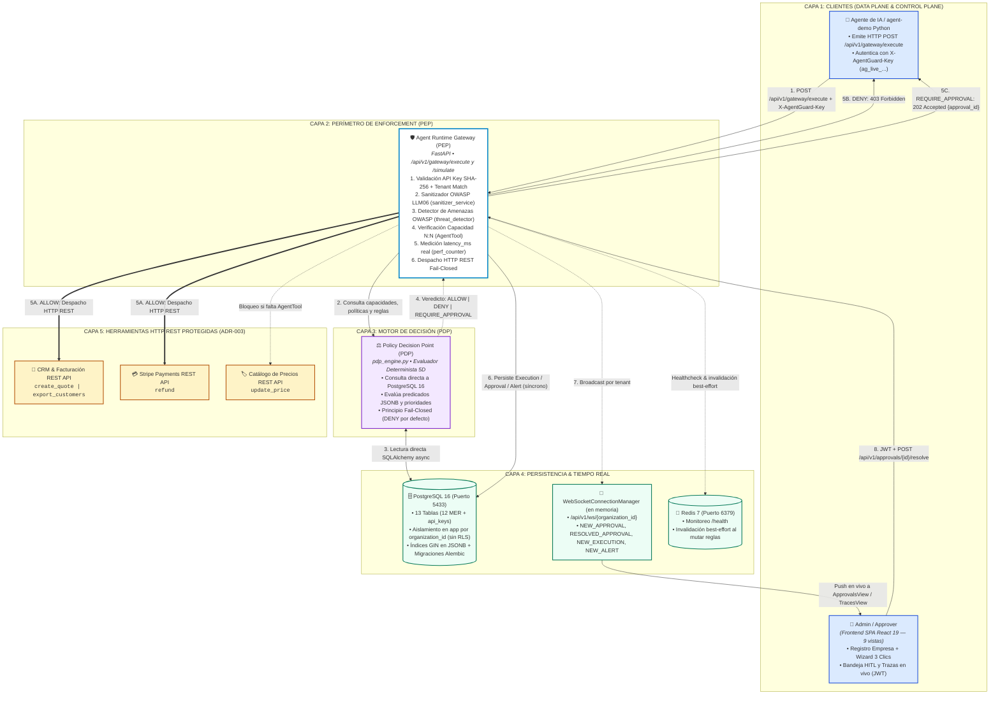

# 🏗️ Guía de Defensa: Arquitectura de Runtime y Flujo de Intercepción PEP / PDP
**Archivo visual opcional (Draw.io):** [`diagramas/agentguard_arquitectura_runtime.drawio`](./diagramas/agentguard_arquitectura_runtime.drawio)  
**Proyecto:** AgentGuard — Plataforma SaaS B2B Multi-Tenant de Gobernanza en Runtime  
**Cátedra:** Desarrollo Web — 5to Semestre, ITU - Universidad Nacional de Cuyo  

---

## 1. El Paradigma de Seguridad: ¿Por qué Fuera del LLM?

El axioma de seguridad fundamental de AgentGuard es:
> **«Never trust the model as the enforcement point» (Nunca confíes en el LLM como punto de control).**

Los modelos de lenguaje grandes (LLMs) son probabilísticos y vulnerables a manipulación semántica (*Prompt Injection, Goal Hijacking, Data Exfiltration* descritos en **OWASP Top 10 for Agentic Applications 2026**). Por ello, la frontera de control vive **completamente fuera del modelo**: el LLM propone la acción y el **Gateway PEP (`POST /api/v1/gateway/execute`)** intercepta, autentica con **`X-AgentGuard-Key`**, sanitiza (OWASP LLM06) y ejecuta únicamente aquello autorizado por el **PDP determinista**.

---

## 2. Diagrama de Arquitectura de Runtime Real (Mermaid)

---

## 3. Componentes Clave de Runtime

1. **Separación Estricta Data Plane vs. Control Plane:**
   * **Data Plane (`/api/v1/gateway/execute`):** Autenticado mediante `X-AgentGuard-Key` (`api_key_service.verify_api_key()`), validando que `request.organization_id == api_key.organization_id`.
   * **Control Plane (`/api/v1/agents`, `/tools`, `/policies`, `/approvals`, `/executions`, `/alerts`, `/api-keys`, `/organizations`, etc.):** Autenticado mediante JWT (`Authorization: Bearer <token>`) y blindado con `403 Forbidden` si la petición incluye `X-Agent-Id`.
2. **Policy Enforcement Point (PEP — `pep_gateway_service.py`):**
   * Sanitiza los parámetros entrantes antes de guardar trazas (`sanitizer_service.py`).
   * Ejecuta detección heurística de inyecciones, evasión Base64, SQL destructivo y exfiltración (`threat_detector.py`, alineado a OWASP Agentic Top 10 2026).
   * Verifica estado `ACTIVE` del agente, existencia de la acción atómica `ToolAction` y capacidad autorizada `AgentTool`.
   * Mide latencia real de procesamiento (`latency_ms` con `time.perf_counter()`).
   * Aplica despacho HTTP REST **Fail-Closed**: si la herramienta externa retorna HTTP `>= 400` o falla por conexión/timeout, reporta error controlado en lugar de éxito ficticio.
3. **Policy Decision Point (PDP — `pdp_engine.py`):**
   * Evalúa de forma determinista la tupla contextual de 5 dimensiones:
     $$\text{Decisión} = f(\text{Principal}, \text{Delegator}, \text{Action}, \text{Resource}, \text{Context})$$
   * Consulta directamente **PostgreSQL 16 (puerto `5433`)** evaluando prioridades de `Policy` y `PolicyRule` más predicados `JSONB`. No utiliza caché de lectura en Redis para evitar inconsistencias o lecturas obsoletas durante cambios de políticas; Redis 7 permanece activo para verificación en `/health` e invalidación best-effort al actualizar reglas.
4. **Trazabilidad Síncrona y Broadcast Reactivo:**
   * El Gateway persiste `Execution`, `Approval` y `Alert` en la transacción de PostgreSQL antes de emitir la respuesta HTTP, garantizando auditabilidad inmediata ante fallos, y luego notifica a los clientes conectados mediante `ws_manager` (`/api/v1/ws/{organization_id}`) y webhook SIEM opcional si la organización lo tiene habilitado.
5. **Modo Simulación Aislado (`POST /api/v1/gateway/simulate` / `dry_run=True`):**
   * Recorre sanitización, detección de amenazas y evaluación completa del PDP retornando explicación legible (`simulation_explanation`), **sin escribir filas en `executions` ni emitir eventos WebSocket**.

---

## 4. Preguntas Difíciles del Profesor y Respuestas Recomendadas

### ❓ P1: *"¿Cómo garantizan consistencia entre políticas recién modificadas y evaluaciones en tiempo real?"*
> **Respuesta:** «El motor `PDPEngine` consulta directamente PostgreSQL 16 mediante SQLAlchemy asíncrono (`asyncpg`) con índices en `organization_id`, `priority` y `JSONB` (GIN). De esa forma, en cuanto un administrador guarda una nueva regla en `PoliciesView` o mediante el wizard en 3 clics, la siguiente llamada al Gateway ya refleja esa regla sin riesgo de caché desactualizado en Redis».

### ❓ P2: *"¿Qué ocurre si una petición activa `REQUIRE_APPROVAL` y nadie responde?"*
> **Respuesta:** «El Gateway responde de inmediato `202 Accepted` con el `approval_id` (sin dejar sockets HTTP bloqueados) y notifica por WebSocket a `ApprovalsView`. Si un `APPROVER` o `ADMIN` intenta resolver el ticket pasados **15 minutos (`900` segundos)**, el servidor transiciona el registro a `EXPIRED` y marca la ejecución como `REJECTED` bajo el principio Fail-Closed, usando bloqueo pesimista `.with_for_update()` para evitar dobles resoluciones».
