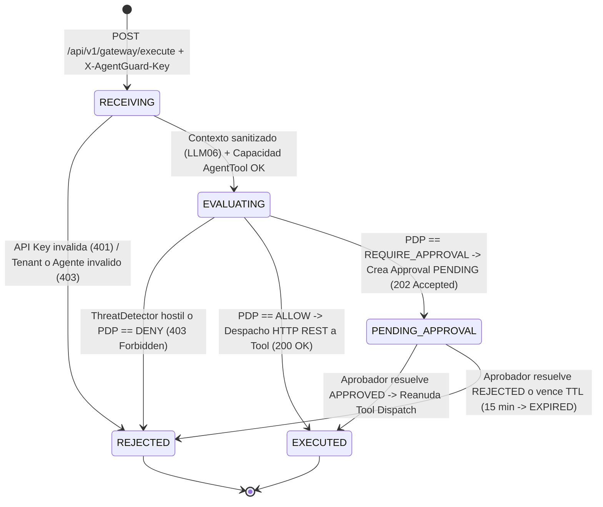
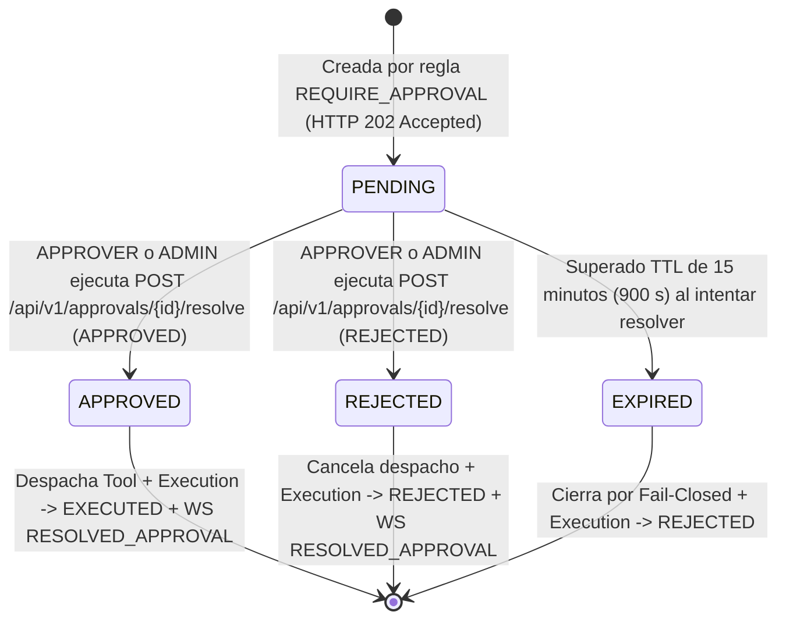
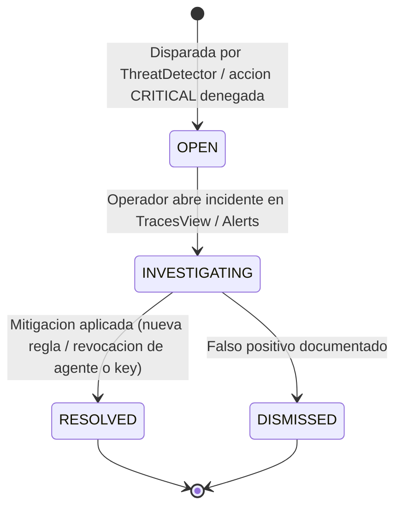

# 🔄 Guía de Defensa: Máquinas de Estados y Ciclo de Vida en Runtime (Protocolo HITL 202 Accepted)
**Archivo visual opcional (Draw.io):** [`diagramas/agentguard_estados_ciclo_vida.drawio`](./diagramas/agentguard_estados_ciclo_vida.drawio)  
**Proyecto:** AgentGuard — Plataforma SaaS B2B Multi-Tenant de Gobernanza en Runtime  
**Cátedra:** Desarrollo Web — 5to Semestre, ITU - Universidad Nacional de Cuyo  

---

## 1. Modelado de Estados en Arquitecturas Asíncronas (`202 Accepted`)

En AgentGuard, cuando una operación requiere intervención humana (*Human-in-the-Loop*, regla `REQUIRE_APPROVAL`), el Gateway PEP **no bloquea conexiones HTTP con long-polling ni retiene sockets abiertos**. En su lugar implementa un protocolo asíncrono desacoplado basado en **`HTTP 202 Accepted`** y eventos reactivos por **WebSocket**.

> **Argumento para el docente:**  
> *«Responder `202 Accepted` con un `approval_id` desacopla el ciclo de vida del agente respecto del tiempo de respuesta humano, evita timeouts HTTP y garantiza atomicidad y principio Fail-Closed mediante bloqueo pesimista (`SELECT ... FOR UPDATE`) y TTL de 15 minutos en PostgreSQL».*

---

## 2. Diagramas de Estados Reales (Mermaid)

### A. Máquina 1: Ciclo de Vida de una Ejecución (`Execution.status`)

Enums reales implementados en `backend/app/models/enums.py`:
* `PolicyDecision`: `ALLOW`, `DENY`, `REQUIRE_APPROVAL`
* `ExecutionStatus`: `PENDING_APPROVAL`, `EXECUTED`, `REJECTED`

### B. Máquina 2: Ciclo de Vida de una Aprobación (`Approval.status`)

Enum real: `ApprovalStatus`: `PENDING`, `APPROVED`, `REJECTED`, `EXPIRED`.

### C. Máquina 3: Ciclo de Vida de un Incidente de Seguridad (`Alert.status`)

Enum real: `AlertStatus`: `OPEN`, `INVESTIGATING`, `RESOLVED`, `DISMISSED`.

---

## 3. Análisis Detallado de Transiciones y Respuestas HTTP

1. **Recepción y Sanitización (`POST /api/v1/gateway/execute`):**
   * Valida la cabecera `X-AgentGuard-Key` contra `api_keys` (`401 Unauthorized` si falta o está revocada) y comprueba `request.organization_id == api_key.organization_id` (`403 Forbidden` si difiere).
   * Enmascara secretos y PII (`sanitizer_service.py`) y analiza vectores hostiles (`threat_detector.py`).
2. **Evaluación Determinista sobre PostgreSQL 16 (`pdp_engine.py`):**
   * Consulta directamente las políticas activas y reglas de la organización en PostgreSQL (sin caché Redis de lectura) evaluando prioridad y predicados `JSONB`.
   * **Si `DENY` (o amenaza detectada o falta capacidad `AgentTool`):** Persiste `Execution(status=REJECTED)` (y `Alert(severity=CRITICAL)` si aplica) y responde **`403 Forbidden`**.
   * **Si `ALLOW`:** Ejecuta `_dispatch_to_tool()` sobre HTTP REST (con comportamiento *fail-closed* si la herramienta falla o responde `>= 400`), persiste `Execution(status=EXECUTED)` con `latency_ms` real y responde **`200 OK`**.
   * **Si `REQUIRE_APPROVAL`:** Persiste `Execution(status=PENDING_APPROVAL)` y `Approval(status=PENDING)`, emite evento **`NEW_APPROVAL`** por WebSocket (`/api/v1/ws/{organization_id}`) y responde inmediatamente **`202 Accepted`** incluyendo `approval_id`.
3. **Resolución HITL en Segundo Paso (`POST /api/v1/approvals/{approval_id}/resolve`):**
   * Exige usuario humano autenticado vía JWT con rol `APPROVER` o `ADMIN`.
   * Si el tiempo transcurrido supera **15 minutos (`900` segundos)**, transiciona automáticamente el ticket a `EXPIRED` y la ejecución a `REJECTED` (Fail-Closed).
   * Si aprueba dentro del TTL, reanuda `_dispatch_to_tool()`, pasa `Approval` a `APPROVED`, `Execution` a `EXECUTED` y notifica vía WebSocket con el evento **`RESOLVED_APPROVAL`**.

---

## 4. Concurrencia y Prevención de Condiciones de Carrera (TOCTOU)

En `PEPGatewayService.resolve_approval()` (`backend/app/services/pep_gateway_service.py`), la concurrencia entre múltiples aprobadores se resuelve mediante:

1. **Bloqueo Pesimista a Nivel de Fila (`.with_for_update()`):**
   La consulta SQLAlchemy adquiere un bloqueo exclusivo en PostgreSQL (`SELECT ... FOR UPDATE`) sobre el registro `Approval` antes de verificar `approval.status == ApprovalStatus.PENDING` y su TTL. Si dos operadores hacen clic al mismo tiempo, la segunda transacción queda serializada y al leer el nuevo estado ya resuelto (`!= PENDING`) aborta de forma segura sin despachar dos veces la herramienta.
2. **Restricción Única en Base de Datos (`uq_approval_execution`):** Garantiza relación 1:1 estricta entre cada `Execution` y su ticket `Approval`.

---

## 5. Preguntas Difíciles del Profesor y Respuestas Sugeridas

### ❓ P1: *"¿Por qué cambiaron de mantener la conexión HTTP abierta a devolver `202 Accepted` en HITL?"*
> **Respuesta:** «Porque una autorización humana puede demorar minutos. Mantener una conexión HTTP en *long-polling* esperando `200 OK` expone al agente cliente a *timeouts* de sockets y agota descriptores del servidor. Con `202 Accepted`, el Gateway responde al instante entregando el `approval_id` y el `execution_id`, el frontend recibe la alerta reactiva en vivo por WebSocket (`/api/v1/ws/{organization_id}`) y el humano resuelve de forma asíncrona sin bloquear threads ni corutinas».

### ❓ P2: *"¿Por qué consideraron el estado `EXPIRED` a los 15 minutos?"*
> **Respuesta:** «Por el principio **Fail-Closed**. Si ningún supervisor autoriza una operación de alto riesgo dentro de la ventana de contexto (`900 s`), el sistema invalida automáticamente el ticket como `EXPIRED` y marca la ejecución como `REJECTED`, evitando que un reembolso o acción sensible se ejecute horas después fuera de contexto».
