# 🛡️ Guía de Defensa: Modelo Entidad-Relación Relacional Multi-Tenant (13 Tablas)
**Archivo visual opcional (Draw.io):** [`diagramas/agentguard_mer_relacional.drawio`](./diagramas/agentguard_mer_relacional.drawio)  
**Proyecto:** AgentGuard — Plataforma SaaS B2B Multi-Tenant de Gobernanza en Runtime  
**Cátedra:** Desarrollo Web — 5to Semestre, ITU - Universidad Nacional de Cuyo  

---

## 1. Propósito y Alcance del Diagrama

Este documento modela la **capa relacional lógica y física** implementada en AgentGuard sobre **PostgreSQL 16** (puerto host **`5433`**). Incluye **13 tablas** (las 12 entidades originales del MER más **`api_keys`** para autenticación del Data Plane), integrando claves primarias **`UUID v4`**, columnas **`JSONB`** con índices **GIN** y discriminador de tenant `organization_id` gestionado mediante Alembic (`001` a `005`).

---

## 2. Diagrama del Modelo Entidad-Relación (Mermaid — 13 Tablas)

```mermaid
erDiagram
    ORGANIZATION ||--o{ USER : "posee miembros (1:N)"
    ORGANIZATION ||--o{ API_KEY : "emite credenciales PEP (1:N)"
    ORGANIZATION ||--o{ AGENT : "registra agentes (1:N)"
    ORGANIZATION ||--o{ TOOL : "administra tools (1:N)"
    ORGANIZATION ||--o{ POLICY : "define politicas (1:N)"
    ORGANIZATION ||--o{ EXECUTION : "registra trazas (1:N)"
    ORGANIZATION ||--o{ ALERT : "monitorea alertas (1:N)"
    ORGANIZATION ||--o{ AUDIT_EVENT : "audita cambios (1:N)"

    USER ||--o{ AGENT : "es sponsor / owner (1:N)"
    USER ||--o{ APPROVAL : "resuelve como approver (1:N)"
    USER ||--o{ ALERT : "investiga incidente (1:N)"

    AGENT ||--o{ AGENT_TOOL : "tiene autorizada (1:N)"
    TOOL ||--o{ AGENT_TOOL : "asignada a (1:N)"
    TOOL ||--o{ TOOL_ACTION : "expone acciones (1:N)"

    POLICY ||--o{ POLICY_RULE : "contiene reglas (1:N)"
    TOOL_ACTION ||--o{ POLICY_RULE : "objeto de regla (1:N)"
    AGENT ||--o{ POLICY_RULE : "aplica opcionalmente (1:N)"

    AGENT ||--o{ EXECUTION : "invoca runtime (1:N)"
    USER ||--o{ EXECUTION : "delega sesion (1:N)"
    TOOL ||--o{ EXECUTION : "recurso destino (1:N)"
    TOOL_ACTION ||--o{ EXECUTION : "accion solicitada (1:N)"
    POLICY_RULE ||--o{ EXECUTION : "regla evaluada (1:N)"

    EXECUTION ||--o| APPROVAL : "requiere intervencion (1:1)"
    EXECUTION ||--o| ALERT : "dispara incidente (1:1)"

    ORGANIZATION {
        UUID id PK
        VARCHAR name "Nombre de la empresa / tenant"
        JSONB settings "Postura fail_closed, mask_sensitive, retencion y SIEM"
        TIMESTAMPTZ created_at
    }

    USER {
        UUID id PK
        UUID organization_id FK
        VARCHAR email "Email unico corporativo"
        VARCHAR hashed_password "Hash bcrypt/argon2 (Nullable legacy)"
        ENUM role "ADMIN | OPERATOR | APPROVER | AUDITOR | VIEWER"
        TIMESTAMPTZ created_at
    }

    API_KEY {
        UUID id PK
        UUID organization_id FK
        VARCHAR name "Etiqueta descriptiva de la llave"
        VARCHAR key_prefix "Prefijo visible (ag_live_...)"
        VARCHAR hashed_key "Hash SHA-256 del secreto"
        BOOLEAN is_active
        TIMESTAMPTZ expires_at
        TIMESTAMPTZ created_at
    }

    AGENT {
        UUID id PK
        UUID organization_id FK
        UUID owner_user_id FK "Humano responsable (Sponsor)"
        VARCHAR name "Nombre del agente de IA"
        TEXT purpose "Proposito / Alcance declarado"
        ENUM status "ACTIVE | SUSPENDED | REVOKED"
        TIMESTAMPTZ created_at
    }

    AGENT_TOOL {
        UUID id PK
        UUID agent_id FK
        UUID tool_id FK
        BOOLEAN enabled "Habilitacion individual"
        JSONB config "Configuracion especifica del agente"
        TIMESTAMPTZ created_at
    }

    TOOL {
        UUID id PK
        UUID organization_id FK
        VARCHAR name "Nombre de la herramienta externa"
        VARCHAR protocol "REST (unico protocolo soportado)"
        VARCHAR endpoint_url "URL base del servicio web"
        TEXT description
        TIMESTAMPTZ created_at
    }

    TOOL_ACTION {
        UUID id PK
        UUID tool_id FK
        VARCHAR action_name "create_quote, refund, etc."
        ENUM risk_level "LOW | MEDIUM | HIGH | CRITICAL"
        TEXT description
        TIMESTAMPTZ created_at
    }

    POLICY {
        UUID id PK
        UUID organization_id FK
        VARCHAR name "Nombre de la politica"
        TEXT description
        INTEGER priority "Orden de resolucion de politicas"
        BOOLEAN is_active
        TIMESTAMPTZ created_at
    }

    POLICY_RULE {
        UUID id PK
        UUID policy_id FK
        INTEGER priority "Prioridad de evaluacion (Fail-Closed)"
        ENUM effect "ALLOW | DENY | REQUIRE_APPROVAL"
        UUID tool_action_id FK "Accion objeto de control"
        UUID target_agent_id FK "Agente especifico (o NULL para todos)"
        JSONB conditions "Predicados logicos (max_amount, roles, etc.)"
        TIMESTAMPTZ created_at
    }

    EXECUTION {
        UUID id PK
        UUID organization_id FK
        UUID agent_id FK
        UUID delegator_user_id FK "Usuario que origino la tarea (Nullable)"
        UUID tool_id FK
        UUID tool_action_id FK
        VARCHAR resource "Identificador de recurso"
        JSONB request_context "Parametros sanitizados del llamado"
        ENUM decision "ALLOW | DENY | REQUIRE_APPROVAL"
        ENUM status "PENDING_APPROVAL | REJECTED | EXECUTED"
        UUID evaluated_policy_rule_id FK "Regla que justifico el veredicto"
        FLOAT latency_ms "Latencia real medida con perf_counter()"
        TIMESTAMPTZ timestamp "Marca temporal inmutable"
    }

    APPROVAL {
        UUID id PK
        UUID execution_id FK "UniqueConstraint uq_approval_execution"
        UUID assigned_approver_id FK "Operador que resolvio (Nullable)"
        ENUM status "PENDING | APPROVED | REJECTED | EXPIRED"
        TEXT resolution_reason "Motivo documentado del humano"
        TIMESTAMPTZ resolved_at
        TIMESTAMPTZ created_at
    }

    ALERT {
        UUID id PK
        UUID organization_id FK
        UUID execution_id FK "Trazabilidad forense (Nullable)"
        VARCHAR title "Titulo del incidente"
        TEXT description "Detalle forense"
        ENUM severity "LOW | MEDIUM | HIGH | CRITICAL"
        ENUM status "OPEN | INVESTIGATING | RESOLVED | DISMISSED"
        UUID resolved_by_user_id FK "Operador investigador (Nullable)"
        TIMESTAMPTZ created_at
    }

    AUDIT_EVENT {
        UUID id PK
        UUID organization_id FK
        ENUM actor_type "USER | AGENT | SYSTEM"
        UUID actor_id "ID del autor de la accion"
        VARCHAR event_type "POLICY_CREATED, CREDENTIAL_REVOKED, etc."
        JSONB metadata "Detalle forense inmutable"
        TIMESTAMPTZ timestamp
    }
```

---

## 3. Decisiones Arquitectónicas y Justificación Técnica

### A. Estrategia Multi-Tenant: Esquema Compartido con Aislamiento Obligatorio en Capa de Aplicación
* **Decisión:** Todas las tablas de dominio raíz portan la columna indexada `organization_id (UUID)`. El aislamiento lógico se garantiza mediante **filtrado obligatorio por `organization_id` en todas las consultas y mutaciones SQLAlchemy de la capa de servicios y routers**, sin depender de Row-Level Security (RLS) en PostgreSQL.
* **Justificación en el SaaS B2B:**
  1. En el **Control Plane**, el usuario autenticado vía JWT opera acotado a su organización (y en `POST /api/v1/auth/register-org` cada empresa nueva obtiene su tenant, usuario `ADMIN` y primera `ApiKey` aislados).
  2. En el **Data Plane** (`POST /api/v1/gateway/execute`), el Gateway verifica criptográficamente la cabecera `X-AgentGuard-Key` contra `api_keys` y exige `request.organization_id == api_key.organization_id`, bloqueando con `403 Forbidden` cualquier intento de cruce de tenant.
  3. Este enfoque mantiene migraciones Alembic simples y deterministas, dejando RLS nativo en PostgreSQL como capa de defensa en profundidad opcional a futuro.

### B. Uso de `UUID v4` como Clave Primaria en lugar de Enteros Seriales
1. **Prevención de Enumeración (IDOR):** Un ID secuencial (`/api/v1/agents/1`) permitiría inferir volumen de clientes o intentar accesos cruzados.
2. **Generación Descentralizada:** Los servicios asíncronos en Python generan identificadores UUID sin bloqueos de secuencias.

### C. Uso Estratégico de `JSONB` con Índices GIN
En el modelo se aprovecha `JSONB` en:
1. `Organization.settings`: Parámetros de gobernanza (`fail_closed`, `mask_sensitive`, `max_autonomous_amount`, `retention_days`, webhook SIEM).
2. `PolicyRule.conditions`: Predicados dinámicos evaluados por el PDP (`{"max_amount": 5000}`, `{"amount": {"lte": 10000}}`, etc.).
3. `Execution.request_context`: Contexto sanitizado del llamado en runtime.
4. `AgentTool.config` y `AuditEvent.metadata`: Límites específicos por vínculo agente-herramienta y detalle forense de eventos administrativos.

### D. Sanitización y Privacidad del `request_context` (OWASP LLM06)
Antes de persistir cualquier fila en `executions`, `sanitizer_service.py` enmascara tokens (`Bearer ...`, `ag_live_...`), credenciales y PII sensible para evitar fugas de secretos en trazas y auditorías.

---

## 4. Capacidades Clave de la Persistencia

1. **Credenciales Criptográficas de Data Plane (`api_keys`):** Almacena el hash SHA-256 (`hashed_key`) y solo el prefijo (`key_prefix`), evitando exponer secretos en texto plano tras el onboarding o generación inicial.
2. **Relación $N:N$ entre Agente y Herramienta (`agent_tools`):** Un agente únicamente puede invocar herramientas vinculadas y habilitadas (`enabled = True`); ante ausencia de vínculo, el Gateway responde `403 Forbidden` (*Agent lacks capability*).
3. **Granularidad Atómica (`tool_actions`) y Protocolo Único `REST` (`tools.protocol`):** Cada acción posee su propio `risk_level` (`LOW`, `MEDIUM`, `HIGH`, `CRITICAL`) sobre herramientas estandarizadas en HTTP REST (ADR-003).
4. **Trazabilidad Forense con Latencia Real (`executions.latency_ms`):** Registra el tiempo efectivo medido con `time.perf_counter()` junto con la regla evaluada (`evaluated_policy_rule_id`), decisión y estado.
5. **Desacoplamiento HITL (`approvals`) e Incidentes (`alerts`):** Con restricción única `uq_approval_execution` sobre `execution_id`, bloqueo pesimista al resolver y trazabilidad hacia `resolved_by_user_id`.

---

## 5. Preguntas Difíciles del Profesor y Respuestas Recomendadas

### ❓ P1: *"¿Por qué la tabla `executions` tiene tantas claves foráneas?"*
> **Respuesta:** «Representan la cadena de trazabilidad y delegación exigida en gobernanza agentic: correlacionan de forma atómica **quién solicitó** (`agent_id`), **en nombre de quién** (`delegator_user_id`), **qué herramienta REST** (`tool_id`), **qué acción atómica** (`tool_action_id`), **bajo qué regla** (`evaluated_policy_rule_id`) y **en qué tenant** (`organization_id`)».

### ❓ P2: *"¿Cómo aseguran el aislamiento Multi-Tenant si no activaron RLS en PostgreSQL?"*
> **Respuesta:** «Todas las tablas raíz tienen `organization_id` indexado con PKs `UUID v4`, y el aislamiento se impone obligatoriamente en dos fronteras: en el Control Plane las rutas exigen JWT y filtran por `organization_id` en cada consulta/mutación SQLAlchemy; en el Data Plane el Gateway autentica la cabecera `X-AgentGuard-Key` contra `api_keys` y rechaza con `403` si `request.organization_id` no coincide con el propietario de la API Key».
