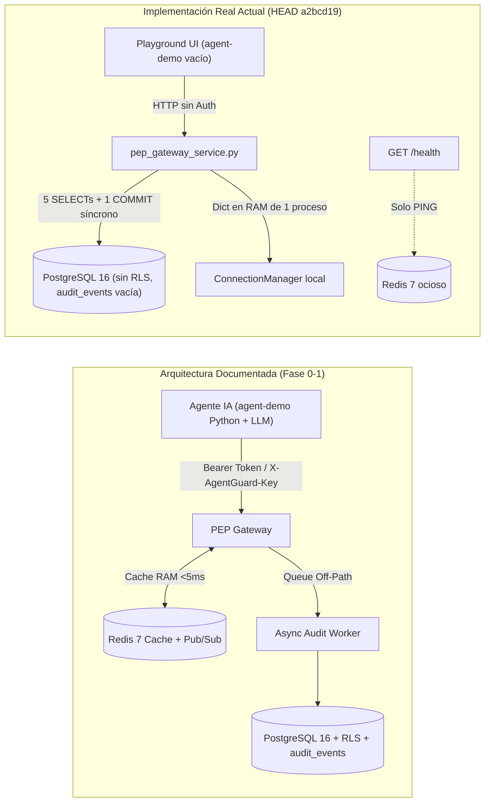

# 01 — Auditoría Forense de Brecha Documental vs. Implementación Real (`Gap Analysis`)

- **Proyecto:** `AgentGuard` — Runtime Authorization & Governance for AI Agents
- **Fecha de Auditoría:** 30 de octubre de 2026 (`HEAD: a2bcd19`, rama `main`)
- **Modalidad:** Auditoría estática integral de solo lectura (*Zero-Modification Policy*)
- **Corpus Contrastado:**
  - Documentos fundacionales: [AgentGuard_Propuesta_Desarrollo_Web_v2.pdf](file:///c:/Users/jonat/Downloads/Codigos/AgentGuard/AgentGuard_Propuesta_Desarrollo_Web_v2.pdf), [AGENTS.md](file:///c:/Users/jonat/Downloads/Codigos/AgentGuard/AGENTS.md), [DECISIONS.md](file:///c:/Users/jonat/Downloads/Codigos/AgentGuard/DECISIONS.md), [README.md](file:///c:/Users/jonat/Downloads/Codigos/AgentGuard/README.md), [guia_simple_proyecto_agentguard.md](file:///c:/Users/jonat/Downloads/Codigos/AgentGuard/guia_simple_proyecto_agentguard.md).
  - Suite de especificación formal (Fase 1): [agentguard_arquitectura_runtime.md](file:///c:/Users/jonat/Downloads/Codigos/AgentGuard/agentguard_arquitectura_runtime.md), [agentguard_mer_relacional.md](file:///c:/Users/jonat/Downloads/Codigos/AgentGuard/agentguard_mer_relacional.md), [agentguard_er_conceptual_chen.md](file:///c:/Users/jonat/Downloads/Codigos/AgentGuard/agentguard_er_conceptual_chen.md), [agentguard_secuencia_demo.md](file:///c:/Users/jonat/Downloads/Codigos/AgentGuard/agentguard_secuencia_demo.md), [agentguard_estados_ciclo_vida.md](file:///c:/Users/jonat/Downloads/Codigos/AgentGuard/agentguard_estados_ciclo_vida.md), [agentguard_casos_de_uso.md](file:///c:/Users/jonat/Downloads/Codigos/AgentGuard/agentguard_casos_de_uso.md).
  - Especificaciones operativas e iteraciones: [docs/PROPUESTAS_MEJORAS_FRONTEND.md](file:///c:/Users/jonat/Downloads/Codigos/AgentGuard/docs/PROPUESTAS_MEJORAS_FRONTEND.md), [backend/README.md](file:///c:/Users/jonat/Downloads/Codigos/AgentGuard/backend/README.md), [agent-demo/README.md](file:///c:/Users/jonat/Downloads/Codigos/AgentGuard/agent-demo/README.md) y los 3 desgloses semanales en `backend/`.
  - Implementación real: `backend/app/**`, `backend/alembic/**`, `backend/scripts/**`, `backend/tests/**`, `frontend/src/**` y `scripts/**`.

---

## 1. Resumen Ejecutivo de Divergencia Arquitectónica

El repositorio presenta una **arquitectura documental altamente madura y detallada** (12 tablas relacionales, diagramas C4/UML/Chen/Mermaid y ADRs formales), pero exhibe **18 brechas estructurales verificables** frente al código realmente ejecutado en `backend/` y `frontend/`.

Las divergencias más severas se concentran en cinco ejes:
1. **Infraestructura declarada pero inactiva (*Vaporware* técnico):** Redis 7 está desplegado en Docker pero **no almacena caché de políticas ni opera Pub/Sub para WebSockets**; solo responde `PING` en `/health`. PostgreSQL **no posee políticas RLS (Row-Level Security)** en las migraciones.
2. **Seguridad perimetral y autenticación ausentes:** Ningún endpoint REST ni canal WebSocket exige JWT, OAuth 2.1 ni `X-AgentGuard-Key`. Las librerías criptográficas instaladas (`python-jose`, `passlib`) no tienen ni un solo `import` en todo el backend.
3. **Auditoría administrativa y asíncrona inconclusa:** La tabla `audit_events` está creada en PostgreSQL pero **jamás es escrita ni leída** (`0` referencias funcionales), y la persistencia de `executions` ocurre de manera **síncrona y bloqueante** dentro del request HTTP del Gateway en lugar de usar colas/workers *off-path*.
4. **Mutaciones silenciosas de protocolo y máquinas de estado:** El flujo HITL (`REQUIRE_APPROVAL`) no mantiene suspendida la corrutina HTTP del agente hasta la decisión humana como prometen los diagramas de secuencia y ciclo de vida, sino que cierra inmediatamente la conexión con `HTTP 202 Accepted`. El enum `ExecutionStatus` redujo los 9 estados diseñados a solo 3, y `AlertStatus` carece de validación de transiciones.
5. **Ausencia total del cliente autónomo `agent-demo/`:** El directorio contiene únicamente un `README.md` de 11 líneas (que además contradice el lenguaje oficial definido en `DECISIONS.md`).

---

## 2. Matriz Maestra de Inconsistencias (Documentación vs. Código Real)

| ID | Severidad | Categoría | Fuente Documental (Promesa) | Evidencia en Código Real (Realidad) | Diagnóstico Forense |
| :--- | :---: | :--- | :--- | :--- | :--- |
| **GAP-01** | **CRÍTICA** | Caché & Escalabilidad | [AGENTS.md](file:///c:/Users/jonat/Downloads/Codigos/AgentGuard/AGENTS.md#L19), [README.md](file:///c:/Users/jonat/Downloads/Codigos/AgentGuard/README.md#L136), [agentguard_arquitectura_runtime.md](file:///c:/Users/jonat/Downloads/Codigos/AgentGuard/agentguard_arquitectura_runtime.md#L38-L58), [backend/README.md](file:///c:/Users/jonat/Downloads/Codigos/AgentGuard/backend/README.md#L31) prometen evaluación sub-5ms cacheando políticas activas en **Redis 7 RAM** y distribución de eventos WebSocket mediante **Redis Pub/Sub**. | [main.py](file:///c:/Users/jonat/Downloads/Codigos/AgentGuard/backend/app/main.py#L16-L54) importa `redis.asyncio` únicamente para `await redis_client.ping()` en `/health`. [pdp_engine.py](file:///c:/Users/jonat/Downloads/Codigos/AgentGuard/backend/app/services/pdp_engine.py#L199-L228) consulta PostgreSQL directamente en cada llamada. [websocket_manager.py](file:///c:/Users/jonat/Downloads/Codigos/AgentGuard/backend/app/core/websocket_manager.py#L19-L21) guarda sockets en `Dict[str, Set[WebSocket]]` en memoria local del proceso. | **NO IMPLEMENTADO (Vaporware).** Con múltiples workers de Uvicorn, los clientes WebSocket conectados al worker B no recibirán eventos generados en el worker A, y cada llamada al Gateway golpea PostgreSQL sin caché. |
| **GAP-02** | **CRÍTICA** | Seguridad / IAM (`RF-01`) | [AgentGuard_Propuesta_Desarrollo_Web_v2.pdf](file:///c:/Users/jonat/Downloads/Codigos/AgentGuard/AgentGuard_Propuesta_Desarrollo_Web_v2.pdf) (págs. 6-7, 10: Entregable Sprint 1 Login/Auth), [README.md](file:///c:/Users/jonat/Downloads/Codigos/AgentGuard/README.md#L35), [agentguard_arquitectura_runtime.md](file:///c:/Users/jonat/Downloads/Codigos/AgentGuard/agentguard_arquitectura_runtime.md#L25-L32), [agentguard_estados_ciclo_vida.md](file:///c:/Users/jonat/Downloads/Codigos/AgentGuard/agentguard_estados_ciclo_vida.md#L26) exigen validación de tokens OAuth 2.1 / JWT / API Keys (`RECEIVED -> BLOCKED: Token Inválido`). | Ninguno de los 13 routers en [backend/app/api/](file:///c:/Users/jonat/Downloads/Codigos/AgentGuard/backend/app/api/__init__.py) define dependencias `Depends(get_current_user)` ni valida cabeceras `Authorization` o `X-AgentGuard-Key`. [config.py](file:///c:/Users/jonat/Downloads/Codigos/AgentGuard/backend/app/core/config.py#L32-L33) declara `SECRET_KEY` y [requirements.txt](file:///c:/Users/jonat/Downloads/Codigos/AgentGuard/backend/requirements.txt#L29-L30) instala `python-jose` y `passlib`, ambos con **0 imports**. En frontend, [AuthContext.tsx](file:///c:/Users/jonat/Downloads/Codigos/AgentGuard/frontend/src/context/AuthContext.tsx#L84-L100) solo cambia un ID en `localStorage` sin pantalla de Login. | **NO IMPLEMENTADO.** Cualquier cliente anónimo con acceso de red al puerto `8000` puede crear políticas, aprobar reembolsos HITL, leer trazas de cualquier tenant o resetear toda la base de datos. |
| **GAP-03** | **CRÍTICA** | Trazabilidad Administrativa | [AGENTS.md](file:///c:/Users/jonat/Downloads/Codigos/AgentGuard/AGENTS.md#L88) (Regla 7), [agentguard_mer_relacional.md](file:///c:/Users/jonat/Downloads/Codigos/AgentGuard/agentguard_mer_relacional.md#L156-L164), [backend/README.md](file:///c:/Users/jonat/Downloads/Codigos/AgentGuard/backend/README.md#L47) (`audit_service`) y [SettingsView.tsx](file:///c:/Users/jonat/Downloads/Codigos/AgentGuard/frontend/src/views/SettingsView.tsx#L528) afirman que toda operación administrativa (`POLICY_CREATED`, `CREDENTIAL_REVOKED`, etc.) queda sellada en `audit_events` en modo *Append-Only WORM*. | [audit.py](file:///c:/Users/jonat/Downloads/Codigos/AgentGuard/backend/app/models/audit.py#L17-L42) y la migración [001_initial_schema.py](file:///c:/Users/jonat/Downloads/Codigos/AgentGuard/backend/alembic/versions/001_initial_schema.py#L197-L212) crean la tabla `audit_events`, pero **`audit_service.py` no existe**, no hay esquema Pydantic `audit.py`, no hay endpoint `/audit-events`, no hay triggers WORM en SQL y ningún servicio instancia `AuditEvent`. | **TABLA MUERTA / NO IMPLEMENTADO.** La tabla `audit_events` permanece permanentemente con `0` filas en cualquier flujo del sistema. |
| **GAP-04** | **ALTA** | Aislamiento Multi-Tenant BD | [README.md](file:///c:/Users/jonat/Downloads/Codigos/AgentGuard/README.md#L136), [agentguard_arquitectura_runtime.md](file:///c:/Users/jonat/Downloads/Codigos/AgentGuard/agentguard_arquitectura_runtime.md#L43), [agentguard_mer_relacional.md](file:///c:/Users/jonat/Downloads/Codigos/AgentGuard/agentguard_mer_relacional.md#L173) y [SettingsView.tsx](file:///c:/Users/jonat/Downloads/Codigos/AgentGuard/frontend/src/views/SettingsView.tsx#L349) declaran aislamiento mediante **PostgreSQL Row-Level Security (RLS)** + filtrado obligatorio por `organization_id`. | [001_initial_schema.py](file:///c:/Users/jonat/Downloads/Codigos/AgentGuard/backend/alembic/versions/001_initial_schema.py#L22-L212) contiene **cero** sentencias `ALTER TABLE ... ENABLE ROW LEVEL SECURITY` o `CREATE POLICY`. Además, los routers de lectura ([agents.py](file:///c:/Users/jonat/Downloads/Codigos/AgentGuard/backend/app/api/agents.py#L46), [executions.py](file:///c:/Users/jonat/Downloads/Codigos/AgentGuard/backend/app/api/executions.py#L64), [websocket.py](file:///c:/Users/jonat/Downloads/Codigos/AgentGuard/backend/app/api/websocket.py#L14), etc.) declaran `organization_id: Optional[UUID] = None`. | **NO IMPLEMENTADO / BRECHA DE AISLAMIENTO.** Ni PostgreSQL impone RLS ni los endpoints obligan el discriminador `organization_id`. Omitir el query param expone registros de todas las organizaciones. |
| **GAP-05** | **ALTA** | Arquitectura *Off-Path* | [agentguard_arquitectura_runtime.md](file:///c:/Users/jonat/Downloads/Codigos/AgentGuard/agentguard_arquitectura_runtime.md#L70-L110) especifica que el `Audit Service` persiste `Execution Traces` y alertas **de forma asíncrona *off-path*** mediante colas/workers en segundo plano para no penalizar la latencia de respuesta al agente. | [pep_gateway_service.py](file:///c:/Users/jonat/Downloads/Codigos/AgentGuard/backend/app/services/pep_gateway_service.py#L344-L431) ejecuta `db.add(...)`, `await db.flush()`, `await db.commit()` y hasta **3 llamadas secuenciales `await ws_manager.broadcast(...)`** dentro de la misma corrutina HTTP antes de retornar respuesta al agente. | **DIVERGENCIA ARQUITECTÓNICA.** La escritura transaccional en disco y la difusión a todos los sockets activos bloquean directamente el *hot-path* del Gateway PEP. |
| **GAP-06** | **ALTA** | Cliente Agéntico (`agent-demo/`) | [guia_simple_proyecto_agentguard.md](file:///c:/Users/jonat/Downloads/Codigos/AgentGuard/guia_simple_proyecto_agentguard.md#L58-L84) (Acto 1 sin AgentGuard vs. Acto 2 con AgentGuard usando Gemini/GPT), [DECISIONS.md](file:///c:/Users/jonat/Downloads/Codigos/AgentGuard/DECISIONS.md#L64-L75) (`agent-demo/ [Python]`), [README.md](file:///c:/Users/jonat/Downloads/Codigos/AgentGuard/README.md#L186) y [desglose_semana_3.md](file:///c:/Users/jonat/Downloads/Codigos/AgentGuard/backend/desglose_de_pasos_semana_3_gateway_interceptor_y_pdp.md#L63) prometen scripts ejecutables de agente autónomo. | El directorio `agent-demo/` solo contiene [agent-demo/README.md](file:///c:/Users/jonat/Downloads/Codigos/AgentGuard/agent-demo/README.md#L1-L11), sin ningún archivo `.py`, `.ts` ni `package.json`. Además, la línea 6 de `agent-demo/README.md` afirma que está desarrollado en **Node.js / TypeScript**, contradiciendo `DECISIONS.md` y el `README.md` raíz que especifican **Python**. | **NO IMPLEMENTADO + CONTRADICCIÓN ENTRE DOCS.** Toda la simulación actual ocurre únicamente desde botones estáticos del frontend (`PlaygroundView.tsx`), sin ningún agente LLM real consumiendo el Gateway. |
| **GAP-07** | **ALTA** | Protocolo HITL (`REQUIRE_APPROVAL`) | [agentguard_secuencia_demo.md](file:///c:/Users/jonat/Downloads/Codigos/AgentGuard/agentguard_secuencia_demo.md#L55-L64) y [agentguard_estados_ciclo_vida.md](file:///c:/Users/jonat/Downloads/Codigos/AgentGuard/agentguard_estados_ciclo_vida.md#L111-L112) especifican que el Gateway mantiene **suspendida la corrutina HTTP del agente** en el Event Loop de `asyncio` hasta que el humano aprueba, retornando recién entonces `200 OK` con el payload ejecutado. | [gateway.py](file:///c:/Users/jonat/Downloads/Codigos/AgentGuard/backend/app/api/gateway.py#L49-L50) cierra inmediatamente la petición HTTP devolviendo `status.HTTP_202_ACCEPTED` con `status="PENDING_APPROVAL"` y `result=None`. Cuando el humano resuelve en [pep_gateway_service.py](file:///c:/Users/jonat/Downloads/Codigos/AgentGuard/backend/app/services/pep_gateway_service.py#L512-L516), el resultado del despacho se descarta y no existe endpoint ni webhook de callback hacia el agente. | **MUTACIÓN NO DOCUMENTADA E INCOMPLETA.** El cambio a `202 Accepted` es más escalable que el *long-polling* HTTP de 15 minutos, pero quedó a mitad de camino: el agente nunca puede recuperar el `result` posterior a la aprobación humana porque `Execution` no tiene columna `response_payload`. |
| **GAP-08** | **ALTA** | Máquina de Estados de `Execution` y `Alert` | [agentguard_estados_ciclo_vida.md](file:///c:/Users/jonat/Downloads/Codigos/AgentGuard/agentguard_estados_ciclo_vida.md#L21-L74) formaliza **9 estados** para `Execution` (`RECEIVED`, `EVALUATING`, `BLOCKED`, `DISPATCHING`, `PENDING_APPROVAL`, `REJECTED_BY_APPROVER`, `ABORTED_BY_TIMEOUT`, `COMPLETED`, `FAILED` con `502 Bad Gateway` / `408 Timeout`) y un grafo estricto para `Alert` (`OPEN -> INVESTIGATING -> RESOLVED \| DISMISSED`). | [enums.py](file:///c:/Users/jonat/Downloads/Codigos/AgentGuard/backend/app/models/enums.py#L39-L42) solo define **3 valores** en `ExecutionStatus` (`PENDING_APPROVAL`, `REJECTED`, `EXECUTED`), haciendo imposible distinguir en BD un bloqueo del PDP (`BLOCKED`), un rechazo humano (`REJECTED_BY_APPROVER`), una expiración (`ABORTED_BY_TIMEOUT`) o un fallo de API externa (`FAILED`). En [alerts.py](file:///c:/Users/jonat/Downloads/Codigos/AgentGuard/backend/app/api/alerts.py#L103), `alert.status = update_data.status` permite cualquier transición arbitraria (ej. `RESOLVED -> OPEN` o `OPEN -> RESOLVED` sin pasar por `INVESTIGATING`). | **SIMPLIFICACIÓN NO DOCUMENTADA.** Pérdida de semántica forense en trazas y ausencia de invariantes de ciclo de vida en incidentes de seguridad. |
| **GAP-09** | **ALTA** | Concurrencia y Expiración Activa HITL | [AGENTS.md](file:///c:/Users/jonat/Downloads/Codigos/AgentGuard/AGENTS.md#L86) (Regla 6) y [agentguard_estados_ciclo_vida.md](file:///c:/Users/jonat/Downloads/Codigos/AgentGuard/agentguard_estados_ciclo_vida.md#L98-L110) prometen expiración automática por TTL/scheduler a los 15 minutos (`EXPIRED`) y bloqueo transaccional atómico `UPDATE ... WHERE status = 'PENDING'` para impedir doble resolución concurrente. | [pep_gateway_service.py](file:///c:/Users/jonat/Downloads/Codigos/AgentGuard/backend/app/services/pep_gateway_service.py#L459-L524) hace un `SELECT` ordinario sin `with_for_update()` (vulnerable a *race condition* TOCTOU y doble despacho financiero) y solo evalúa el TTL de 15 minutos **pasivamente** si alguien intenta resolver ese ID puntual; `list_approvals` sigue devolviendo tickets vencidos como `PENDING` indefinidamente. | **IMPLEMENTACIÓN PARCIAL CON RIESGO DE CONCURRENCIA.** Tickets abandonados nunca transicionan a `EXPIRED` por sí solos. |
| **GAP-10** | **MEDIA** | Motor PDP: Operadores Contextuales | [AgentGuard_Propuesta_Desarrollo_Web_v2.pdf](file:///c:/Users/jonat/Downloads/Codigos/AgentGuard/AgentGuard_Propuesta_Desarrollo_Web_v2.pdf) (págs. 3, 5 — `RF-05`), [agentguard_mer_relacional.md](file:///c:/Users/jonat/Downloads/Codigos/AgentGuard/agentguard_mer_relacional.md#L183) y [desglose_semana_3.md](file:///c:/Users/jonat/Downloads/Codigos/AgentGuard/backend/desglose_de_pasos_semana_3_gateway_interceptor_y_pdp.md#L16) especifican soporte para restricciones de horario (`allowed_hours`), rol del delegador (`allowed_roles`) y operadores `neq` y `contains`. | [pdp_engine.py](file:///c:/Users/jonat/Downloads/Codigos/AgentGuard/backend/app/services/pdp_engine.py#L38-L176) soporta `max_amount`, `min_amount`, `allowed_currencies`, `blocked_domains`, `eq`, `gt`, `gte`, `lt`, `lte`, `in`, `not_in`. **No existen** `neq`, `contains`, `allowed_hours` ni `allowed_roles`. (Si una regla usa `neq` o `contains`, cae en `Operador desconocido -> False` por Fail-Closed). | **IMPLEMENTACIÓN INCOMPLETA.** El documento de Semana 3 marca `[x]` completados los operadores `neq` y `contains`, pero jamás fueron codificados en `_evaluate_single_condition`. |
| **GAP-11** | **MEDIA** | Despacho HTTP Real y Fail-Closed Upstream | [DECISIONS.md](file:///c:/Users/jonat/Downloads/Codigos/AgentGuard/DECISIONS.md#L48-L62) (ADR-003), [agentguard_arquitectura_runtime.md](file:///c:/Users/jonat/Downloads/Codigos/AgentGuard/agentguard_arquitectura_runtime.md#L64-L68) y [agentguard_estados_ciclo_vida.md](file:///c:/Users/jonat/Downloads/Codigos/AgentGuard/agentguard_estados_ciclo_vida.md#L43) establecen que si la API REST externa falla o excede timeout, el Gateway registra `FAILED` y devuelve `502 Bad Gateway` o `408 Request Timeout`. | En [pep_gateway_service.py](file:///c:/Users/jonat/Downloads/Codigos/AgentGuard/backend/app/services/pep_gateway_service.py#L50-L81), `_dispatch_to_tool` captura **cualquier excepción de red o código HTTP `>= 400`** de un endpoint real y cae silenciosamente en el retorno de un **payload simulado `{"status": "success", ...}`** con `HTTP 200 OK` y estado `EXECUTED`. Además, tanto [schemas/tool.py](file:///c:/Users/jonat/Downloads/Codigos/AgentGuard/backend/app/schemas/tool.py#L28) como [ToolsView.tsx](file:///c:/Users/jonat/Downloads/Codigos/AgentGuard/frontend/src/views/ToolsView.tsx#L768-L769) siguen ofreciendo protocolos `gRPC` y `MCP` eliminados por ADR-003. | **VIOLACIÓN DE COMPORTAMIENTO DETERMINISTA.** Enmascara caídas reales de integraciones externas reportándolas como ejecuciones exitosas en la auditoría forense. |
| **GAP-12** | **MEDIA** | Persistencia de Latencia Forense | [OverviewView.tsx](file:///c:/Users/jonat/Downloads/Codigos/AgentGuard/frontend/src/views/OverviewView.tsx#L213) y [TracesView.tsx](file:///c:/Users/jonat/Downloads/Codigos/AgentGuard/frontend/src/views/TracesView.tsx#L256) exhiben latencias por traza y promedio en milisegundos supuestamente provenientes de PostgreSQL. | La tabla `executions` ([models/execution.py](file:///c:/Users/jonat/Downloads/Codigos/AgentGuard/backend/app/models/execution.py#L23-L45)) **no tiene columna `latency_ms`**. El router [executions.py](file:///c:/Users/jonat/Downloads/Codigos/AgentGuard/backend/app/api/executions.py#L47) devuelve `latency_ms=21.5` hardcodeado para el 100% de los registros históricos. | **RETORNO FICTICIO (Hardcoded Stub).** La latencia real medida en `pep_gateway_service.py:407` se pierde tras el broadcast WebSocket. |
| **GAP-13** | **MEDIA** | Contratos y Rutas REST (`/traces` vs `/executions`) | [DECISIONS.md](file:///c:/Users/jonat/Downloads/Codigos/AgentGuard/DECISIONS.md#L86) y [guia_simple_proyecto_agentguard.md](file:///c:/Users/jonat/Downloads/Codigos/AgentGuard/guia_simple_proyecto_agentguard.md#L54-L55) documentan rutas sin versionar (`/api/gateway/execute`, `/api/traces`); [backend/README.md](file:///c:/Users/jonat/Downloads/Codigos/AgentGuard/backend/README.md#L21) documenta `/api/v1/traces`. Asimismo, **RF-10** (Propuesta pág. 5) exige filtros por usuario delegador, herramienta y rango de fechas. | El router real en [executions.py](file:///c:/Users/jonat/Downloads/Codigos/AgentGuard/backend/app/api/executions.py#L19-L70) expone `/api/v1/executions` (no existe `/api/v1/traces`) y solo filtra por `organization_id`, `agent_id`, `decision` y `status` (faltan `tool_id`, `delegator_user_id`, `from_date`, `to_date`). | **DESINCRONIZACIÓN DOCUMENTAL + FILTROS RF-10 INCOMPLETOS.** |
| **GAP-14** | **MEDIA** | Deriva de Esquema MER (`UserRole`, `Alert`, `Approval`) | 1) `UserRole`: [agentguard_mer_relacional.md](file:///c:/Users/jonat/Downloads/Codigos/AgentGuard/agentguard_mer_relacional.md#L59) define 3 roles (`ADMIN, OPERATOR, APPROVER`); [desglose_semana_1.md](file:///c:/Users/jonat/Downloads/Codigos/AgentGuard/backend/desglose_de_pasos_semana_1_base_de_datos_y_setup_inicial.md#L154) define 5 con `SECURITY_OFFICER` (sin `OPERATOR`). 2) `Alert`: [agentguard_mer_relacional.md](file:///c:/Users/jonat/Downloads/Codigos/AgentGuard/agentguard_mer_relacional.md#L146-L154) no incluye `title`/`description`; [generate_diagrams.py](file:///c:/Users/jonat/Downloads/Codigos/AgentGuard/scripts/generate_diagrams.py#L207-L211) usa `alert_type` y `resolved_at`. 3) `Approval`: MER omite `created_at`. | 1) Backend [enums.py](file:///c:/Users/jonat/Downloads/Codigos/AgentGuard/backend/app/models/enums.py#L6-L11) define 5 roles (`ADMIN, OPERATOR, APPROVER, AUDITOR, VIEWER`), mientras Frontend [domain.ts](file:///c:/Users/jonat/Downloads/Codigos/AgentGuard/frontend/src/types/domain.ts#L132) define solo 4 (omite `VIEWER`). 2) Migración [001_initial_schema.py](file:///c:/Users/jonat/Downloads/Codigos/AgentGuard/backend/alembic/versions/001_initial_schema.py#L180-L195) tiene `title` y `description`, pero carece de `alert_type` y `resolved_at`. 3) `approvals` sí incluye `created_at` ([001_initial_schema.py](file:///c:/Users/jonat/Downloads/Codigos/AgentGuard/backend/alembic/versions/001_initial_schema.py#L173)). | **DERIVA DE MODELO ENTRE 4 FUENTES.** Coexisten 4 definiciones distintas de `UserRole` entre MER, Semana 1, Backend y Frontend. |
| **GAP-15** | **MEDIA** | Configuración Fail-Fast y Middleware Global 500 | [AGENTS.md](file:///c:/Users/jonat/Downloads/Codigos/AgentGuard/AGENTS.md#L117-L120) (Regla 8) y [desglose_semana_1.md](file:///c:/Users/jonat/Downloads/Codigos/AgentGuard/backend/desglose_de_pasos_semana_1_base_de_datos_y_setup_inicial.md#L122-L201) exigen *fail-fast* al arrancar si faltan variables críticas en `.env` y un middleware global de excepciones no controladas para evitar fugas de información interna. | [config.py](file:///c:/Users/jonat/Downloads/Codigos/AgentGuard/backend/app/core/config.py#L25-L65) asigna defaults hardcodeados a **todas** las variables (incluyendo `POSTGRES_PASSWORD="agentguard_secret"` y `SECRET_KEY="agentguard-insecure-..."`), validando solo si `ENVIRONMENT == "production"`. [main.py](file:///c:/Users/jonat/Downloads/Codigos/AgentGuard/backend/app/main.py) carece de `@app.exception_handler(Exception)` y [demo.py](file:///c:/Users/jonat/Downloads/Codigos/AgentGuard/backend/app/api/demo.py#L45) filtra `str(exc)` crudo al cliente en errores 500. | **INCUMPLIMIENTO DE REGLA 8 Y OWASP.** El servidor arranca silenciosamente con secretos inseguros aunque no exista archivo `.env`. |
| **GAP-16** | **MEDIA** | Casos de Uso UI Faltantes (`CU-11`, `Presenter Tour`) | [agentguard_casos_de_uso.md](file:///c:/Users/jonat/Downloads/Codigos/AgentGuard/agentguard_casos_de_uso.md#L72-L119) define `CU-11: Gestionar Incidente / Alerta` (`OPEN -> INVESTIGATING -> RESOLVED / DISMISSED`). [docs/PROPUESTAS_MEJORAS_FRONTEND.md](file:///c:/Users/jonat/Downloads/Codigos/AgentGuard/docs/PROPUESTAS_MEJORAS_FRONTEND.md#L218-L280) prioriza como *"MUY ALTA RECOMENDACIÓN"* la Propuesta 4 (*Modo Presentación Guiada / Presenter Tour*). | No existe vista de Alertas en [App.tsx](file:///c:/Users/jonat/Downloads/Codigos/AgentGuard/frontend/src/App.tsx#L20); el botón `"Ver todas"` de [OverviewView.tsx](file:///c:/Users/jonat/Downloads/Codigos/AgentGuard/frontend/src/views/OverviewView.tsx#L384) redirige a `#traces` (donde no hay alertas) y la UI solo permite marcar `RESOLVED` (nunca `INVESTIGATING` ni `DISMISSED`). El *Presenter Tour* tiene **0% de implementación**. | **BRECHA FUNCIONAL DE FRONTEND.** |
| **GAP-17** | **MEDIA** | Sanitización PII (`AGENTS.md` Regla 3) | [AGENTS.md](file:///c:/Users/jonat/Downloads/Codigos/AgentGuard/AGENTS.md#L80) exige sanitizar tokens, credenciales, contraseñas **y datos personales (PII)** antes de guardar `request_context`. | [sanitizer_service.py](file:///c:/Users/jonat/Downloads/Codigos/AgentGuard/backend/app/services/sanitizer_service.py#L14-L39) solo redacta claves sensibles, JWTs, `sk-...`, tarjetas de 13-16 dígitos y SSN formato EE.UU. (`XXX-XX-XXXX`). No enmascara emails, teléfonos ni DNI/CUIT latinoamericanos, e inyecta `decoded_payload` Base64 **después** de sanitizar ([pep_gateway_service.py](file:///c:/Users/jonat/Downloads/Codigos/AgentGuard/backend/app/services/pep_gateway_service.py#L284-L286)). | **IMPLEMENTACIÓN PARCIAL CON BYPASS.** |
| **GAP-18** | **BAJA** | Grafo de Conocimiento Desactualizado | [AGENTS.md](file:///c:/Users/jonat/Downloads/Codigos/AgentGuard/AGENTS.md#L136-L137) establece mantener `graphify-out/` sincronizado tras cambios en código. | Según `git log`, el último sync de `graphify-out/` fue el commit `a79568f`, quedando por detrás del commit `a2bcd19` (*"feat: enriquecer trazas HITL y cerrar banner SIEM al resolver alertas"*), por lo que las adiciones recientes en `executions.py`, `alerts.py`, `App.tsx` y `TracesView.tsx` aún no figuran en `graph.json`. | **DESFASE MENOR (1 commit).** |

---

## 3. Análisis Específico de Contradicciones Internas en la Documentación

Más allá de la brecha frente al código, los propios documentos del repositorio presentan **5 contradicciones internas** que deben alinearse:

1. **Lenguaje de `agent-demo/`:**
   - [DECISIONS.md](file:///c:/Users/jonat/Downloads/Codigos/AgentGuard/DECISIONS.md#L64-L75) y [README.md](file:///c:/Users/jonat/Downloads/Codigos/AgentGuard/README.md#L186): declaran explícitamente `agent-demo/ # Scripts de simulación de agentes autónomos [Python]`.
   - [agent-demo/README.md](file:///c:/Users/jonat/Downloads/Codigos/AgentGuard/agent-demo/README.md#L6): declara *"Desarrollado en **Node.js / TypeScript** para simular un entorno empresarial agéntico moderno"*.
2. **Protocolos soportados por `Tool` tras ADR-003:**
   - [DECISIONS.md](file:///c:/Users/jonat/Downloads/Codigos/AgentGuard/DECISIONS.md#L48-L62) (ADR-003): elimina formalmente el protocolo MCP del alcance en favor de API REST estándar.
   - [backend/app/schemas/tool.py](file:///c:/Users/jonat/Downloads/Codigos/AgentGuard/backend/app/schemas/tool.py#L28) y [frontend/src/views/ToolsView.tsx](file:///c:/Users/jonat/Downloads/Codigos/AgentGuard/frontend/src/views/ToolsView.tsx#L767-L770): continúan ofreciendo `MCP (Model Context Protocol)` y `gRPC` como protocolos seleccionables.
3. **Inmutabilidad Forense (WORM) vs. Purga Automática por Retención:**
   - [AGENTS.md](file:///c:/Users/jonat/Downloads/Codigos/AgentGuard/AGENTS.md#L88) (Regla 7): *"Queda prohibido alterar o eliminar trazas de auditoría"*.
   - [SettingsView.tsx](file:///c:/Users/jonat/Downloads/Codigos/AgentGuard/frontend/src/views/SettingsView.tsx#L490-L512): presenta un selector de *"Período de Retención de Trazas de Ejecución (30/90/180/365 días — se depuran automáticamente tras expirar)"*.
4. **Cantidad de Escenarios Oficiales de la Demo (4 vs. 5):**
   - [AGENTS.md](file:///c:/Users/jonat/Downloads/Codigos/AgentGuard/AGENTS.md#L102-L107), [agentguard_secuencia_demo.md](file:///c:/Users/jonat/Downloads/Codigos/AgentGuard/agentguard_secuencia_demo.md) y `test_gateway_scenarios.py` certifican **4 escenarios**.
   - [AGENTS.md](file:///c:/Users/jonat/Downloads/Codigos/AgentGuard/AGENTS.md#L156) (Sección 10.2), `seed_demo.py` y [PlaygroundView.tsx](file:///c:/Users/jonat/Downloads/Codigos/AgentGuard/frontend/src/views/PlaygroundView.tsx#L370-L435) implementan **5 escenarios** (agregando `Escenario 5: database.drop`), pero el Escenario 5 no está incluido en la suite de regresión `test_gateway_scenarios.py` ni genera alerta real en backend cuando lo dispara `Agente de Ventas` (ver Informe `03`).
5. **Nombre del Tenant de Demostración:**
   - `seed_demo.py` crea `"Acme Corp"`; `Sidebar.tsx:117` muestra `"Acme Networks"`; `SettingsView.tsx:40` muestra `"Acme Corp Global"`.

