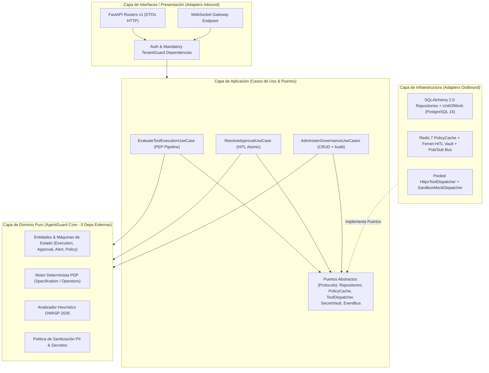

# 06 — Propuesta de Evolución Arquitectónica, Optimización de Rendimiento y Mejores Prácticas

- **Proyecto:** `AgentGuard` — Runtime Authorization & Governance for AI Agents
- **Alcance:** Diagnóstico de acoplamiento actual, arquitectura objetivo (*Clean / Hexagonal Architecture* en Backend + *Feature-Sliced Modular Architecture* en Frontend), catálogo de patrones de diseño, detección de cuellos de botella de rendimiento y guía de estándares de ingeniería para el stack políglota (`FastAPI + SQLAlchemy 2.0 + PostgreSQL 16 + Redis 7` / `React 19 + TypeScript 6 + Vite 8`).
- **Fecha de Auditoría:** 30 de octubre de 2026 (`HEAD: a2bcd19`, rama `main`).

---

## 0. Diagnóstico del Acoplamiento Actual (Estado *As-Is*)

El análisis estático del código y del grafo arquitectónico (`graphify-out/GRAPH_REPORT.md`) evidencia cuatro focos severos de acoplamiento que explican los crashes `HTTP 500`, las regresiones silenciosas y la dificultad de extensión detectadas en los Informes `02` y `03`:

### 0.1 Backend: Servicios "Dios", Fuga de ORM hacia HTTP y Dominio Impuro
1. **`PEPGatewayService` como *God Class* acoplada a 5 responsabilidades ([pep_gateway_service.py](file:///c:/Users/jonat/Downloads/Codigos/AgentGuard/backend/app/services/pep_gateway_service.py), 591 líneas):**
   - Una sola clase estática ejecuta consultas directas con `AsyncSession` de SQLAlchemy, orquesta reglas de negocio e invariantes de estado, abre sockets TCP salientes con `httpx.AsyncClient`, invoca sanitización, muta `Execution` y `Approval`, y dispara difusiones WebSocket (`ws_manager.broadcast`). Es imposible testear el pipeline de decisión sin mockear simultáneamente SQLAlchemy, `httpx` y `ws_manager`.
2. **Fuga del ORM hacia la capa de serialización FastAPI/Pydantic (Causa de los 5 `MissingGreenlet`):**
   - Los routers devuelven entidades SQLAlchemy crudas (`return tool`, `return policy`, `return rule`) confiando en que Pydantic lea `@property` navegacionales (`Tool.assigned_agents`, `PolicyRule.action_name`, `PolicyRule.tool_name`) fuera del contexto asíncrono del repositorio.
3. **Routers con SQL incrustado sin capa de aplicación:**
   - [executions.py](file:///c:/Users/jonat/Downloads/Codigos/AgentGuard/backend/app/api/executions.py) y [alerts.py](file:///c:/Users/jonat/Downloads/Codigos/AgentGuard/backend/app/api/alerts.py) construyen sentencias `select(...)` y ejecutan `await db.commit()` directamente en controladores HTTP, mientras [demo.py](file:///c:/Users/jonat/Downloads/Codigos/AgentGuard/backend/app/api/demo.py#L28-L32) altera `sys.path` en caliente para importar un script CLI (`scripts/seed_demo.py`).
4. **Aislamiento Multi-Tenant delegado a la memoria del programador:**
   - Cada endpoint decide manualmente si pide `organization_id: Optional[UUID] = None`, sin un objeto `TenantContext` obligatorio inyectado por dependencia o repositorio acotado.

### 0.2 Frontend: Vistas Monolíticas, Cliente HTTP "Mágico" y Sockets Duplicados
1. **Componentes de vista monolíticos (>1,000 líneas por archivo):**
   - [SettingsView.tsx](file:///c:/Users/jonat/Downloads/Codigos/AgentGuard/frontend/src/views/SettingsView.tsx) (1,610 LOC), [PoliciesView.tsx](file:///c:/Users/jonat/Downloads/Codigos/AgentGuard/frontend/src/views/PoliciesView.tsx) (1,175 LOC), [ToolsView.tsx](file:///c:/Users/jonat/Downloads/Codigos/AgentGuard/frontend/src/views/ToolsView.tsx) (1,164 LOC) y [PlaygroundView.tsx](file:///c:/Users/jonat/Downloads/Codigos/AgentGuard/frontend/src/views/PlaygroundView.tsx) (1,012 LOC) concentran en un único archivo: llamadas de red, mapeo de estado, formularios, tablas, modales, drawers y cientos de objetos `style={{ ... }}` inline.
2. **Acoplamiento entre transporte HTTP, mapeo de DTOs y datos ficticios ([api.ts](file:///c:/Users/jonat/Downloads/Codigos/AgentGuard/frontend/src/services/api.ts), 958 líneas):**
   - `api.ts` mezcla `fetch`, transformación de contratos snake_case -> camelCase, reglas de negocio inventadas (hardcodear `['CRM', 'Catalog']` o `'$500'`) y captura silenciosa de errores con retorno a `mockData.ts`.
3. **Conexiones WebSocket duplicadas desde múltiples componentes:**
   - [App.tsx](file:///c:/Users/jonat/Downloads/Codigos/AgentGuard/frontend/src/App.tsx#L67) abre un socket permanente y, simultáneamente, la vista activa (`OverviewView`, `TracesView`, `ApprovalsView` o `PlaygroundView`) instancia **una segunda conexión WebSocket paralela** contra el mismo backend mediante `useAgentGuardWebSocket`, duplicando handshakes, heartbeats y deserializaciones JSON.

---

## 1. Propuesta de Arquitectura Objetivo y Árbol de Directorios (Front & Back)

### 1.1 Diagrama de Capas y Regla de Dependencia (Arquitectura Hexagonal / Clean)

La regla cardinal de la arquitectura objetivo es que **las dependencias de código fuente apuntan exclusivamente hacia adentro (hacia el Dominio)**. El Dominio (`pdp`, `threat_detection`, `sanitization`, entidades y máquinas de estado) no importa FastAPI, ni SQLAlchemy, ni Redis, ni `httpx`.



### 1.2 Árbol de Directorios Objetivo — Backend (`backend/`)

```text
backend/
├── alembic/
│   ├── versions/
│   │   ├── 001_initial_schema.py
│   │   └── 002_execution_latency_payload_indexes_apikeys.py
│   └── env.py
├── app/
│   ├── core/                              # Configuración transversal y ciclo de vida ASGI
│   │   ├── config.py                      # Pydantic Settings con validación Fail-Fast estricta
│   │   ├── lifespan.py                    # Pool singleton de AsyncEngine, Redis y httpx.AsyncClient
│   │   ├── logging.py                     # Logging estructurado JSON con correlation_id / org_id
│   │   └── exceptions.py                  # Jerarquía DomainError -> AppError (sin HTTPException aquí)
│   │
│   ├── domain/                            # NÚCLEO PURO (Python estándar, 0 SQLAlchemy / 0 FastAPI)
│   │   ├── enums.py                       # Enums canónicos unificados (UserRole, ExecutionStatus, etc.)
│   │   ├── entities/                      # Dataclasses / modelos de dominio con invariantes
│   │   │   ├── agent.py
│   │   │   ├── tool.py
│   │   │   ├── policy.py
│   │   │   ├── execution.py               # Máquina de estados formal de Execution
│   │   │   ├── approval.py                # Reglas de TTL, elegibilidad de rol y resolución única
│   │   │   └── alert.py                   # Grafo válido OPEN -> INVESTIGATING -> RESOLVED | DISMISSED
│   │   └── services/                      # Motores deterministas puros (100% unit-testables en <10ms)
│   │       ├── pdp_evaluator.py           # Evaluación pura + registro extensible de operadores
│   │       ├── threat_analyzer.py         # Reglas heurísticas OWASP ASI01-ASI05 + decodificación segura
│   │       └── context_sanitizer.py       # Tokenización exacta de claves + regex PII/credenciales
│   │
│   ├── application/                       # CASOS DE USO Y PUERTOS (Orquestación de negocio)
│   │   ├── dto/                           # Comandos y resultados agnósticos de transporte HTTP
│   │   ├── ports/                         # typing.Protocol (Interfaces invertidas)
│   │   │   ├── unit_of_work.py            # Transaccionalidad atómica (commit/rollback)
│   │   │   ├── repositories.py            # Contratos acotados obligatoriamente por organization_id
│   │   │   ├── policy_cache.py            # Puerto L2 Cache (get_rules / invalidate_org)
│   │   │   ├── hitl_payload_vault.py      # Custodia cifrada temporal de parámetros pre-redacción
│   │   │   ├── tool_dispatcher.py         # Despacho hacia herramientas externas o sandbox
│   │   │   └── event_bus.py               # Publicación de eventos (ExecutionCreated, AlertTriggered...)
│   │   └── use_cases/
│   │       ├── gateway/
│   │       │   └── execute_tool_action.py # Pipeline PEP ordenado y determinista
│   │       ├── approvals/
│   │       │   ├── resolve_approval.py    # Bloqueo atómico FOR UPDATE + re-despacho desde Vault
│   │       │   └── expire_stale_approvals.py
│   │       ├── governance/                # Casos de uso CRUD de Agents, Tools, Policies, Rules
│   │       │   └── ...                    # Emiten automáticamente AuditEvent en la misma UoW
│   │       └── demo/
│   │           └── reset_demo_tenant.py   # Caso de uso limpio (reemplaza importación por sys.path)
│   │
│   ├── infrastructure/                    # ADAPTADORES CONCRETOS (SQLAlchemy, Redis, HTTPX, Crypto)
│   │   ├── persistence/
│   │   │   ├── models/                    # Modelos ORM SQLAlchemy 2.0 (tablas físicas)
│   │   │   ├── mappers/                   # Conversión explícita ORM <-> Domain Entity / ReadDTO
│   │   │   ├── repositories/              # Implementación SQL con selectinload garantizado y filtro tenant
│   │   │   ├── unit_of_work.py            # SqlAlchemyUnitOfWork
│   │   │   └── seeds/                     # Seeder determinista importable como módulo formal
│   │   ├── cache/
│   │   │   ├── redis_policy_cache.py      # Cache JSON de reglas PDP por (org_id, tool_action_id)
│   │   │   ├── redis_hitl_vault.py        # Cifrado Fernet con TTL automático de 900s
│   │   │   └── redis_pubsub_bus.py        # Fan-out multi-worker para WebSockets
│   │   ├── http/
│   │   │   ├── live_rest_dispatcher.py    # httpx.AsyncClient compartido + Circuit Breaker + Fail-Closed
│   │   │   └── sandbox_mock_dispatcher.py # Respuestas deterministas exclusivas para herramientas SANDBOX
│   │   └── security/
│   │       ├── jwt_provider.py            # PyJWT (emisión y verificación RBAC)
│   │       └── api_key_hasher.py          # SHA-256 / HMAC para X-AgentGuard-Key
│   │
│   └── interfaces/                        # ADAPTADORES DE ENTRADA (FastAPI HTTP & WebSockets)
│       ├── api/
│       │   ├── dependencies.py            # TenantContext obligatorio, CurrentUser RBAC, AgentAuth
│       │   ├── error_handlers.py          # Mapeo centralizado DomainError/IntegrityError -> JSON RFC 7807
│       │   └── v1/
│       │       ├── router.py              # Agregador único /api/v1
│       │       ├── gateway.py
│       │       ├── approvals.py
│       │       ├── executions.py
│       │       ├── alerts.py
│       │       ├── audit_events.py
│       │       ├── agents.py
│       │       ├── tools.py               # Sub-rutas /tools/{id}/actions anidadas semánticamente
│       │       ├── policies.py            # Sub-rutas /policies/{id}/rules anidadas semánticamente
│       │       ├── users.py
│       │       ├── organizations.py
│       │       └── demo.py                # Protegido por require_role(UserRole.ADMIN) + guard de entorno
│       └── ws/
│           └── realtime_gateway.py        # Suscripción autenticada y estrictamente aislada por org_id
│
└── tests/
    ├── conftest.py                        # Fixtures compartidas, Testcontainers/PostgreSQL transaccional
    ├── unit/domain/                       # Tests ultrarrápidos (<50ms) de PDP, Sanitizer, Threat y Estados
    ├── integration/persistence/           # Certificación real SQLAlchemy (cero MissingGreenlet / FK surprises)
    └── e2e/api/                           # Suite de regresión de los 5 escenarios sobre HTTP + BD real
```

**Justificación Modular del Backend:**
1. **Erradicación estructural de `MissingGreenlet`:** Al prohibir que `interfaces/api/v1/` reciba instancias ORM crudas y obligar a los repositorios en `infrastructure/persistence/` a retornar **Entidades de Dominio o ReadDTOs ya hidratados**, resulta técnicamente imposible que Pydantic dispare lazy-loading accidental.
2. **Aislamiento Multi-Tenant por Construcción:** Todos los métodos de `repositories.py` exigen `org_id: OrganizationId` como primer argumento posicional obligatorio (`repo.list_executions(ctx.org_id, filters)`), impidiendo olvidos de `WHERE organization_id = ...`.
3. **Testabilidad Total:** `domain/` se prueba sin base de datos ni mocks complejos; `infrastructure/persistence/` se prueba contra PostgreSQL real validando constraints, índices y cascadas.

---

### 1.3 Árbol de Directorios Objetivo — Frontend (`frontend/src/`)

Se propone migrar de vistas monolíticas acopladas a una **Arquitectura Modular Guiada por Dominios (*Feature-Sliced Design* simplificado)**:

```text
frontend/src/
├── app/                                   # Composición raíz de la aplicación
│   ├── App.tsx
│   ├── router.tsx                         # Enrutamiento declarativo con soporte de query params (?agentId=...)
│   ├── ErrorBoundary.tsx                  # Aislamiento de fallos de renderizado (evita pantalla blanca global)
│   └── providers/
│       ├── QueryProvider.tsx              # TanStack Query (caché declarativa, reintentos y rollback)
│       ├── AuthProvider.tsx               # Sesión JWT/RBAC sincronizada con usuarios reales del tenant
│       ├── ThemeProvider.tsx              # Tokens CSS Dark/Light consistentes
│       └── RealtimeProvider.tsx           # ÚNICA conexión WebSocket multiplexada por sesión
│
├── shared/                                # Primitivas reutilizables sin lógica de un feature puntual
│   ├── api/
│   │   ├── httpClient.ts                  # Cliente fetch tipado con interceptores JWT, X-Org-Id y ApiError real
│   │   └── endpoints.ts                   # Constantes de rutas relativas (/api/v1/...) usando proxy Vite
│   ├── ui/                                # Sistema de Diseño atómico (usa variables CSS, cero hex hardcodeados)
│   │   ├── Drawer.tsx
│   │   ├── Modal.tsx
│   │   ├── DataTable.tsx
│   │   ├── StatusBadge.tsx
│   │   ├── JsonInspector.tsx
│   │   ├── EmptyState.tsx
│   │   └── Toast.tsx
│   ├── styles/
│   │   ├── tokens.css                     # Paleta semántica completa (incluyendo --bg-canvas en dark y light)
│   │   └── animations.css                 # Clases unificadas (.animate-spin, .animate-pulse)
│   └── lib/
│       ├── formatters.ts                  # Fechas UTC/locales, latencias, monedas
│       └── rbac.ts                        # Helpers puros de permisos por UserRole canónico
│
├── features/                              # Módulos verticales autocontenidos de negocio
│   ├── overview/
│   │   ├── api/overviewQueries.ts
│   │   ├── components/                    # KpiGrid, RuntimeActivityChart (datos reales), LiveFeedList
│   │   └── OverviewPage.tsx
│   ├── agents/
│   │   ├── api/agentsApi.ts               # DTOs exactos + mappers puros (sin ['CRM', 'Catalog'] falsos)
│   │   ├── components/                    # AgentsTable, AgentDetailDrawer, AgentToolsManagerModal
│   │   └── AgentsPage.tsx
│   ├── tools/
│   │   ├── api/toolsApi.ts
│   │   ├── components/                    # ToolsTable, CreateToolModal, ToolActionsEditor
│   │   └── ToolsPage.tsx
│   ├── policies/
│   │   ├── api/policiesApi.ts
│   │   ├── components/                    # PolicyCard, RuleConditionBuilder, CoverageMeter
│   │   └── PoliciesPage.tsx
│   ├── approvals/
│   │   ├── api/approvalsApi.ts
│   │   ├── hooks/useApprovalCountdown.ts  # Temporizador reactivo sobre TTL real de 15 min
│   │   ├── components/                    # ApprovalTicketCard, ResolutionReasonModal
│   │   └── ApprovalsPage.tsx
│   ├── traces/
│   │   ├── api/tracesApi.ts               # Paginación server-side + filtros completos RF-10
│   │   ├── components/                    # TracesFilterBar, TracesTable, TraceForensicDrawer
│   │   └── TracesPage.tsx
│   ├── alerts/                            # NUEVO módulo dedicado para CU-11 (Gestión SIEM)
│   │   ├── api/alertsApi.ts
│   │   ├── components/                    # AlertBanner, AlertsKanbanOrTable, IncidentTransitionModal
│   │   └── AlertsPage.tsx
│   ├── playground/
│   │   ├── api/playgroundApi.ts           # Consume GET /api/v1/gateway/attacks y POST /gateway/execute
│   │   ├── components/                    # ScenarioPresetsPanel, CustomPayloadSimulator, GovernanceDiffView
│   │   └── PlaygroundPage.tsx
│   └── settings/
│       ├── api/settingsApi.ts
│       ├── components/                    # WorkspaceTab, ApiKeysTab, SecurityPostureTab, RbacTeamTab
│       └── SettingsPage.tsx               # Divide las 1,610 líneas actuales en 5 subcomponentes de <200 LOC
│
└── __fixtures__/                          # Mocks aislados EXCLUSIVAMENTE para tests Vitest (fuera del bundle prod)
    └── demoFixtures.ts
```

**Justificación Modular del Frontend:**
1. **Ningún archivo supera las ~250 líneas:** Dividir vistas de 1,100–1,600 líneas en `Page + components/ + api/ + hooks/` permite que **Juan Martín Battiato** y **Mateo Ortega** trabajen en paralelo sin conflictos de merge en Git.
2. **Separación estricta `DTO` vs. `Modelo UI` vs. `Fixtures`:** Al extraer `mockData.ts` hacia `__fixtures__/`, el bundle productivo jamás mezcla datos simulados con respuestas vacías de PostgreSQL.
3. **Sistema de Diseño Unificado (`shared/ui/`):** Un único `<Drawer>` y `<Modal>` basados en variables CSS corrige de raíz la ruptura del Modo Claro (`[data-theme="light"]`) en todas las vistas a la vez.

---

## 2. Patrones de Diseño Recomendados para Desacoplar el Dominio

### 2.1 *Chain of Responsibility* (Pipeline Determinista) para el Interceptor PEP
Reemplazar el método monolítico `PEPGatewayService.execute_tool_action` (330 líneas secuenciales con `return` tempranos que hoy pierden alertas y trazas) por un pipeline explícito de etapas sobre un objeto `InterceptionContext`:

1. **`IdentityAndTenantStep`:** Valida existencia y estado `ACTIVE` del `Agent`, existencia de `Tool`/`ToolAction` y pertenencia de `delegator_user_id` al `organization_id`. *(Si falla -> marca `DENY`, pero **continúa hacia la etapa de Persistencia Forense** para no violar la Regla 7).*
2. **`ThreatInspectionStep`:** Ejecuta `ThreatAnalyzer` (OWASP ASI01–ASI05) sobre los parámetros crudos **antes** de evaluar permisos `AgentTool`, garantizando que todo intento de SQLi o Prompt Injection quede marcado para generar `Alert` SIEM aunque el agente no tenga la herramienta asignada.
3. **`CapabilityBindingStep`:** Verifica vínculo activo en `AgentTool` (`enabled == True`) y aplica restricciones operativas de `AgentTool.config` (ej. timeout específico, cuota por minuto).
4. **`PdpEvaluationStep`:** Evalúa reglas obtenidas desde `PolicyCachePort` (Redis -> fallback PostgreSQL) aplicando precedencia determinista y *Fail-Closed*.
5. **`ContextSanitizationStep`:** Redacta credenciales y PII sobre una copia profunda (*incluyendo* cualquier `decoded_payload` generado por `ThreatInspectionStep`). Si el veredicto es `REQUIRE_APPROVAL`, deposita el payload original cifrado en `HitlPayloadVaultPort` (Redis TTL 15 min).
6. **`ForensicCommitAndDispatchStep`:** Persiste atómicamente `Execution` (+ `Approval` o `Alert`) mediante `UnitOfWork`, despacha con `ToolDispatcherPort` solo si `ALLOW`, registra `latency_ms` y `response_payload` reales, y publica el evento en `EventBusPort`.

### 2.2 *Specification / Strategy Registry* para Operadores del Motor PDP
En lugar de la cadena `if/elif` cerrada de [pdp_engine.py](file:///c:/Users/jonat/Downloads/Codigos/AgentGuard/backend/app/services/pdp_engine.py#L96-L176), registrar cada operador como una función pura tipada en un diccionario inmutable `OPERATOR_STRATEGIES: Mapping[str, OperatorFn]`:
- Permite incorporar limpiamente `neq`, `contains`, `allowed_hours` (evaluando ventana horaria UTC/tz del tenant) y `allowed_roles` (evaluando rol del `delegator_user`).
- Mantiene el invariante **Fail-Closed**: cualquier operador no registrado en `OPERATOR_STRATEGIES` retorna `EvaluationMatch(matched=False, reason="UNKNOWN_OPERATOR_FAIL_CLOSED")`.

### 2.3 *Claim-Check Pattern* Cifrado para HITL (`HitlPayloadVault`)
Resuelve simultáneamente **OWASP LLM06 (No guardar secretos en PostgreSQL)** y la **integridad funcional del re-despacho HITL**:
- PostgreSQL almacena únicamente `request_context` sanitizado (`"***REDACTED***"`).
- Redis almacena `hitl:vault:{approval_id}` cifrado con `cryptography.fernet.Fernet` y `EX 900` (15 minutos).
- Cuando el aprobador humano resuelve `APPROVED`, `ResolveApprovalUseCase` ejecuta `SELECT ... FOR UPDATE NOWAIT` sobre la fila `approvals` (previniendo doble despacho concurrente TOCTOU), recupera y **elimina atómicamente (`GETDEL`)** el secreto de Redis, invoca a la herramienta externa y guarda el resultado sanitizado en `Execution.response_payload`.

### 2.4 *Strategy + Circuit Breaker* para Despacho de Herramientas (`LiveRestDispatcher` vs. `SandboxMockDispatcher`)
Eliminar el `try/except` de `_dispatch_to_tool` que disfraza errores reales como éxitos:
- Si `tool.execution_mode == SANDBOX` (herramientas demo de `Acme Corp`), se inyecta `SandboxMockDispatcher`, dejando constancia explícita `"simulated": True` en la respuesta.
- Si `tool.execution_mode == LIVE_REST`, se utiliza `LiveRestDispatcher` sobre un pool compartido `httpx.AsyncClient`. Ante timeout o HTTP `>= 400`, la ejecución transiciona a `ExecutionStatus.FAILED` y retorna `502 Bad Gateway` / `504 Gateway Timeout` sin falsificar éxitos.

---

## 3. Detección de Cuellos de Botella de Rendimiento y Estrategias de Optimización

### 3.1 Cuellos de Botella en Backend, Base de Datos y Concurrencia

| # | Cuello de Botella Detectado | Ubicación Exacta | Impacto en Latencia / Recursos | Estrategia Concreta de Optimización |
| :---: | :--- | :--- | :--- | :--- |
| **B1** | **5 consultas SQL secuenciales + 0 caché en el *hot-path* del Gateway** | [pep_gateway_service.py](file:///c:/Users/jonat/Downloads/Codigos/AgentGuard/backend/app/services/pep_gateway_service.py#L114-L245) y [pdp_engine.py](file:///c:/Users/jonat/Downloads/Codigos/AgentGuard/backend/app/services/pdp_engine.py#L209-L227) | Cada llamada de un agente ejecuta 4 `SELECT` secuenciales (`Agent`, `Tool`, `ToolAction`, `AgentTool`) + 1 `SELECT JOIN` de `PolicyRule`, impidiendo alcanzar la meta de `<5ms` prometida en la arquitectura. | **1)** Colapsar la validación de contexto (`Agent + Tool + ToolAction + OuterJoin(AgentTool)`) en **1 solo `SELECT` con JOIN**.<br>**2)** Cachear las reglas activas serializadas en Redis (`pdp:rules:{org_id}:{action_id}`, TTL 300s) e invalidar la clave al mutar `Policy` o `PolicyRule`. |
| **B2** | **Creación y destrucción de pools TCP/TLS por cada request** | [pep_gateway_service.py](file:///c:/Users/jonat/Downloads/Codigos/AgentGuard/backend/app/services/pep_gateway_service.py#L56) (`httpx.AsyncClient`) y [main.py](file:///c:/Users/jonat/Downloads/Codigos/AgentGuard/backend/app/main.py#L42) (`redis.from_url`) | Handshake TCP + TLS repetido en cada ejecución (+50–150ms extra en llamadas HTTPS reales) y agotamiento de puertos efímeros bajo ráfagas concurrentes. | Inicializar **un único `httpx.AsyncClient(limits=Limits(max_connections=100, max_keepalive_connections=20))`** y **un único pool `redis.asyncio.Redis`** dentro del `lifespan` de FastAPI (`app.state`), cerrándolos al apagar Uvicorn. |
| **B3** | **Índices compuestos faltantes e índices duplicados redundantes en PostgreSQL** | [001_initial_schema.py](file:///c:/Users/jonat/Downloads/Codigos/AgentGuard/backend/alembic/versions/001_initial_schema.py#L120-L212) | *Seq Scans* / *Sort* en memoria al filtrar trazas por `decision`/`status` o alertas por `status + created_at`; penalización de escritura (`INSERT`) por mantener 3 índices B-Tree redundantes. | **Agregar índices:**<br>• `ix_policy_rules_action_priority (tool_action_id, priority)`<br>• `ix_policies_org_enabled (organization_id, enabled)`<br>• `ix_executions_org_decision_ts (organization_id, decision, timestamp DESC)`<br>• `ix_alerts_org_status_created (organization_id, status, created_at DESC)`<br>• Índice parcial `ix_approvals_pending_created (created_at) WHERE status = 'PENDING'`<br>**Eliminar redundantes:** `ix_executions_organization_id` (cubierto por `idx_executions_org_timestamp`), `ix_audit_events_organization_id` (cubierto por `idx_audit_events_org_timestamp`) e `ix_approvals_execution_id` (duplica el constraint `UNIQUE` de `execution_id`). |
| **B4** | **Broadcast WebSocket bloqueante en bucle `for` secuencial dentro del request HTTP** | [websocket_manager.py](file:///c:/Users/jonat/Downloads/Codigos/AgentGuard/backend/app/core/websocket_manager.py#L94-L102) y [pep_gateway_service.py](file:///c:/Users/jonat/Downloads/Codigos/AgentGuard/backend/app/services/pep_gateway_service.py#L381-L431) | `for ws in targets: await ws.send_json(...)` envía mensajes uno por uno dentro de la corrutina del agente. Un solo cliente navegador con red lenta frena la respuesta HTTP del Gateway; además no escala a >1 worker Uvicorn. | Publicar el evento en **Redis Pub/Sub** (o despachar con `asyncio.gather(*[ws.send_json(...) for ws in targets], return_exceptions=True)` desde una tarea `BackgroundTasks` fuera de la ruta crítica del agente). |
| **B5** | **Expiración de aprobaciones HITL solo pasiva** | [pep_gateway_service.py](file:///c:/Users/jonat/Downloads/Codigos/AgentGuard/backend/app/services/pep_gateway_service.py#L485-L497) | Los tickets abandonados permanecen `PENDING` indefinidamente en la bandeja y en las métricas del Dashboard. | Ejecutar una corrutina periódica liviana cada 30 segundos en `lifespan` que ejecute un `UPDATE approvals SET status='EXPIRED' ... WHERE status='PENDING' AND created_at < now() - interval '15 minutes' RETURNING id` aprovechando el índice parcial `ix_approvals_pending_created` y emitiendo `RESOLVED_APPROVAL` por WebSocket. |

---

### 3.2 Cuellos de Botella en Frontend (Renderizado, Red, Estado y Memoria)

| # | Cuello de Botella Detectado | Ubicación Exacta | Impacto en UX / Rendimiento | Estrategia Concreta de Optimización |
| :---: | :--- | :--- | :--- | :--- |
| **F1** | **Conexiones WebSocket duplicadas simultáneas** | [App.tsx](file:///c:/Users/jonat/Downloads/Codigos/AgentGuard/frontend/src/App.tsx#L67) + `OverviewView`, `TracesView`, `ApprovalsView`, `PlaygroundView` | 2 sockets abiertos a la vez por pestaña; cada desmontaje/montaje al navegar por el Sidebar cierra y reabre el segundo socket (con timers de reconexión). | Crear un único `<RealtimeProvider>` en la raíz que mantenga **1 sola conexión WebSocket** autenticada por `organization_id` y distribuya eventos tipados a las vistas suscritas mediante un bus ligero en memoria o invalidación selectiva de `TanStack Query`. |
| **F2** | **Bundle monolítico sin *Code Splitting* (`import` estático de las 8 vistas)** | [App.tsx](file:///c:/Users/jonat/Downloads/Codigos/AgentGuard/frontend/src/App.tsx#L5-L12) | El navegador descarga, parsea y compila las ~9,400 líneas (incluyendo las 1,610 líneas de `SettingsView` y las 1,175 de `PoliciesView`) en la carga inicial antes de pintar `OverviewView`. | Cargar todas las vistas secundarias con **`React.lazy(() => import(...))` + `<Suspense fallback={<ViewSkeleton />}>`**, reduciendo el JS inicial en >65%. |
| **F3** | **Recálculo O(N) sin memoización y recreación masiva de objetos `style={{...}}`** | Todas las vistas en `frontend/src/views/*.tsx` (ej. filtros en `TracesView.tsx:83-91`, `PoliciesView.tsx:188-200`) | Cada pulsación de tecla en un buscador o tick de estado recrea cientos de objetos literales de estilo inline y re-ejecuta `.filter().map()` sobre todas las filas, forzando reconciliación completa del Virtual DOM. | **1)** Migrar estilos estáticos repetitivos a clases CSS / CSS Modules con variables de tema.<br>**2)** Envolver filtrados y agregaciones derivadas en `useMemo`.<br>**3)** Encapsular filas de tablas densas (`TraceRow`, `PolicyCard`, `ApprovalCard`) en `React.memo`. |
| **F4** | **Ausencia de caché HTTP / Deduplicación de fetches al cambiar de pestaña** | `useEffect(() => { loadData() }, [])` en las 8 vistas | Alternar entre `Agents -> Tools -> Policies -> Agents` dispara `GET /agents`, `GET /tools` y `GET /policies` desde cero cada vez, con parpadeos de carga y estados desincronizados entre vistas. | Adoptar **`@tanstack/react-query`** (`staleTime: 30_000`), logrando navegación instantánea (*stale-while-revalidate*), deduplicación automática y mutaciones con rollback garantizado ante errores HTTP. |
| **F5** | **Fuga potencial de timers en notificaciones de tiempo real** | [App.tsx](file:///c:/Users/jonat/Downloads/Codigos/AgentGuard/frontend/src/App.tsx#L41-L45) (`setTimeout(..., 15000)`) | Múltiples alertas críticas seguidas acumulan `setTimeout` huérfanos; el primer timer cierra prematuramente el banner de una alerta nueva llegada 2 segundos antes. | Guardar el identificador del timer en un `useRef<number \| null>(null)` y ejecutar `clearTimeout(timerRef.current)` antes de registrar el nuevo timeout y en el `cleanup` del efecto. |

---

## 4. Guía de Estilo, Convenciones y Mejores Prácticas para el Stack de AgentGuard

### 4.1 Estándares de Backend (`Python 3.12+` / `FastAPI` / `SQLAlchemy 2.0` / `Pydantic v2`)

1. **Reglas Estrictas de SQLAlchemy 2.0 Asíncrono:**
   - Configurar `async_sessionmaker(..., expire_on_commit=False)` en [database.py](file:///c:/Users/jonat/Downloads/Codigos/AgentGuard/backend/app/core/database.py#L22-L26), pero **jamás** depender de atributos no cargados: toda consulta que alimente un DTO con relaciones debe declarar explícitamente `.options(selectinload(...))` o `.options(joinedload(...))` y recargar mediante `get_by_id` tras mutaciones complejas.
   - **Prohibido** definir lógica de navegación de relaciones dentro de `@property` en modelos ORM (`models/tool.py:52`, `models/policy.py:72`); esa proyección pertenece al Mapper o al `SELECT` explícito del Repositorio.
   - Para transiciones de estado críticas con efectos externos (como `Approval`: `PENDING -> APPROVED`), utilizar siempre bloqueo de fila `select(Approval).where(...).with_for_update()` dentro de la transacción.
2. **Contratos HTTP y Manejo Uniforme de Errores (RFC 7807 / Problem Details):**
   - Ningún servicio de aplicación o dominio debe lanzar `fastapi.HTTPException`. El dominio lanza excepciones semánticas (`EntityNotFoundError`, `TenantAccessDeniedError`, `ResourceConflictError`, `InvalidStateTransitionError`, `UpstreamToolFailureError`) y un único registro en `interfaces/api/error_handlers.py` las traduce a códigos HTTP deterministas (`404`, `403`, `409`, `422`, `502`), ocultando siempre trazas internas de Python o detalles crudos de `IntegrityError` al cliente externo.
3. **Dependencias Tipadas con `typing.Annotated`:**
   - Estandarizar guardias reutilizables en `dependencies.py`:
     ```python
     TenantCtx = Annotated[TenantContext, Depends(require_tenant_context)]
     AdminUser = Annotated[AuthenticatedUser, Depends(require_roles(UserRole.ADMIN))]
     ApproverUser = Annotated[AuthenticatedUser, Depends(require_roles(UserRole.APPROVER, UserRole.ADMIN))]
     ```
4. **Calidad Automatizada y Linting Backend:**
   - Incorporar **`ruff`** (reemplazando flake8/black/isort en un solo binario ultrarrápido) y **`mypy --strict`** con el plugin de Pydantic v2 y SQLAlchemy 2.0.
   - Separar claramente `pytest -m unit` (dominio puro, sin red/BD) de `pytest -m integration` (repositorios y endpoints sobre una base PostgreSQL real de test con rollback transaccional por test).

### 4.2 Estándares de Frontend (`TypeScript 6` / `React 19` / `Vite 8` / `pnpm`)

1. **Cero Silenciamiento de Errores y Tipado Estricto de Contratos:**
   - **Prohibido** devolver `boolean` o mocks falsos ante errores HTTP en funciones de API. Toda función en `features/*/api/*.ts` debe resolver al tipo de dominio validado o lanzar un `ApiError` estructurado (`status`, `code`, `detail`) para que la capa UI muestre retroalimentación veraz.
   - Mantener `strict: true` y `noUncheckedIndexedAccess: true` en `tsconfig.app.json`, prohibiendo `any` en payloads WebSocket (definir una unión discriminada `RealtimeEvent = NewExecutionEvent | NewApprovalEvent | ResolvedApprovalEvent | NewAlertEvent | AlertStatusUpdatedEvent`, lo que habría detectado en tiempo de compilación el crash `execution_id` vs. `id` de `TracesView.tsx`).
2. **Proxy Relativo en Desarrollo y Variables de Entorno Limpias:**
   - Configurar `VITE_API_BASE_URL=/api/v1` por defecto para aprovechar el `server.proxy` de [vite.config.ts](file:///c:/Users/jonat/Downloads/Codigos/AgentGuard/frontend/vite.config.ts#L9-L18) (corrigiendo la entrada WebSocket a `'/api/v1/ws'`), eliminando URLs `http://localhost:8000` hardcodeadas en el código fuente.
3. **Sistema de Tokens CSS para Soporte Real de Modo Oscuro y Claro:**
   - Prohibir colores hexadecimales literales (`#0F172A`, `#1E293B`, `#FFFFFF`) en componentes TSX; utilizar exclusivamente variables semánticas definidas tanto en `:root` como en `[data-theme="light"]` (`var(--bg-surface)`, `var(--bg-elevated)`, `var(--bg-canvas)`, `var(--text-primary)`, `var(--border-subtle)`).
4. **Pirámide de Testing en Frontend (Actualmente en 0%):**
   - Configurar **`Vitest` + `@testing-library/react`** y enlazarlo al script `"test"` de `frontend/package.json` (reparando `pnpm test:frontend` en la raíz).
   - Cubrir prioritariamente: **(a)** mappers DTO -> Dominio, **(b)** renderizado resiliente ante eventos WebSocket en `TracesPage`, `OverviewPage` y `ApprovalsPage`, **(c)** restricciones visuales RBAC por rol, y **(d)** una suite E2E ligera con **Playwright** que certifique de punta a punta los 5 escenarios del Playground contra el backend levantado.

---

## 5. Hoja de Ruta Sugerida de Ejecución Incremental (Post-Aprobación de Decisiones)

Una vez respondido el cuestionario de [05_PREGUNTAS_CLAVE_USUARIO.md](file:///c:/Users/jonat/Downloads/Codigos/AgentGuard/audit_reports/05_PREGUNTAS_CLAVE_USUARIO.md) y siguiendo la metodología **SDD (Spec-Driven Development)** de `AGENTS.md`:

1. **Fase A — Estabilización Crítica (*Stop-the-Bleed*):** Corregir los 5 `MissingGreenlet` (`HTTP 500`), los 5 `IntegrityError` (`HTTP 500`), el crash de pantalla blanca `execution_id` en `TracesView.tsx`, el orden del pipeline OWASP vs. `AgentTool` en `pep_gateway_service.py`, sembrar a `Lucia Vance` y eliminar los 8 archivos huérfanos del Informe `04`.
2. **Fase B — Integridad Forense y Seguridad Core:** Incorporar migración Alembic `002` (`latency_ms`, `response_payload`, índices compuestos, `api_keys`), implementar `TenantContext` + Auth JWT/API Key, activar bóveda cifrada Redis para HITL + bloqueo `FOR UPDATE` + worker TTL de 15 min, e implementar `AuditService` (`audit_events`).
3. **Fase C — Desacoplamiento Arquitectónico y Rendimiento:** Extraer capas `domain/` + `application/` + `infrastructure/` en Backend (con caché Redis en PDP y clientes `httpx`/Redis en `lifespan`), y modularizar `frontend/src/features/` con `<RealtimeProvider>` único, `TanStack Query`, `React.lazy` y eliminación de fallbacks silenciosos a `mockData.ts`.
4. **Fase D — Completitud Funcional del Alma Máter y Suite Zero-Regression:** Habilitar el Simulador Libre en `PlaygroundPage`, la gestión completa de incidentes `AlertsPage` (`CU-11`), el cliente autónomo `agent-demo/` y las suites de integración real (`pytest` con PostgreSQL + `Vitest`/`Playwright`).

