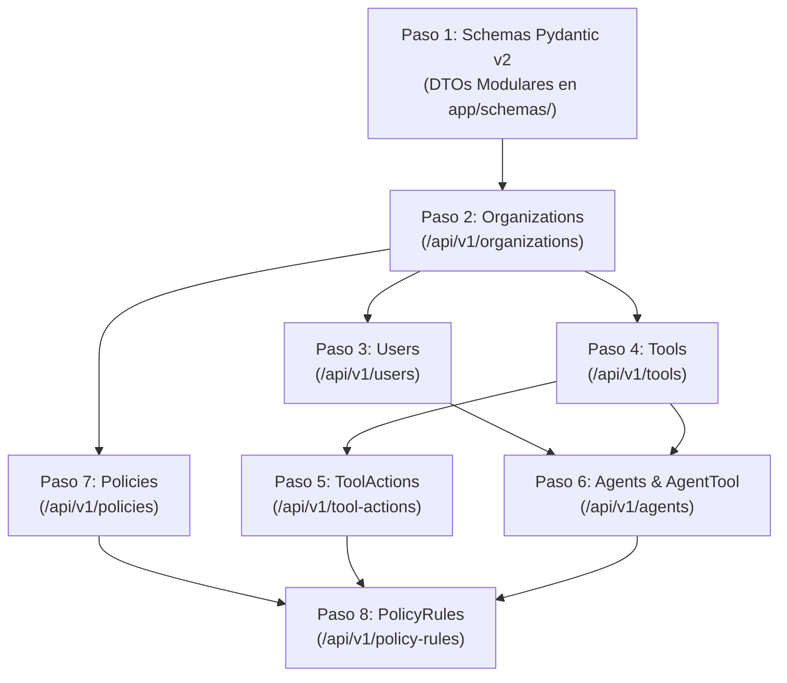

# 📑 Desglose de Pasos: Semana 2 — API REST de Gestión Administrativa

> **Documento de Especificación Técnica y Justificación para la Defensa Académica**  
> **Módulo:** `backend/`  
> **Proyecto:** AgentGuard — Runtime Authorization & Governance for AI Agents  
> **Cátedra:** Desarrollo Web (5to Semestre) — ITU / Universidad Nacional de Cuyo  
> **Autores / Responsables:** Agustín Belardinelli (PO / Lógica Core) & Jonathan Araujo (Arquitectura Backend / Persistencia)  
> **Estado:** Implementado y Testeado (69 tests unitarios/integración — 100% OK)  

---

## 🎯 Objetivo de la Semana 2

Diseñar e implementar la capa de servicios de negocio y endpoints HTTP CRUD para la administración del ciclo de vida de los tenants, identidades de IA, catálogo de herramientas y políticas deterministas.

Al finalizar esta semana, el backend expone los endpoints requeridos en la arquitectura REST de [`backend/README.md`](./README.md) bajo el prefijo `/api/v1`:

1. `/api/v1/organizations` (Tenants raíz)
2. `/api/v1/users` (Usuarios y roles)
3. `/api/v1/tools` (Catálogo de herramientas externas)
4. `/api/v1/tool-actions` (Acciones atómicas con nivel de riesgo tipificado — ruta separada)
5. `/api/v1/agents` (Identidades de IA y asignación N:N en `AgentTool`)
6. `/api/v1/policies` (Contenedores de políticas con prioridad)
7. `/api/v1/policy-rules` (Reglas deterministas con condiciones JSONB y principio Fail-Closed — ruta separada)

---

## 🧭 Diagrama de Flujo de los 8 Pasos Atómicos



---

## 🏗️ Resumen de Capas Implementadas

```text
HTTP Request ──► FastAPI Router (app/api/) ──► Service (app/services/) ──► ORM (app/models/)
                        │                              │
                        ▼                              ▼
                 Schemas Pydantic              SQLAlchemy Session
                 (app/schemas/)              (app/core/database.py)
```

| Capa | Archivos Desarrollados | Responsabilidad Principal |
| :--- | :--- | :--- |
| **Schemas** | `base.py`, `organization.py`, `user.py`, `tool.py`, `tool_action.py`, `agent.py`, `policy.py`, `policy_rule.py`, `__init__.py` | Validación estricta en Rust (Pydantic v2), DTOs de entrada/salida y mapeo ORM con `from_attributes=True`. |
| **Services** | `organization_service.py`, `user_service.py`, `tool_service.py`, `tool_action_service.py`, `agent_service.py`, `policy_service.py`, `policy_rule_service.py` | Lógica de persistencia asíncrona, filtrado estricto por `organization_id` y control de integridad referencial. |
| **Routers** | `organizations.py`, `users.py`, `tools.py`, `tool_actions.py`, `agents.py`, `policies.py`, `policy_rules.py`, `__init__.py` | Enrutamiento REST, inyección de dependencias (`Depends(get_db)`), códigos de estado semánticos (`201`, `200`, `400`, `404`, `409`, `422`). |

---

## 🛡️ Cumplimiento de Reglas Innegociables del Dominio

1. **Principio Fail-Closed (Denegación por Defecto):**
   - El schema `PolicyRuleCreate` y el modelo `PolicyRule` aplican por defecto `effect = RuleEffect.DENY`.
2. **Aislamiento Multi-Tenant Estricto:**
   - Todo alta y consulta de usuarios, agentes, herramientas y políticas valida y filtra por `organization_id`.
   - Se bloquean con `400 Bad Request` intentos de asociar agentes con herramientas de otros tenants o asignar sponsors de distintas organizaciones.
3. **Desacoplamiento N:N Agente ↔ Herramienta (`AgentTool`):**
   - Configuración contextual tipada en `config JSONB` y bandera de activación `enabled`.
4. **Granularidad Fina de Acción (`ToolAction`):**
   - Endpoints independientes `/api/v1/tool-actions` tipificados con `RiskLevel` (`LOW`, `MEDIUM`, `HIGH`, `CRITICAL`).
5. **Calidad y Testing:**
   - 69 pruebas automatizadas con cobertura total de servicios y endpoints.

---

## 📦 Historial de Commits Atómicos (Semana 2)

```text
f29788f feat: implementar gestion de reglas deterministas con condiciones JSONB (/api/v1/policy-rules)
2beb31f feat: implementar CRUD de contenedores de politicas (/api/v1/policies)
d3ff1dc feat: implementar CRUD de agentes y vinculacion AgentTool (/api/v1/agents)
618a30a feat: implementar gestion de acciones atomicas y niveles de riesgo (/api/v1/tool-actions)
bf607c3 feat: implementar CRUD de herramientas (/api/v1/tools)
677d96c feat: implementar CRUD de usuarios con filtro multi-tenant (/api/v1/users)
9bf31d8 feat: implementar CRUD completo de organizaciones (/api/v1/organizations)
1e60fb0 feat: agregar schemas Pydantic v2 para entidades de gestion y sub-recursos
```
