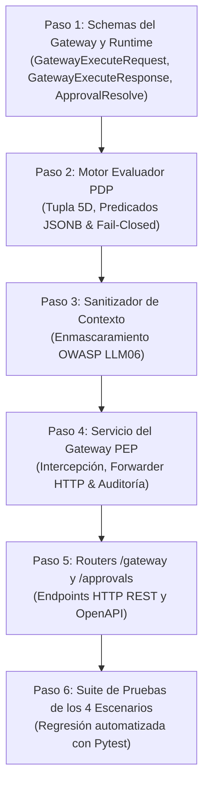

# 📑 Desglose de Pasos: Semana 3 — El Gateway Interceptor (PEP) y el Motor de Políticas (PDP)

> **Documento de Especificación Técnica y Justificación para la Defensa Académica**  
> **Módulo:** `backend/`  
> **Proyecto:** AgentGuard — Runtime Authorization & Governance for AI Agents  
> **Cátedra:** Desarrollo Web (5to Semestre) — ITU / Universidad Nacional de Cuyo  
> **Autores / Responsables:** Jonathan Araujo (Arquitectura Backend & Gateway PEP) & Agustín Belardinelli (PO & Motor PDP)  
> **Estado:** Propuesta de Planificación / Listo para Ejecución  

---

## 🎯 Objetivo de la Semana 3

Construir el núcleo crítico de tiempo de ejecución (*runtime*) de AgentGuard. Al finalizar esta semana, el backend dispondrá del interceptor físico de llamadas a herramientas (**PEP**) y del evaluador determinista de autorización contextual (**PDP**), capaces de resolver y validar de forma automatizada los **4 escenarios clave de la demo ante el profesor**:

1. **Escenario 1 (ALLOW):** Acción legítima dentro de umbrales normales (ej. `create_quote` < $10.000).
2. **Escenario 2 (DENY):** Acción no autorizada / abuso de capacidades bloqueado deterministamente (ej. `update_price`).
3. **Escenario 3 (REQUIRE_APPROVAL):** Acción sensible que suspende ejecución y emite ticket en espera de revisión humana (ej. `refund` >= $500).
4. **Escenario 4 (DENY + ALERT):** Intento de violación o exfiltración anómala que bloquea y dispara una alerta de seguridad (ej. `export_customers`).

---

## 🧭 Diagrama de Flujo de los 6 Pasos Atómicos

---

## 🔬 Desglose Paso a Paso: Qué Hacemos y Por Qué

---

### 📦 PASO 1: Schemas de Runtime y Validación de Entrada (`app/schemas/gateway.py` y `approval.py`)

#### ¿Qué se hace concretamente?
1. Se crea `backend/app/schemas/gateway.py` con:
   * **`GatewayExecuteRequest`**:
     * `organization_id: UUID` (Tenant)
     * `agent_id: UUID` (Identidad del agente)
     * `delegator_user_id: Optional[UUID]` (Usuario delegador, si aplica)
     * `tool_id: UUID` (Herramienta externa destino)
     * `action_name: str` (Acción puntual solicitada, ej. `create_quote`)
     * `parameters: Dict[str, Any]` (Argumentos que el LLM propuso para la herramienta)
     * `resource: Optional[str]` (Recurso afectado, ej. `quotes/QT-991`)
   * **`GatewayExecuteResponse`**:
     * `execution_id: UUID` (Trazabilidad forense inmutable generada)
     * `decision: PolicyDecision` (`ALLOW` | `DENY` | `REQUIRE_APPROVAL`)
     * `status: ExecutionStatus` (`EXECUTED` | `REJECTED` | `PENDING_APPROVAL`)
     * `result: Optional[Dict[str, Any]]` (Respuesta de la API destino en caso de ALLOW)
     * `error_message: Optional[str]` (Razón descriptiva en caso de DENY)
     * `approval_id: Optional[UUID]` (ID de ticket en caso de REQUIRE_APPROVAL)
2. Se crea `backend/app/schemas/approval.py` con:
   * **`ApprovalResolveRequest`**:
     * `decision: ApprovalStatus` (`APPROVED` | `REJECTED`)
     * `resolution_reason: str` (Motivo obligatorio documentado por el humano)
     * `approver_user_id: UUID` (Identidad del operador con rol APPROVER)

#### Justificación para la Cátedra:
* Cumple con la validación estricta en Rust de **Pydantic v2**: ningún payload con tipos inconsistentes o campos faltantes ingresa a la lógica del gateway, emitiendo errores semánticos `422 Unprocessable Entity` de inmediato.

---

### ⚖️ PASO 2: Motor Evaluador de Políticas PDP (`app/services/pdp_engine.py`)

#### ¿Qué se hace concretamente?
1. Se implementa el evaluador determinista de tuplas contextuales de 5 dimensiones:
   $$\text{Decisión} = f(\text{Principal}, \text{Delegator}, \text{Action}, \text{Resource}, \text{Context})$$
2. Se implementa el motor de resolución de predicados lógicos sobre `conditions (JSONB)`:
   * **Operadores numéricos:** `amount_gt`, `amount_gte`, `amount_lt`, `amount_lte`, `amount_eq`.
   * **Operadores de pertenencia y listas:** `allowed_roles`, `allowed_destinations`, `in`, `not_in`.
   * **Operadores de entorno/tiempo:** `allowed_environments`, `time_window`.
3. **Orden de precedencia y Principio Fail-Closed:**
   * Las reglas activas de la organización para la acción solicitada se evalúan por orden de `priority` (menor número = mayor prioridad).
   * **Regla innegociable:** Si hay conflicto, ambigüedad o falta de reglas coincidentes, el motor **SIEMPRE emite `DENY`**. Jamás se autoriza por excepción o por defecto.

#### Justificación para la Cátedra:
* Demuestra el desacoplamiento formal **XACML / RFC 2904**. El LLM es probabilístico y manipulable; el PDP es una función matemática pura, determinista y auditable.

---

### 🛡️ PASO 3: Sanitización y Enmascaramiento de Contexto (`app/services/sanitizer_service.py`)

#### ¿Qué se hace concretamente?
1. Se crea un servicio de sanitización antes de persistir el `request_context` en la tabla `executions`:
   * Detección y enmascaramiento de credenciales y secretos (`api_key`, `secret`, `password`, `token`, `bearer`, `authorization` -> `"***REDACTED***"`).
   * Detección de patrones de tarjetas de crédito (algoritmo regex de tarjeta -> `****-****-****-1234`).
   * Detección de patrones de inyección o URLs no homologadas en campos como `destination` o `payload`.

#### Justificación para la Cátedra:
* Alineación con **OWASP Top 10 for LLM Applications (LLM06 - Sensitive Information Disclosure)**. Si la base de datos de trazas fuera expuesta o consultada por auditores con menor nivel de privilegio, nunca contendrá secretos ni datos de pago en texto plano.

---

### 🚀 PASO 4: Servicio Central del Gateway PEP (`app/services/pep_gateway_service.py`)

#### ¿Qué se hace concretamente?
1. Coordina el flujo completo de autorización e intercepción:
   1. **Validación de Capacidad:** Verifica que el agente pertenezca a la organización, esté en estado `ACTIVE`, y tenga asignada la herramienta en `agent_tools` con `enabled=True`. Si no está asignada, emite `DENY (Agent lacks capability)`.
   2. **Resolución de Acción:** Verifica que la acción exista en `tool_actions` y pertenezca a la herramienta.
   3. **Invocación al PDP:** Obtiene el veredicto contextual.
   4. **Bifurcación del Flujo:**
      * **Si es `ALLOW`:** Despacha la llamada HTTP hacia la API externa con `httpx.AsyncClient` (o simulador de mock para entornos de prueba offline), registra la traza en `executions` (`status=EXECUTED`) y retorna `200 OK`.
      * **Si es `DENY`:** Detiene la llamada en seco. Si el riesgo de la acción es `CRITICAL` o detecta violación de frontera, crea un incidente en `alerts`. Registra en `executions` (`status=REJECTED`) y retorna `403 Forbidden`.
      * **Si es `REQUIRE_APPROVAL`:** Pausa la ejecución, registra la traza en `executions` (`status=PENDING_APPROVAL`), crea el ticket en `approvals` (`status=PENDING`) y retorna `202 Accepted` con el ID de aprobación.
2. Implementa la lógica de **reanudación de aprobaciones:** Cuando un usuario con rol `APPROVER` resuelve en `/api/v1/approvals/{id}/resolve`, si aprueba se dispara la llamada pendiente y se actualizan los registros.

#### Justificación para la Cátedra:
* Es el núcleo del valor de AgentGuard: actuar como un **firewall / reverse proxy inteligente** que protege las APIs empresariales contra alucinaciones o abusos del modelo.

---

### 🌐 PASO 5: Routers del Gateway y Aprobaciones (`app/api/gateway.py` y `app/api/approvals.py`)

#### ¿Qué se hace concretamente?
1. Se expone el endpoint principal:
   * **`POST /api/v1/gateway/execute`**: Punto único de entrada para agentes de IA.
2. Se exponen los endpoints de gestión de intervenciones humanas (HITL):
   * **`GET /api/v1/approvals`**: Lista de solicitudes de aprobación con filtros (`organization_id`, `status=PENDING`).
   * **`GET /api/v1/approvals/{id}`**: Detalle forense de una solicitud puntual.
   * **`POST /api/v1/approvals/{id}/resolve`**: Resolución humana con motivo justificado.
3. Se integran los nuevos routers en `app/main.py` y se documentan automáticamente en `/docs`.

---

### 🧪 PASO 6: Suite de Pruebas de los 4 Escenarios de la Demo (`backend/tests/test_gateway_scenarios.py`)

#### ¿Qué se hace concretamente?
Se implementa una suite exhaustiva en Pytest que valida deterministamente los **4 actos de la demostración**:
1. `test_scenario_1_allow_normal_operation()`: `create_quote` por USD 2.500 retorna `200 OK` y traza `EXECUTED`.
2. `test_scenario_2_deny_privilege_abuse()`: `update_price` por USD 10 retorna `403 Forbidden` y traza `REJECTED`.
3. `test_scenario_3_require_approval_and_resolve()`: `refund` por USD 4.500 retorna `202 Accepted` (`PENDING_APPROVAL`), se resuelve favorablemente y se ejecuta.
4. `test_scenario_4_deny_and_critical_alert()`: `export_customers` a destino no permitido retorna `403 Forbidden`, traza `REJECTED` y crea una `Alert` con severidad `CRITICAL`.

#### Justificación para la Cátedra:
* Garantiza la **política Zero-Regression** exigida en `AGENTS.md`. El día de la presentación en clase, la demo funcionará de manera predecible y blindada.

---

## 📊 Matriz de Entregables de la Semana 3

| Archivo / Módulo | Capa | Responsabilidad |
| :--- | :--- | :--- |
| `app/schemas/gateway.py` | Schemas | DTOs tipados de entrada y salida para el Gateway. |
| `app/schemas/approval.py` | Schemas | DTOs para la resolución humana de aprobaciones. |
| `app/services/pdp_engine.py` | Service (PDP) | Motor de decisión determinista y evaluación de predicados JSONB. |
| `app/services/sanitizer_service.py` | Service (Seguridad) | Sanitización y enmascaramiento de contexto (OWASP LLM06). |
| `app/services/pep_gateway_service.py` | Service (PEP) | Interceptor, despachador HTTP y orquestador de ciclo de vida. |
| `app/api/gateway.py` | Router | Endpoint `POST /api/v1/gateway/execute`. |
| `app/api/approvals.py` | Router | Endpoints `/api/v1/approvals` y `/api/v1/approvals/{id}/resolve`. |
| `tests/test_gateway_scenarios.py` | Testing | Suite automatizada de los 4 escenarios de la demo oficial. |

---

## 📌 Próxima Acción Inmediata
Con la aprobación del equipo, procederemos con el **Paso 1: Schemas de Runtime y Validación de Entrada** (`app/schemas/gateway.py` y `approval.py`).
