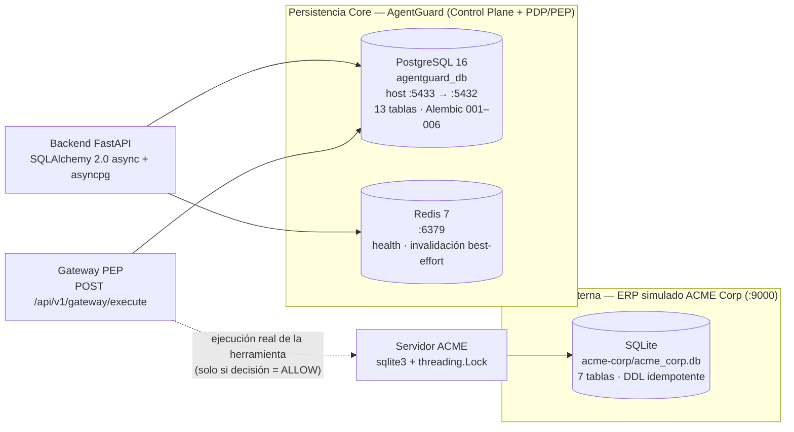
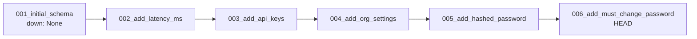
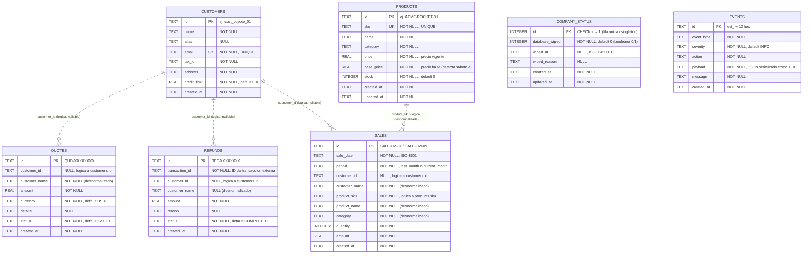

# 🗄️ AgentGuard — MER Relacional y Modelo Físico de Datos (Versión Final Verificada)

> **Cátedra Desarrollo Web — ITU, UNCuyo (2026)** · Proyecto `AgentGuard`
> **Fuente de verdad:** código real de `backend/app/models/*.py`, `backend/alembic/versions/001…006`, `docker-compose.yml` y `acme-corp/server/database.py`. Este documento **reemplaza** a `agentguard_mer_relacional.md`, que estaba desactualizado (12 tablas, 5 migraciones, UUID «generado en Python», sin `api_keys` ni `users.must_change_password`).

---

## 0. Resumen ejecutivo (datos verificados contra el código)

| Dato | Valor real | Evidencia |
|---|---|---|
| Motor core | **PostgreSQL 16** (`postgres:16-alpine`), contenedor `agentguard-postgres` | `docker-compose.yml` |
| Puerto | host **`5433`** → contenedor `5432` | `docker-compose.yml` (`"5433:5432"`) |
| BD / usuario | `agentguard_db` / `agentguard` | `docker-compose.yml` |
| Caché / mensajería | **Redis 7** (`redis:7-alpine`, puerto `6379`, `--appendonly yes`) — verificación en `GET /health` e invalidación best-effort (`policies:{org_id}:*`); `PDPEngine` consulta PostgreSQL directamente y los WebSockets operan en memoria Python | `docker-compose.yml`, `pdp_engine.py`, `policy_rule_service.py`, `websocket_manager.py` |
| Tablas de dominio | **13** (+ `alembic_version` técnica de Alembic) | `backend/app/models/__init__.py` (13 clases mapeadas) |
| Migraciones Alembic | **6** (`001` → `006`) en cadena lineal, un único *head* | `backend/alembic/versions/` |
| PKs | `UUID v4` generado **nativamente por PostgreSQL**: `server_default=text("gen_random_uuid()")` | todos los modelos y migraciones |
| Tipos `ENUM` nativos | **10** (`CREATE TYPE … AS ENUM`) | `001_initial_schema.py` |
| Columnas `JSONB` | **5** (`organizations.settings`, `agent_tools.config`, `policy_rules.conditions`, `executions.request_context`, `audit_events.metadata`) | modelos |
| Índices GIN | **4** (`agent_tools.config`, `policy_rules.conditions`, `executions.request_context`, `audit_events.metadata`) | `001_initial_schema.py` |
| Aislamiento multi-tenant | **Lógico en capa de aplicación** por `organization_id` (**sin RLS nativo** de PostgreSQL) | modelos + servicios |
| BD externa ACME | **SQLite** `acme-corp/acme_corp.db`, **7 tablas** de dominio | `acme-corp/server/database.py` |

> [!NOTE]
> Cuentas oficiales de este documento: **5 columnas JSONB, 4 con índice GIN** (`organizations.settings` **no** tiene GIN: se lee siempre completa por `id` de organización).

---

## 1. Arquitectura de doble persistencia

El repositorio contiene **dos persistencias independientes** con propósitos distintos. No comparten esquema, motor ni ciclo de migración.



### 1.1 Persistencia Core AgentGuard (PostgreSQL 16)

- **Driver:** `asyncpg` vía SQLAlchemy 2.0 async (`create_async_engine`, `pool_size=10`, `max_overflow=20`, `pool_pre_ping=True`) — `backend/app/core/database.py`.
- **Migraciones:** Alembic (`backend/alembic.ini`), revisiones numeradas manualmente (`001_…` a `006_…`).
- **PKs `UUID v4` generadas por el motor:** cada PK se declara con
  `UUID(as_uuid=True), primary_key=True, server_default=text("gen_random_uuid()")`.
  La generación ocurre **dentro de PostgreSQL** (función `gen_random_uuid()`, nativa desde PostgreSQL 13, sin extensión `pgcrypto`). La aplicación **no** genera el UUID en Python → el valor existe recién tras el `INSERT … RETURNING` / `flush()`.
  *(Esto corrige la afirmación antigua «UUID generado en Python».)*
- **`JSONB` + GIN:** campos semiestructurados (`config`, `conditions`, `request_context`, `metadata`, `settings`) con 4 índices GIN para consultas de contención (`@>`, `?`).
- **Aislamiento multi-tenant (Anti-IDOR):** discriminador `organization_id` filtrado **siempre en la capa de servicios/repositorios**. **No se usa Row-Level Security (RLS) de PostgreSQL.** Consecuencia de diseño: el aislamiento depende de la disciplina del código (cada consulta incluye `WHERE organization_id = :org`), por lo que se verifica con la suite de tests del backend (`backend/tests/`: `test_organizations.py`, `test_rbac_matrix.py`, `test_agents.py`, etc.).
- **Tablas sin columna `organization_id` propia** (heredan el tenant por su padre): `agent_tools` (vía `agents`/`tools`), `tool_actions` (vía `tools`), `policy_rules` (vía `policies`), `approvals` (vía `executions`). Las 8 tablas restantes con tenant directo: `users`, `agents`, `tools`, `policies`, `executions`, `alerts`, `audit_events`, `api_keys`; y `organizations` es la raíz del tenant (su `id` **es** el `organization_id`).
- **Trazabilidad forense inmutable:** `executions` (con `latency_ms` real medido) y `audit_events` solo se insertan; no se alteran ni borran trazas (regla de dominio, no un trigger de BD).

### 1.2 Persistencia Externa ACME Corp (SQLite)

Base **local y didáctica** del ERP simulado ACME Corporation (universo Looney Tunes). Es el *recurso protegido*: el agente de IA intenta operar sobre ella y AgentGuard decide `ALLOW`/`DENY`/`REQUIRE_APPROVAL`. Se detalla en la **§6**.

---

## 2. Diagrama MER físico completo — PostgreSQL (13 tablas)

> Notación Mermaid `erDiagram`. `PK` clave primaria, `FK` clave foránea, `UK` única. Los tipos `VARCHAR_n` equivalen a `VARCHAR(n)`; `FLOAT` a `double precision`. La política `ON DELETE` de cada FK se detalla en la §3.2 y en los comentarios de cada columna.

```mermaid
erDiagram
    ORGANIZATIONS ||--o{ USERS : "tiene"
    ORGANIZATIONS ||--o{ AGENTS : "gobierna"
    ORGANIZATIONS ||--o{ TOOLS : "registra"
    ORGANIZATIONS ||--o{ POLICIES : "define"
    ORGANIZATIONS ||--o{ EXECUTIONS : "traza"
    ORGANIZATIONS ||--o{ ALERTS : "recibe"
    ORGANIZATIONS ||--o{ AUDIT_EVENTS : "audita"
    ORGANIZATIONS ||--o{ API_KEYS : "emite"
    USERS ||--o{ AGENTS : "patrocina (owner_user_id)"
    AGENTS ||--o{ AGENT_TOOLS : "se vincula"
    TOOLS ||--o{ AGENT_TOOLS : "se asigna"
    TOOLS ||--o{ TOOL_ACTIONS : "expone"
    POLICIES ||--o{ POLICY_RULES : "contiene"
    TOOL_ACTIONS ||--o{ POLICY_RULES : "es regulada por"
    AGENTS |o--o{ POLICY_RULES : "apunta (target_agent_id)"
    AGENTS ||--o{ EXECUTIONS : "ejecuta"
    USERS |o--o{ EXECUTIONS : "delega (delegator_user_id)"
    TOOLS ||--o{ EXECUTIONS : "es invocada"
    TOOL_ACTIONS ||--o{ EXECUTIONS : "se invoca"
    POLICY_RULES |o--o{ EXECUTIONS : "decide (evaluated_policy_rule_id)"
    EXECUTIONS ||--o| APPROVALS : "suspende (1 a 0..1)"
    USERS |o--o{ APPROVALS : "resuelve (assigned_approver_id)"
    EXECUTIONS |o--o{ ALERTS : "origina (execution_id)"
    USERS |o--o{ ALERTS : "resuelve (resolved_by_user_id)"

    ORGANIZATIONS {
        uuid id PK "server_default gen_random_uuid()"
        varchar_255 name "NOT NULL"
        timestamptz created_at "NOT NULL, default now()"
        jsonb settings "NOT NULL, default '{}' (migracion 004)"
    }

    USERS {
        uuid id PK "gen_random_uuid()"
        uuid organization_id FK "NOT NULL, organizations.id ON DELETE CASCADE"
        varchar_255 email UK "NOT NULL, UNIQUE global, indexado"
        varchar_255 hashed_password "NULL, hash bcrypt (migracion 005)"
        boolean must_change_password "NOT NULL, default false (migracion 006)"
        user_role_enum role "NOT NULL, default OPERATOR"
        timestamptz created_at "NOT NULL, default now()"
    }

    AGENTS {
        uuid id PK "gen_random_uuid()"
        uuid organization_id FK "NOT NULL, organizations.id ON DELETE CASCADE"
        uuid owner_user_id FK "NOT NULL, users.id ON DELETE RESTRICT"
        varchar_255 name "NOT NULL"
        text purpose "NULL"
        agent_status_enum status "NOT NULL, default ACTIVE"
        timestamptz created_at "NOT NULL, default now()"
    }

    TOOLS {
        uuid id PK "gen_random_uuid()"
        uuid organization_id FK "NOT NULL, organizations.id ON DELETE CASCADE"
        varchar_255 name "NOT NULL"
        varchar_50 protocol "NOT NULL, default REST"
        varchar_1024 endpoint_url "NOT NULL"
        text description "NULL"
        timestamptz created_at "NOT NULL, default now()"
    }

    AGENT_TOOLS {
        uuid id PK "gen_random_uuid()"
        uuid agent_id FK "NOT NULL, agents.id ON DELETE CASCADE"
        uuid tool_id FK "NOT NULL, tools.id ON DELETE CASCADE"
        boolean enabled "NOT NULL, default true"
        jsonb config "NOT NULL, default '{}', indice GIN"
        timestamptz created_at "NOT NULL, default now()"
    }

    TOOL_ACTIONS {
        uuid id PK "gen_random_uuid()"
        uuid tool_id FK "NOT NULL, tools.id ON DELETE CASCADE"
        varchar_255 action_name "NOT NULL, UNIQUE con tool_id"
        risk_level_enum risk_level "NOT NULL, default LOW"
        text description "NULL"
        timestamptz created_at "NOT NULL, default now()"
    }

    POLICIES {
        uuid id PK "gen_random_uuid()"
        uuid organization_id FK "NOT NULL, organizations.id ON DELETE CASCADE"
        varchar_255 name "NOT NULL"
        text description "NULL"
        integer priority "NOT NULL, default 100"
        boolean is_active "NOT NULL, default true"
        timestamptz created_at "NOT NULL, default now()"
    }

    POLICY_RULES {
        uuid id PK "gen_random_uuid()"
        uuid policy_id FK "NOT NULL, policies.id ON DELETE CASCADE"
        integer priority "NOT NULL, default 100"
        rule_effect_enum effect "NOT NULL, default DENY"
        uuid tool_action_id FK "NOT NULL, tool_actions.id ON DELETE RESTRICT"
        uuid target_agent_id FK "NULL, agents.id ON DELETE CASCADE (NULL = regla global)"
        jsonb conditions "NOT NULL, default '{}', indice GIN"
        timestamptz created_at "NOT NULL, default now()"
    }

    EXECUTIONS {
        uuid id PK "gen_random_uuid()"
        uuid organization_id FK "NOT NULL, organizations.id ON DELETE CASCADE"
        uuid agent_id FK "NOT NULL, agents.id ON DELETE RESTRICT"
        uuid delegator_user_id FK "NULL, users.id ON DELETE SET NULL"
        uuid tool_id FK "NOT NULL, tools.id ON DELETE RESTRICT"
        uuid tool_action_id FK "NOT NULL, tool_actions.id ON DELETE RESTRICT"
        varchar_255 resource "NULL"
        jsonb request_context "NOT NULL, default '{}', sanitizado, indice GIN"
        policy_decision_enum decision "NOT NULL"
        execution_status_enum status "NOT NULL, default EXECUTED"
        uuid evaluated_policy_rule_id FK "NULL, policy_rules.id ON DELETE SET NULL"
        timestamptz timestamp "NOT NULL, default now(), indexado"
        float latency_ms "NULL, double precision medido (migracion 002)"
    }

    APPROVALS {
        uuid id PK "gen_random_uuid()"
        uuid execution_id FK "NOT NULL, UNIQUE, executions.id ON DELETE CASCADE"
        uuid assigned_approver_id FK "NULL, users.id ON DELETE SET NULL"
        approval_status_enum status "NOT NULL, default PENDING, indexado"
        text resolution_reason "NULL"
        timestamptz resolved_at "NULL"
        timestamptz created_at "NOT NULL, default now()"
    }

    ALERTS {
        uuid id PK "gen_random_uuid()"
        uuid organization_id FK "NOT NULL, organizations.id ON DELETE CASCADE"
        uuid execution_id FK "NULL, executions.id ON DELETE SET NULL"
        varchar_255 title "NOT NULL, default Incidente de Seguridad"
        text description "NULL"
        alert_severity_enum severity "NOT NULL, default MEDIUM"
        alert_status_enum status "NOT NULL, default OPEN, indexado"
        uuid resolved_by_user_id FK "NULL, users.id ON DELETE SET NULL"
        timestamptz created_at "NOT NULL, default now()"
    }

    AUDIT_EVENTS {
        uuid id PK "gen_random_uuid()"
        uuid organization_id FK "NOT NULL, organizations.id ON DELETE CASCADE"
        actor_type_enum actor_type "NOT NULL"
        uuid actor_id "NOT NULL, polimorfico SIN FK (usuario/agente/sistema), indexado"
        varchar_255 event_type "NOT NULL, indexado"
        jsonb metadata "NOT NULL, default '{}', indice GIN (atributo ORM event_metadata)"
        timestamptz timestamp "NOT NULL, default now(), indexado"
    }

    API_KEYS {
        uuid id PK "gen_random_uuid()"
        uuid organization_id FK "NOT NULL, organizations.id ON DELETE CASCADE"
        varchar_100 name "NOT NULL"
        varchar_12 key_prefix "NOT NULL, indexado"
        varchar_255 hashed_key "NOT NULL, hash criptografico (nunca la llave en claro)"
        timestamptz created_at "NOT NULL, default now()"
        timestamptz expires_at "NULL"
        boolean is_active "NOT NULL, default true"
    }
```



> [!IMPORTANT]
> **Tres puntos finos de cardinalidad física** (frecuentes en defensa):
> 1. `approvals.execution_id` es **UNIQUE** → una ejecución tiene **0 ó 1** aprobación (`||--o|`).
> 2. `alerts.execution_id` es **nullable y NO único** en la BD → físicamente una ejecución podría tener varias alertas; el ORM la modela como `uselist=False` (1 alerta por ejecución en la práctica del PEP), y es nullable porque el FK usa `ON DELETE SET NULL` (la alerta sobrevive como evidencia SIEM).
> 3. `audit_events.actor_id` **no es FK**: es un identificador polimórfico (`actor_type` ∈ `USER|AGENT|SYSTEM`) y debe sobrevivir al borrado del actor.

---

## 3. Diccionario físico tabla por tabla

### 3.1 Enumeraciones nativas PostgreSQL (10 tipos — `backend/app/models/enums.py`)

Los Python `StrEnum` se mapean con `SQLEnum(..., native_enum=True)` a `CREATE TYPE … AS ENUM`. Los valores internos permanecen **en inglés mayúsculas** (compatibles con OpenAPI); la UI los traduce a español con `frontend/src/constants/labels.ts`.

| Tipo PostgreSQL | Clase Python | Valores (orden real) | Usado en |
|---|---|---|---|
| `user_role_enum` | `UserRole` | `ADMIN`, `OPERATOR`, `APPROVER`, `AUDITOR`, `VIEWER` | `users.role` (default `OPERATOR`) |
| `agent_status_enum` | `AgentStatus` | `ACTIVE`, `SUSPENDED`, `REVOKED` | `agents.status` (default `ACTIVE`) |
| `risk_level_enum` | `RiskLevel` | `LOW`, `MEDIUM`, `HIGH`, `CRITICAL` | `tool_actions.risk_level` (default `LOW`) |
| `rule_effect_enum` | `RuleEffect` | `ALLOW`, `DENY`, `REQUIRE_APPROVAL` | `policy_rules.effect` (default `DENY` → *fail-closed*) |
| `policy_decision_enum` | `PolicyDecision` | `ALLOW`, `DENY`, `REQUIRE_APPROVAL` | `executions.decision` (sin default) |
| `execution_status_enum` | `ExecutionStatus` | `PENDING_APPROVAL`, `REJECTED`, `EXECUTED` | `executions.status` (default `EXECUTED`) |
| `approval_status_enum` | `ApprovalStatus` | `PENDING`, `APPROVED`, `REJECTED`, `EXPIRED` | `approvals.status` (default `PENDING`) |
| `alert_severity_enum` | `AlertSeverity` | `LOW`, `MEDIUM`, `HIGH`, `CRITICAL` | `alerts.severity` (default `MEDIUM`) |
| `alert_status_enum` | `AlertStatus` | `OPEN`, `INVESTIGATING`, `RESOLVED`, `DISMISSED` | `alerts.status` (default `OPEN`) |
| `actor_type_enum` | `ActorType` | `USER`, `AGENT`, `SYSTEM` | `audit_events.actor_type` |

> `rule_effect_enum` y `policy_decision_enum` tienen los mismos valores pero son tipos **distintos** a propósito: uno es la *intención* de una regla; el otro, la *decisión emitida*. Idem `risk_level_enum` (riesgo de la acción) vs `alert_severity_enum` (gravedad del incidente).
> Roles con permiso para resolver aprobaciones HITL: `APPROVER` **o** `ADMIN` (`pep_gateway_service.py`, resolución de aprobaciones).

### 3.2 Tablas

Convención de columnas: **Nulo** = admite `NULL`; **Default (BD)** = `server_default` físico creado por la migración.

#### 3.2.1 `organizations` — raíz del tenant

| Columna | Tipo | Nulo | Default (BD) | Restricciones / Notas |
|---|---|---|---|---|
| `id` | `UUID` | NO | `gen_random_uuid()` | **PK** |
| `name` | `VARCHAR(255)` | NO | — | Nombre de la organización |
| `created_at` | `TIMESTAMPTZ` | NO | `now()` | UTC |
| `settings` | `JSONB` | NO | `'{}'::jsonb` | Postura de seguridad del tenant (migración 004). Claves por defecto en `organization_service.DEFAULT_ORGANIZATION_SETTINGS`: `fail_closed`, `mask_sensitive`, `max_autonomous_amount` (5000.0), `retention_days` (90), `siem_format`, `siem_webhook_url`, `siem_webhook_enabled`, `siem_webhook_secret`, `siem_webhook_events` |

Índices: PK. Sin GIN.

#### 3.2.2 `users`

| Columna | Tipo | Nulo | Default (BD) | Restricciones / Notas |
|---|---|---|---|---|
| `id` | `UUID` | NO | `gen_random_uuid()` | **PK** |
| `organization_id` | `UUID` | NO | — | **FK** → `organizations.id` `ON DELETE CASCADE` |
| `email` | `VARCHAR(255)` | NO | — | **UNIQUE** global |
| `hashed_password` | `VARCHAR(255)` | **SÍ** | — | Hash **bcrypt** (`passlib`/`bcrypt`, nunca texto plano); nullable porque pueden existir usuarios sin credencial local (migración 005) |
| `must_change_password` | `BOOLEAN` | NO | `false` | **Fuerza el cambio de contraseña en el primer login** (`POST /api/v1/auth/change-password`, modal `ForcePasswordChangeModal`) — migración 006 |
| `role` | `user_role_enum` | NO | `'OPERATOR'` | RBAC humano |
| `created_at` | `TIMESTAMPTZ` | NO | `now()` | UTC |

Índices: `ix_users_organization_id`, `ix_users_email` (+ UNIQUE sobre `email`).

#### 3.2.3 `agents`

| Columna | Tipo | Nulo | Default (BD) | Restricciones / Notas |
|---|---|---|---|---|
| `id` | `UUID` | NO | `gen_random_uuid()` | **PK** |
| `organization_id` | `UUID` | NO | — | **FK** → `organizations.id` `CASCADE` |
| `owner_user_id` | `UUID` | NO | — | **FK** → `users.id` **`RESTRICT`** (no se puede borrar un usuario que patrocina agentes) |
| `name` | `VARCHAR(255)` | NO | — | |
| `purpose` | `TEXT` | SÍ | — | Propósito declarado |
| `status` | `agent_status_enum` | NO | `'ACTIVE'` | `ACTIVE`/`SUSPENDED`/`REVOKED` |
| `created_at` | `TIMESTAMPTZ` | NO | `now()` | |

Índices: `ix_agents_organization_id`, `ix_agents_owner_user_id`.

#### 3.2.4 `tools`

| Columna | Tipo | Nulo | Default (BD) | Restricciones / Notas |
|---|---|---|---|---|
| `id` | `UUID` | NO | `gen_random_uuid()` | **PK** |
| `organization_id` | `UUID` | NO | — | **FK** → `organizations.id` `CASCADE` |
| `name` | `VARCHAR(255)` | NO | — | |
| `protocol` | `VARCHAR(50)` | NO | `'REST'` | |
| `endpoint_url` | `VARCHAR(1024)` | NO | — | |
| `description` | `TEXT` | SÍ | — | |
| `created_at` | `TIMESTAMPTZ` | NO | `now()` | |

Índices: `ix_tools_organization_id`.

#### 3.2.5 `agent_tools` — asociativa N:N Agente ↔ Herramienta

| Columna | Tipo | Nulo | Default (BD) | Restricciones / Notas |
|---|---|---|---|---|
| `id` | `UUID` | NO | `gen_random_uuid()` | **PK** |
| `agent_id` | `UUID` | NO | — | **FK** → `agents.id` `CASCADE` |
| `tool_id` | `UUID` | NO | — | **FK** → `tools.id` `CASCADE` |
| `enabled` | `BOOLEAN` | NO | `true` | Interruptor de autorización (vínculo activo/inactivo) |
| `config` | `JSONB` | NO | `'{}'::jsonb` | Configuración contextual del vínculo |
| `created_at` | `TIMESTAMPTZ` | NO | `now()` | |

Restricción: `UNIQUE (agent_id, tool_id)` = **`uq_agent_tool_pair`**. Índices: `ix_agent_tools_agent_id`, `ix_agent_tools_tool_id`, **`idx_agent_tools_config_gin`** (GIN).
*Tiene PK propia (`id`) además del par único: es una **entidad asociativa con atributos** (`enabled`, `config`), no una simple tabla puente.*

#### 3.2.6 `tool_actions`

| Columna | Tipo | Nulo | Default (BD) | Restricciones / Notas |
|---|---|---|---|---|
| `id` | `UUID` | NO | `gen_random_uuid()` | **PK** |
| `tool_id` | `UUID` | NO | — | **FK** → `tools.id` `CASCADE` |
| `action_name` | `VARCHAR(255)` | NO | — | Acción atómica (`create_quote`, `update_price`, `refund`, `export_customers`, `query_sales`, `delete_sales`…) |
| `risk_level` | `risk_level_enum` | NO | `'LOW'` | `LOW`/`MEDIUM`/`HIGH`/`CRITICAL` |
| `description` | `TEXT` | SÍ | — | |
| `created_at` | `TIMESTAMPTZ` | NO | `now()` | |

Restricción: `UNIQUE (tool_id, action_name)` = **`uq_tool_action_name`**. Índice: `ix_tool_actions_tool_id`.

#### 3.2.7 `policies`

| Columna | Tipo | Nulo | Default (BD) | Restricciones / Notas |
|---|---|---|---|---|
| `id` | `UUID` | NO | `gen_random_uuid()` | **PK** |
| `organization_id` | `UUID` | NO | — | **FK** → `organizations.id` `CASCADE` |
| `name` | `VARCHAR(255)` | NO | — | |
| `description` | `TEXT` | SÍ | — | |
| `priority` | `INTEGER` | NO | `100` | |
| `is_active` | `BOOLEAN` | NO | `true` | |
| `created_at` | `TIMESTAMPTZ` | NO | `now()` | |

Índices: `ix_policies_organization_id`.

#### 3.2.8 `policy_rules`

| Columna | Tipo | Nulo | Default (BD) | Restricciones / Notas |
|---|---|---|---|---|
| `id` | `UUID` | NO | `gen_random_uuid()` | **PK** |
| `policy_id` | `UUID` | NO | — | **FK** → `policies.id` `CASCADE` |
| `priority` | `INTEGER` | NO | `100` | Orden de evaluación; empate de prioridades ⇒ `DENY` (fail-closed) |
| `effect` | `rule_effect_enum` | NO | `'DENY'` | |
| `tool_action_id` | `UUID` | NO | — | **FK** → `tool_actions.id` **`RESTRICT`** |
| `target_agent_id` | `UUID` | **SÍ** | — | **FK** → `agents.id` `CASCADE`; `NULL` = regla global / multi-agente |
| `conditions` | `JSONB` | NO | `'{}'::jsonb` | Predicados del PDP (p. ej. `amount`, `destination`) |
| `created_at` | `TIMESTAMPTZ` | NO | `now()` | |

Índices: `ix_policy_rules_policy_id`, `ix_policy_rules_tool_action_id`, `ix_policy_rules_target_agent_id`, **`idx_policy_rules_conditions_gin`** (GIN).

#### 3.2.9 `executions` — trazas forenses del PEP

| Columna | Tipo | Nulo | Default (BD) | Restricciones / Notas |
|---|---|---|---|---|
| `id` | `UUID` | NO | `gen_random_uuid()` | **PK** |
| `organization_id` | `UUID` | NO | — | **FK** → `organizations.id` `CASCADE` |
| `agent_id` | `UUID` | NO | — | **FK** → `agents.id` **`RESTRICT`** (no se borra un agente con trazas) |
| `delegator_user_id` | `UUID` | SÍ | — | **FK** → `users.id` `SET NULL` |
| `tool_id` | `UUID` | NO | — | **FK** → `tools.id` **`RESTRICT`** |
| `tool_action_id` | `UUID` | NO | — | **FK** → `tool_actions.id` **`RESTRICT`** |
| `resource` | `VARCHAR(255)` | SÍ | — | Recurso afectado |
| `request_context` | `JSONB` | NO | `'{}'::jsonb` | Parámetros de la llamada **ya sanitizados** (enmascara tokens/PII, OWASP LLM06) cuando `mask_sensitive=true` |
| `decision` | `policy_decision_enum` | NO | — | Sin default: la decisión es siempre explícita |
| `status` | `execution_status_enum` | NO | `'EXECUTED'` | |
| `evaluated_policy_rule_id` | `UUID` | SÍ | — | **FK** → `policy_rules.id` `SET NULL` (regla que decidió; `NULL` si fue *fail-closed* por falta de coincidencia) |
| `timestamp` | `TIMESTAMPTZ` | NO | `now()` | Momento de la decisión (UTC) |
| `latency_ms` | `DOUBLE PRECISION` (`Float`) | SÍ | — | **Latencia real medida** del PEP/PDP (migración 002); nunca hardcodeada |

Índices: `ix_executions_organization_id`, `ix_executions_agent_id`, `ix_executions_delegator_user_id`, `ix_executions_tool_id`, `ix_executions_tool_action_id`, `ix_executions_timestamp`, **`idx_executions_org_timestamp`** (compuesto `organization_id, timestamp`), **`idx_executions_request_context_gin`** (GIN).

#### 3.2.10 `approvals` — bandeja HITL

| Columna | Tipo | Nulo | Default (BD) | Restricciones / Notas |
|---|---|---|---|---|
| `id` | `UUID` | NO | `gen_random_uuid()` | **PK** |
| `execution_id` | `UUID` | NO | — | **FK** → `executions.id` `CASCADE`, **UNIQUE** (1 ejecución ⇒ máx. 1 aprobación) |
| `assigned_approver_id` | `UUID` | SÍ | — | **FK** → `users.id` `SET NULL` |
| `status` | `approval_status_enum` | NO | `'PENDING'` | |
| `resolution_reason` | `TEXT` | SÍ | — | |
| `resolved_at` | `TIMESTAMPTZ` | SÍ | — | |
| `created_at` | `TIMESTAMPTZ` | NO | `now()` | Base del TTL |

Índices: `ix_approvals_execution_id`, `ix_approvals_assigned_approver_id`, `ix_approvals_status`.
> **No existe columna `expires_at`.** La expiración es **calculada**: al resolver, si `now − created_at > 900 s` (TTL de **15 minutos**), el servicio pasa la aprobación a `EXPIRED` y la ejecución a `REJECTED` (fail-closed).

#### 3.2.11 `alerts`

| Columna | Tipo | Nulo | Default (BD) | Restricciones / Notas |
|---|---|---|---|---|
| `id` | `UUID` | NO | `gen_random_uuid()` | **PK** |
| `organization_id` | `UUID` | NO | — | **FK** → `organizations.id` `CASCADE` |
| `execution_id` | `UUID` | SÍ | — | **FK** → `executions.id` `SET NULL` (la alerta es evidencia SIEM con ciclo de vida propio) |
| `title` | `VARCHAR(255)` | NO | `'Incidente de Seguridad'` | |
| `description` | `TEXT` | SÍ | — | |
| `severity` | `alert_severity_enum` | NO | `'MEDIUM'` | |
| `status` | `alert_status_enum` | NO | `'OPEN'` | |
| `resolved_by_user_id` | `UUID` | SÍ | — | **FK** → `users.id` `SET NULL` |
| `created_at` | `TIMESTAMPTZ` | NO | `now()` | |

Índices: `ix_alerts_organization_id`, `ix_alerts_execution_id`, `ix_alerts_status`.

#### 3.2.12 `audit_events` — log administrativo inmutable

| Columna | Tipo | Nulo | Default (BD) | Restricciones / Notas |
|---|---|---|---|---|
| `id` | `UUID` | NO | `gen_random_uuid()` | **PK** |
| `organization_id` | `UUID` | NO | — | **FK** → `organizations.id` `CASCADE` |
| `actor_type` | `actor_type_enum` | NO | — | `USER`/`AGENT`/`SYSTEM` |
| `actor_id` | `UUID` | NO | — | **Sin FK** (referencia polimórfica) |
| `event_type` | `VARCHAR(255)` | NO | — | |
| `metadata` | `JSONB` | NO | `'{}'::jsonb` | Columna física `metadata`; atributo ORM `event_metadata` (evita colisión con `Base.metadata`) |
| `timestamp` | `TIMESTAMPTZ` | NO | `now()` | |

Índices: `ix_audit_events_organization_id`, `ix_audit_events_actor_id`, `ix_audit_events_event_type`, `ix_audit_events_timestamp`, **`idx_audit_events_org_timestamp`** (compuesto), **`idx_audit_events_metadata_gin`** (GIN).

#### 3.2.13 `api_keys` — credenciales del Gateway (migración 003)

| Columna | Tipo | Nulo | Default (BD) | Restricciones / Notas |
|---|---|---|---|---|
| `id` | `UUID` | NO | `gen_random_uuid()` | **PK** |
| `organization_id` | `UUID` | NO | — | **FK** → `organizations.id` `CASCADE` |
| `name` | `VARCHAR(100)` | NO | — | Etiqueta humana de la llave |
| `key_prefix` | `VARCHAR(12)` | NO | — | Prefijo visible para localizar la llave sin exponerla |
| `hashed_key` | `VARCHAR(255)` | NO | — | **Hash SHA-256 (hex, 64 car.)** de la llave (`api_key_service._hash_key`); la llave en claro (`ag_live_` + `token_urlsafe(32)`) se muestra una sola vez al crearla y no se persiste |
| `created_at` | `TIMESTAMPTZ` | NO | `now()` | |
| `expires_at` | `TIMESTAMPTZ` | SÍ | — | Expiración opcional |
| `is_active` | `BOOLEAN` | NO | `true` | Revocación lógica |

Índices: `ix_api_keys_organization_id`, `ix_api_keys_key_prefix`.

### 3.3 Inventario de integridad referencial (resumen de `ON DELETE`)

| Política | FKs |
|---|---|
| **`CASCADE`** | `*.organization_id → organizations` (8 tablas); `agent_tools.agent_id`; `agent_tools.tool_id`; `tool_actions.tool_id`; `policy_rules.policy_id`; `policy_rules.target_agent_id`; `approvals.execution_id` |
| **`RESTRICT`** | `agents.owner_user_id`; `policy_rules.tool_action_id`; `executions.agent_id`; `executions.tool_id`; `executions.tool_action_id` |
| **`SET NULL`** | `executions.delegator_user_id`; `executions.evaluated_policy_rule_id`; `approvals.assigned_approver_id`; `alerts.execution_id`; `alerts.resolved_by_user_id` |

Total: **24 claves foráneas** (8 de tenant `organization_id` + 16 funcionales): 14 `CASCADE`, 5 `RESTRICT`, 5 `SET NULL`.

### 3.4 Desvíos modelo ORM ↔ migración (hallazgos de auditoría)

Verificados por lectura de código (el esquema vivo lo gobierna **Alembic**, no `create_all`):

| # | Hallazgo | Impacto |
|---|---|---|
| 1 | Los modelos declaran `index=True` en `executions.evaluated_policy_rule_id` y `alerts.resolved_by_user_id`, pero **ninguna migración crea** esos dos índices. | Menor: no hay índice en esas FK nullable; `alembic revision --autogenerate` los detectaría como pendientes. |
| 2 | `users.email`: el modelo declara `unique=True, index=True` (un único índice UNIQUE `ix_users_email`); la migración 001 crea `UNIQUE` **más** un índice no único `ix_users_email`. | Cosmético: la unicidad se cumple igual. |
| 3 | `approvals.execution_id`: el modelo nombra `uq_approval_execution`; la migración usa `unique=True` inline (nombre autogenerado por PostgreSQL). | Cosmético (nombre del constraint). |
| 4 | Los `created_at` tienen `server_default=now()` en las migraciones, pero los modelos solo definen `default=` en Python (`datetime.now(timezone.utc)`). | Un `INSERT` SQL manual (fuera del ORM) igualmente obtiene fecha por el default de la BD. |
| 5 | El `comment=` de `executions.latency_ms` existe en el modelo pero la migración 002 no lo crea. | Solo documentación de catálogo. |
| 6 | El docstring de `001_initial_schema.py` y `backend/app/models/__init__.py` aún dicen «12 tablas»; la cifra real es **13** (la 13ª, `api_keys`, entra con la migración 003). | Documental. |

---

## 4. Historial completo de migraciones Alembic (`001` → `006`)

Cadena **lineal** verificada (`revision` / `down_revision` leídos de cada archivo). Un único *head*: `006_add_must_change_password`.



| # | Archivo | `revision` | `down_revision` | Fecha (Create Date) | Cambio de esquema | Tablas tras la migración |
|---|---|---|---|---|---|---|
| 001 | `001_initial_schema.py` | `001_initial_schema` | `None` (raíz) | 2026-10-11 | Crea los **10 tipos ENUM** nativos y **12 tablas**: `organizations`, `users`, `agents`, `tools`, `agent_tools`, `tool_actions`, `policies`, `policy_rules`, `executions`, `approvals`, `alerts`, `audit_events`; 4 índices GIN y 2 compuestos `(organization_id, timestamp)`. `downgrade()` borra las 12 tablas y los 10 enums. | 12 |
| 002 | `002_add_latency_ms_to_executions.py` | `002_add_latency_ms` | `001_initial_schema` | 2026-11-02 | `ADD COLUMN executions.latency_ms FLOAT NULL` (telemetría forense real). | 12 |
| 003 | `003_add_api_keys.py` | `003_add_api_keys` | `002_add_latency_ms` | 2026-11-02 | `CREATE TABLE api_keys` (+ `ix_api_keys_organization_id`, `ix_api_keys_key_prefix`). | **13** |
| 004 | `004_add_organization_settings.py` | `004_add_org_settings` | `003_add_api_keys` | 2026-11-02 | `ADD COLUMN organizations.settings JSONB NOT NULL DEFAULT '{}'`. | 13 |
| 005 | `005_add_hashed_password_to_users.py` | `005_add_hashed_password` | `004_add_org_settings` | 2026-11-03 | `ADD COLUMN users.hashed_password VARCHAR(255) NULL`. | 13 |
| 006 | `006_add_must_change_password_to_users.py` | `006_add_must_change_password` | `005_add_hashed_password` | 2026-11-16 | `ADD COLUMN users.must_change_password BOOLEAN NOT NULL DEFAULT false`. | 13 |

> [!NOTE]
> Los **nombres de archivo** no coinciden siempre con el `revision` id (p. ej. archivo `002_add_latency_ms_to_executions.py` ⇒ `revision = "002_add_latency_ms"`). Para `alembic upgrade head` lo que cuenta es el `revision`/`down_revision`, no el nombre del archivo.
> Las fechas `Create Date` son las declaradas en el docstring de cada migración.

Comando canónico (desde la raíz del repositorio, Windows):

```bat
backend\.venv\Scripts\alembic.exe -c backend/alembic.ini upgrade head
```

---

## 5. Índices GIN, compuestos y estrategia de consulta

| Índice | Tabla.columna | Tipo | Consulta que acelera |
|---|---|---|---|
| `idx_agent_tools_config_gin` | `agent_tools.config` | GIN (JSONB) | Búsqueda por claves/valores de configuración del vínculo |
| `idx_policy_rules_conditions_gin` | `policy_rules.conditions` | GIN (JSONB) | Búsqueda de reglas por predicados |
| `idx_executions_request_context_gin` | `executions.request_context` | GIN (JSONB) | Auditoría forense por contenido del contexto (`@>`) |
| `idx_audit_events_metadata_gin` | `audit_events.metadata` | GIN (JSONB) | Auditoría por metadatos administrativos |
| `idx_executions_org_timestamp` | `executions(organization_id, timestamp)` | B-tree compuesto | Listados paginados del dashboard por tenant y fecha |
| `idx_audit_events_org_timestamp` | `audit_events(organization_id, timestamp)` | B-tree compuesto | Ídem para auditoría administrativa |

---

## 6. Persistencia Externa ACME Corp (SQLite — `acme-corp/acme_corp.db`)

ERP simulado (Looney Tunes) en `acme-corp/` (puerto `9000`). Gestor: clase `AcmeDatabase` en `acme-corp/server/database.py` (`sqlite3`, `threading.Lock`, `PRAGMA foreign_keys = ON`, timeout 15 s). El DDL es **idempotente** (`CREATE TABLE IF NOT EXISTS` en `init_db()`); **no usa Alembic**. Ruta configurable: `ACME_DB_PATH` (`server/config.py`, por defecto `acme_corp.db`).

> [!WARNING]
> Aunque se activa `PRAGMA foreign_keys = ON`, **ninguna tabla declara `REFERENCES`**: la base ACME tiene **0 claves foráneas físicas** (verificado con `pragma_foreign_key_list`). Las relaciones son **lógicas** (columnas `customer_id`, `product_sku` por convención), y por eso son nullable y/o desnormalizadas (`customer_name`, `product_name`, `category`). Es una decisión deliberada de «ERP legado» para la demo. Además, SQLite no tiene tipos `UUID`, `BOOLEAN` ni `TIMESTAMP`: los booleanos son `INTEGER 0/1`, las fechas son `TEXT` ISO-8601 en UTC y el JSON se guarda como `TEXT`.

### 6.1 Diagrama MER — ACME Corp (7 tablas)

Las líneas punteadas son relaciones **lógicas** (sin FK declarada).



> `COMPANY_STATUS` y `EVENTS` no se relacionan con nada: la primera es un *singleton* de estado global (flag de «base purgada»); la segunda es una **bitácora de impacto** (append-only) que registra cada operación real ejecutada.

### 6.2 Diccionario físico ACME (SQLite)

| Tabla | Rol | Clave primaria | Restricciones relevantes | Escrita por |
|---|---|---|---|---|
| `company_status` | Estado global de la empresa (¿BD purgada?) | `id INTEGER` con `CHECK (id = 1)` → **una sola fila** | `database_wiped` default `0` | `drop_acme_database()` (marca `1`), `init_db()` |
| `products` | Catálogo de productos | `id TEXT` (= SKU en la semilla) | `sku UNIQUE NOT NULL`; `price` y `base_price` separados para detectar *tampering* (`price < base_price`) | `update_product_price()` |
| `customers` | CRM de clientes VIP | `id TEXT` | `email UNIQUE NOT NULL`; `credit_limit REAL` | semilla; leída por `export_all_customers()` |
| `quotes` | Cotizaciones | `id TEXT` (`QUO-…`) | `currency` default `'USD'`; `status` default `'ISSUED'` | `record_quote()` (acción `create_quote`) |
| `refunds` | Reembolsos (simulación Stripe) | `id TEXT` (`REF-…`) | `transaction_id NOT NULL`; `status` default `'COMPLETED'` | `record_refund()` (acción `refund`) |
| `sales` | Ventas históricas para BI | `id TEXT` (`SALE-LM-nn` / `SALE-CM-nn`) | `period` ∈ {`last_month`, `current_month`}; sin FKs | semilla; `query_sales_records()` (lee), `delete_sales_records()` (**DELETE real**) |
| `events` | Bitácora inmutable de impacto | `id TEXT` (`evt_<12 hex>`) | `payload` es JSON en `TEXT`; `severity` default `'INFO'` | `record_event()` en toda operación |

**Operaciones destructivas y su efecto en el esquema** (base de las demos de seguridad):

- `delete_sales_records(...)` → `DELETE FROM sales WHERE …` (salvaguarda: sin filtros no borra nada). Registra evento `SALES_DELETED` (severidad `CRITICAL`). Bloqueada por AgentGuard con `DENY` en *Modo Protegido*; ejecutada realmente en *Modo Directo*.
- `drop_acme_database(...)` → `DELETE` de `sales`, `quotes`, `refunds`, `customers`, `products` + `company_status.database_wiped = 1`; evento `DB_WIPED` (`CRITICAL`). Las tablas **no se eliminan** (`DROP TABLE`), se vacían; `events` se conserva como evidencia.
- `reset_db()` → `init_db(force_recreate=True)`: `DROP TABLE IF EXISTS` de las 7 tablas, recreación y resiembra; luego evento `SYSTEM_RESET`.
- `update_product_price(...)` con `new_price < base_price` → evento `CATALOG_PRICE_TAMPERING` (`CRITICAL`).

### 6.3 Datos semilla Looney Tunes (`SEED_*` en `database.py`)

**`products` — 6 filas**

| id / sku | Nombre | Categoría | Precio (= base) | Stock |
|---|---|---|---|---|
| `ACME-ROCKET-01` | Cohete Propulsor ACME Mk-IV | Propulsión | 4 500,00 | 12 |
| `ACME-SKATES-02` | Patines Cohete Supersónicos | Movilidad | 1 200,00 | 25 |
| `ACME-ANVIL-03` | Yunque Clásico de Hierro 500kg | Impacto Pesado | 650,00 | 48 |
| `ACME-TNT-04` | Dinamita TNT Multi-Pack ACME | Explosivos | 890,00 | 30 |
| `ACME-TUNNEL-05` | Pintura Negra Túnel Instantáneo | Camuflaje | 320,00 | 60 |
| `ACME-SEEDS-06` | Semillas Súper Rápidas Correcaminos | Señuelos | 150,00 | 100 |

**`customers` — 5 filas**

| id | Nombre | Alias | Límite de crédito |
|---|---|---|---|
| `cust_coyote_01` | Wile E. Coyote | Genio Incomprendido | 15 000,00 |
| `cust_pato_02` | Lucas 'Daffy' Duck | Estrella de Warner | 12 000,00 |
| `cust_sam_03` | Sam Bigotes | Barón Minero | 25 000,00 |
| `cust_marvin_04` | Marvin el Marciano | Comandante Lunar | 50 000,00 |
| `cust_elmer_05` | Elmer Gruñón | Cazador Temporada | 8 000,00 |

**`sales` — 15 filas** (8 de `last_month` = USD 19 210 + 7 de `current_month` = USD 15 230; **total USD 34 440**)

| Período | Ventas ≥ USD 1 000 | Ventas < USD 1 000 |
|---|---|---|
| `last_month` (oct-2026) | `SALE-LM-01` (9 000), `-02` (4 500), `-03` (2 400), `-04` (1 300) | `SALE-LM-05` (890), `-06` (650), `-07` (320), `-08` (150) |
| `current_month` (nov-2026) | `SALE-CM-09` (6 000), `-10` (4 500), `-11` (2 670) | `SALE-CM-12` (640), `-13` (650), `-14` (450), `-15` (320) |

Esta partición (≥ / < USD 1 000) sustenta los escenarios de BI: la consulta `query_sales` (permitida) y el borrado `delete_sales` de ventas menores a USD 1 000 (denegado en modo protegido).

**`company_status`** → 1 fila (`id=1`, `database_wiped=0`). **`events`** → 1 evento inicial `SYSTEM_INIT` (severidad `INFO`, acción `init_db`). `quotes` y `refunds` **arrancan vacías**.

> **Estado observado del archivo versionado en el repo** (`acme-corp/acme_corp.db`, lectura de solo lectura): 7 tablas de dominio con 1 / 6 / 5 / 3 / 2 / 15 / 15 filas (`company_status`, `products`, `customers`, `quotes`, `refunds`, `sales`, `events`) — `quotes`, `refunds` y `events` acumulan filas por el uso de las demos. Aparecen además `sqlite_stat1`/`sqlite_stat4`, tablas internas de SQLite creadas por `ANALYZE`; **no forman parte del modelo** (el modelo ACME tiene 7 tablas).

---

## 7. Sanitización, trazabilidad y reglas de dominio reflejadas en el esquema

| Regla de dominio | Dónde se refleja en el esquema |
|---|---|
| **Fail-closed (`DENY` por defecto)** | `policy_rules.effect` default `DENY`; `organizations.settings.fail_closed = true`; `executions.evaluated_policy_rule_id` nullable (decisión sin regla ⇒ `DENY`) |
| **Anti-IDOR / multi-tenant** | `organization_id` en 8 tablas + `organizations.id` raíz; `users.email` único global |
| **Anti-data leaks (LLM06)** | `executions.request_context` guarda parámetros ya sanitizados; `api_keys.hashed_key` y `users.hashed_password` solo guardan hashes |
| **Granularidad fina** | `tool_actions` (acción atómica + `risk_level`) y `agent_tools` (`enabled`, `config`) |
| **HITL** | `approvals` (`PENDING`→`APPROVED`/`REJECTED`/`EXPIRED`), TTL de 15 min calculado |
| **Trazabilidad forense** | `executions.latency_ms` real; `audit_events` administrativo; FKs `RESTRICT` impiden borrar agentes/herramientas/acciones con trazas |
| **Blindaje del Control Plane** | No es columna: se aplica en API (`403` ante `X-Agent-Id`, `require_admin_user`); el rol humano vive en `users.role` |

---

## 8. Preguntas difíciles de cátedra y respuestas actualizadas

**1. ¿Cuántas tablas tiene la base y cuántas migraciones existen?**
**13 tablas de dominio** en PostgreSQL 16 (más `alembic_version`) y **6 migraciones** (`001`–`006`): 001 crea 12 tablas y 10 enums; 002 agrega `executions.latency_ms`; 003 crea `api_keys`; 004 agrega `organizations.settings`; 005 `users.hashed_password`; 006 `users.must_change_password`. La documentación previa decía 12 tablas y 5 migraciones.

**2. ¿Quién genera los UUID y de qué versión son?**
Los genera **PostgreSQL** con `server_default=gen_random_uuid()`, que produce **UUID v4** (aleatorio). No los genera Python. Ventajas: sirve igual a inserciones SQL directas, evita IDs predecibles (anti-IDOR por enumeración) y no requiere coordinar un generador en la aplicación.

**3. ¿Por qué UUID v4 y no `SERIAL`/`BIGINT`?**
Un id secuencial es enumerable (`/agents/1`, `/agents/2`…) y facilita IDOR; el UUID no es adivinable, no revela volumen y permite generar ids sin consultar la BD. Costo: 16 bytes por clave e índices B-tree menos compactos que un entero; aceptable en este dominio.

**4. ¿Usan Row-Level Security de PostgreSQL?**
**No.** El aislamiento multi-tenant es **lógico, en la aplicación**: todo servicio filtra por `organization_id` (sin RLS nativo). Trade-off asumido: simplicidad y portabilidad frente a defensa en profundidad en la BD. Mitigaciones: filtrado centralizado en servicios, tests de backend y claves foráneas `organization_id` en todas las tablas con tenant directo. Una evolución natural sería activar RLS con `SET app.current_org`.

**5. Si `agent_tools`, `tool_actions`, `policy_rules` y `approvals` no tienen `organization_id`, ¿cómo evitan el cruce de tenants?**
Heredan el tenant por su padre (`agents`/`tools`, `tools`, `policies`, `executions`), y los servicios hacen `JOIN` con la tabla padre filtrada por `organization_id`. Es una normalización deliberada (3FN: no duplicar el atributo), con el riesgo ya señalado de que una consulta mal escrita omita el `JOIN`.

**6. ¿Por qué `agent_tools` tiene PK propia si ya existe `UNIQUE(agent_id, tool_id)`?**
Porque es una **entidad asociativa con atributos** (`enabled`, `config JSONB`, `created_at`) y el ORM/API la manipula como recurso. La unicidad del par (`uq_agent_tool_pair`) evita duplicados. Una PK compuesta también sería válida; se eligió PK sustituta por uniformidad (todas las tablas usan UUID).

**7. ¿Qué es JSONB, por qué un índice GIN y dónde se usa?**
`JSONB` almacena JSON binario indexable. Se usa en 5 columnas: `organizations.settings`, `agent_tools.config`, `policy_rules.conditions`, `executions.request_context`, `audit_events.metadata`. El índice **GIN** (índice invertido) acelera operadores de contención/existencia (`@>`, `?`) y existe en 4 de ellas (no en `settings`, que se lee por PK). JSONB evita una tabla EAV para atributos de forma variable (predicados de política, contexto de la llamada).

**8. ¿Por qué `executions.request_context` no guarda tokens ni PII?**
Antes de persistir, el PEP sanitiza los parámetros (`sanitizer_service`) según OWASP GenAI LLM06 cuando la postura del tenant tiene `mask_sensitive = true` (valor por defecto). Así un volcado de la tabla forense no filtra secretos.

**9. ¿Por qué hay FKs `RESTRICT`, `CASCADE` y `SET NULL`? Justifique cada una.**
- `CASCADE` en `organization_id` y en tablas dependientes (si desaparece el tenant/padre, desaparece lo que no tiene sentido sin él).
- `RESTRICT` en `executions.agent_id/tool_id/tool_action_id`, `agents.owner_user_id` y `policy_rules.tool_action_id`: protege la **evidencia forense** y la integridad (no se borra lo que tiene historia o dueño).
- `SET NULL` en `delegator_user_id`, `assigned_approver_id`, `resolved_by_user_id`, `evaluated_policy_rule_id` y `alerts.execution_id`: se conserva el registro aunque se borre el usuario, la regla o la ejecución.

**10. ¿Por qué `alerts.execution_id` es nullable y sin `CASCADE`, mientras `approvals.execution_id` sí es `CASCADE`?**
Una **aprobación** carece de sentido sin su ejecución (dependencia fuerte). Una **alerta** es evidencia SIEM con ciclo de vida independiente, por eso `SET NULL` (y el ORM no define `delete-orphan` en `alert`).

**11. ¿`audit_events` y `executions` son realmente inmutables?**
La inmutabilidad es una **regla de aplicación** (solo `INSERT`; no existen endpoints de `UPDATE`/`DELETE` sobre trazas) reforzada por FKs `RESTRICT`. No hay triggers ni permisos de BD que lo impidan: sería la mejora para producción (rol de BD con solo `INSERT, SELECT` + particionado/retención por `settings.retention_days`).

**12. ¿Por qué `audit_events.actor_id` no tiene clave foránea?**
Es una referencia **polimórfica** (`actor_type` = `USER`/`AGENT`/`SYSTEM`) hacia tablas distintas, y el evento de auditoría debe sobrevivir al borrado del actor. Una FK real no es posible hacia dos tablas.

**13. ¿Cómo se implementa el TTL de las aprobaciones HITL si no hay columna `expires_at`?**
Se calcula con `created_at`: al intentar resolver, si pasaron más de 900 s la aprobación pasa a `EXPIRED` y la ejecución a `REJECTED` (fail-closed). Solo resuelven usuarios con rol `APPROVER` o `ADMIN`.

**14. ¿Para qué sirve `users.must_change_password`?**
Para obligar al cambio de la contraseña inicial (cuentas sembradas/auto-aprovisionadas). Si es `true`, el frontend muestra `ForcePasswordChangeModal` y la API expone `POST /api/v1/auth/change-password`. Se agregó en la migración **006** con `NOT NULL DEFAULT false`, para no romper filas existentes.

**15. ¿Por qué `api_keys` guarda `key_prefix` y `hashed_key`?**
`hashed_key` almacena solo el hash (si la BD se filtra, las llaves no son utilizables); `key_prefix` (12 caracteres, indexado) permite localizar candidatos sin recorrer ni descifrar. La llave completa se muestra una única vez al crearla.

**16. ¿Cómo evolucionó el esquema sin perder datos?**
Con migraciones Alembic incrementales y reversibles: las columnas nuevas son `nullable` o `NOT NULL` con `server_default` (`latency_ms` nullable, `settings` default `'{}'`, `hashed_password` nullable, `must_change_password` default `false`), por lo que se aplican sobre tablas con datos.

**17. ¿Por qué ENUM nativos y no `VARCHAR` + `CHECK`?**
Validación en el motor, almacenamiento compacto y legibilidad del catálogo. Costo: agregar valores exige una migración (`ALTER TYPE … ADD VALUE`). Los valores internos son en inglés (contrato OpenAPI) y la UI los muestra en español.

**18. ¿Por qué hay dos bases (PostgreSQL y SQLite)?**
No son redundantes: PostgreSQL es la persistencia **del producto** (gobernanza, trazas, políticas). SQLite (`acme_corp.db`) es la base del **sistema externo protegido** (ERP ACME) que el agente intenta manipular; sirve para demostrar que, sin AgentGuard (*Modo Directo*), el agente realmente borra ventas o altera precios, y con AgentGuard (*Modo Protegido*) el PEP lo bloquea antes de llegar a esa base.

**19. ¿Por qué la base ACME no declara claves foráneas?**
Simula un ERP legado: relaciones lógicas (`customer_id`, `product_sku`) y datos desnormalizados (`customer_name`, `product_name`) para que cada registro sea autosuficiente en la demo. No es el modelo del producto; el rigor referencial vive en PostgreSQL.

**20. ¿Por qué `company_status` tiene `CHECK (id = 1)`?**
Implementa un **singleton** relacional: solo puede existir una fila de estado global; evita estados contradictorios sobre si la base fue purgada.

**21. ¿Qué pasa si el PDP o la BD fallan al decidir?**
El diseño es *fail-closed*: ante error, ambigüedad o falta de coincidencia se emite `DENY` y la ejecución queda registrada como `REJECTED`.

**22. ¿Dónde está Redis en el modelo de datos?**
Redis 7 no persiste entidades de dominio: en la implementación actual se utiliza para verificación de conectividad en `GET /health` e invalidación *best-effort* de claves `policies:{org_id}:*` (`policy_rule_service.py`). `PDPEngine` consulta directamente PostgreSQL 16 (sin caché Redis de lectura) y los WebSockets (`WebSocketConnectionManager`) operan en memoria Python. La fuente de verdad relacional es PostgreSQL.
