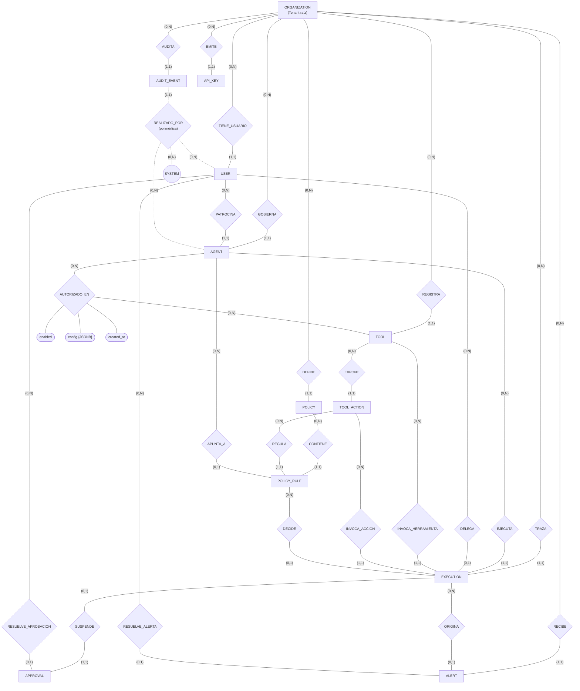
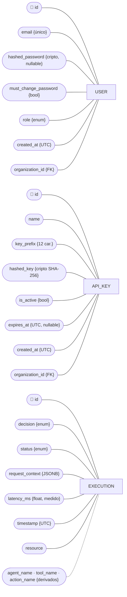
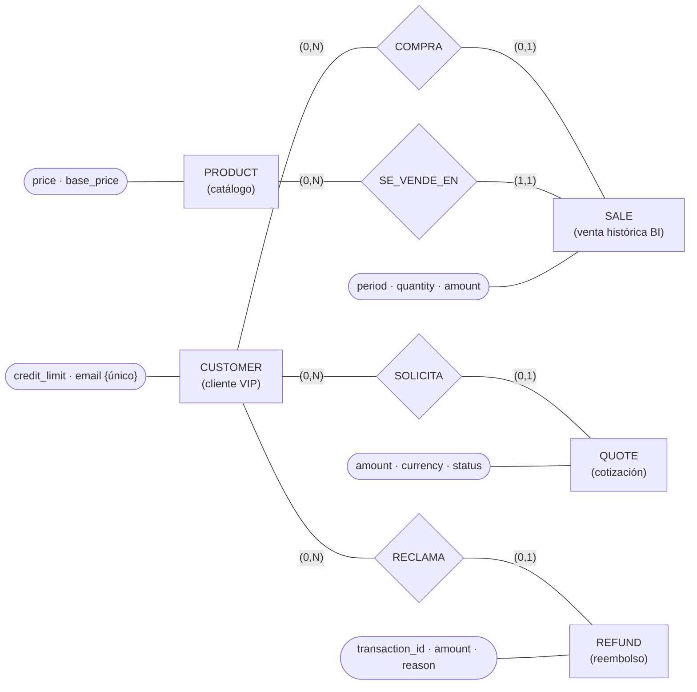

# 🧩 AgentGuard — MER Conceptual (Notación Chen) y Biblioteca de Atributos (Versión Final Verificada)

> **Cátedra Desarrollo Web — ITU, UNCuyo (2026)** · Proyecto `AgentGuard`
> **Fuente de verdad:** `backend/app/models/*.py` (13 entidades persistentes, 10 enums), migraciones Alembic `001`–`006` y `acme-corp/server/database.py`. Este documento **reemplaza** a `agentguard_er_conceptual_chen.md`, que solo diagramaba 11 entidades y omitía `API_KEY` y los atributos `enabled`/`config` de la relación `AUTORIZADO_EN`. El modelo **físico** (tipos, índices, ON DELETE, migraciones) está en [`01_MER_RELACIONAL_Y_FISICO_DB.md`](./01_MER_RELACIONAL_Y_FISICO_DB.md).

---

## 0. Leyenda de notación (Chen adaptada a Mermaid)

Mermaid no dispone de notación Chen nativa; se adapta con `flowchart`:

| Elemento Chen | Representación en Mermaid | Ejemplo |
|---|---|---|
| **Entidad fuerte** | Rectángulo `[ ]` | `USER` |
| **Relación** | Rombo `{ }` | `PATROCINA` |
| **Atributo** | Elipse `([ ])` | `email` |
| **Atributo clave (identificador)** | Elipse con texto subrayado → se escribe `🔑 id` | `🔑 id` |
| **Relación con atributos (asociativa)** | Rombo con elipses colgantes | `AUTORIZADO_EN` → `enabled`, `config` |
| **Cardinalidad `(mín,máx)`** | Etiqueta sobre el arco entidad—rombo | `(0,N)` |

**Convención de cardinalidad:** el par `(mín,máx)` junto a una entidad indica **cuántas veces como mínimo y como máximo participa esa entidad en la relación** (es decir, cuántas instancias de la *otra* entidad le corresponden). `N` = muchos. Se distingue el mínimo **impuesto por la base** (`NOT NULL` en la FK ⇒ `1`; nullable ⇒ `0`) del mínimo meramente **de negocio**.

---

## 1. Diagrama conceptual completo — Dominio AgentGuard (13 entidades)

Incluye las entidades que faltaban en la documentación anterior: **`API_KEY`** y la relación asociativa **`AUTORIZADO_EN`** (`AGENT` N:M `TOOL`) con sus atributos `enabled` y `config`.

### 1.1 Lectura del diagrama

- **`ORGANIZATION`** es la raíz del multi-tenant: 8 entidades cuelgan **directamente** de ella con cardinalidad `(1,1)` (cada instancia pertenece a exactamente una organización). `AGENT_TOOL`, `TOOL_ACTION`, `POLICY_RULE` y `APPROVAL` heredan el tenant a través de su entidad padre.
- **`AUTORIZADO_EN`** es una relación **N:M con atributos propios** (`enabled`, `config`, `created_at`). Al pasar al modelo relacional se **reifica** en la tabla `agent_tools` (PK propia `id` + `UNIQUE(agent_id, tool_id)` = `uq_agent_tool_pair`). Es el mecanismo de **desacoplamiento N:N** de AgentGuard: un agente solo puede invocar herramientas vinculadas y `enabled = true`.
- **`REALIZADO_POR`** (punteada) es una relación **conceptual polimórfica**: `audit_events.actor_id` apunta a un `USER`, un `AGENT` o al `SYSTEM` según `actor_type`, y **no** tiene clave foránea física (para que el evento sobreviva al actor).
- **`SYSTEM`** no es entidad persistente: es un valor del dominio `ActorType`.
- **`EXECUTION`** es la entidad central de trazabilidad: intersecta agente, usuario delegador, herramienta, acción y regla evaluada.

### 1.2 Conteo de relaciones y correspondencia con claves foráneas

| Concepto | Cantidad |
|---|---|
| Entidades persistentes | **13** (12 «propias» + `AGENT_TOOL` derivada de la relación asociativa) |
| Relaciones binarias 1:N | 22 (R1–R9, R11–R23) |
| Relaciones N:M (reificadas) | 1 (`AUTORIZADO_EN` → `agent_tools`) |
| Relaciones 1:0..1 | 1 (`SUSPENDE`: `EXECUTION`–`APPROVAL`, por `UNIQUE(execution_id)`) |
| Claves foráneas físicas resultantes | **24** (8 de tenant + 16 funcionales; `AUTORIZADO_EN` aporta 2) |

---

## 2. Diagrama de atributos de entidades núcleo (notación Chen)

Para no saturar el diagrama general, se muestran los atributos de las entidades que más se consultan en defensa. **Todos** los atributos de las 13 entidades están en la §4.

> Los atributos **derivados** (`agent_name`, `tool_name`, `action_name`, `Tool.assigned_agents`, `PolicyRule.agent_name`…) **no se persisten**: son `@property` del ORM calculadas por navegación de relaciones. En Chen se dibujan con elipse punteada.

---

## 3. Análisis formal de cardinalidades `(mín, máx)`

Notación: cada fila lee «una instancia de **A** se asocia con entre *mín* y *máx* instancias de **B**» y viceversa. «Mín (BD)» = lo que obliga el esquema físico (`NOT NULL`/`UNIQUE`); «Mín (negocio)» = lo que el dominio espera sin que la BD lo exija.

| Rel. | Entidad A | `(A→B)` | Entidad B | `(B→A)` | Tipo | Fundamento físico (columna, `ON DELETE`) | Justificación |
|---|---|---|---|---|---|---|---|
| R1 `TIENE_USUARIO` | ORGANIZATION | (0,N) | USER | (1,1) | 1:N | `users.organization_id` NOT NULL, CASCADE | Toda cuenta pertenece a una sola organización; una organización recién creada puede no tener usuarios en BD (negocio: ≥ 1 `ADMIN` al registrarse). |
| R2 `GOBIERNA` | ORGANIZATION | (0,N) | AGENT | (1,1) | 1:N | `agents.organization_id` NOT NULL, CASCADE | Un agente pertenece a un único tenant. |
| R3 `REGISTRA` | ORGANIZATION | (0,N) | TOOL | (1,1) | 1:N | `tools.organization_id` NOT NULL, CASCADE | Catálogo de herramientas por tenant. |
| R4 `DEFINE` | ORGANIZATION | (0,N) | POLICY | (1,1) | 1:N | `policies.organization_id` NOT NULL, CASCADE | Las políticas son privadas del tenant. |
| R5 `EMITE` | ORGANIZATION | (0,N) | API_KEY | (1,1) | 1:N | `api_keys.organization_id` NOT NULL, CASCADE | Una llave autentica al Gateway **de una** organización. |
| R6 `TRAZA` | ORGANIZATION | (0,N) | EXECUTION | (1,1) | 1:N | `executions.organization_id` NOT NULL, CASCADE | Aislamiento forense por tenant (Anti-IDOR). |
| R7 `RECIBE` | ORGANIZATION | (0,N) | ALERT | (1,1) | 1:N | `alerts.organization_id` NOT NULL, CASCADE | Alertas visibles solo dentro del tenant. |
| R8 `AUDITA` | ORGANIZATION | (0,N) | AUDIT_EVENT | (1,1) | 1:N | `audit_events.organization_id` NOT NULL, CASCADE | Auditoría administrativa por tenant. |
| R9 `PATROCINA` | USER | (0,N) | AGENT | (1,1) | 1:N | `agents.owner_user_id` NOT NULL, **RESTRICT** | Todo agente tiene un humano responsable; no se puede borrar un usuario con agentes. |
| R10 `AUTORIZADO_EN` | AGENT | (0,N) | TOOL | (0,N) | **N:M** (con atributos `enabled`, `config`) | `agent_tools.agent_id`/`tool_id` NOT NULL, CASCADE ambas; `UNIQUE(agent_id, tool_id)` | Un agente puede no tener herramientas; una herramienta puede no estar asignada. El par es único (no hay vínculos duplicados). |
| R11 `EXPONE` | TOOL | (0,N) | TOOL_ACTION | (1,1) | 1:N | `tool_actions.tool_id` NOT NULL, CASCADE; `UNIQUE(tool_id, action_name)` | Una acción pertenece a una sola herramienta; su nombre es único dentro de ella. Entidad *débil* en sentido conceptual (su identidad lógica depende de la herramienta). |
| R12 `CONTIENE` | POLICY | (0,N) | POLICY_RULE | (1,1) | 1:N | `policy_rules.policy_id` NOT NULL, CASCADE | Una regla pertenece a una política. |
| R13 `REGULA` | TOOL_ACTION | (0,N) | POLICY_RULE | (1,1) | 1:N | `policy_rules.tool_action_id` NOT NULL, **RESTRICT** | Cada regla regula exactamente una acción atómica; no se borra una acción con reglas. |
| R14 `APUNTA_A` | AGENT | (0,N) | POLICY_RULE | **(0,1)** | 1:N opcional | `policy_rules.target_agent_id` **NULL**, CASCADE | `NULL` ⇒ regla **global / multi-agente**; con valor ⇒ regla específica de un agente. |
| R15 `EJECUTA` | AGENT | (0,N) | EXECUTION | (1,1) | 1:N | `executions.agent_id` NOT NULL, **RESTRICT** | Toda ejecución la origina un agente; no se borra un agente con trazas. |
| R16 `DELEGA` | USER | (0,N) | EXECUTION | **(0,1)** | 1:N opcional | `executions.delegator_user_id` NULL, SET NULL | El humano en cuyo nombre actúa el agente puede ser desconocido o borrado posteriormente. |
| R17 `INVOCA_HERRAMIENTA` | TOOL | (0,N) | EXECUTION | (1,1) | 1:N | `executions.tool_id` NOT NULL, **RESTRICT** | Toda ejecución apunta a una herramienta. |
| R18 `INVOCA_ACCION` | TOOL_ACTION | (0,N) | EXECUTION | (1,1) | 1:N | `executions.tool_action_id` NOT NULL, **RESTRICT** | Granularidad fina: la unidad evaluada es la **acción atómica**. |
| R19 `DECIDE` | POLICY_RULE | (0,N) | EXECUTION | **(0,1)** | 1:N opcional | `executions.evaluated_policy_rule_id` NULL, SET NULL | Si ninguna regla coincide la decisión es `DENY` *fail-closed* y la FK queda `NULL`. |
| R20 `SUSPENDE` | EXECUTION | **(0,1)** | APPROVAL | (1,1) | **1:0..1** | `approvals.execution_id` NOT NULL **UNIQUE**, CASCADE | Solo las ejecuciones con decisión `REQUIRE_APPROVAL` generan aprobación; nunca más de una. |
| R21 `RESUELVE_APROBACION` | USER | (0,N) | APPROVAL | **(0,1)** | 1:N opcional | `approvals.assigned_approver_id` NULL, SET NULL | Sin aprobador mientras está `PENDING`; resolver exige rol `APPROVER` o `ADMIN`. |
| R22 `ORIGINA` | EXECUTION | (0,N)ᵇᵈ / (0,1)ᵒʳᵐ | ALERT | **(0,1)** | 1:0..1 (en la práctica) | `alerts.execution_id` NULL, SET NULL (**sin** UNIQUE) | La BD permitiría varias alertas por ejecución; el ORM (`uselist=False`) y el PEP generan a lo sumo una. Alertas sin ejecución (`NULL`) son válidas. |
| R23 `RESUELVE_ALERTA` | USER | (0,N) | ALERT | **(0,1)** | 1:N opcional | `alerts.resolved_by_user_id` NULL, SET NULL | Una alerta `OPEN` aún no tiene resolutor. |
| R24 `REALIZADO_POR` | AUDIT_EVENT | (1,1) | USER ∪ AGENT ∪ SYSTEM | (0,N) | polimórfica | `audit_events.actor_type` + `actor_id`, **sin FK** | Referencia lógica a tres posibles tipos de actor. |

### 3.1 Resumen de participaciones

- **Participación total (mín = 1) de la entidad dependiente:** todas las FK `NOT NULL` (R1–R13, R15, R17, R18, R20).
- **Participación parcial (mín = 0):** `target_agent_id` (R14), `delegator_user_id` (R16), `evaluated_policy_rule_id` (R19), `assigned_approver_id` (R21), `alerts.execution_id` (R22), `resolved_by_user_id` (R23).
- **Entidades con dependencia existencial fuerte (CASCADE):** `AGENT_TOOL`, `TOOL_ACTION`, `POLICY_RULE`, `APPROVAL` y todas las colgadas de `ORGANIZATION`.
- **Entidades que protegen evidencia (RESTRICT / SET NULL):** `EXECUTION` y `ALERT`.

---

## 4. Biblioteca / Diccionario completo de atributos reales (96 atributos)

Clasificación por **naturaleza**. Las categorías son disjuntas y suman **96 columnas** de las 13 tablas físicas.

| Naturaleza | Cantidad |
|---|---|
| 4.1 Identificadores `UUID` (PK) | 13 |
| 4.2 Referencias (FK y referencia polimórfica) | 24 FK + 1 polimórfica = 25 |
| 4.3 Simples / Atómicos (texto, enteros, booleanos, flotante) | 26 (19 texto + 4 booleanos + 2 enteros + 1 flotante) |
| 4.4 Compuestos / semiestructurados `JSONB` | 5 |
| 4.5 Temporales UTC (`TIMESTAMPTZ`) | 15 |
| 4.6 Dominios restringidos (`ENUM` nativos) | 10 |
| 4.7 Criptográficos | 2 (+1 derivado de apoyo: `key_prefix`, clasificado como simple) |
| **Total** | **13 + 25 + 26 + 5 + 15 + 10 + 2 = 96** ✔ |

### 4.1 Identificadores (clave primaria `UUID v4`)

Los 13 `id` se generan **en PostgreSQL** (`server_default=gen_random_uuid()`), no en Python. Son **identificadores sustitutos** (no tienen significado de negocio) y no enumerables (Anti-IDOR).

`organizations.id` · `users.id` · `agents.id` · `tools.id` · `agent_tools.id` · `tool_actions.id` · `policies.id` · `policy_rules.id` · `executions.id` · `approvals.id` · `alerts.id` · `audit_events.id` · `api_keys.id`

### 4.2 Referencias (claves foráneas y referencia polimórfica)

| Atributo | Referencia | Obligatorio | `ON DELETE` |
|---|---|---|---|
| `users.organization_id`, `agents.organization_id`, `tools.organization_id`, `policies.organization_id`, `executions.organization_id`, `alerts.organization_id`, `audit_events.organization_id`, `api_keys.organization_id` | `organizations.id` | Sí | CASCADE |
| `agents.owner_user_id` | `users.id` | Sí | RESTRICT |
| `agent_tools.agent_id` | `agents.id` | Sí | CASCADE |
| `agent_tools.tool_id` | `tools.id` | Sí | CASCADE |
| `tool_actions.tool_id` | `tools.id` | Sí | CASCADE |
| `policy_rules.policy_id` | `policies.id` | Sí | CASCADE |
| `policy_rules.tool_action_id` | `tool_actions.id` | Sí | RESTRICT |
| `policy_rules.target_agent_id` | `agents.id` | **No** (global) | CASCADE |
| `executions.agent_id` | `agents.id` | Sí | RESTRICT |
| `executions.delegator_user_id` | `users.id` | **No** | SET NULL |
| `executions.tool_id` | `tools.id` | Sí | RESTRICT |
| `executions.tool_action_id` | `tool_actions.id` | Sí | RESTRICT |
| `executions.evaluated_policy_rule_id` | `policy_rules.id` | **No** | SET NULL |
| `approvals.execution_id` | `executions.id` (**UNIQUE**) | Sí | CASCADE |
| `approvals.assigned_approver_id` | `users.id` | **No** | SET NULL |
| `alerts.execution_id` | `executions.id` | **No** | SET NULL |
| `alerts.resolved_by_user_id` | `users.id` | **No** | SET NULL |
| `audit_events.actor_id` | **polimórfica**: `users`/`agents`/sistema según `actor_type` — **sin FK** | Sí | — |

### 4.3 Atributos simples / atómicos

**Texto** (`VARCHAR`/`TEXT`) — 19:

| Entidad | Atributo | Tipo | Nulo | Notas |
|---|---|---|---|---|
| ORGANIZATION | `name` | VARCHAR(255) | No | |
| USER | `email` | VARCHAR(255) | No | **Único global** |
| AGENT | `name` | VARCHAR(255) | No | |
| AGENT | `purpose` | TEXT | Sí | Propósito declarado |
| TOOL | `name` | VARCHAR(255) | No | |
| TOOL | `protocol` | VARCHAR(50) | No | default `REST` |
| TOOL | `endpoint_url` | VARCHAR(1024) | No | |
| TOOL | `description` | TEXT | Sí | |
| TOOL_ACTION | `action_name` | VARCHAR(255) | No | Único por herramienta |
| TOOL_ACTION | `description` | TEXT | Sí | |
| POLICY | `name` | VARCHAR(255) | No | |
| POLICY | `description` | TEXT | Sí | |
| EXECUTION | `resource` | VARCHAR(255) | Sí | |
| APPROVAL | `resolution_reason` | TEXT | Sí | |
| ALERT | `title` | VARCHAR(255) | No | default «Incidente de Seguridad» |
| ALERT | `description` | TEXT | Sí | |
| AUDIT_EVENT | `event_type` | VARCHAR(255) | No | |
| API_KEY | `name` | VARCHAR(100) | No | |
| API_KEY | `key_prefix` | VARCHAR(12) | No | Prefijo visible (`ag_live_…`) para localizar la llave; **no** es secreto suficiente para autenticar |

**Booleanos** — 4: `users.must_change_password` (default `false`, migración 006) · `agent_tools.enabled` (default `true`) · `policies.is_active` (default `true`) · `api_keys.is_active` (default `true`).

**Enteros** — 2: `policies.priority` (default 100) · `policy_rules.priority` (default 100).

**Flotante** — 1: `executions.latency_ms` (`double precision`, nullable; **latencia real medida** del PEP/PDP, migración 002; nunca hardcodeada).

### 4.4 Atributos compuestos / semiestructurados (`JSONB`)

En sentido Chen son **atributos compuestos** (de estructura interna variable). Se guardan como `JSONB` (no se normalizan en tablas EAV).

| Atributo | Entidad | Estructura / contenido | Índice |
|---|---|---|---|
| `settings` | ORGANIZATION | Postura de seguridad del tenant (migración 004). Subatributos por defecto (`organization_service.DEFAULT_ORGANIZATION_SETTINGS`): `fail_closed` (true), `mask_sensitive` (true), `max_autonomous_amount` (5000.0), `retention_days` (90), `siem_format` (`splunk`), `siem_webhook_url`, `siem_webhook_enabled` (false), `siem_webhook_secret`, `siem_webhook_events` (`ALERT_CRITICAL`, `POLICY_VIOLATION`) | — (sin GIN) |
| `config` | AGENT_TOOL (atributo de `AUTORIZADO_EN`) | Configuración contextual del vínculo agente↔herramienta | **GIN** `idx_agent_tools_config_gin` |
| `conditions` | POLICY_RULE | Predicados que evalúa el PDP determinista | **GIN** `idx_policy_rules_conditions_gin` |
| `request_context` | EXECUTION | Parámetros de la solicitud **ya sanitizados** (enmascara tokens/PII, OWASP LLM06) | **GIN** `idx_executions_request_context_gin` |
| `metadata` (ORM: `event_metadata`) | AUDIT_EVENT | Detalle de la mutación administrativa | **GIN** `idx_audit_events_metadata_gin` |

### 4.5 Atributos temporales (UTC, `TIMESTAMPTZ`)

Todos se almacenan en UTC (`datetime.now(timezone.utc)` en el ORM; `now()` como default de BD).

| Atributo | Entidad | Semántica |
|---|---|---|
| `created_at` | ORGANIZATION, USER, AGENT, TOOL, AGENT_TOOL, TOOL_ACTION, POLICY, POLICY_RULE, APPROVAL, ALERT, API_KEY (**11 entidades**) | Instante de creación |
| `timestamp` | EXECUTION, AUDIT_EVENT (**2 entidades**) | Instante del evento forense (indexado; parte del índice compuesto `(organization_id, timestamp)`) |
| `resolved_at` | APPROVAL | Instante de resolución (nullable hasta resolverse) |
| `expires_at` | API_KEY | Vencimiento opcional (nullable) |

> **Atributo derivado temporal:** la **expiración de una aprobación HITL** no es columna: se deduce de `approvals.created_at + 900 s` (TTL de 15 min). Si se supera, el servicio fija `EXPIRED` y la ejecución queda `REJECTED`. `APPROVAL` **no tiene** `expires_at`.

### 4.6 Dominios restringidos (10 `ENUM` nativos — `backend/app/models/enums.py`)

Los valores son **enums internos en inglés mayúsculas** (contrato OpenAPI); la interfaz los presenta en español mediante `frontend/src/constants/labels.ts`.

| Atributo (entidad) | Tipo PostgreSQL / Clase Python | Dominio de valores | Default |
|---|---|---|---|
| `users.role` | `user_role_enum` / `UserRole` | `ADMIN`, `OPERATOR`, `APPROVER`, `AUDITOR`, `VIEWER` | `OPERATOR` |
| `agents.status` | `agent_status_enum` / `AgentStatus` | `ACTIVE`, `SUSPENDED`, `REVOKED` | `ACTIVE` |
| `tool_actions.risk_level` | `risk_level_enum` / `RiskLevel` | `LOW`, `MEDIUM`, `HIGH`, `CRITICAL` | `LOW` |
| `policy_rules.effect` | `rule_effect_enum` / `RuleEffect` | `ALLOW`, `DENY`, `REQUIRE_APPROVAL` | `DENY` (fail-closed) |
| `executions.decision` | `policy_decision_enum` / `PolicyDecision` | `ALLOW`, `DENY`, `REQUIRE_APPROVAL` | — (obligatorio) |
| `executions.status` | `execution_status_enum` / `ExecutionStatus` | `PENDING_APPROVAL`, `REJECTED`, `EXECUTED` | `EXECUTED` |
| `approvals.status` | `approval_status_enum` / `ApprovalStatus` | `PENDING`, `APPROVED`, `REJECTED`, `EXPIRED` | `PENDING` |
| `alerts.severity` | `alert_severity_enum` / `AlertSeverity` | `LOW`, `MEDIUM`, `HIGH`, `CRITICAL` | `MEDIUM` |
| `alerts.status` | `alert_status_enum` / `AlertStatus` | `OPEN`, `INVESTIGATING`, `RESOLVED`, `DISMISSED` | `OPEN` |
| `audit_events.actor_type` | `actor_type_enum` / `ActorType` | `USER`, `AGENT`, `SYSTEM` | — (obligatorio) |

> Existen **10 clases** `StrEnum` y **10 tipos** `ENUM` nativos, en correspondencia 1:1. Hay dos pares de dominios con valores idénticos pero **semántica distinta** a propósito: `RuleEffect`/`PolicyDecision` (intención de la regla vs. decisión emitida) y `RiskLevel`/`AlertSeverity` (riesgo de la acción vs. gravedad del incidente).
> Solo `APPROVER` y `ADMIN` pueden resolver aprobaciones HITL; las rutas administrativas exigen `ADMIN` humano (`require_admin_user`) y rechazan `X-Agent-Id` con `403`.

### 4.7 Atributos criptográficos

| Atributo | Entidad | Algoritmo | Propósito y garantías |
|---|---|---|---|
| `hashed_password` | USER | **bcrypt** (`passlib` + `bcrypt`), `VARCHAR(255)`, *nullable* | Nunca se guarda ni se devuelve la contraseña en claro. *Nullable* porque puede haber usuarios sin credencial local. Va de la mano de `must_change_password` (obliga a rotar la clave inicial). |
| `hashed_key` | API_KEY | **SHA-256** (hex de 64 car.) en `VARCHAR(255)` | Solo se persiste el *hash* de la API Key (`ag_live_` + `token_urlsafe(32)`); la llave completa se muestra una sola vez al crearla. Apoyado por `key_prefix` (12 car., indexado) para localizar el candidato sin recorrer la tabla. |

> Un **volcado completo de la base** no expone contraseñas ni API Keys utilizables; y `request_context` nunca contiene secretos porque se sanitiza antes de persistir.

### 4.8 Atributos derivados (no persistidos)

| Atributo derivado | Entidad | Cálculo |
|---|---|---|
| `assigned_agents` | TOOL | Nombres de agentes vinculados vía `agent_tools` |
| `action_name`, `tool_name`, `agent_name` | POLICY_RULE | Navegación a `tool_action`/`tool`/`target_agent` (`agent_name` = «Global / Multi-agent» si `target_agent_id` es `NULL`) |
| `agent_name`, `tool_name`, `action_name` | EXECUTION | Navegación a `agent`/`tool`/`tool_action` |
| `expiración de aprobación` | APPROVAL | `created_at + 900 s` |

---

## 5. Vista conceptual resumida — Dominio ERP ACME Corp (SQLite)

ACME es el **sistema externo protegido** (puerto `9000`, `acme-corp/acme_corp.db`). Su modelo es deliberadamente simple (ERP legado), con **7 tablas** y **0 claves foráneas físicas** (relaciones lógicas). Detalle físico en [`01_MER_RELACIONAL_Y_FISICO_DB.md`](./01_MER_RELACIONAL_Y_FISICO_DB.md) §6.

| Relación | Cardinalidad | Realización física (lógica, sin FK) |
|---|---|---|
| `SOLICITA` CUSTOMER–QUOTE | (0,N) / (0,1) | `quotes.customer_id` **nullable** (+ `customer_name` desnormalizado) |
| `RECLAMA` CUSTOMER–REFUND | (0,N) / (0,1) | `refunds.customer_id` **nullable**; `transaction_id` referencia una transacción externa (pasarela de pago simulada) |
| `COMPRA` CUSTOMER–SALE | (0,N) / (0,1) | `sales.customer_id` nullable (+ `customer_name`) |
| `SE_VENDE_EN` PRODUCT–SALE | (0,N) / (1,1) | `sales.product_sku` **NOT NULL** (+ `product_name`, `category` desnormalizados) |

Entidades de soporte (fuera del dominio comercial): `COMPANY_STATUS` (singleton, `CHECK id = 1`, flag `database_wiped`) y `EVENTS` (bitácora inmutable de impacto: `event_type`, `severity`, `action`, `payload` JSON-en-`TEXT`, `message`).

**Puente conceptual entre ambos dominios:** las operaciones del ERP (`create_quote`, `update_price`, `refund`, `export_customers`, `query_sales`, `delete_sales`) se registran en AgentGuard como instancias de `TOOL_ACTION` (cada una con su `risk_level`) de una `TOOL` ACME, y cada intento del agente genera una `EXECUTION` con decisión del PDP. La base ACME **no** referencia a AgentGuard: el acoplamiento es solo por HTTP a través del Gateway (PEP).

---

## 6. Preguntas de defensa de base de datos ante cátedra

**1. ¿Qué cambió respecto del diagrama conceptual anterior?**
Se pasó de 11 a **13 entidades**: se incorporó **`API_KEY`** (llaves hash de autenticación del Gateway, migración 003) y se explicitó la relación asociativa **`AUTORIZADO_EN`** (`AGENT` N:M `TOOL`) con sus atributos **`enabled`** y **`config`** (tabla `agent_tools`). También se agregaron `organizations.settings`, `executions.latency_ms`, `users.hashed_password` y `users.must_change_password`.

**2. ¿Por qué `AUTORIZADO_EN` es una relación y no una entidad? ¿Y por qué después tiene tabla?**
Conceptualmente es una asociación N:M entre agente y herramienta que **tiene atributos propios** (`enabled`, `config`), por eso se dibuja como rombo con elipses. Al llevarla al modelo relacional toda N:M se **reifica** en una tabla; `agent_tools` además tiene PK `id` para ser manipulable como recurso REST, con `UNIQUE(agent_id, tool_id)` para evitar duplicados.

**3. ¿Cuál es la cardinalidad entre `EXECUTION` y `APPROVAL`?**
**(0,1) – (1,1)**. Una ejecución genera como máximo una aprobación (solo si la decisión fue `REQUIRE_APPROVAL`) y toda aprobación pertenece a una única ejecución. Se garantiza con `UNIQUE(approvals.execution_id)`.

**4. ¿Por qué `delegator_user_id`, `target_agent_id` y `evaluated_policy_rule_id` admiten `NULL`?**
Son participaciones **parciales (mín = 0)**: la delegación humana puede ser desconocida o el usuario eliminado; una regla sin `target_agent_id` es **global**; y si ninguna regla coincide el PDP decide `DENY` por *fail-closed*, de modo que no existe regla evaluada que referenciar.

**5. ¿Dónde está el atributo multivaluado? ¿Cómo se resolvió?**
No hay atributos multivaluados normalizados; se representan como **compuestos `JSONB`** (por ejemplo `settings.siem_webhook_events`, una lista). Se eligió `JSONB` en lugar de crear tablas auxiliares porque su estructura es variable y se consulta por contención (índice GIN).

**6. ¿Qué atributos son derivados y por qué no se guardan?**
`agent_name`, `tool_name`, `action_name`, `assigned_agents` y la expiración de aprobaciones (`created_at + 900 s`). Guardarlos duplicaría información (violaría 3FN) y podría desincronizarse al renombrar un agente o herramienta.

**7. ¿Por qué `AUDIT_EVENT.actor_id` no es FK?**
Porque el actor es **polimórfico** (`USER`/`AGENT`/`SYSTEM`) y una FK solo puede apuntar a una tabla; además el registro forense debe sobrevivir a la eliminación del actor. La integridad se resguarda por la regla de dominio y el enum `actor_type`.

**8. ¿Cómo se garantiza el aislamiento multi-tenant en el modelo conceptual?**
`ORGANIZATION` es raíz con participación **(1,1)** de 8 entidades. Las 4 restantes (`AGENT_TOOL`, `TOOL_ACTION`, `POLICY_RULE`, `APPROVAL`) lo heredan por su padre. La BD **no** aplica RLS: el filtrado por `organization_id` es lógico, en la capa de aplicación (Anti-IDOR).

**9. ¿Por qué hay dos enums con los mismos valores (`RuleEffect`/`PolicyDecision`, `RiskLevel`/`AlertSeverity`)?**
Son **dominios distintos** con semántica distinta aunque coincidan hoy sus valores: pueden evolucionar por separado (p. ej. `PolicyDecision` podría sumar un estado que una regla no puede declarar). Evitar reutilizarlos protege la evolución del esquema.

**10. ¿Qué atributos son criptográficos y qué algoritmo usan?**
`users.hashed_password` (**bcrypt**) y `api_keys.hashed_key` (**SHA-256**). Ninguno guarda el secreto en claro. La API Key tiene entropía alta (`token_urlsafe(32)`), por eso un hash rápido SHA-256 es suficiente; las contraseñas humanas, de baja entropía, requieren un hash lento con sal como bcrypt.

**11. ¿Qué rol cumple `must_change_password` en el modelo?**
Es un atributo booleano de `USER` (default `false`, migración 006) que fuerza la rotación de la contraseña inicial: el frontend muestra `ForcePasswordChangeModal` y la API `POST /api/v1/auth/change-password` lo apaga.

**12. ¿Por qué el atributo `latency_ms` es `NULL`-able si «nunca está hardcodeado»?**
Se agregó en la migración 002 sobre una tabla con datos históricos que no tenían medición; por eso es *nullable*. Las ejecuciones nuevas siempre lo completan con el valor **real** medido por el PEP/PDP.

**13. ¿La entidad `TOOL_ACTION` es débil?**
Conceptualmente es dependiente de `TOOL` (su identificador lógico es `(tool_id, action_name)`, `UNIQUE`), pero se implementa con PK sustituta `id`, porque `POLICY_RULE` y `EXECUTION` la referencian. Es el caso típico de *entidad débil con clave sustituta* (la dependencia existencial se mantiene con `ON DELETE CASCADE`).

**14. ¿Cómo se relaciona el modelo conceptual de AgentGuard con el de ACME?**
No hay relación entre sus esquemas. ACME es el *recurso protegido*; AgentGuard modela **cómo se gobierna** el acceso a él (`TOOL`, `TOOL_ACTION`, `POLICY_RULE`, `EXECUTION`). Se vinculan en tiempo de ejecución vía el Gateway, no por claves foráneas.

**15. ¿Por qué la base ACME no declara claves foráneas aunque las relaciones existen conceptualmente?**
Representa un ERP legado donde las relaciones son **lógicas** y los datos están desnormalizados (`customer_name`, `product_name`) para que cada registro sea autosuficiente en la demo. Verificado: 0 FKs físicas en las 7 tablas. El rigor referencial del producto reside en PostgreSQL.

**16. ¿Qué garantiza la inmutabilidad forense en el modelo?**
`EXECUTION` y `AUDIT_EVENT` son entidades de solo-inserción por regla de dominio; las FKs `RESTRICT` (`agent_id`, `tool_id`, `tool_action_id`) impiden eliminar agentes, herramientas y acciones con historial. `ALERT` no hereda `delete-orphan` para sobrevivir como evidencia SIEM.
