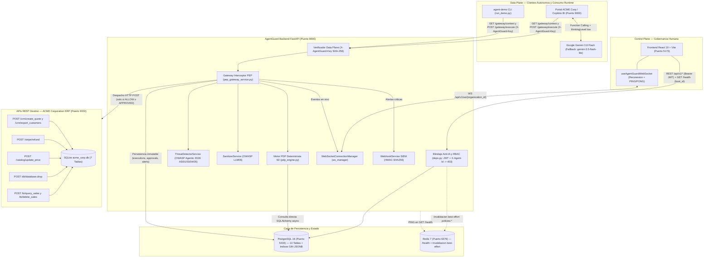

# 03 — Arquitectura Runtime Zero Trust (PEP/PDP) e Inventario API REST

> **Documento Maestro Técnico (SSOT):** Refleja exclusivamente la implementación verificada en código fuente real del repositorio `AgentGuard` (`backend/`, `frontend/`, `acme-corp/`, `agent-demo/`, `docker-compose.yml`).

---

## 1. Principio Rector Zero Trust y Arquitectura en Capas

### 1.1 Principio: *"Never trust the model as the enforcement point"*

En sistemas basados en Modelos de Lenguaje (LLMs), el modelo opera sobre texto probabilístico y es inherentemente susceptible a *Prompt Injection* (OWASP ASI01), evasión mediante ofuscación (ASI04) o abuso de capacidades (*Excessive Agency*). Confiar en las instrucciones del *System Prompt* para impedir acciones destructivas o fugas de datos equivale a delegar el control de acceso al propio actor no confiable.

**AgentGuard** materializa una arquitectura **Zero Trust para Agentes de IA** desacoplando estrictamente el razonamiento del control de ejecución:

1. **Separación Control Plane vs. Data Plane:**
   - **Data Plane (Runtime):** Los agentes autónomos (`acme-corp` en puerto `9000` con el *Consultante BI* / `Agente de Ventas` potenciados por `gemini-3.8-flash`, y el cliente CLI `agent-demo`) **nunca** poseen credenciales administrativas ni acceso directo a las APIs destino cuando operan bajo gobernanza. Se autentican exclusivamente mediante `X-AgentGuard-Key` (`ag_live_...`, verificada por prefijo de 12 caracteres + digest SHA-256) y solo consumen `GET /api/v1/gateway/context` y `POST /api/v1/gateway/execute`.
   - **Control Plane (Gobernanza):** El panel SPA en React 19 + Vite (`frontend/` en puerto `5173`) autentica exclusivamente a operadores humanos mediante **JWT Bearer (`HS256`)** vinculado al `SERVER_BOOT_ID` del backend. Toda ruta administrativa aplica **Blindaje Anti-IA** en `backend/app/api/deps.py`: cualquier petición que incluya la cabecera `X-Agent-Id` es rechazada inmediatamente con `403 Forbidden` (`"AI Agents are not permitted to manage governance policies or rules"`).
2. **Perímetro Físico PEP + Decisión Determinista PDP:** El agente propone una intención de uso de herramienta (*Function Calling*); `PEPGatewayService` intercepta la llamada, valida la identidad del agente, verifica su capacidad N:N en `AgentTool`, inspecciona vectores hostiles con `ThreatDetectorService`, sanitiza credenciales según OWASP LLM06 con `SanitizerService` y consulta al motor determinista `PDPEngine` antes de despachar o bloquear hacia la API REST destino.
3. **Principio Fail-Closed (`DENY` por defecto):** Ante ausencia de reglas, condiciones incompletas, error en consulta de políticas, agente suspendido/revocado, falta de capacidad en `AgentTool` o fallo de conectividad hacia el servicio destino, el veredicto resultante es siempre **`DENY`** (`403 Forbidden`).

---

### 1.2 Esquema Arquitectónico en Capas (Runtime Real)

> [!NOTE]
> **Rol exacto de Redis 7 (`6379`) en el runtime actual:** En la implementación vigente, Redis se utiliza en dos puntos concretos: (1) el chequeo de salud `check_redis_health()` expuesto en `GET /health` (`backend/app/main.py`) y (2) la invalidación *best-effort* / *fail-open* de claves `policies:{organization_id}:*` en `backend/app/services/policy_rule_service.py` al crear, editar o eliminar reglas. **El motor `PDPEngine.evaluate()` consulta directamente PostgreSQL 16 (`5433`)** mediante SQLAlchemy 2.0 asíncrono (`asyncpg`), priorizando consistencia fuerte e inmediatez determinista sobre caché distribuido.

---

## 2. Inventario Verificado de Endpoints REST y WebSockets

Inventario exhaustivo extraído directamente de `backend/app/main.py`, `backend/app/api/__init__.py` (los **17 routers** montados bajo `/api/v1`) y `backend/app/api/*.py`.

### 2.1 Endpoints Raíz y Diagnóstico (`backend/app/main.py`)

| Método | Ruta Exacta | Autenticación | Roles RBAC / Reglas | Descripción y Particularidades Verificadas |
| :--- | :--- | :--- | :--- | :--- |
| `GET` | `/` | Público | N/A | Metadatos de la API (`name`, `version`, `status: "online"`, rutas `/docs`, `/redoc`, `/api/v1`). |
| `GET` | `/health` | Público | N/A | Estado de PostgreSQL y Redis (`healthy` / `degraded`) y **`boot_id`** (`SERVER_BOOT_ID`) usado por `AuthContext.tsx` para invalidar JWTs de arranques previos. |
| `GET` | `/api/v1/ping` | Público | N/A | Ping ultraligero de latencia HTTP sin acceso a persistencia (`{"message": "pong", "timestamp": ...}`). |

### 2.2 Autenticación y Gestión de Sesión (`/api/v1/auth` — `auth.py`)

| Método | Ruta Exacta | Autenticación | Roles RBAC / Bloqueo IA | Descripción y Particularidades Verificadas |
| :--- | :--- | :--- | :--- | :--- |
| `POST` | `/api/v1/auth/login` | Público | N/A | Valida email/password (`verify_password` bcrypt); incluye compatibilidad de dominio `@acmecorp.com` <-> `@acme.corp`. Emite JWT con `sub`, `org_id`, `role`, `boot_id`, `exp`. |
| `POST` | `/api/v1/auth/register` | Público | N/A (crea `ADMIN`) | Crea `Organization` + `User` (`ADMIN`, `must_change_password=False`) y retorna `TokenResponse`. |
| `POST` | `/api/v1/auth/register-org` | Público | N/A (crea `ADMIN`) | Alta SaaS B2B atómica: crea `Organization` con `DEFAULT_ORGANIZATION_SETTINGS`, usuario `ADMIN` y primera `ApiKey` (`ag_live_...` en texto plano una sola vez). |
| `GET` | `/api/v1/auth/me` | JWT (`get_current_user`) | Todos (`ADMIN`, `APPROVER`, `OPERATOR`, `AUDITOR`, `VIEWER`) · **403 si `X-Agent-Id`** | Retorna perfil (`UserMeResponse`) incluyendo `must_change_password`. |
| `POST` | `/api/v1/auth/change-password` | JWT (`get_current_user`) | Todos los roles humanos · **403 si `X-Agent-Id`** | Verifica contraseña actual, exige clave distinta (`min_length=8`), actualiza `hashed_password` y apaga `must_change_password = False`. |

### 2.3 Gateway Runtime PEP y Simulación (`/api/v1/gateway` — `gateway.py`)

| Método | Ruta Exacta | Autenticación | Roles RBAC / Reglas | Descripción y Particularidades Verificadas |
| :--- | :--- | :--- | :--- | :--- |
| `POST` | `/api/v1/gateway/execute` | `X-AgentGuard-Key` (Data Plane) | Tenant de API Key == `request.organization_id` (`403` si difiere; `401` si falta/inválida) | Punto único de intercepción PEP/PDP. Retorna `200 OK` (`ALLOW`), `202 Accepted` (`REQUIRE_APPROVAL`) o `403 Forbidden` (`DENY`). |
| `GET` | `/api/v1/gateway/context` | `X-AgentGuard-Key` (Data Plane) | Tenant de API Key (`401` si falta/inválida) | **Auto-discovery Data Plane:** retorna `organization_id`, `organization_name`, listado de `agents` (`id`, `name`, `status`) y `tools` con sus `actions` (`id`, `action_name`, `risk_level`). |
| `POST` | `/api/v1/gateway/simulate` | JWT (`require_roles`) | `ADMIN`, `OPERATOR` · **403 si `X-Agent-Id`** · `ensure_same_tenant` | Evalúa PDP, sanitización y `ThreatDetector` forzando `dry_run=True` sin persistir trazas ni invocar APIs externas. |
| `GET` | `/api/v1/gateway/attacks` | JWT (`get_current_user`) | Todos los roles humanos · **403 si `X-Agent-Id`** | Retorna el catálogo OWASP Agentic Top 10 2026 (`ASI03_EXFILTRATION`, `ASI01_GOAL_HIJACKING`, `ASI04_BASE64_EVASION`, `ASI05_SQL_INJECTION`) para el Playground. |

### 2.4 Organizaciones, Usuarios y API Keys (`/organizations`, `/users`, `/api-keys`)

| Método | Ruta Exacta | Autenticación | Roles RBAC / Bloqueo IA | Descripción y Particularidades Verificadas |
| :--- | :--- | :--- | :--- | :--- |
| `POST` | `/api/v1/organizations` | JWT (`require_admin_user`) | `ADMIN` · **403 si `X-Agent-Id`** | Crea una nueva organización tenant. |
| `GET` | `/api/v1/organizations` | JWT (`get_current_user`) | Todos los roles · **403 si `X-Agent-Id`** | Retorna únicamente `[current_user.organization]` (aislamiento multi-tenant). |
| `GET` | `/api/v1/organizations/{org_id}` | JWT (`get_current_user`) | Todos los roles · **403 si `X-Agent-Id`** · `ensure_same_tenant` | Obtiene detalle de la organización del usuario. |
| `PATCH` | `/api/v1/organizations/{org_id}` | JWT (`require_admin_user`) | `ADMIN` · **403 si `X-Agent-Id`** · `ensure_same_tenant` | Actualiza nombre y registra `ORGANIZATION_UPDATED` en `audit_events`. |
| `GET` | `/api/v1/organizations/{org_id}/settings` | JWT (`require_admin_user`) | `ADMIN` · **403 si `X-Agent-Id`** · tenant check | Retorna `OrganizationSettings` (`fail_closed`, `mask_sensitive`, `max_autonomous_amount`, `retention_days`, SIEM). |
| `PATCH` | `/api/v1/organizations/{org_id}/settings` | JWT (`require_admin_user`) | `ADMIN` · **403 si `X-Agent-Id`** · tenant check | Actualiza settings JSONB (`flag_modified`) y audita `ORGANIZATION_SETTINGS_UPDATED`. |
| `POST` | `/api/v1/organizations/{org_id}/settings/webhooks/test` | JWT (`require_admin_user`) | `ADMIN` · **403 si `X-Agent-Id`** · tenant check | Emite evento `agentguard.siem.test_ping` firmado con HMAC-SHA256 (`X-AgentGuard-Signature`). |
| `POST` | `/api/v1/users` | JWT (`require_admin_user`) | `ADMIN` · **403 si `X-Agent-Id`** · `ensure_same_tenant` | Da de alta usuario corporativo con email único (`409 Conflict` si existe). |
| `GET` | `/api/v1/users` | JWT (`require_admin_user`) | `ADMIN` · **403 si `X-Agent-Id`** · `resolve_tenant_org_id` | Lista usuarios de la organización. |
| `GET` | `/api/v1/users/{user_id}` | JWT (`require_admin_user`) | `ADMIN` · **403 si `X-Agent-Id`** · `ensure_same_tenant` | Obtiene usuario por UUID dentro del tenant. |
| `PATCH` | `/api/v1/users/{user_id}` | JWT (`require_admin_user`) | `ADMIN` · **403 si `X-Agent-Id`** · `ensure_same_tenant` | Modifica el rol RBAC del usuario (`400` si falta `role`). |
| `DELETE` | `/api/v1/users/{user_id}` | JWT (`require_admin_user`) | `ADMIN` · **403 si `X-Agent-Id`** · `ensure_same_tenant` | Elimina usuario del tenant (`204 No Content`). |
| `POST` | `/api/v1/api-keys` | JWT (`require_admin_user`) | `ADMIN` · **403 si `X-Agent-Id`** · tenant check | Emite nueva `ag_live_...` (retorna secreto plano 1 vez), guarda SHA-256 y audita `API_KEY_CREATED`. |
| `GET` | `/api/v1/api-keys` | JWT (`require_admin_user`) | `ADMIN` · **403 si `X-Agent-Id`** · tenant check | Lista metadatos seguros de API Keys (`key_prefix`, `is_active`, sin hash). |
| `GET` | `/api/v1/api-keys/{key_id}` | JWT (`require_admin_user`) | `ADMIN` · **403 si `X-Agent-Id`** · tenant check | Obtiene metadatos de una API Key por UUID. |
| `DELETE` | `/api/v1/api-keys/{key_id}` | JWT (`require_admin_user`) | `ADMIN` · **403 si `X-Agent-Id`** · tenant check | Revocación lógica (`is_active = False`, `200 OK`) y registro `API_KEY_REVOKED`. |

### 2.5 Agentes, Herramientas, Acciones Atómicas y Políticas (`/agents`, `/tools`, `/tool-actions`, `/policies`, `/policy-rules`)

| Método | Ruta Exacta | Autenticación | Roles RBAC / Bloqueo IA | Descripción y Particularidades Verificadas |
| :--- | :--- | :--- | :--- | :--- |
| `POST` | `/api/v1/agents` | JWT (`require_admin_user`) | `ADMIN` · **403 si `X-Agent-Id`** · `ensure_same_tenant` | Registra agente vinculado a `owner_user_id` del mismo tenant y audita `AGENT_CREATED`. |
| `GET` | `/api/v1/agents` | JWT (`get_current_user`) | Todos los roles · **403 si `X-Agent-Id`** · `resolve_tenant_org_id` | Lista agentes de la organización. |
| `GET` | `/api/v1/agents/{agent_id}` | JWT (`get_current_user`) | Todos los roles · **403 si `X-Agent-Id`** · `ensure_same_tenant` | Detalle de un agente por UUID. |
| `PATCH` | `/api/v1/agents/{agent_id}` | JWT (`require_admin_user`) | `ADMIN` · **403 si `X-Agent-Id`** · `ensure_same_tenant` | Actualiza estado (`ACTIVE`, `SUSPENDED`, `REVOKED`) o metadatos y audita evento específico. |
| `DELETE` | `/api/v1/agents/{agent_id}` | JWT (`require_admin_user`) | `ADMIN` · **403 si `X-Agent-Id`** · `ensure_same_tenant` | Elimina agente (`204 No Content`) y audita `AGENT_DELETED`. |
| `POST` | `/api/v1/agents/{agent_id}/tools` | JWT (`require_admin_user`) | `ADMIN` · **403 si `X-Agent-Id`** · `ensure_same_tenant` | Crea/actualiza capacidad N:N en `AgentTool` (`enabled`, `config JSONB`). |
| `GET` | `/api/v1/agents/{agent_id}/tools` | JWT (`get_current_user`) | Todos los roles · **403 si `X-Agent-Id`** · `ensure_same_tenant` | Lista herramientas asignadas al agente. |
| `POST` | `/api/v1/tools` | JWT (`require_admin_user`) | `ADMIN` · **403 si `X-Agent-Id`** · `ensure_same_tenant` | Registra herramienta externa (`Tool`) con recarga ansiosa `get_by_id`. |
| `GET` | `/api/v1/tools` | JWT (`get_current_user`) | Todos los roles · **403 si `X-Agent-Id`** · `resolve_tenant_org_id` | Lista catálogo de herramientas con acciones y agentes asignados. |
| `GET` | `/api/v1/tools/{tool_id}` | JWT (`get_current_user`) | Todos los roles · **403 si `X-Agent-Id`** · `ensure_same_tenant` | Detalle de herramienta con sus `actions`. |
| `PATCH` | `/api/v1/tools/{tool_id}` | JWT (`require_admin_user`) | `ADMIN` · **403 si `X-Agent-Id`** · `ensure_same_tenant` | Actualiza herramienta (`endpoint_url`, `protocol`, etc.). |
| `DELETE` | `/api/v1/tools/{tool_id}` | JWT (`require_admin_user`) | `ADMIN` · **403 si `X-Agent-Id`** · `ensure_same_tenant` | Elimina herramienta (`409 Conflict` ante `IntegrityError` por trazas/reglas). |
| `POST` | `/api/v1/tool-actions` | JWT (`require_admin_user`) | `ADMIN` · **403 si `X-Agent-Id`** · `ensure_same_tenant` | Registra acción atómica (`risk_level`: `LOW`/`MEDIUM`/`HIGH`/`CRITICAL`; `409` si duplicada). |
| `GET` | `/api/v1/tool-actions` | JWT (`get_current_user`) | Todos los roles · **403 si `X-Agent-Id`** | Lista acciones filtradas por `organization_id` del usuario y opcionalmente `tool_id`. |
| `GET` | `/api/v1/tool-actions/{action_id}` | JWT (`get_current_user`) | Todos los roles · **403 si `X-Agent-Id`** · `ensure_same_tenant` | Obtiene acción atómica por UUID. |
| `POST` | `/api/v1/policies` | JWT (`require_admin_user`) | `ADMIN` · **403 si `X-Agent-Id`** · `ensure_same_tenant` | Crea política contenedora y audita `POLICY_CREATED`. |
| `GET` | `/api/v1/policies` | JWT (`get_current_user`) | Todos los roles · **403 si `X-Agent-Id`** · `resolve_tenant_org_id` | Lista políticas ordenadas por prioridad descendente con reglas precargadas. |
| `GET` | `/api/v1/policies/{policy_id}` | JWT (`get_current_user`) | Todos los roles · **403 si `X-Agent-Id`** · `ensure_same_tenant` | Detalle de política con sus `rules`. |
| `PATCH` | `/api/v1/policies/{policy_id}` | JWT (`require_admin_user`) | `ADMIN` · **403 si `X-Agent-Id`** · `ensure_same_tenant` | Actualiza `is_active`, `priority`, `name`, `description` y audita `POLICY_UPDATED`. |
| `DELETE` | `/api/v1/policies/{policy_id}` | JWT (`require_admin_user`) | `ADMIN` · **403 si `X-Agent-Id`** · `ensure_same_tenant` | Elimina política y reglas hijas en cascada; audita `POLICY_DELETED`. |
| `POST` | `/api/v1/policies/{policy_id}/rules` | JWT (`require_admin_user`) | `ADMIN` · **403 si `X-Agent-Id`** · tenant check | Crea regla determinista jerárquica dentro de la política, invalida Redis y audita `POLICY_RULE_CREATED`. |
| `POST` | `/api/v1/policy-rules` | JWT (`require_admin_user`) | `ADMIN` · **403 si `X-Agent-Id`** · `ensure_same_tenant` | Crea regla determinista directa validando tenant de política, acción y agente objetivo. |
| `GET` | `/api/v1/policy-rules` | JWT (`get_current_user`) | Todos los roles · **403 si `X-Agent-Id`** | Lista reglas del tenant ordenadas por prioridad descendente. |
| `GET` | `/api/v1/policy-rules/{rule_id}` | JWT (`get_current_user`) | Todos los roles · **403 si `X-Agent-Id`** · `ensure_same_tenant` | Detalle de regla con `action_name`, `tool_name` y `agent_name`. |
| `PATCH` | `/api/v1/policy-rules/{rule_id}` | JWT (`require_admin_user`) | `ADMIN` · **403 si `X-Agent-Id`** · tenant check | Edita `conditions`, `effect`, `priority` o `target_agent_id`, invalida Redis y audita `POLICY_RULE_UPDATED`. |
| `DELETE` | `/api/v1/policy-rules/{rule_id}` | JWT (`require_admin_user`) | `ADMIN` · **403 si `X-Agent-Id`** · tenant check | Elimina regla atómica, invalida Redis y audita `POLICY_RULE_DELETED`. |

### 2.6 HITL, Forense, Analítica, WebSockets y Demo (`/approvals`, `/executions`, `/alerts`, `/audit-events`, `/analytics`, `/ws`, `/demo`)

| Método | Ruta Exacta | Autenticación | Roles RBAC / Bloqueo IA | Descripción y Particularidades Verificadas |
| :--- | :--- | :--- | :--- | :--- |
| `GET` | `/api/v1/approvals` | JWT (`get_current_user`) | Todos los roles · **403 si `X-Agent-Id`** · `resolve_tenant_org_id` | Lista tickets HITL con `execution`, `agent`, `tool` y `tool_action`. |
| `GET` | `/api/v1/approvals/{approval_id}` | JWT (`get_current_user`) | Todos los roles · **403 si `X-Agent-Id`** · `ensure_same_tenant` | Detalle de ticket HITL por UUID. |
| `POST` | `/api/v1/approvals/{approval_id}/resolve` | JWT (`require_roles`) | `ADMIN`, `APPROVER` · **403 si `X-Agent-Id`** · tenant check | Resuelve ticket (`APPROVED` / `REJECTED`) con bloqueo `with_for_update()`, chequeo TTL `900s`, re-despacho si `APPROVED` y broadcast `RESOLVED_APPROVAL`. |
| `GET` | `/api/v1/executions` | JWT (`get_current_user`) | Todos los roles · **403 si `X-Agent-Id`** · `resolve_tenant_org_id` | Lista trazas forenses (`executions`) con filtros por `agent_id`, `decision` y `status`. |
| `GET` | `/api/v1/executions/{execution_id}` | JWT (`get_current_user`) | Todos los roles · **403 si `X-Agent-Id`** · `ensure_same_tenant` | Detalle completo de traza forense (`request_context` sanitizado y `latency_ms`). |
| `GET` | `/api/v1/alerts` | JWT (`get_current_user`) | Todos los roles · **403 si `X-Agent-Id`** · `resolve_tenant_org_id` | Lista alertas de seguridad filtrables por `status` y `severity`. |
| `GET` | `/api/v1/alerts/{alert_id}` | JWT (`get_current_user`) | Todos los roles · **403 si `X-Agent-Id`** · `ensure_same_tenant` | Detalle de alerta por UUID. |
| `PATCH` | `/api/v1/alerts/{alert_id}/status` | JWT (`require_roles`) | `ADMIN`, `APPROVER`, `OPERATOR` · **403 si `X-Agent-Id`** · `ensure_same_tenant` | Actualiza estado (`OPEN`, `INVESTIGATING`, `RESOLVED`, `DISMISSED`), registra `resolved_by_user_id` y emite `ALERT_STATUS_UPDATED`. |
| `GET` | `/api/v1/audit-events` | JWT (`require_roles`) | `ADMIN`, `AUDITOR` · **403 si `X-Agent-Id`** · tenant check | Lista bitácora administrativa inmutable (`actor_type`, `event_type`). |
| `GET` | `/api/v1/audit-events/{id}` | JWT (`require_roles`) | `ADMIN`, `AUDITOR` · **403 si `X-Agent-Id`** · tenant check | Obtiene evento de auditoría por UUID dentro del tenant. |
| `GET` | `/api/v1/analytics/overview` | JWT (`get_current_user`) | Todos los roles · **403 si `X-Agent-Id`** · `_verify_tenant_access` | KPIs agregados (ejecuciones, desglose `ALLOW`/`DENY`/`REQUIRE_APPROVAL`, latencia promedio real, alertas activas). |
| `GET` | `/api/v1/analytics/timeseries` | JWT (`get_current_user`) | Todos los roles · **403 si `X-Agent-Id`** · `_verify_tenant_access` | Serie temporal horaria (24 buckets en ventana `24h`). |
| `WS` | `/api/v1/ws` | WebSocket | Canal global | Handshake `CONNECTED`; soporta heartbeat `{"type": "PING"}` -> `{"event": "PONG"}`. |
| `WS` | `/api/v1/ws/{organization_id}` | WebSocket | Aislado por `organization_id` | Canal WebSocket multi-tenant utilizado por el Dashboard (`useAgentGuardWebSocket.ts`). |
| `POST` | `/api/v1/demo/reset` | JWT (`require_admin_user`) | `ADMIN` de `Acme Corp` / `@acmecorp.com` · **403 si `X-Agent-Id`** | Ejecuta `seed_data(reset=True)` solo para Acme Corp y re-emite JWT/sesión con los nuevos UUIDs. |

---

## 3. Detalle Técnico de los Componentes Internos

### 3.1 Gateway Interceptor (`backend/app/services/pep_gateway_service.py`)

`PEPGatewayService.execute(db, request)` implementa la cadena de intercepción síncrona en **8 etapas secuenciales**:

1. **Medición de latencia real (`time.perf_counter()`):** Inicia `start_time = time.perf_counter()` al entrar al método y calcula `latency_ms = round((time.perf_counter() - start_time) * 1000.0, 2)` justo antes de persistir o retornar por rechazo temprano. Nunca se hardcodean latencias.
2. **Carga de configuración runtime del tenant (`_load_runtime_org_settings`):** Lee `Organization.settings` vía `db.get(Organization, request.organization_id)` y fusiona sobre `DEFAULT_ORGANIZATION_SETTINGS` (`fail_closed=True`, `mask_sensitive=True`, `max_autonomous_amount=5000.0`, `retention_days=90`).
3. **Sanitización preventiva (OWASP LLM06):** Si `org_settings.mask_sensitive` es `True`, genera `sanitized_params = sanitizer_service.sanitize(request.parameters)` antes de cualquier persistencia.
4. **Detección heurística de amenazas (`threat_detector.analyze`):** Evalúa `request.parameters` y `request.resource` en búsqueda de inyecciones, exfiltración, ofuscación Base64 y comandos destructivos.
5. **Validación de Identidad, Herramienta, Acción y Capacidad N:N:**
   - Verifica `Agent` (`id` + `organization_id` + `status == AgentStatus.ACTIVE`). Si falla -> `DENY` / `REJECTED` inmediato.
   - Verifica `Tool` (en el mismo tenant) y `ToolAction` (`tool_id` + `action_name`). Si falla -> `DENY` / `REJECTED`.
   - Verifica vínculo activo en `AgentTool` (`agent_id`, `tool_id`, `enabled == True`). Si no existe, persiste `Execution` (`DENY` / `REJECTED`, salvo en `dry_run=True`) y retorna `403` con `"El agente no tiene autorizada la herramienta '...' (Agent lacks capability)"`.
6. **Evaluación PDP y Overrides de Seguridad/Umbral:**
   - Invoca `pdp_engine.evaluate(...)`.
   - **Prioridad absoluta de amenaza:** Si `threat.is_threat` es `True`, fuerza `final_decision = PolicyDecision.DENY`, adjunta `sanitized_params["_security_threat"]` y crea `Alert(severity=AlertSeverity.CRITICAL, status=AlertStatus.OPEN)`.
   - **Escalamiento financiero del tenant:** Si el PDP emitió `ALLOW` y `parameters["amount"]` es un número finito superior a `org_settings.max_autonomous_amount`, escala automáticamente a `PolicyDecision.REQUIRE_APPROVAL` (generando ticket HITL).
7. **Resolución de Veredicto y Despacho HTTP Fail-Closed (`_dispatch_to_tool`):**
   - `ALLOW`: En `dry_run=True` devuelve payload simulado sin red. En producción llama a `_dispatch_to_tool`: realiza `POST {tool.endpoint_url.rstrip('/')}/{action_name}` con `httpx.AsyncClient(timeout=3.0)`. Si `endpoint_url` contiene `"test"`, `"api.corp"` o `".internal"`, devuelve simulación offline controlada; si una llamada HTTP real falla por excepción o responde `status_code >= 400`, retorna diccionario de error estructurado sin propagar estado inconsistente (despacho *fail-closed*).
   - `REQUIRE_APPROVAL`: No despacha la herramienta y crea `Approval(status=ApprovalStatus.PENDING, created_at=now)`.
   - `DENY` (o cualquier rama `_` no tipificada): `ExecutionStatus.REJECTED`; si `tool_action.risk_level` es `HIGH` o `CRITICAL`, crea `Alert` (`CRITICAL` o `HIGH`).
8. **Persistencia Forense, SIEM y Eventos WebSocket:** Persiste atómicamente `Execution` (+ `Alert` y/o `Approval`), notifica a SIEM vía `webhook_service.dispatch_security_alert_if_enabled` si hubo alerta, y emite eventos en tiempo real por `ws_manager.broadcast`.

---

### 3.2 Motor PDP Determinista 5D (`backend/app/services/pdp_engine.py`)

Implementa la función pura de evaluación de **5 dimensiones**:

$$\text{Decisión} = f(\text{Principal}, \text{Delegator}, \text{Action}, \text{Resource}, \text{Context})$$

- **Consulta de reglas candidatas:** Selecciona `PolicyRule` unidas a `Policy` filtrando por `Policy.organization_id == organization_id`, `Policy.is_active == True`, `PolicyRule.tool_action_id == tool_action_id` y `(PolicyRule.target_agent_id == agent_id OR PolicyRule.target_agent_id IS NULL)`.
- **Orden de precedencia y desempate Fail-Closed (`ORDER BY` en SQL):**
  1. `PolicyRule.target_agent_id.isnot(None) DESC` (reglas específicas del agente antes que reglas globales).
  2. `Policy.priority DESC` (prioridad del contenedor de política).
  3. `PolicyRule.priority DESC` (prioridad de la regla atómica).
  4. **Desempate Fail-Closed (`CASE`):** `DENY (1)` precede a `REQUIRE_APPROVAL (2)`, y ambos preceden a `ALLOW (3)`.
  5. `PolicyRule.created_at DESC` (regla más reciente).
- **Operadores JSONB reales soportados en `PDPEngine.matches_conditions()`:**
  - `conditions == {}`: aplica incondicionalmente (`True`).
  - Umbrales directos de monto: `max_amount` / `amount_max` (`<=`) y `min_amount` / `amount_min` (`>=`) sobre `ctx["amount"]`.
  - Sufijos numéricos sobre cualquier campo `<campo>`: `_lt` (`<`), `_lte` (`<=`), `_gt` (`>`), `_gte` (`>=`), `_eq` (`==`).
  - Listas de destinos: `allowed_destinations` / `destinations` y `blocked_destinations` evaluando `dest`, `destination` o `url`.
  - Pertenencia a conjuntos: `<campo>_in` y `<campo>_not_in`.
  - Comparación por clave exacta (`cond_key in ctx`): igualdad escalar, pertenencia si `cond_val` es lista/tupla/set, o **diccionario de sub-operadores** (ej. `{"lte": 10000}`, `{"<": 100, ">=": 10}`, soportando `<`, `<=`, `>`, `>=`, `==`, `lt`, `lte`, `gt`, `gte`, `eq`).
  - Si la condición exige una clave ausente en `ctx` (`{**parameters, "resource": resource, "delegator_user_id": ...}`), retorna `False`.
- **Default Deny:** Si ninguna regla candidata coincide, retorna `PDPDecisionResult(decision=PolicyDecision.DENY, evaluated_policy_rule_id=None)`.

---

### 3.3 Sanitización (OWASP LLM06) y Detección de Amenazas (OWASP Agentic Top 10 2026)

#### `SanitizerService` (`backend/app/services/sanitizer_service.py`)
Antes de persistir `executions.request_context` o emitir eventos WebSocket, realiza una copia profunda (`copy.deepcopy`) y enmascara recursivamente diccionarios, listas y cadenas:
- **Claves sensibles (`SENSITIVE_KEY_NAMES`, coincidencia *case-insensitive* por subcadena):** `api_key`, `apikey`, `secret`, `password`, `token`, `bearer`, `access_token`, `refresh_token`, `authorization`, `auth`, `private_key`, `client_secret`, `cvv`, `cvc`, `credit_card`, `card_number`, `pin` -> reemplazadas por `"***REDACTED***"`.
- **Patrones Regex en valores string:**
  - `BEARER_REGEX`: `Bearer <token>` -> `"Bearer ***REDACTED***"`.
  - `JWT_REGEX`: tokens `eyJ...` -> `"***REDACTED_JWT***"`.
  - `CREDIT_CARD_REGEX`: secuencias de 13–19 dígitos -> `"****-****-****-<last4>"` (preservando últimos 4 dígitos).

#### `ThreatDetectorService` (`backend/app/services/threat_detector.py`)
Inspecciona recursivamente claves/valores de `parameters` y el campo `resource` en 4 niveles:
1. **ASI01 — `PROMPT_INJECTION` (confianza `0.95`):** Detecta patrones como `ignore all previous instructions`, `bypass/override guardrails/pdp/policy`, `you are now in developer/god/unrestricted/dan mode`, `do anything now`, `system prompt override/leak/reveal`, `disregard guardrails`.
2. **ASI03 — `DATA_EXFILTRATION` (confianza `0.99`):** Bloquea dominios de exfiltración/C2 en `UNTRUSTED_DESTINATIONS`: `attacker.io`, `webhook.site`, `requestbin`, `pastebin.com`, `ngrok.io`, `ngrok-free.app`, `pipedream.net`, `burpcollaborator.net`, `leak.external`.
3. **ASI05 — `INSECURE_EXECUTION` (confianza `0.98`):** Detecta SQL/comandos destructivos (`DROP TABLE`, `TRUNCATE TABLE`, `DELETE FROM <tbl> WHERE 1=1|;|\Z`, `; SHUTDOWN|DROP|EXEC|xp_cmdshell`, `rm -rf`, `del /f`, `powershell -enc`).
4. **ASI04 — `BASE64_OBFUSCATION` (confianza `0.99`):** Identifica candidatos Base64 (`>= 24` caracteres), decodifica con `base64.b64decode(..., validate=True)` a UTF-8 (`len > 8`) y ejecuta **recursivamente `_check_string(decoded_str)`** capturando payloads ocultos en `decoded_payload`.

---

### 3.4 Seguridad Criptográfica (`security.py`) y Tiempo Real (`websocket_manager.py`)

#### `backend/app/core/security.py`
- **`SERVER_BOOT_ID`:** `uuid.uuid4().hex` generado en memoria al arrancar el proceso FastAPI. Se inserta por defecto en el claim `"boot_id"` de cada JWT emitido por `create_access_token()` (algoritmo `HS256`, expiración configurable `ACCESS_TOKEN_EXPIRE_MINUTES`, por defecto 7 días). En `decode_access_token()`, si `token_boot_id != SERVER_BOOT_ID`, el token se invalida inmediatamente (`None`), evitando reutilizar sesiones tras reinicios del servidor. Además, `GET /health` expone `boot_id` para que el frontend React valide vigencia contra `sessionStorage`.
- **Claims JWT emitidos en `/auth/login`, `/register`, `/register-org` y `/demo/reset`:** `sub` (`user.id`), `org_id` (`user.organization_id`), `role` (`user.role.value`), `boot_id` (`SERVER_BOOT_ID`) y `exp`.
- **Hashing de contraseñas:** `CryptContext(schemes=["bcrypt"])` con adaptador `_safe_hashpw` que trunca contraseñas a 72 bytes para compatibilidad con `bcrypt >= 4.0/5.0`.

#### `backend/app/core/websocket_manager.py` y `backend/app/api/websocket.py`
`WebSocketConnectionManager` (`ws_manager`) mantiene conjuntos separados de sockets por tenant (`tenant_connections[organization_id]`) y globales (`global_connections`). Limpia automáticamente sockets caídos durante cada envío.

**Eventos reales emitidos en el código fuente:**

| Evento (`event` / `type`) | Origen en Backend | Cuándo se emite | Destinatarios |
| :--- | :--- | :--- | :--- |
| `CONNECTED` | `ws_manager.connect()` | Al aceptar handshake WebSocket en `/ws` o `/ws/{org_id}`. | Socket recién conectado |
| `PONG` | `websocket.py` | Respuesta a mensaje entrante `{"type": "PING"}`. | Socket solicitante |
| `NEW_APPROVAL` | `pep_gateway_service.py` | Decisión `REQUIRE_APPROVAL` (no `dry_run`) al crear ticket HITL. | Tenant `organization_id` + globales |
| `RESOLVED_APPROVAL` | `pep_gateway_service.py` | Al resolver ticket en `POST /approvals/{id}/resolve` (`APPROVED`/`REJECTED`). | Tenant `organization_id` + globales |
| `NEW_ALERT` | `pep_gateway_service.py` | Al crearse `Alert` por amenaza o bloqueo `HIGH`/`CRITICAL`. | Tenant `organization_id` + globales |
| `NEW_EXECUTION` | `pep_gateway_service.py` | Al finalizar cualquier ejecución real (`not dry_run`) interceptada. | Tenant `organization_id` + globales |
| `ALERT_STATUS_UPDATED` | `alerts.py` | Al cambiar el estado de una alerta en `PATCH /alerts/{id}/status`. | Tenant `organization_id` + globales |

---

### 3.5 Recarga Ansiosa Anti-`MissingGreenlet` (`selectinload` vía `get_by_id`)

En SQLAlchemy 2.0 asíncrono (`asyncpg`), los esquemas Pydantic de respuesta (`ToolRead`, `PolicyRead`, `PolicyRuleRead`) acceden tras `commit()` y `refresh()` a atributos calculados (`@property`) que navegan relaciones lazy:
- `Tool.assigned_agents` (`tool.py`) navega `self.agent_tools -> AgentTool.agent`.
- `PolicyRead` serializa `Policy.rules -> PolicyRule.tool_action -> ToolAction.tool` y `PolicyRule.target_agent`.
- `PolicyRule.action_name`, `PolicyRule.tool_name` y `PolicyRule.agent_name` (`policy.py`) navegan `tool_action`, `tool_action.tool` y `target_agent`.

Si tras `await db.commit()` y `await db.refresh(obj)` se retorna la instancia directamente, el acceso síncrono de Pydantic a una relación no precargada dispara `sqlalchemy.exc.MissingGreenlet` (*greenlet_spawn has not been called*). Para erradicarlo, los tres servicios ejecutan una **recarga ansiosa explícita llamando a `get_by_id`** (que usa `selectinload(...)`) antes de retornar:
- **`ToolService` (`tool_service.py`):** `create()` y `update()` llaman `await self.get_by_id(db=db, tool_id=tool.id)` con `selectinload(Tool.actions)` y `selectinload(Tool.agent_tools).selectinload(AgentTool.agent)`.
- **`PolicyService` (`policy_service.py`):** `create()` y `update()` llaman `await self.get_by_id(db=db, policy_id=policy.id)` con `selectinload(Policy.rules).selectinload(PolicyRule.tool_action).selectinload(ToolAction.tool)` y `selectinload(Policy.rules).selectinload(PolicyRule.target_agent)`.
- **`PolicyRuleService` (`policy_rule_service.py`):** `create()`, `create_rule_in_policy()` y `update_rule()` llaman `await cls.get_by_id(db=db, rule_id=rule.id)` con `selectinload(PolicyRule.policy)`, `selectinload(PolicyRule.tool_action).selectinload(ToolAction.tool)` y `selectinload(PolicyRule.target_agent)`.
