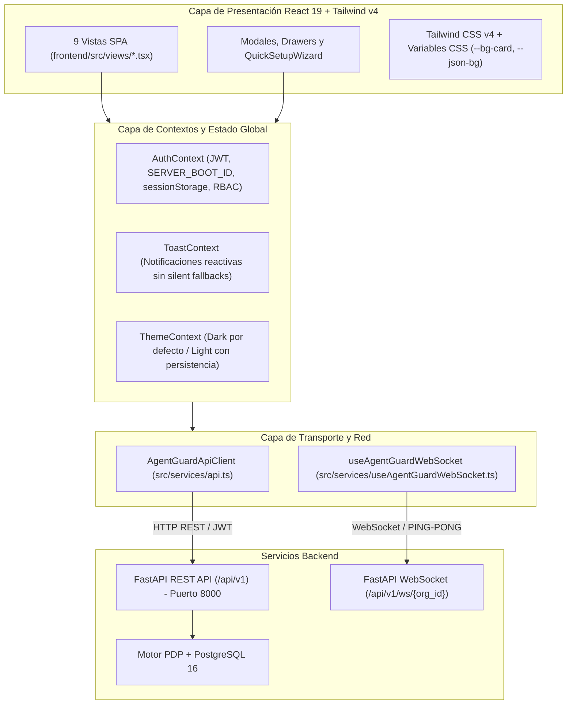
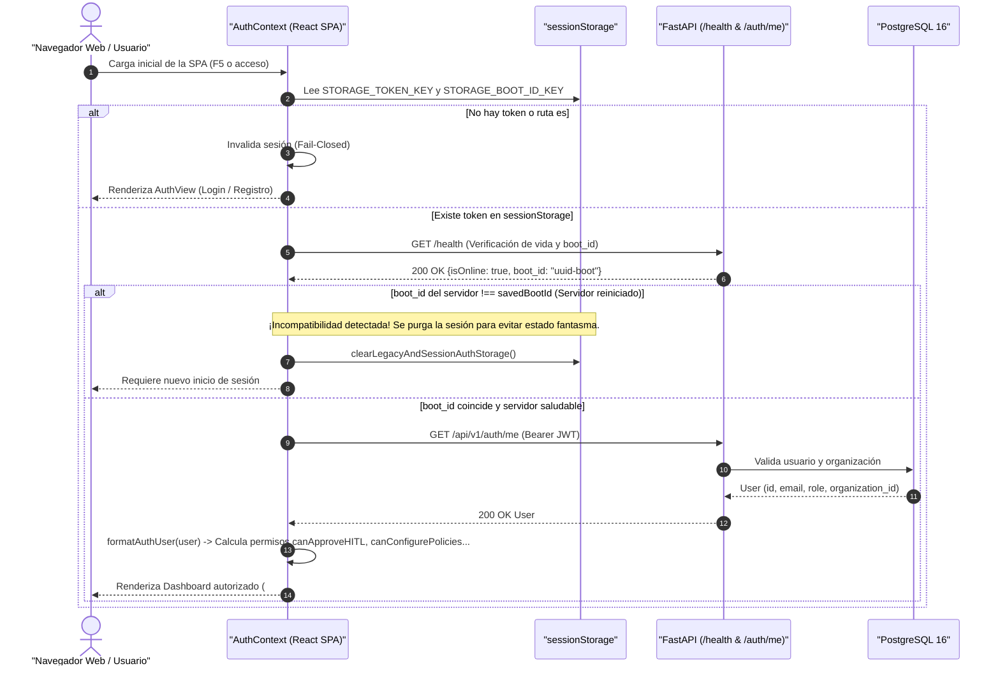
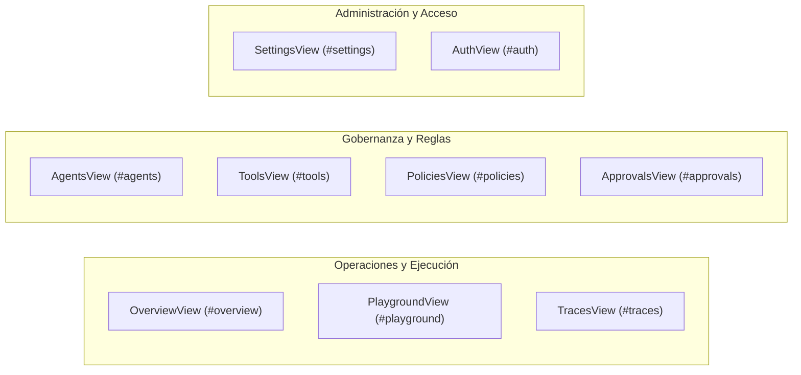
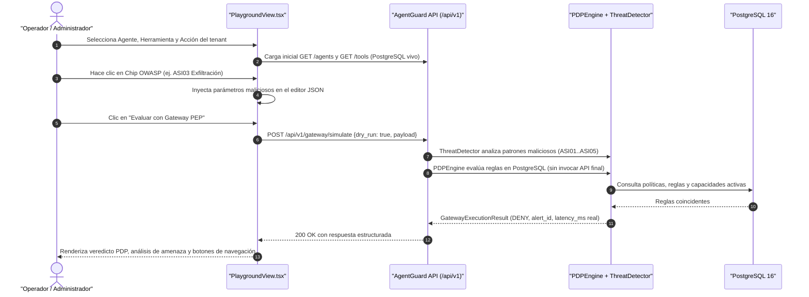
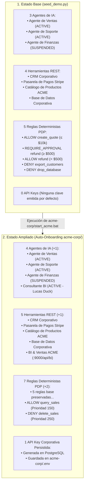

# 05 — Manual Frontend SPA, Sistema RBAC y Guía de Credenciales

> **Documento Oficial de Referencia Frontend y Seguridad (SSOT):** Inspección 100% fidedigna del código fuente real en `frontend/src/**`, `backend/app/api/deps.py`, `backend/app/api/*.py`, `backend/scripts/seed_demo.py` y `acme-corp/`.

---

## 1. Ficha Técnica del Stack Frontend y Arquitectura de Cliente

El frontend de **AgentGuard** está concebido como una Single Page Application (SPA) empresarial de alto rendimiento, diseñada para la observabilidad en runtime, gobernanza determinista de agentes de IA y resolución en tiempo real de aprobaciones humanas (HITL).



### 1.1 Dependencias y Versiones Exactas (`frontend/package.json`)

| Paquete / Herramienta | Versión Exacta | Rol en la Arquitectura |
| :--- | :--- | :--- |
| **`react`** | `^19.2.8` | Núcleo de componentes, hooks modernos (`useCallback`, `useMemo`, `useRef`). |
| **`react-dom`** | `^19.2.8` | Renderizador en el DOM para React 19. |
| **`vite`** | `^8.3.0` | Bundler y servidor de desarrollo HMR ultrarrápido (Puerto `5173`). |
| **`typescript`** | `~6.0.2` | Tipado estático estricto del dominio y contratos de API. |
| **`tailwindcss`** | `v4` (`@import "tailwindcss";`) | Motor CSS basado en variables de tema nativas `@theme inline`. |
| **`lucide-react`** | `^1.57.0` | Set iconográfico unificado para toda la consola de administración. |
| **`oxlint`** | `^1.81.0` | Linter Rust ultrarrápido configurado en `npm run lint`. |
| **`pnpm`** | `v9+` / `v10+` | Gestor de paquetes canónico del proyecto (con enlaces simbólicos). |

### 1.2 Comandos y Scripts Canónicos

Los comandos oficiales se ejecutan desde la raíz del proyecto o dentro del directorio `frontend/`:
- **Verificación rápida de tipos TypeScript (~1s):**
  ```powershell
  pnpm --dir frontend exec tsc -b
  ```
- **Linter de código estático (Oxlint):**
  ```powershell
  pnpm --dir frontend run lint
  ```
- **Compilación de producción:**
  ```powershell
  pnpm --dir frontend run build
  # Ejecuta secuencialmente: tsc -b && vite build
  ```
- **Servidor de desarrollo local:**
  ```powershell
  pnpm --dir frontend run dev
  # Expone la SPA en http://localhost:5173
  ```

---

### 1.3 Arquitectura de Integración HTTP: `src/services/api.ts`

La clase `AgentGuardApiClient` encapsula todas las peticiones a la API FastAPI (`/api/v1`) bajo la política estricta de **Cero Silent Fallbacks**:
1. **Clase Canónica `ApiError`:** Ante cualquier código HTTP `>= 400`, se invoca `extractApiError(res)` para desempaquetar el mensaje de error estructurado (`detail` de FastAPI o lista de errores de validación Pydantic) y se lanza una instancia de `ApiError(status, detail, errors)`. Nunca se retorna un mock vacío ni se ocultan errores del servidor.
2. **Normalización de Red (`handleNetworkError`):** Si la conexión con `http://localhost:8000` se cae o falla el socket TCP, se mapea a `ApiError(0, 'Error de conexión con el servidor')` para que la UI notifique la indisponibilidad mediante `useToast().error(...)`.
3. **Señales de Timeout con `AbortSignal.timeout(...)`:** Todas las operaciones de red cuentan con límites de tiempo deterministas para evitar bloqueos:
   - Lecturas rápidas (`/health`, `/agents`, `/tools`, `/traces`): `5000 ms` - `6000 ms`.
   - Modificaciones de políticas, usuarios y herramientas: `8000 ms`.
   - Simulaciones en Playground (`/gateway/simulate`): `6000 ms`.
   - Purgas y restablecimiento de datos (`/demo/reset`): `15000 ms`.
4. **Manejo de Aislamiento de Organización Activa:**
   - La API inyecta el token Bearer en el encabezado `Authorization: Bearer <token>` mediante `fetchWithAuth`.
   - El tenant activo se recupera de `sessionStorage.getItem('agentguard_active_org')`. Si existiera una clave obsoleta en `localStorage`, se purga automáticamente para evitar fugas de sesión cross-tenant.

---

### 1.4 Notificaciones Reactivas: `ToastContext.tsx`

Centraliza el feedback al usuario en la esquina superior derecha de la pantalla:
- **Hook `useToast()`:** Expone helpers ergonómicos: `toast.success(msg)`, `toast.error(msg)`, `toast.warning(msg)` y `toast.info(msg)`.
- **Cola y Descarte Automático:** Cada notificación recibe un identificador único `toast_<timestamp>_<random>` y se programa su eliminación a los `4000 ms` (configurable).
- **Limpieza de Temporizadores:** `ToastProvider` gestiona un `useRef<Map<string, ReturnType<typeof setTimeout>>>` que purga todos los timers activos al desmontar la vista, previniendo fugas de memoria.

---

### 1.5 Ciclo de Autenticación, Hidratación y Protección Fail-Closed: `AuthContext.tsx`

El contexto de autenticación implementa defensas críticas de seguridad:



#### Reglas de Seguridad en `AuthContext`:
1. **Arranque Fail-Closed:** `isAuthenticated` inicia estrictamente en `false` y `isLoading` en `true`. Ningún componente protegido se renderiza hasta confirmar la sesión en vivo.
2. **Validación contra `SERVER_BOOT_ID`:** En cada arranque, el frontend consulta `GET /health`. Si el backend fue reiniciado (nuevo `boot_id` tras reinicio de Docker o Uvicorn), cualquier JWT previo es revocado de inmediato en el cliente para evitar inconsistencias con la base de datos resembrada.
3. **Purga de Almacenamiento Legado:** Todo rastro en `localStorage` de `agentguard_token`, `agentguard_user` y `agentguard_active_org` es borrado al inicio. Toda sesión vive exclusivamente en `sessionStorage` (aislada por pestaña).
4. **Cálculo Derivado de Permisos (`formatAuthUser`):**
   ```typescript
   canApproveHITL: role === 'ADMIN' || role === 'APPROVER',
   canConfigurePolicies: role === 'ADMIN',
   canManageTeam: role === 'ADMIN',
   canManageAlerts: role === 'ADMIN' || role === 'APPROVER' || role === 'OPERATOR',
   canRunPlayground: role === 'ADMIN' || role === 'OPERATOR',
   canViewAudit: role === 'ADMIN' || role === 'AUDITOR',
   canResetDemo: role === 'ADMIN' && (email.toLowerCase().endsWith('@acmecorp.com') || resolvedOrgName === 'Acme Corp'),
   mustChangePassword: Boolean(user.must_change_password ?? user.mustChangePassword)
   ```

---

### 1.6 Sistema de Diseño y Temas: `ThemeProvider.tsx` e `index.css`

AgentGuard implementa un tema oscuro nativo (*Navy Cyberpunk*) con opción a tema claro, utilizando atributos HTML `data-theme="dark"` / `data-theme="light"` y variables CSS personalizadas:
- `--bg-app`: `#0B121A` (navy muy profundo de base).
- `--bg-sidebar`: `#0D1520` (superficie del menú lateral).
- `--bg-card`: `#131C28` (fondo de tarjetas de información).
- `--bg-card-hover`: `#182432` (elevación en hover).
- `--json-bg`: `#0A1320` (fondo oscuro para editores y visores de JSON).
- `--json-text`: `#7DD3FC` (celeste 300 para texto de parámetros estructurados).
- `--brand-primary`: `#0EA5E9` (celeste 500 para botones de acción principal).
- `--brand-turquoise`: `#2DD4BF` (acento turquesa).
- `--success`: `#34D399` / `--danger`: `#F87171` / `--warning`: `#FBBF24` / `--info`: `#38BDF8`.

---

### 1.7 Localización Canónica 100% en Español: `src/constants/labels.ts`

Erradica términos crudos en inglés de la interfaz visual, manteniendo compatibilidad con los enums OpenAPI:
- **Roles:** `ADMIN` -> «Administrador», `APPROVER` -> «Aprobador (HITL)», `OPERATOR` -> «Operador», `AUDITOR` -> «Auditor», `VIEWER` -> «Visualizador».
- **Decisiones PDP:** `ALLOW` -> «Permitido», `DENY` -> «Denegado», `REQUIRE_APPROVAL` -> «Requiere Aprobación».
- **Estados de Agente:** `ACTIVE` -> «Activo», `SUSPENDED` -> «Suspendido», `REVOKED` -> «Revocado».
- **Severidad de Alertas:** `LOW` -> «Baja», `MEDIUM` -> «Media», `HIGH` -> «Alta», `CRITICAL` -> «Crítica».
- **Riesgo de Acciones:** `LOW` -> «Bajo», `MEDIUM` -> «Medio», `HIGH` -> «Alto», `CRITICAL` -> «Crítico».
- **Estados de Aprobación:** `PENDING` -> «Pendiente», `APPROVED` -> «Aprobada», `REJECTED` -> «Rechazada», `EXPIRED` -> «Expirada».

---

### 1.8 Conexión WebSocket en Tiempo Real: `useAgentGuardWebSocket.ts`

Gestiona el streaming reactivo bidireccional contra `/api/v1/ws/{org_id}`:
1. **Heartbeat PING/PONG:** Envía `{"type": "PING"}` cada `25` segundos para mantener viva la conexión a través de balanceadores o firewalls.
2. **Reconexión con Backoff Exponencial:** Si el canal WebSocket se interrumpe, reintenta con retardo progresivo:
   $$\text{delay} = \min(1000 \times 1.5^{\text{intentos}}, 15000)\text{ ms}$$
3. **Despacho de Eventos:**
   - `NEW_APPROVAL`: Notifica la creación de un ticket HITL pendiente y actualiza el contador global de la barra lateral.
   - `RESOLVED_APPROVAL`: Informa que un ticket fue aprobado o rechazado por un humano.
   - `NEW_ALERT`: Alerta de seguridad detectada (ej. OWASP ASI03).
   - `ALERT_STATUS_UPDATED`: Cambio de estado en una alerta (OPEN -> RESOLVED).
   - `NEW_EXECUTION`: Inserción en vivo de una nueva traza de ejecución en la tabla de auditoría.

---

## 2. Documentación Exhaustiva de las 9 Vistas (`frontend/src/views/`)



---

### 2.1 `OverviewView.tsx` — Panel Ejecutivo y Observabilidad General

- **Propósito:** Ofrece un cuadro de mando con métricas agregadas del tenant actual, latencia del motor PDP y eventos críticos en tiempo real.
- **Componentes y Métricas:**
  - **KPIs Principales:** Total de Ejecuciones evaluadas, Desglose de Decisiones (`ALLOW`, `DENY`, `REQUIRE_APPROVAL`), Latencia promedio en milisegundos (`evaluation_latency_ms`) y Alertas de seguridad activas.
  - **Gráfico Temporal de Ejecuciones:** Curva de actividad histórica generada desde `GET /api/v1/analytics/timeseries`.
  - **Tabla de Últimas Ejecuciones:** Trae las 5 transacciones más recientes con insignias semánticas de decisión.
  - **Feed de Incidentes Recientes:** Muestra alertas abiertas con nivel de severidad y botón directo de investigación.
- **Navegación Contextual:** Accesos rápidos con un solo clic hacia el **Playground**, **Políticas** o la **Bandeja de Aprobaciones**.

---

### 2.2 `AgentsView.tsx` — Gestión de Agentes de IA y Capacidades

- **Propósito:** Administración del inventario de agentes inteligentes registrados para la organización y sus herramientas asociadas.
- **Funcionalidades:**
  - **Filtrado y Búsqueda:** Filtro por estado (`ACTIVE`, `SUSPENDED`, `REVOKED`), buscador por nombre o propósito, y filtro por herramientas asignadas.
  - **Modal de Registro de Agente:** Permite dar de alta un agente (`name`, `purpose`, `status: ACTIVE | SUSPENDED`) y seleccionar qué herramientas tendrá habilitadas (`selectedTools` vinculadas mediante `POST /api/v1/agents/{id}/tools`).
  - **Acceso al Asistente Rápido:** Botón destacado para abrir el `QuickSetupWizard`.
  - **Drawer Lateral de Detalle:**
    - Identificador UUID único con botón de copiado rápido.
    - Acciones de ciclo de vida: Activar / Suspender agente (`PUT /api/v1/agents/{id}/status`).
    - Revocación permanente de credenciales (`DELETE /api/v1/agents/{id}`).
    - Listado de herramientas activas con desglose de acciones atómicas permitidas.
- **Control RBAC:** La creación, suspensión y revocación están restringidas a usuarios con rol `ADMIN`. Los roles restantes operan en modo solo lectura.

---

### 2.3 `ToolsView.tsx` — Catálogo de Herramientas y Acciones Atómicas

- **Propósito:** Gestión de las APIs y microservicios externos que los agentes pueden invocar bajo supervisión de AgentGuard.
- **Funcionalidades:**
  - **Catálogo de Herramientas:** Listado de integraciones registradas (ej. `CRM Corporativo`, `Pasarela de Pagos Stripe`, `Catálogo de Productos ACME`, `Base de Datos Corporativa`).
  - **Modal "Registrar Herramienta":** Alta de nombre, descripción, protocolo (`REST`) y URL base del endpoint de destino.
  - **Gestión de Acciones Atómicas (`ToolAction`):**
    - Desglose por herramienta de sus acciones expuestas (`action_name`, ej. `create_quote`, `refund`, `update_price`).
    - Asignación de nivel de riesgo: `LOW`, `MEDIUM`, `HIGH`, `CRITICAL`.
    - Modal para agregar nuevas acciones atómicas a una herramienta existente.
- **Control RBAC:** Exclusivo de administradores humanos (`ADMIN` vía `require_admin_user`).

---

### 2.4 `PoliciesView.tsx` — Políticas de Gobernanza y Reglas Deterministas

- **Propósito:** Configuración del motor de políticas de autorización contextual (PDP).
- **Funcionalidades:**
  - **Listado Jerárquico de Políticas:** Muestra políticas activas agrupando sus reglas deterministas ordenadas por prioridad numérica (menor número = mayor prioridad de evaluación).
  - **Banner de Protección Fail-Closed:** Identifica visualmente acciones atómicas que no cuentan con regla explícita configurada, advirtiendo que serán bloqueadas por omisión (`DENY` por defecto).
  - **Modal "Nueva Política":** Crea una política contenedora (`name`, `description`).
  - **Modal "Nueva Regla":**
    - Selección de la acción atómica de destino (`tool_action_id`).
    - Agente específico (opcional, para aislamiento N:N) o regla global para todos los agentes.
    - Prioridad numérica (ej. 100, 200, 300).
    - Efecto determinista: `ALLOW`, `REQUIRE_APPROVAL` o `DENY`.
    - Editor de Condiciones JSON: Configuración de umbrales cuantitativos (ej. `{"amount": {"lte": 10000}}`).
  - **Drawer Lateral de Edición:** Permite cambiar el estado de la política (Activa / Inactiva), eliminar reglas individuales o borrar la política completa en cascada (`DELETE /api/v1/policies/{id}`).
- **Control RBAC:** Configurable únicamente por administradores (`ADMIN`).

---

### 2.5 `ApprovalsView.tsx` — Bandeja Human-in-the-Loop (HITL) en Tiempo Real

- **Propósito:** Bandeja de entrada para que supervisores humanos evalúen y resuelvan transacciones de agentes detenidas por políticas `REQUIRE_APPROVAL`.
- **Funcionalidades:**
  - **Suscripción WebSocket en Vivo:** Al producirse una solicitud sensible en cualquier agente (ej. reembolso `>= $500`), el ticket aparece de forma instantánea en la pantalla sin recargar la página (`onNewApproval`).
  - **Temporizador de Expiración:** Cada ticket cuenta con un TTL de 15 minutos (900 segundos). Si no se resuelve en ese lapso, transiciona automáticamente a `EXPIRED`.
  - **Panel de Inspección:** Visualiza el agente solicitante, herramienta, acción, parámetros JSON formateados, justificación y riesgo.
  - **Acciones de Resolución:**
    - Botón **Aprobar** (`decision: APPROVED`): Reanuda el despacho en el Gateway hacia la API final.
    - Botón **Rechazar** (`decision: REJECTED`): Deniega la operación permanentemente con motivo opcional.
- **Control RBAC:** Requiere explícitamente rol `ADMIN` o `APPROVER`. Para otros roles, los botones de acción se deshabilitan con una insignia explicativa.

---

### 2.6 `TracesView.tsx` — Auditoría Forense de Ejecuciones e Incidentes

- **Propósito:** Registro inmutable de trazabilidad operativa y centro de triage para alertas de seguridad OWASP.
- **Funcionalidades:**
  - **Pestaña de Trazas (`executions`):**
    - Muestra cada invocación al Gateway con su identificador UUID, timestamp ISO-8601, agente, herramienta, acción y veredicto (`ALLOW`, `DENY`, `REQUIRE_APPROVAL`).
    - Muestra la **latencia real medida en milisegundos** (`latency_ms`), nunca hardcodeada.
    - Visualización del contexto de la petición sanitizado (tokens enmascarados como `[REDACTED_SECRET]`).
    - Enlace cruzado con el `approval_id` o `alert_id` asociado.
  - **Pestaña de Alertas (`alerts`):**
    - Incidentes de seguridad generados por el analizador de amenazas (ej. OWASP ASI03 Exfiltración).
    - Severidad: `LOW`, `MEDIUM`, `HIGH`, `CRITICAL`.
    - Acciones de gestión: Marcar como `INVESTIGATING`, `RESOLVED` o `DISMISSED`.
- **Control RBAC:** Trazas consultables por `ADMIN` y `AUDITOR`. Resolución de alertas permitida para `ADMIN`, `APPROVER` y `OPERATOR`.

---

### 2.7 `PlaygroundView.tsx` — Evaluador PDP Real sobre PostgreSQL

> [!IMPORTANT]
> ### 🚨 Evaluación 100% Real: Cero Maquetas en el Playground
> `PlaygroundView.tsx` **NO es una maqueta ni un simulador estático**. Ejecuta llamadas HTTP reales contra `POST /api/v1/gateway/simulate` y consume `GET /api/v1/gateway/attacks`. Las políticas se evalúan en tiempo real directamente sobre las tablas de **PostgreSQL 16** mediante el motor determinista del backend (`PDPEngine`).



#### Capacidades Específicas del Playground:
1. **Entidades Vivas del Tenant:** Los selectores de Agente, Herramienta y Acción se pueblan dinámicamente con los registros reales de la organización en PostgreSQL.
2. **Editor de Parámetros con Validación de Sintaxis:** Campo JSON con detección de errores sintácticos en tiempo real que previene envíos corruptos.
3. **Catálogo de Chips de Prueba Rápida OWASP (ASI01 a ASI05):**
   - `ESTÁNDAR`: Cotización comercial legítima ($2,500).
   - `ASI01`: Inyección de Prompt (*Goal Hijacking* con intento de anulación de reglas).
   - `ASI03`: Exfiltración masiva de datos hacia Webhook externo (`https://attacker.io/leak`).
   - `ASI04`: Evasión de filtros de palabras clave codificada en Base64.
   - `ASI05`: Sentencia destructiva de base de datos (`DROP TABLE users CASCADE;`).
4. **Respuesta Estructurada con Navegación Contextual:** Al recibir la respuesta del backend, la vista renderiza:
   - Medalla del veredicto (`Permitido`, `Denegado`, `Requiere Aprobación`).
   - Latencia de evaluación medida (`latency_ms`).
   - Caja de amenaza de seguridad con categoría OWASP, patrón detectado y payload decodificado.
   - Botones inteligentes para saltar a **Ajustar Reglas en Políticas**, **Ver en Bandeja de Aprobaciones** o **Ver en Trazas**.
- **Control RBAC:** Simulación permitida para `ADMIN` y `OPERATOR` (`currentUser.canRunPlayground`).

---

### 2.8 `SettingsView.tsx` — Ajustes, Equipo, API Keys y SIEM Webhook

- **Propósito:** Administración central del tenant corporativo y configuración de seguridad.
- **Secciones:**
  - **Perfil de la Organización:** Visualización de nombre, identificador UUID y fecha de creación.
  - **Gestión de Miembros del Equipo:**
    - Listado de usuarios humanos con su rol RBAC asignado.
    - Modal para invitar / registrar nuevos usuarios con selección de rol (`ADMIN`, `APPROVER`, `OPERATOR`, `AUDITOR`, `VIEWER`).
    - Eliminación de miembros del equipo.
  - **Claves de API del Gateway (Data Plane):**
    - Creación de nuevas llaves (`POST /api/v1/api-keys`).
    - Visualización protegida: el secreto en texto plano (`ag_live_...`) se muestra **una sola vez** al momento de la creación con botón de copiado. En la base de datos se almacena únicamente el hash criptográfico SHA-256 (`api_key_hash`) y el prefijo de 8 caracteres (`api_key_prefix`).
    - Revocación y eliminación de claves.
  - **Integración con SIEM Corporativo:**
    - Configuración de URL de Webhook externo y secreto compartido.
    - Botón **Probar Conexión Webhook**: Envía un evento firmado con HMAC-SHA256 y verifica la recepción exitosa (código 200).
  - **Zona de Peligro — Restablecer Entorno Demo:** Botón para abrir el modal `ResetDemoModal`.
- **Control RBAC:** Todas las mutaciones de configuración exigen rol `ADMIN`.

---

### 2.9 `AuthView.tsx` — Acceso Seguro, Registro B2B y Onboarding SaaS

- **Propósito:** Puerta de entrada a la plataforma con soporte para múltiples flujos de autenticación.
- **Modos de Operación:**
  1. **Pestaña Iniciar Sesión:** Autenticación por correo y contraseña (`POST /api/v1/auth/login`). Al autenticarse, persiste el token JWT en `sessionStorage` y redirige a `#overview`.
  2. **Pestaña Registrar Empresa (Alta SaaS B2B):** Formulario para aprovisionar una nueva organización independiente (`POST /api/v1/auth/register-org`). En una sola transacción crea:
     - La nueva entidad `Organization`.
     - El usuario Administrador inicial (`ADMIN`).
     - La primera clave de API de acceso al Gateway (`ag_live_...`).
     - Al completarse, presenta un panel de éxito (`onboardingSuccessPanel`) con el secreto para copiarlo al portapapeles antes de entrar al dashboard.
  3. **Botón Rápido Demo:** Atajo para iniciar sesión instantáneamente con la cuenta `admin@acmecorp.com` / `demo-password`.

---

## 3. Componentes Clave de Onboarding y Seguridad

### 3.1 `QuickSetupWizard.tsx` — Asistente de Configuración Rápida en 3 Pasos

Permite a un administrador vincular una nueva capacidad protegida de principio a fin sin navegar por tres pantallas distintas:
- **Paso 1: Herramienta y Acción:** Define el nombre de la herramienta (ej. *Pasarela de Pagos Stripe*), la URL del endpoint y la acción principal con su nivel de riesgo (`HIGH`). Invoca `api.createTool`.
- **Paso 2: Agente y Vinculación:** Define el nombre del agente (ej. *Agente de Finanzas y Soporte*) y su propósito. Invoca `api.createAgent` y `api.bindAgentTool` asociando la herramienta creada en el Paso 1.
- **Paso 3: Política y Regla:** Establece la política de gobernanza (ej. *Política de Control de Reembolsos*), la decisión del motor PDP (`REQUIRE_APPROVAL`) y el umbral de monto (`max_amount: 500`). Invoca `api.createPolicy` y `api.createPolicyRule`.

---

### 3.2 `ForcePasswordChangeModal.tsx` — Bloqueo Obligatorio de Contraseña Temporal

Protección de seguridad estricta para usuarios con credenciales provisorias:
- **Control Modal Nativo `<dialog>`:** Se abre mediante `dialog.showModal()`, creando una capa sobre el resto de la interfaz.
- **Intercepción de Cancelación (Escape):** Intercepta el evento `cancel` (tecla Escape). Si el usuario intenta cerrarlo sin cambiar la clave, el modal se vuelve a abrir de inmediato.
- **Validaciones en Cliente:**
  - Contraseña nueva de al menos 8 caracteres.
  - La nueva contraseña debe ser obligatoriamente diferente a la temporal actual.
  - Confirmación de contraseña coincidente.
- **Actualización en Backend:** Invoca `POST /api/v1/auth/change-password`. Tras el éxito, remueve la bandera `must_change_password` en la sesión y libera la navegación.

---

### 3.3 `ResetDemoModal.tsx` — Factory Reset en Vivo de PostgreSQL 16

Permite restablecer el entorno de evaluación académica a su estado oficial sin reiniciar contenedores Docker:
- **Ejecución Real:** Invoca el endpoint administrativo `POST /api/v1/demo/reset`.
- **Acciones en el Backend:** Ejecuta `seed_demo.py --reset`, purgando en cascada las operaciones acumuladas en las 12 tablas de PostgreSQL para el tenant Acme Corp y re-sembrando los 3 agentes, 4 herramientas y 5 reglas canónicas.
- **Rehidratación de Sesión:** Tras recibir la respuesta exitosa, refresca automáticamente el token JWT y recarga la SPA para sincronizar el estado visual.

---

## 4. Matriz Exacta de Permisos RBAC (5 Roles)

AgentGuard implementa un modelo de Control de Acceso Basado en Roles (RBAC) con **Blindaje Anti-IA**: las cabeceras `X-Agent-Id` son rechazadas de inmediato con `403 Forbidden` en todas las rutas administrativas del Control Plane.

### Matriz Completa de Autorización (Backend vs Frontend)

| Funcionalidad / Recurso | Endpoint de API | Dependencia Backend (`deps.py`) | ADMIN | APPROVER | OPERATOR | AUDITOR | VIEWER | Bandera UI (`AuthUser`) |
| :--- | :--- | :--- | :---: | :---: | :---: | :---: | :---: | :--- |
| **Dashboard Ejecutivo** | `GET /analytics/overview` | `get_current_user` | ✅ | ✅ | ✅ | ✅ | ✅ | `isAuthenticated` |
| **Gráficas Temporales** | `GET /analytics/timeseries` | `get_current_user` | ✅ | ✅ | ✅ | ✅ | ✅ | `isAuthenticated` |
| **Listar Agentes** | `GET /agents` | `get_current_user` | ✅ | ✅ | ✅ | ✅ | ✅ | `isAuthenticated` |
| **Crear / Editar Agente** | `POST, PUT /agents` | `require_admin_user` | ✅ | ❌ | ❌ | ❌ | ❌ | `canManageTeam` |
| **Suspender / Revocar Agente** | `PUT /status, DELETE /agents` | `require_admin_user` | ✅ | ❌ | ❌ | ❌ | ❌ | `canManageTeam` |
| **Vincular AgentTool (N:N)** | `POST /agents/{id}/tools` | `require_admin_user` | ✅ | ❌ | ❌ | ❌ | ❌ | `canConfigurePolicies` |
| **Listar Herramientas** | `GET /tools, GET /tool-actions` | `get_current_user` | ✅ | ✅ | ✅ | ✅ | ✅ | `isAuthenticated` |
| **Crear / Modificar Tools** | `POST, PUT, DELETE /tools` | `require_admin_user` | ✅ | ❌ | ❌ | ❌ | ❌ | `canConfigurePolicies` |
| **Listar Políticas y Reglas** | `GET /policies, GET /policy-rules` | `get_current_user` | ✅ | ✅ | ✅ | ✅ | ✅ | `isAuthenticated` |
| **Crear / Borrar Políticas** | `POST, PUT, DELETE /policies` | `require_admin_user` | ✅ | ❌ | ❌ | ❌ | ❌ | `canConfigurePolicies` |
| **Crear / Borrar Reglas PDP** | `POST, DELETE /policy-rules` | `require_admin_user` | ✅ | ❌ | ❌ | ❌ | ❌ | `canConfigurePolicies` |
| **Listar Aprobaciones HITL** | `GET /approvals` | `get_current_user` | ✅ | ✅ | ✅ | ✅ | ✅ | `isAuthenticated` |
| **Resolver HITL (Aprobar/Rechazar)** | `POST /approvals/{id}/resolve` | `require_roles(ADMIN, APPROVER)` | ✅ | ✅ | ❌ | ❌ | ❌ | `canApproveHITL` |
| **Simulación en Playground** | `POST /gateway/simulate` | `require_roles(ADMIN, OPERATOR)` | ✅ | ❌ | ✅ | ❌ | ❌ | `canRunPlayground` |
| **Listar Trazas de Ejecución** | `GET /executions` | `get_current_user` | ✅ | ✅ | ✅ | ✅ | ✅ | `canViewAudit` |
| **Auditoría Forense Avanzada** | `GET /audit-events` | `require_roles(ADMIN, AUDITOR)` | ✅ | ❌ | ❌ | ✅ | ❌ | `canViewAudit` |
| **Listar Alertas de Seguridad** | `GET /alerts` | `get_current_user` | ✅ | ✅ | ✅ | ✅ | ✅ | `isAuthenticated` |
| **Cambiar Estado de Alerta** | `PATCH /alerts/{id}/status` | `require_roles(ADMIN, APPROVER, OPERATOR)` | ✅ | ✅ | ✅ | ❌ | ❌ | `canManageAlerts` |
| **Gestionar Equipo (Usuarios)** | `POST, PUT, DELETE /users` | `require_admin_user` | ✅ | ❌ | ❌ | ❌ | ❌ | `canManageTeam` |
| **Crear / Revocar API Keys** | `POST, DELETE /api-keys` | `require_admin_user` | ✅ | ❌ | ❌ | ❌ | ❌ | `canConfigurePolicies` |
| **Configurar SIEM Webhook** | `PUT /organizations/{id}/settings` | `require_admin_user` | ✅ | ❌ | ❌ | ❌ | ❌ | `canConfigurePolicies` |
| **Restablecer Entorno Demo** | `POST /demo/reset` | `require_admin_user` | ✅ | ❌ | ❌ | ❌ | ❌ | `canResetDemo` |

> **Comportamiento ante Violación de Rol:** El backend FastAPI retorna de inmediato un error `HTTP 403 Forbidden` con detalle explícito en español: *«Acceso denegado: El usuario con rol 'OPERATOR' no tiene privilegios de ADMIN para esta operación»*. El frontend intercepta la excepción con `extractApiError` y despliega una notificación de error en rojo mediante `useToast().error(...)`.

---

## 5. Guía Completa de Credenciales Demo (`Acme Corp`)

Para facilitar la evaluación y defensas académicas, AgentGuard cuenta con usuarios pre-sembrados con contraseñas deterministas.

### 5.1 Cuentas Canónicas Sembradas (`backend/scripts/seed_demo.py`)

Todos los usuarios demo comparten la contraseña uniforme: **`demo-password`**.

| Correo Electrónico | Rol RBAC | Contraseña | Propósito en la Demostración |
| :--- | :--- | :--- | :--- |
| **`admin@acmecorp.com`** | `ADMIN` | `demo-password` | **Control total:** Configurar políticas, crear reglas, gestionar usuarios y API Keys, restablecer demo. |
| **`approver@acmecorp.com`** | `APPROVER` | `demo-password` | **Gobernanza Humana (HITL):** Autorizar o rechazar solicitudes de reembolso retenidas en `ApprovalsView`. |
| **`operator@acmecorp.com`** | `OPERATOR` | `demo-password` | **Sandbox & Monitoreo:** Evaluar ataques y vectores OWASP en `PlaygroundView`, gestionar estados de alertas. |
| **`auditor@acmecorp.com`** | `AUDITOR` | `demo-password` | **Cumplimiento y Forense:** Inspeccionar trazas en `TracesView` y consultar registros inmutables en `audit_events`. |
| **`viewer@acmecorp.com`** | `VIEWER` | `demo-password` | **Consulta Ejecutiva:** Vista general del dashboard analítico en modo solo lectura estricto. |

---

### 5.2 Comparativa de Estado: Semilla Base vs Estado Ampliado

Es fundamental comprender la diferencia entre el estado recién sembrado por `seed_demo.py` y el estado ampliado tras el auto-onboarding del portal empresarial `acme-corp/`:



---

### 5.3 Flujo de Alta Autogestionada SaaS B2B (`POST /api/v1/auth/register-org`)

Cualquier organización externa puede registrarse de forma autónoma sin intervención manual. La petición viaja con el esquema:

```json
{
  "organization_name": "Wayne Enterprises",
  "admin_name": "Bruce Wayne",
  "email": "bruce@waynecorp.com",
  "password": "Password123!"
}
```

#### Transacción Atómica en el Backend:
1. Crea la fila en la tabla `organizations` generando un nuevo `organization_id` (UUID v4).
2. Crea el usuario administrador con `role = UserRole.ADMIN` y hash de contraseña Argon2/Bcrypt.
3. Genera una clave criptográfica de API con prefijo `ag_live_` y persistencia de su hash SHA-256 en `api_keys`.
4. Retorna el token JWT del usuario y la llave en texto plano:
   ```json
   {
     "access_token": "eyJhbGciOiJIUzI1Ni...",
     "token_type": "bearer",
     "user": {
       "id": "c1f7b882-...",
       "email": "bruce@waynecorp.com",
       "role": "ADMIN",
       "organization_id": "8f3b2a11-..."
     },
     "organization": {
       "id": "8f3b2a11-...",
       "name": "Wayne Enterprises"
     },
     "api_key": "ag_live_9f81a7b82c3d4e5f60718293a4b5c6d7",
     "api_key_prefix": "ag_live_",
     "api_key_id": "3e9b1102-..."
   }
   ```
5. La SPA detecta la respuesta y muestra el panel `onboardingSuccessPanel` para garantizar que el nuevo administrador copie su credencial antes de comenzar a operar.
