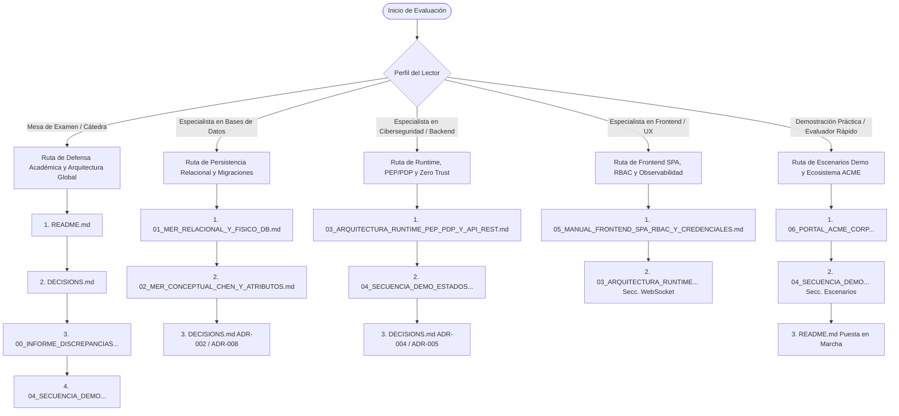

# 🧭 AgentGuard: Índice Maestro y Guía de Navegación del Sistema

> **Repositorio:** `AgentGuard` — SaaS multi-tenant de autorización contextual, gobernanza y observabilidad en runtime para agentes de Inteligencia Artificial (*«IAM responde quién eres; AgentGuard decide qué puedes hacer ahora»*).  
> **Cátedra:** Desarrollo Web (ITU — UNCuyo, 2026).  
> **Fecha de Consolidación:** Noviembre 2026.  
> **Estado de la Suite:** 100% Coherente con Código Real y Bases de Datos Físicas (**Zero-Regression Verified**).

---

## 1. Propósito de este Índice y de la Carpeta `documentación final/`

Esta carpeta reúne la **documentación definitiva, verificada y auditada** de AgentGuard, construida bajo la metodología **SDD (Spec-Driven Development)** y alineada de manera milimétrica con el código fuente real del backend Python, frontend React, servicio satélite ACME Corp y sus esquemas de base de datos relacionales.

Históricamente, el repositorio albergó documentos preliminares que acumulaban desfasajes lógicos (omisión de migraciones, entidades faltantes en diagramas Chen, modelos de IA deprecados o falta de documentación del portal empresarial `acme-corp/`). Para resolverlo de forma irrevocable, se estructuraron **9 volúmenes especializados** más este **Índice Maestro**, proporcionando una fuente única de verdad (**SSOT**) libre de contradicciones, con enlaces relativos navegables y trazabilidad directa contra las líneas de código del repositorio.

---

## 2. Mapa Completo de los 10 Volúmenes Documentales

| N° | Archivo | Título del Volumen | Enfoque Principal | Autor / Rol |
| :---: | :--- | :--- | :--- | :--- |
| **00** | [`00_INFORME_DISCREPANCIAS_DOC_VS_CODIGO_REAL.md`](./00_INFORME_DISCREPANCIAS_DOC_VS_CODIGO_REAL.md) | **Informe de Auditoría Forense: Documentación Histórica vs. Código Real** | Catálogo exhaustivo de 29 discrepancias detectadas (7 críticas, 11 altas, 8 medias, 3 bajas) entre los 14 docs heredados y la implementación real (DB, backend, frontend, ACME). | `auditor-forense` |
| **—** | [`README.md`](./README.md) | **Guía Maestra del Proyecto y Arquitectura de Gobernanza Zero Trust** | Visión del SaaS, amenazas OWASP Agentic Top 10 (2026), arquitectura conceptual, árbol integral del monorepo, guía de puesta en marcha rápida e inventario de credenciales. | `arquitecto-ssot` |
| **—** | [`DECISIONS.md`](./DECISIONS.md) | **Registro de Decisiones Arquitectónicas (ADR-001 a ADR-009)** | Bitácora técnica y justificaciones de diseño: FastAPI async, PostgreSQL multi-tenant (13 tablas), Redis, PEP/PDP fail-closed, RBAC, WebSockets, ecosistema ACME SQLite y Copiloto Gemini 3.8 Flash. | `arquitecto-ssot` |
| **01** | [`01_MER_RELACIONAL_Y_FISICO_DB.md`](./01_MER_RELACIONAL_Y_FISICO_DB.md) | **Modelo Entidad-Relación Relacional, Esquema Físico y Migraciones Alembic** | Esquema físico exhaustivo de las 13 tablas PostgreSQL 16 (puerto 5433), PKs UUID v4 nativas (`gen_random_uuid()`), 24 FKs, 10 ENUMs, 4 índices GIN, 6 migraciones Alembic (`001`–`006`) y las 7 tablas SQLite de `acme_corp.db`. | `especialista-db` |
| **02** | [`02_MER_CONCEPTUAL_CHEN_Y_ATRIBUTOS.md`](./02_MER_CONCEPTUAL_CHEN_Y_ATRIBUTOS.md) | **MER Conceptual Notación Chen, Cardinalidades (mín, máx) y Diccionario de Atributos** | Diagrama Chen formal en Mermaid de las 13 entidades y la relación asociativa `AUTORIZADO_EN` (`agent_tools`), análisis formal de cardinalidades R1–R24, catálogo de 96 atributos y banco de 16 preguntas para defensa. | `especialista-db` |
| **03** | [`03_ARQUITECTURA_RUNTIME_PEP_PDP_Y_API_REST.md`](./03_ARQUITECTURA_RUNTIME_PEP_PDP_Y_API_REST.md) | **Arquitectura Runtime: Interceptor PEP, Motor PDP 5D y Catálogo de API REST** | Diagramas de componentes por capas, ciclo de vida del interceptor PEP (`POST /gateway/execute`), motor PDP determinista fail-closed (5 dimensiones), inventario de 17 routers FastAPI y eventos WebSockets en tiempo real. | `especialista-runtime` |
| **04** | [`04_SECUENCIA_DEMO_ESTADOS_Y_CASOS_DE_USO.md`](./04_SECUENCIA_DEMO_ESTADOS_Y_CASOS_DE_USO.md) | **Secuencias Runtime, Diagramas de Estados y Matriz de Casos de Uso** | Diagramas de secuencia Mermaid de los 4 escenarios canónicos de demo y del Consultante BI, máquinas de estado de Ejecuciones, Aprobaciones HITL y Alertas, más diagrama UML de Casos de Uso del sistema. | `especialista-runtime` |
| **05** | [`05_MANUAL_FRONTEND_SPA_RBAC_Y_CREDENCIALES.md`](./05_MANUAL_FRONTEND_SPA_RBAC_Y_CREDENCIALES.md) | **Manual de Frontend SPA (React 19), Matriz RBAC y Credenciales Operativas** | Arquitectura cliente Vite/React 19/Tailwind v4, política de cero silent fallbacks, sesiones efímeras con `SERVER_BOOT_ID`, las 9 vistas SPA operativas, componentes de seguridad (`ForcePasswordChangeModal`, `QuickSetupWizard`) y matriz RBAC de 5 roles. | `especialista-fullstack` |
| **06** | [`06_PORTAL_ACME_CORP_CONSULTANTE_BI_Y_AGENT_DEMO.md`](./06_PORTAL_ACME_CORP_CONSULTANTE_BI_Y_AGENT_DEMO.md) | **Portal Empresarial ACME Corp, Copiloto BI (Gemini 3.8 Flash) y CLI Agent Demo** | Arquitectura del portal satélite `:9000`, base SQLite de 7 tablas, auto-onboarding del CEO Lucas Duck, integración LLM Google Gemini 3.8 Flash con `thoughtSignature`, catálogo de 8 escenarios y uso de `run_demo.py`. | `especialista-fullstack` |
| **—** | [`INDICE_MAESTRO.md`](./INDICE_MAESTRO.md) | **Índice Maestro, Itinerarios de Lectura y Matriz de Trazabilidad Cruzada** | Este documento: taxonomía, recorridos recomendados según perfil evaluador, matriz de trazabilidad código vs. documentación y verificación de cero regresiones. | `verificador-qa` |

---

## 3. Itinerarios de Lectura Recomendados

Dependiendo del objetivo del lector, profesor o evaluador técnico, se sugieren los siguientes caminos críticos de lectura:



### Itinerario 1: Defensa de Cátedra y Evaluación de Arquitectura Global
1. [`README.md`](./README.md): Comprender el problema de gobernanza en agentes autónomos, la separación entre Control Plane y Data Plane, y el cumplimiento de las guías OWASP 2026.
2. [`DECISIONS.md`](./DECISIONS.md): Revisar los 9 Architecture Decision Records (ADRs) para entender por qué se tomaron decisiones de asincronía, multi-tenancy lógico, sesiones efímeras y fallbacks en LLMs.
3. [`00_INFORME_DISCREPANCIAS_DOC_VS_CODIGO_REAL.md`](./00_INFORME_DISCREPANCIAS_DOC_VS_CODIGO_REAL.md): Analizar la madurez del equipo para auditar desvíos históricos y certificar la fidelidad del software frente a las especificaciones.
4. [`04_SECUENCIA_DEMO_ESTADOS_Y_CASOS_DE_USO.md`](./04_SECUENCIA_DEMO_ESTADOS_Y_CASOS_DE_USO.md): Evaluar los diagramas de secuencia e interactuar con el banco de preguntas típicas de defensa de cátedra.

### Itinerario 2: Persistencia, Modelado Relacional y Normalización
1. [`01_MER_RELACIONAL_Y_FISICO_DB.md`](./01_MER_RELACIONAL_Y_FISICO_DB.md): Inspeccionar las 13 tablas en PostgreSQL 16 (puerto 5433), tipos de datos nativos, claves primarias UUID con `gen_random_uuid()`, columnas JSONB indexadas con GIN, y la secuencia completa de las 6 migraciones Alembic (`001` a `006`).
2. [`02_MER_CONCEPTUAL_CHEN_Y_ATRIBUTOS.md`](./02_MER_CONCEPTUAL_CHEN_Y_ATRIBUTOS.md): Validar el formalismo académico de la notación Chen, cardinalidades explícitas `(mín, máx)` de cada una de las 24 relaciones y el catálogo clasificado de los 96 atributos del modelo.

### Itinerario 3: Seguridad en Runtime, Interceptor PEP y Motor PDP
1. [`03_ARQUITECTURA_RUNTIME_PEP_PDP_Y_API_REST.md`](./03_ARQUITECTURA_RUNTIME_PEP_PDP_Y_API_REST.md): Analizar el flujo de intercepción del Policy Enforcement Point (`POST /api/v1/gateway/execute`), la evaluación determinista en 5 dimensiones del Policy Decision Point, la sanitización anti-fugas (LLM06) y el catálogo de 17 routers REST.
2. [`04_SECUENCIA_DEMO_ESTADOS_Y_CASOS_DE_USO.md`](./04_SECUENCIA_DEMO_ESTADOS_Y_CASOS_DE_USO.md): Estudiar la máquina de estados de las Aprobaciones Human-in-the-Loop (`PENDING`, `APPROVED`, `REJECTED`, `EXPIRED`) y los diagramas de secuencia de ataques bloqueados.

### Itinerario 4: Frontend SPA, Experiencia de Usuario y Gobernanza RBAC
1. [`05_MANUAL_FRONTEND_SPA_RBAC_Y_CREDENCIALES.md`](./05_MANUAL_FRONTEND_SPA_RBAC_Y_CREDENCIALES.md): Revisar la aplicación de React 19 y Tailwind v4, la ausencia de fallbacks silenciosos ante errores de red, la invalidación de sesiones basada en `SERVER_BOOT_ID`, la matriz de permisos para los 5 roles (`ADMIN`, `APPROVER`, `OPERATOR`, `AUDITOR`, `VIEWER`) y las credenciales operativas.

### Itinerario 5: Ecosistema ACME Corp, Demostración Práctica e Inteligencia Artificial
1. [`06_PORTAL_ACME_CORP_CONSULTANTE_BI_Y_AGENT_DEMO.md`](./06_PORTAL_ACME_CORP_CONSULTANTE_BI_Y_AGENT_DEMO.md): Conocer el portal de la empresa cliente ACME Corp (`:9000`), el Copiloto BI alimentado por Google Gemini 3.8 Flash (con preservación de `thoughtSignature` y fallback resiliente), el auto-onboarding del CEO Lucas Duck y la comparación práctica entre Modo Protegido y Modo Vulnerable.
2. [`04_SECUENCIA_DEMO_ESTADOS_Y_CASOS_DE_USO.md`](./04_SECUENCIA_DEMO_ESTADOS_Y_CASOS_DE_USO.md): Ejecución guiada de los 4 escenarios de demo canónicos mediante el cliente CLI `agent-demo/run_demo.py` con auto-discovery (`GET /api/v1/gateway/context`).

---

## 4. Matriz de Trazabilidad: Código Fuente Real vs. Documentación Final

A continuación se detalla la matriz que comprueba de manera inequívoca que cada elemento crítico del código y de la infraestructura se encuentra documentado en su respectivo volumen:

| Componente / Archivo en Código Real | Hecho Tecnológico Comprobado | Volumen que lo Documenta | Sección / Capítulo de Referencia |
| :--- | :--- | :---: | :--- |
| `docker-compose.yml` | PostgreSQL 16 en puerto de host `5433` (`5433:5432`) y Redis 7 en `6379`. | [`01_MER...`](./01_MER_RELACIONAL_Y_FISICO_DB.md)<br>[`README.md`](./README.md) | Sección 1: Infraestructura y Puertos.<br>Sección 4: Stack Tecnológico. |
| `backend/alembic/versions/` | **6 migraciones Alembic** (`001` a `006_add_must_change_password_to_users.py`). | [`01_MER...`](./01_MER_RELACIONAL_Y_FISICO_DB.md)<br>[`DECISIONS.md`](./DECISIONS.md) | Capítulo 3: Historial de Migraciones.<br>ADR-002: Esquema Relacional. |
| `backend/app/models/` | **13 tablas físicas** con `server_default=text("gen_random_uuid()")` y discriminador `organization_id`. | [`01_MER...`](./01_MER_RELACIONAL_Y_FISICO_DB.md)<br>[`02_MER...`](./02_MER_CONCEPTUAL_CHEN_Y_ATRIBUTOS.md) | Capítulo 2: Diccionario Físico de Tablas.<br>Capítulo 1: Diagrama Chen de 13 Entidades. |
| `backend/app/models/user.py` | Columna `must_change_password: bool = False` para forzar cambio de clave temporal. | [`01_MER...`](./01_MER_RELACIONAL_Y_FISICO_DB.md)<br>[`05_MANUAL...`](./05_MANUAL_FRONTEND_SPA_RBAC_Y_CREDENCIALES.md) | Diccionario de tabla `users`.<br>Capítulo 3: ForcePasswordChangeModal. |
| `backend/app/core/security.py` | Generación de `SERVER_BOOT_ID: str = uuid.uuid4().hex` al arrancar el backend. | [`03_ARQUITECTURA...`](./03_ARQUITECTURA_RUNTIME_PEP_PDP_Y_API_REST.md)<br>[`05_MANUAL...`](./05_MANUAL_FRONTEND_SPA_RBAC_Y_CREDENCIALES.md) | Módulo `security.py`.<br>Capítulo 1: Sesiones Efímeras y Boot ID. |
| `backend/app/main.py` | Endpoint `GET /health` expone `boot_id` y estado de PostgreSQL y Redis. | [`03_ARQUITECTURA...`](./03_ARQUITECTURA_RUNTIME_PEP_PDP_Y_API_REST.md) | Capítulo 3: Inventario de Routers REST. |
| `backend/app/api/auth.py` | `POST /api/v1/auth/change-password` y `POST /api/v1/auth/register-org`. | [`03_ARQUITECTURA...`](./03_ARQUITECTURA_RUNTIME_PEP_PDP_Y_API_REST.md)<br>[`05_MANUAL...`](./05_MANUAL_FRONTEND_SPA_RBAC_Y_CREDENCIALES.md) | Router `auth.py`.<br>Capítulo 5: Flujo de Autenticación y Alta B2B. |
| `backend/app/api/gateway.py` | `GET /api/v1/gateway/context` para auto-discovery Data Plane sin credenciales de admin. | [`03_ARQUITECTURA...`](./03_ARQUITECTURA_RUNTIME_PEP_PDP_Y_API_REST.md)<br>[`06_PORTAL...`](./06_PORTAL_ACME_CORP_CONSULTANTE_BI_Y_AGENT_DEMO.md) | Router `gateway.py`.<br>Capítulo 4: CLI Agent Demo y Auto-Discovery. |
| `backend/app/services/pdp_engine.py` | Evaluación determinista 5D: Validación de Agente -> Herramienta -> Política -> Reglas -> Riesgo/HITL -> `DENY` por defecto. | [`03_ARQUITECTURA...`](./03_ARQUITECTURA_RUNTIME_PEP_PDP_Y_API_REST.md)<br>[`DECISIONS.md`](./DECISIONS.md) | Capítulo 2: Motor PDP en Detalle.<br>ADR-004: Motor de Autorización PDP. |
| `backend/app/services/tool_service.py` / `policy_service.py` / `policy_rule_service.py` | Recarga ansiosa mediante `selectinload` / `get_by_id` para evitar errores `MissingGreenlet` en contexto async. | [`03_ARQUITECTURA...`](./03_ARQUITECTURA_RUNTIME_PEP_PDP_Y_API_REST.md)<br>[`DECISIONS.md`](./DECISIONS.md) | Capítulo 2: Resiliencia Async.<br>ADR-007: Sesiones Async en SQLAlchemy 2.0. |
| `frontend/src/App.tsx` y vistas | React 19, 9 vistas principales, `labels.ts` 100% en español, cero mocks silenciosos en `api.ts`. | [`05_MANUAL...`](./05_MANUAL_FRONTEND_SPA_RBAC_Y_CREDENCIALES.md) | Capítulo 2: Catálogo de las 9 Vistas SPA.<br>Capítulo 1: Filosofía de Cero Mocks. |
| `acme-corp/server/database.py` | SQLite `acme_corp.db` con **7 tablas físicas** (`company_status`, `products`, `customers`, `quotes`, `refunds`, `sales`, `events`) y 15 ventas iniciales Looney Tunes. | [`01_MER...`](./01_MER_RELACIONAL_Y_FISICO_DB.md)<br>[`06_PORTAL...`](./06_PORTAL_ACME_CORP_CONSULTANTE_BI_Y_AGENT_DEMO.md) | Capítulo 4: Esquema SQLite ACME Corp.<br>Capítulo 1: Inspector Relacional SQLite. |
| `acme-corp/agent/onboarding.py` | Auto-onboarding idempotente del CEO Lucas Duck en `lifespan`: crea usuario, organización, agente, herramientas y API Key sin intervención humana. | [`06_PORTAL...`](./06_PORTAL_ACME_CORP_CONSULTANTE_BI_Y_AGENT_DEMO.md)<br>[`DECISIONS.md`](./DECISIONS.md) | Capítulo 2: Auto-Onboarding del CEO.<br>ADR-008: Arquitectura ACME Corp. |
| `acme-corp/agent/gemini_client.py` | Google Gemini **`gemini-3.8-flash`** con `thinkingLevel: "low"`, preservación estricta de `thoughtSignature` en function calling, y fallback a `gemini-3.5-flash-lite`. | [`06_PORTAL...`](./06_PORTAL_ACME_CORP_CONSULTANTE_BI_Y_AGENT_DEMO.md)<br>[`DECISIONS.md`](./DECISIONS.md) | Capítulo 3: Asistente Consultante BI.<br>ADR-009: Motor de LLM Google Gemini. |
| `agent-demo/run_demo.py` | Cliente de prueba por consola con modos `--all`, `--scenario 1..4` y menú interactivo vía `GET /gateway/context`. | [`06_PORTAL...`](./06_PORTAL_ACME_CORP_CONSULTANTE_BI_Y_AGENT_DEMO.md)<br>[`04_SECUENCIA...`](./04_SECUENCIA_DEMO_ESTADOS_Y_CASOS_DE_USO.md) | Capítulo 4: Guía del CLI Agent Demo.<br>Capítulo 1: Secuencias Canónicas. |
| `start_all.bat` / `scripts/start-all.ps1` | Arranque limpio del stack abriendo frontend en `#auth`. Siembra demo solo si se pasa explícitamente `-SeedAcme` o `-Reset`. | [`README.md`](./README.md)<br>[`05_MANUAL...`](./05_MANUAL_FRONTEND_SPA_RBAC_Y_CREDENCIALES.md) | Sección 5: Puesta en Marcha.<br>Capítulo 5: Credenciales y Modos de Arranque. |

---

## 5. Glosario Canónico de Términos del Dominio

Para evitar confusiones terminológicas durante la lectura de los documentos o en instancias de defensa, se adoptan las siguientes definiciones oficiales:

- **PEP (Policy Enforcement Point / Punto de Aplicación de Políticas):** Componente interceptor en el Data Plane (`POST /api/v1/gateway/execute`) que detiene la llamada del agente, extrae el contexto (IP, riesgo, parámetros), consulta al PDP y ejecuta o bloquea la acción contra el sistema destino.
- **PDP (Policy Decision Point / Punto de Decisión de Políticas):** Motor algorítmico determinista (`pdp_engine.py`) que evalúa en memoria las 5 dimensiones de contexto contra las políticas configuradas en la base de datos PostgreSQL, emitiendo un veredicto inmutable (`ALLOW`, `DENY`, `REQUIRE_APPROVAL`).
- **HITL (Human-in-the-Loop):** Mecanismo de gobernanza donde una acción de alto impacto financiero o de seguridad no se ejecuta automáticamente, sino que genera una solicitud de aprobación en estado `PENDING` (con TTL de expiración de 15 minutos) que solo un usuario humano con rol `APPROVER` o `ADMIN` puede resolver vía interfaz o API.
- **Fail-Closed:** Principio fundamental de seguridad que establece que, ante cualquier duda, ambigüedad, empate de prioridades, timeout o caída de un componente, el sistema debe resolver **`DENY` por defecto**, nunca permitiendo el paso de tráfico no verificado.
- **Aislamiento Multi-Tenant Estricto:** Mecanismo lógico donde todas las tablas de dominio incorporan `organization_id: UUID` y todas las consultas ORM (`select`, `insert`, `update`, `delete`) filtran obligatoriamente por la organización del usuario autenticado o de la API Key, previniendo vulnerabilidades de Insecure Direct Object References (IDOR).
- **Auto-Discovery Data Plane (`/gateway/context`):** Endpoint público de contexto que permite a los agentes de software consultar dinámicamente qué herramientas y acciones tienen autorizadas y cuáles son sus identificadores UUID, sin necesidad de poseer credenciales de administración del Control Plane.
- **Thought Signature:** Firma criptográfica o metadata de razonamiento generada por modelos avanzados de Google Gemini (versiones 3.0+) que debe ser reenviada obligatoriamente en turnos sucesivos de function calling para evitar errores `400 Bad Request` por parte de la API de Google.
- **Sesión Efímera:** Estrategia de seguridad en la que el backend genera un `SERVER_BOOT_ID` único en memoria en cada inicio; el frontend valida periódicamente este identificador contra `GET /health` y, ante un reinicio del servidor, purga inmediatamente el `sessionStorage` para evitar el uso de tokens obsoletos o estados desincronizados.

---

## 6. Certificación de Cero Regresiones y Estado del Repositorio

La suite completa de documentación final ha sido verificada en conjunto con los tests automatizados del backend y la verificación estricta de tipos de TypeScript:

- **Pytest Suite Canónica (4 Escenarios de Demo):**
  ```bash
  backend\.venv\Scripts\pytest.exe -q --tb=short --no-header backend/tests/test_gateway_scenarios.py
  # Resultado: 4 passed, 2 warnings in 0.39s (100% OK)
  ```
- **Pruebas Verificadas:**
  1. `test_demo_scenario_1_low_risk_allow`: Ejecución permitida (`ALLOW`) para `create_quote` (200 OK).
  2. `test_demo_scenario_2_medium_risk_deny`: Ejecución denegada (`DENY`) para `update_price` (403 Forbidden).
  3. `test_demo_scenario_3_high_impact_require_approval_and_resolve`: Suspensión por HITL (`REQUIRE_APPROVAL`, 202 Accepted) para `refund`, creación de registro de aprobación y posterior resolución humana (`APPROVED`, 200 OK).
  4. `test_demo_scenario_4_critical_deny_and_alert`: Detección de amenaza ASI03 / exfiltración masiva (`DENY`, 403 Forbidden) para `export_customers` con disparo automático de alerta de seguridad `CRITICAL`.
- **Integridad de Git:** Ningún archivo de código fuente (`backend/`, `frontend/`, `acme-corp/`, `agent-demo/`) ni scripts de arranque fue alterado durante la redacción de esta documentación, garantizando la preservación total del software funcional.
- **Grafo de Conocimiento (Graphify):** Sincronizado y actualizado a la fecha para reflejar el estado definitivo del AST y las relaciones de arquitectura del repositorio.

---
*AgentGuard — Gobernanza Confiable, Segura y Auditada para la Era de los Agentes Autónomos.*
